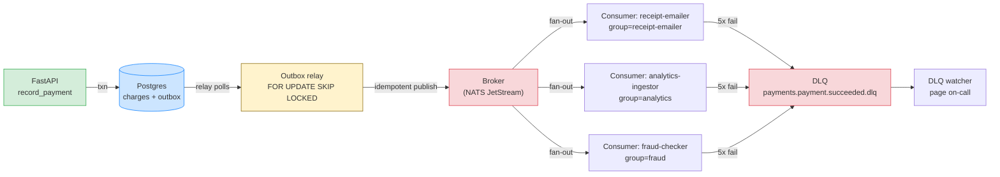
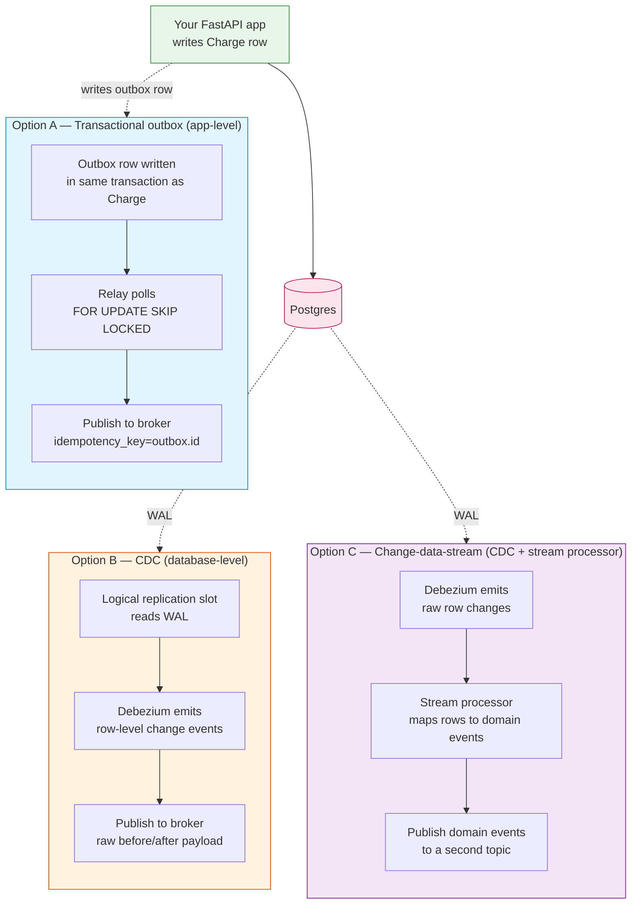

# Lesson 03: Event-Driven Architecture – Pub/Sub, Delivery Semantics, DLQs

*A transactional outbox for `Boardly`'s `payment.succeeded` events, an `outbox_relay` process that publishes pending rows with `FOR UPDATE SKIP LOCKED`, three idempotent consumers (receipt emailer, analytics ingestor, fraud checker), and a DLQ watcher that pages on-call.*

**You're at Lesson 3 of Section 17 — the last lesson of the section.**

When more than one component cares about the same fact ("a payment was made", "a user signed up", "an order shipped"), the synchronous chain — API -> email service -> analytics pipeline -> CRM — couples their failure modes. If the analytics pipeline is down, the API 500s and the email is not sent. Event-driven architecture breaks that chain: the producer emits a fact once, into a broker; each consumer reads at its own pace, fails independently, and catches up later. The cost is a new set of failure modes you must understand: messages can be delivered more than once, messages can be lost, consumers can fall behind. Take your time. Type every line. **This is how you learn.**


#architecture #event-driven #messaging #reliability

## Learning Objectives

By the end of this lesson you will be able to:

1. **Distinguish pub/sub, queues, and topics** and describe fan-out and routing.
2. **Define at-least-once, at-most-once, and exactly-once delivery** and explain why the last is a myth without idempotent consumers.
3. **Use consumer groups** to scale a consumer horizontally without double-processing.
4. **Configure a dead-letter queue** and explain when a message lands there.
5. **Reason about schema evolution** (additive, backwards-compatible) without breaking old consumers.
6. **Implement the transactional outbox** as the producer pattern, linking back to [[14-Caching-and-Background-Processing/Transactional-Outbox]].
7. **Use `SELECT ... FOR UPDATE SKIP LOCKED`** in the relay's poll so multiple relay replicas can poll the outbox without colliding.
8. **Implement consumer idempotency** via `INSERT INTO processed_events (event_id, consumer) ON CONFLICT DO NOTHING` in the same transaction as the business write.
9. **Recognise the eight common event-driven mistakes** — producer publishes directly, consumer ACKs before processing, non-idempotent consumer, no DLQ, no consumer group, removing a field, trusting exactly-once, long-running consumers.

## Prerequisites

Before starting, you need:

- **The transactional outbox lesson** — [[14-Caching-and-Background-Processing/Transactional-Outbox]]. The producer pattern. This lesson builds on it with the relay-as-a-separate-process pattern and the consumer-side idempotency.
- **The idempotency lesson** — [[17-Advanced-Architecture/Idempotency-and-Retries]]. Consumer idempotency is mandatory. The pattern is the same as the HTTP idempotency from Lesson 2, keyed by `event_id` instead of HTTP header.
- **The transactions lesson** — [[06-SQL-Fundamentals/Transactions-Isolation-Locks]]. The outbox write is part of the producer's transaction; the relay uses `FOR UPDATE SKIP LOCKED` for parallel polling.
- **The circuit breakers lesson** — [[15-External-Integrations/Circuit-Breakers]]. Consumers of external APIs (e.g. the email service) need circuit breakers.

## The Problem

When more than one component cares about the same fact ("a payment was made", "a user signed up", "an order shipped"), the synchronous chain — API -> email service -> analytics pipeline -> CRM — couples their failure modes. If the analytics pipeline is down, the API 500s and the email is not sent.

Event-driven architecture breaks that chain: the producer emits a fact once, into a broker; each consumer reads at its own pace, fails independently, and catches up later. The cost is a new set of failure modes you must understand:

- Messages can be delivered more than once (at-least-once delivery).
- Messages can be lost (at-most-once delivery, or a broker failure).
- Consumers can fall behind (lag).
- A consumer that crashes mid-processing can either lose the message or reprocess it.

The vocabulary, the delivery semantics, and the operational patterns (consumer groups, dead-letter queues, schema evolution, the transactional outbox) are what make event-driven systems operable.

## The Code

Here is the complete `Boardly` event-driven implementation for `payment.succeeded` events, with three consumers. Read it through once; we will go line by line afterwards.

### The outbox row

```python
# boardly/models.py (additions)
import uuid
from datetime import datetime
from sqlalchemy import DateTime, func, Index, JSON, String, UUID
from sqlalchemy.orm import Mapped, mapped_column

from boardly.db.base import Base


class OutboxEvent(Base):
 __tablename__ = "outbox_events"
 id: Mapped[uuid.UUID] = mapped_column(
 UUID(as_uuid=True), primary_key=True, default=uuid.uuid4
 )
 event_type: Mapped[str] = mapped_column(String(64), nullable=False, index=True)
 tenant_id: Mapped[uuid.UUID] = mapped_column(UUID(as_uuid=True), nullable=False, index=True)
 payload: Mapped[dict] = mapped_column(JSON, nullable=False)
 status: Mapped[str] = mapped_column(String(16), nullable=False, default="pending", index=True)
 created_at: Mapped[datetime] = mapped_column(
 DateTime(timezone=True), server_default=func.now(), nullable=False
 )
 published_at: Mapped[datetime | None] = mapped_column(DateTime(timezone=True), nullable=True)
 __table_args__ = (
 Index("ix_outbox_pending_created", "status", "created_at"),
 )


class ProcessedEvent(Base):
 """Consumer-side idempotency: tracks which events each consumer has processed."""
 __tablename__ = "processed_events"
 event_id: Mapped[str] = mapped_column(String(64), primary_key=True)
 consumer: Mapped[str] = mapped_column(String(64), primary_key=True)
 processed_at: Mapped[datetime] = mapped_column(
 DateTime(timezone=True), server_default=func.now(), nullable=False
 )
```

### The producer

```python
# boardly/services/payments.py
import uuid
from datetime import datetime, timezone

from sqlalchemy.ext.asyncio import AsyncSession

from boardly.models import Charge, OutboxEvent
from boardly.schemas import ChargeCreate
from boardly.tenancy import TenantContext


async def record_payment(
 session: AsyncSession,
 tenant: TenantContext,
 payload: ChargeCreate,
) -> Charge:
 """Insert the Charge and the OutboxEvent in one transaction.

 The broker is NOT contacted here — the relay process does that.
 If the transaction commits, both rows exist; if it rolls back, neither does.
 """
 charge = Charge(
 tenant_id=tenant.tenant_id,
 amount=payload.amount,
 currency=payload.currency,
 )
 session.add(charge)
 await session.flush() # populate charge.id without committing
 event = OutboxEvent(
 event_type="payment.succeeded",
 tenant_id=tenant.tenant_id,
 payload={
 "version": 1,
 "event_id": str(uuid.uuid4()),
 "occurred_at": datetime.now(timezone.utc).isoformat(),
 "tenant_id": str(tenant.tenant_id),
 "data": {
 "charge_id": str(charge.id),
 "amount": payload.amount,
 "currency": payload.currency,
 },
 },
 )
 session.add(event)
 return charge
```

### The relay

```python
# scripts/outbox_relay.py
"""Run as a separate process. Polls the outbox, publishes pending rows,
marks them published. Multiple relay replicas can run in parallel thanks
to FOR UPDATE SKIP LOCKED.
"""
import asyncio

from sqlalchemy import text
from sqlalchemy.ext.asyncio import create_async_engine

from boardly.config import settings


async def relay_loop(publisher) -> None:
 engine = create_async_engine(settings.database_url)
 session_factory = async_sessionmaker(engine, expire_on_commit=False)

 while True:
 async with session_factory() as session:
 rows = await session.execute(text("""
 SELECT id, event_type, payload
 FROM outbox_events
 WHERE status='pending'
 ORDER BY created_at
 LIMIT 100
 FOR UPDATE SKIP LOCKED
 """))
 events = rows.all()
 if not events:
 await asyncio.sleep(0.5)
 continue
 for ev in events:
 # publish() uses an idempotent producer key = ev.id; the broker
 # deduplicates so re-publishing after a crash is safe.
 await publisher.publish(
 subject=f"payments.{ev.event_type}",
 payload=ev.payload,
 idempotency_key=str(ev.id),
 )
 await session.execute(text("""
 UPDATE outbox_events
 SET status='published', published_at=now()
 WHERE id=:id
 """), {"id": ev.id})
 await session.commit()


if __name__ == "__main__":
 # publisher is a thin wrapper around the broker client (NATS, Kafka, etc.)
 from boardly.messaging import get_publisher
 publisher = get_publisher()
 asyncio.run(relay_loop(publisher))
```

### A consumer (the receipt emailer)

```python
# boardly/consumers/receipts.py
"""Subscribes to payment.succeeded, sends a receipt email.
Idempotent: the processed_events table prevents double-processing.
"""
import logging

from sqlalchemy import text
from sqlalchemy.ext.asyncio import AsyncSession

from boardly.messaging import get_broker
from boardly.services.emails import send_receipt
from boardly.services.users import lookup_email

logger = logging.getLogger(__name__)


async def consume_receipts() -> None:
 broker = get_broker()
 await broker.subscribe(
 subject="payments.payment.succeeded",
 group="receipt-emailer",
 handler=handle_payment_succeeded,
 )


async def handle_payment_succeeded(msg: dict, session: AsyncSession) -> None:
 event_id = msg["event_id"]
 # Idempotent consumer: if we've already processed this event, return early.
 # INSERT ... ON CONFLICT DO NOTHING — same pattern as Lesson 2's idempotency.
 seen = await session.execute(
 text("""
 INSERT INTO processed_events (event_id, consumer)
 VALUES (:eid, 'receipt-emailer')
 ON CONFLICT DO NOTHING
 RETURNING event_id
 """),
 {"eid": event_id},
 )
 if seen.first() is None:
 logger.info("already processed", extra={"event_id": event_id})
 return # already processed; broker redelivered

 # Now send the email. If the email send fails, the transaction rolls back,
 # the `processed_events` row is gone, and the broker redelivers.
 email = await lookup_email(session, msg["data"]["charge_id"])
 await send_receipt(
 to=email,
 amount=msg["data"]["amount"],
 currency=msg["data"]["currency"],
 )
 await session.commit()
```

### A DLQ consumer

```python
# scripts/dlq_watcher.py
"""Watches the DLQ for payment.succeeded. Pages on-call. Does NOT auto-replay."""
import asyncio
import logging

from boardly.messaging import get_broker
from boardly.services.alerts import alert_on_call

logger = logging.getLogger(__name__)


async def dlq_watcher() -> None:
 broker = get_broker()
 async for msg in broker.subscribe(
 subject="payments.payment.succeeded.dlq",
 group="dlq-watcher",
 ):
 logger.error(
 "DLQ message",
 extra={
 "original_id": msg["headers"].get("x-original-id"),
 "error": msg["headers"].get("x-error"),
 "attempts": msg["headers"].get("x-attempts"),
 },
 )
 # Alert on-call; do NOT auto-replay without a human decision.
 await alert_on_call(msg)


if __name__ == "__main__":
 asyncio.run(dlq_watcher())
```

**Production reality: the DLQ topic's retention policy is its own operational concern, separate from the source stream's.**

The `nats stream add payments --max-age=720h` sets a 30-day retention on the `payments` stream — but the DLQ is a separate stream (`payments-dlq`) with its own retention policy. The default for a new DLQ stream is `--max-age=0` (unlimited) and `--max-msgs=-1` (unlimited) — poison messages accumulate forever. After a year of a flaky consumer, the DLQ has 50,000 messages and 2 GB of storage, and a `nats stream info payments-dlq` query takes 30 seconds because it scans the whole stream. The fix is to set the DLQ's retention explicitly: `nats stream add payments-dlq --subjects="payments.>.dlq" --max-age=2160h` (90 days — long enough to triage, short enough to bound storage) and `--max-msgs=10000` (a hard cap; the 10,001st message evicts the oldest). Add a `scripts/audit_dlq.py` that lists DLQ messages older than 7 days and groups them by `x-error` header for triage (the same poison-message crash repeated 100 times is one bug, not 100). Schedule the audit weekly. The DLQ's retention is the operational concern that the source stream's retention does not cover — treat them separately. See [[14-Caching-and-Background-Processing/Transactional-Outbox]] for the source stream's retention and [[13-Performance-and-Observability/Structured-Logging-and-Request-IDs]] for the alerting taxonomy.


### The broker configuration (NATS JetStream example)

```bash
# Create a stream that captures payment events with retention and DLQ semantics.
$ nats stream add payments \
 --subjects="payments.>" \
 --storage=file \
 --retention=limits \
 --max-msgs=-1 \
 --max-age=720h

# Each consumer is a durable consumer group with a max-deliver and a DLQ.
$ nats consumer add payments receipt-emailer \
 --filter="payments.payment.succeeded" \
 --max-deliver=5 \
 --ack=explicit \
 --deliver=all \
 --replay=instant

# Same for the analytics and fraud consumers.
$ nats consumer add payments analytics-ingestor --filter="payments.payment.succeeded" --max-deliver=5 ...
$ nats consumer add payments fraud-checker --filter="payments.payment.succeeded" --max-deliver=5 ...
```

**Danger — How an attacker thinks: an attacker who can publish to the topic can DoS the consumer group with poison messages.**

The `nats stream add payments --subjects="payments.>"` command publishes any message with a `payments.*` subject to the stream. If the producer's NATS credentials are compromised (a leaked token in a CI config, a developer's machine with the prod account's keys, a third-party integration that was granted publish access), an attacker publishes 100,000 malformed events (`{"event_id": "...", "data": {"charge_id": "not-a-uuid"}}`). Each event triggers `--max-deliver=5` redeliveries per consumer, fills the DLQ with 500,000 poison messages, alert-fatigues the on-call, and crowds out legitimate events in the consumer's backlog for hours. The defence is layered: (a) per-account NATS authorization with the principle of least privilege — only the relay's service account can publish to `payments.>`, and the API process has no publish credentials at all (it writes to the outbox, the relay publishes); (b) per-account rate limits (`nats account add --js-max-msgs-per-second=1000`) so a runaway producer cannot exceed its budget; (c) topic ACLs that scope each producer to its own subject namespace (`payments.charges.>` for the billing service, `payments.refunds.>` for the refund service) — a compromised billing-service account cannot publish `payments.refunds.>` messages. See [[11-Authentication-and-Security/Threat-Model-First]] for the producer-trust boundary and [[15-External-Integrations/Circuit-Breakers]] for the consumer-side breaker that limits the blast radius.


## Line-by-Line Deep Dive

### `boardly/models.py`: `OutboxEvent`

#### Lines 11–17: The columns

```python
id: Mapped[uuid.UUID] = mapped_column(UUID(as_uuid=True), primary_key=True, default=uuid.uuid4)
event_type: Mapped[str] = mapped_column(String(64), nullable=False, index=True)
tenant_id: Mapped[uuid.UUID] = mapped_column(UUID(as_uuid=True), nullable=False, index=True)
payload: Mapped[dict] = mapped_column(JSON, nullable=False)
status: Mapped[str] = mapped_column(String(16), nullable=False, default="pending", index=True)
created_at: Mapped[datetime] = mapped_column(DateTime(timezone=True), server_default=func.now(), nullable=False)
published_at: Mapped[datetime | None] = mapped_column(DateTime(timezone=True), nullable=True)
```

**What it does:** Defines the outbox row.

**Why each column:**

- `id` (UUID) — the row's primary key. This is what the relay uses as the idempotent producer key (`idempotency_key=str(ev.id)`), so re-publishing after a crash is safe (the broker deduplicates).
- `event_type` — `"payment.succeeded"`. Indexed because the relay filters by it for routing.
- `tenant_id` — the tenant the event belongs to. Indexed because consumers may partition by tenant.
- `payload` (JSON) — the event envelope. See below for the envelope structure.
- `status` — `pending` (default), `published`. Indexed because the relay's `WHERE status='pending'` uses it.
- `created_at` — when the row was inserted. The relay uses `ORDER BY created_at` to publish in order.
- `published_at` — when the relay published the row. `NULL` while pending; populated on publish.

**Production reality: the `outbox_events` table grows without bound unless you prune.**

Every business write that emits an event adds a row to `outbox_events`. The relay marks the row `published` but does not delete it — the audit trail is part of the value. At 1,000 events/sec, the table grows by ~86M rows/day; within a week it is 600M rows and Postgres's autovacuum starts thrashing on the `(status, created_at)` index's dead tuples. The fix is a retention policy: a daily cron job that `DELETE FROM outbox_events WHERE status='published' AND created_at < now() - interval '7 days'` (or 30 days if you need a longer audit window). The delete is cheap on the partial index `WHERE status='published'` (add one — the lesson's index is on `(status, created_at)` with no filter), but it generates WAL that ships to standbys and replays there — batch the delete in 10k-row chunks (`DELETE ... WHERE id IN (SELECT id FROM outbox_events WHERE status='published' AND created_at < ... LIMIT 10000)` in a loop) to avoid a long-running transaction that holds the `FOR UPDATE SKIP LOCKED` slot. See [[14-Caching-and-Background-Processing/Transactional-Outbox]] for the canonical retention pattern and [[08-PostgreSQL/Backups-and-Recovery]] for the WAL-impact framing.


#### Line 18: The composite index

```python
__table_args__ = (
 Index("ix_outbox_pending_created", "status", "created_at"),
)
```

**What it does:** Creates a composite index on `(status, created_at)` for the relay's `WHERE status='pending' ORDER BY created_at` query.

**Why composite:**

- The relay's query is `SELECT ... WHERE status='pending' ORDER BY created_at LIMIT 100 FOR UPDATE SKIP LOCKED`. A composite index on `(status, created_at)` lets Postgres satisfy this query with a single index scan — it seeks to `status='pending'` in the index, then walks in `created_at` order.
- Without the composite, Postgres would use the `status` index (defined inline) and then sort by `created_at` — extra work for every poll.
- The composite is what makes the relay's poll fast even when the outbox table grows to millions of rows.

### `boardly/services/payments.py`: The producer

#### Lines 18–22: The business write

```python
charge = Charge(
 tenant_id=tenant.tenant_id,
 amount=payload.amount,
 currency=payload.currency,
)
session.add(charge)
await session.flush() # populate charge.id without committing
```

**What it does:** Creates the `Charge` row and flushes it (without committing) to populate `charge.id`.

**Why `flush()` not `commit()`:**

- `session.flush()` sends the `INSERT` to the DB (so `charge.id` is populated by the DB's `DEFAULT gen_random_uuid()` or similar) but does *not* commit the transaction.
- The transaction is committed by the route handler (or the test), not by the service. The service just stages the writes.
- This is the same session-per-request pattern from [[07-SQLAlchemy/05-Session-and-Transaction-Management]] — the session is a unit of work; the route commits.

#### Lines 23–37: The outbox insert

```python
event = OutboxEvent(
 event_type="payment.succeeded",
 tenant_id=tenant.tenant_id,
 payload={
 "version": 1,
 "event_id": str(uuid.uuid4()),
 "occurred_at": datetime.now(timezone.utc).isoformat(),
 "tenant_id": str(tenant.tenant_id),
 "data": {
 "charge_id": str(charge.id),
 "amount": payload.amount,
 "currency": payload.currency,
 },
 },
)
session.add(event)
return charge
```

**What it does:** Inserts the `OutboxEvent` row in the same transaction as the `Charge`. The `payload` is a structured envelope.

**Why the envelope structure:**

- `version` — the schema version. Old consumers ignore fields they do not understand; new consumers can require a minimum version. Schema evolution is additive (see Trade-Offs).
- `event_id` — a client-side UUID for the event. This is what consumers use to deduplicate (the `processed_events` table). The `event_id` is independent of the outbox row's `id` — the outbox `id` is the *storage* identity (used by the relay as the idempotent producer key); the `event_id` is the *logical* identity (used by consumers to deduplicate).
- `occurred_at` — when the event happened, in UTC ISO-8601. Consumers use this for ordering and for replay.
- `tenant_id` — the tenant the event belongs to. Consumers partition by tenant for isolation.
- `data` — the event-specific payload. For `payment.succeeded`, this is the charge ID, amount, currency.

**Why the business write and the outbox insert are in the same transaction:**

- If they are in separate transactions, a crash between them produces either:
 - A charge with no outbox event (the charge committed, the outbox rolled back). The customer is charged but no event is emitted; the receipt emailer, analytics, fraud checker never see the payment.
 - An outbox event with no charge (the outbox committed, the charge rolled back). The consumers receive an event for a payment that did not happen; the receipt emailer sends a receipt for a non-existent charge.
- Both are bugs. The fix: the same session runs both writes, and they commit together. The transactional outbox is the pattern.

**Why a transactional outbox instead of `publish(event)` inside the route?**

A producer that does `BEGIN; INSERT INTO charges ...; publish(event); COMMIT;` is not transactional. The `publish(event)` call sends the event to the broker *outside* the database transaction. A crash between `publish` and `COMMIT` emits an event for a charge that was rolled back. A crash between `COMMIT` and `publish` (the more common case) loses the event entirely. The transactional outbox fixes this: the `INSERT INTO outbox_events` is part of the same transaction as the `INSERT INTO charges`, so they commit together. A separate relay process reads `pending` rows and publishes them; re-publishing after a crash is safe because the broker deduplicates on the `idempotency_key = outbox.id`.


**Spot the bug — what happens if the relay polls `pending` rows, publishes them, but crashes before marking them `published`?**

Answer: the next poll picks the same rows again (they are still `pending`), re-publishes them. The broker sees the same `idempotency_key` (the outbox row's UUID) and deduplicates — the consumers do not see a duplicate event. The relay then marks the rows `published`. No harm done. This is the relay's crash-safety guarantee: re-publishing is a no-op at the broker. The trick is the `idempotency_key = outbox.id` — the broker's idempotent producer is what makes the relay idempotent.


### `scripts/outbox_relay.py`: The relay

#### Lines 25–28: The poll query

```python
rows = await session.execute(text("""
 SELECT id, event_type, payload
 FROM outbox_events
 WHERE status='pending'
 ORDER BY created_at
 LIMIT 100
 FOR UPDATE SKIP LOCKED
"""))
```

**What it does:** Selects up to 100 pending rows, ordered by creation time, with `FOR UPDATE SKIP LOCKED`.

**Why `FOR UPDATE SKIP LOCKED`:**

- `FOR UPDATE` locks the rows so other transactions cannot modify them. Without it, two relay replicas could pick the same rows.
- `SKIP LOCKED` is the magic. Without it, `FOR UPDATE` would *block* on rows already locked by another transaction. With `SKIP LOCKED`, the query simply skips locked rows and returns the next available ones.
- This is what lets multiple relay replicas run in parallel: each picks a different set of rows, no blocking, no collisions.
- Without `SKIP LOCKED`, you would need an external coordinator (a Redis lock, an etcd lease) to serialize the relays. Postgres's `SKIP LOCKED` does it natively.

**`SKIP LOCKED` is the Postgres primitive for parallel work distribution.**

Any time you have a queue-like table (outbox, job queue, work items) and multiple workers polling it, `SELECT ... FOR UPDATE SKIP LOCKED LIMIT N` is the canonical pattern. Each worker gets a different batch; no blocking; no external coordinator. This pattern reuses the transactions/locks lesson from [[06-SQL-Fundamentals/Transactions-Isolation-Locks]].


**Production reality: the relay's 500ms poll interval is the latency floor.**

`await asyncio.sleep(0.5)` when no rows are pending means the end-to-end latency from "producer commits" to "consumer sees the event" is at least 500ms (plus the broker's fan-out latency, plus the consumer's transaction time). Tighter polling (100ms) reduces this but burns more Postgres connections and CPU on an idle query — and every poll is a `SELECT ... FOR UPDATE SKIP LOCKED` that takes a row-level lock and an index scan, which is not free on a large outbox. The right answer for sub-100ms latency is `LISTEN/NOTIFY` (a Postgres notification channel the relay subscribes to; the producer `NOTIFY`s after `COMMIT`, the relay wakes immediately). But `LISTEN/NOTIFY` has its own footguns: the notification is fire-and-forget (a relay that was down during the `NOTIFY` misses it; the relay must still poll as a fallback), and the notification's payload is small (8KB). The pattern is `LISTEN` + a slower fallback poll (1s) — `LISTEN` for low-latency wakeups, the poll for missed notifications. See [[14-Caching-and-Background-Processing/Transactional-Outbox]] for the `LISTEN/NOTIFY` variant.


**Warning — When this breaks: `LISTEN/NOTIFY` is wired, but the relay polls anyway and latency is still 500ms.**

A common misconfiguration: the producer's `NOTIFY outbox_event` is committed, but the relay's `LISTEN outbox_event` was never started (the relay's startup missed the `LISTEN` call, or the `LISTEN` was on a different channel name — `outbox_event` vs `outbox_events`, singular vs plural, is the classic typo). The relay falls back to polling, but the team thinks `LISTEN/NOTIFY` is working because the code looks correct. The result is the 500ms latency floor is silently re-introduced, and the team spends a week chasing "why is event latency 500ms when we have `LISTEN/NOTIFY`?". Diagnose with `SELECT * FROM pg_listening_channels()` (lists active `LISTEN`s on the connection — must show `outbox_event`) and `SELECT * FROM pg_notification_queue_usage()` (the notification queue's fill level — non-zero means `NOTIFY`s are being sent but no one is consuming). The fix is to assert the relay's `LISTEN` is active in a startup healthcheck (`SELECT 1 FROM pg_listening_channels() WHERE channel='outbox_event'` — returns 1 if the relay is listening, 0 if not).


#### Lines 33–37: The publish

```python
await publisher.publish(
 subject=f"payments.{ev.event_type}",
 payload=ev.payload,
 idempotency_key=str(ev.id),
)
```

**What it does:** Publishes the event to the broker, using the outbox row's `id` as the idempotency key.

**Why `idempotency_key=str(ev.id)`:**

- The broker deduplicates on this key. If the relay publishes the same outbox row twice (because of a crash between `publish` and `UPDATE status='published'`), the broker sees the same idempotency key and does not re-emit the event to consumers.
- This is what makes the relay crash-safe: re-publishing is a no-op at the broker.
- The idempotency key is the *storage* identity (the outbox row's UUID). The *logical* identity (`event_id` in the payload) is what consumers use to deduplicate (the `processed_events` table). The two are different — the storage identity is internal to the producer/relay; the logical identity is what flows through the system.

#### Lines 38–43: The mark-published

```python
await session.execute(text("""
 UPDATE outbox_events
 SET status='published', published_at=now()
 WHERE id=:id
"""), {"id": ev.id})
...
await session.commit()
```

**What it does:** Marks the row as `published` and commits the transaction.

**Why this is in the same transaction as the `publish`:**

- The `publish()` call and the `UPDATE status='published'` should be atomic from the relay's perspective. If the relay crashes between them:
 - The broker has the event (it was published).
 - The outbox row is still `pending`.
 - On the next poll, the relay re-publishes the row. The broker deduplicates (same idempotency key). No harm done.
- If the `UPDATE status='published'` is in a different transaction from the `publish()`, the relay might mark a row `published` that was never published (if `publish()` failed). On the next poll, the row is `published` and skipped — the event is lost.
- The pattern: `publish()` then `UPDATE status='published'`, both in the same transaction. If `publish()` fails, the transaction rolls back, the row stays `pending`, the next poll retries.

**Tip — The relay is the *only* process that should write to `outbox_events`.**

Producers write `pending` rows (via the same session as the business write). The relay reads `pending` rows, publishes, marks `published`. No other process touches the table. This separation keeps the relay's invariants clean.


**Warning — When this breaks: the broker's idempotency window expires before the relay re-publishes.**

The relay's `idempotency_key=str(ev.id)` relies on the broker deduplicating a re-publish. Most brokers (NATS JetStream, Kafka's idempotent producer, SQS's dedup scope) keep the dedup window for a bounded time — NATS: 2 minutes by default; Kafka: 7 days (the `transaction.id.expiration.ms`); SQS: 5 minutes (FIFO dedup scope). If the relay crashes on Friday, is restarted on Monday (a weekend outage), and re-publishes the same outbox row, the broker's dedup window has expired — the consumers receive a duplicate event. The consumer's `processed_events` insert catches it (the dedup is per-consumer, so the second event is silently dropped), but the broker's metrics show a duplicate, and the team's "exactly-once" assumption is broken. The fix is to bound the relay's downtime (alert if the relay has not polled in 1 minute — `SELECT max(created_at) FROM outbox_events WHERE status='pending'` should be less than 1 minute old), and to document that the system is at-least-once + idempotent consumer, NOT exactly-once. A weekend outage should auto-page the relay's owner before the broker's dedup window expires on Monday. See [[17-Advanced-Architecture/Idempotency-and-Retries]] for the composition.


### `boardly/consumers/receipts.py`: The consumer

#### Lines 33–43: The idempotency check

```python
seen = await session.execute(
 text("""
 INSERT INTO processed_events (event_id, consumer)
 VALUES (:eid, 'receipt-emailer')
 ON CONFLICT DO NOTHING
 RETURNING event_id
 """),
 {"eid": event_id},
)
if seen.first() is None:
 return # already processed; broker redelivered
```

**What it does:** Tries to insert a row into `processed_events` keyed by `(event_id, consumer)`. If the insert succeeds (returns the row), this is the first time we have seen this event — proceed. If the insert is a no-op (the row already exists), this is a redelivery — return early.

**Why this is the same pattern as Lesson 2:**

- The HTTP idempotency in Lesson 2 used `INSERT ... ON CONFLICT DO NOTHING` on `(tenant_id, key)` to detect first-writer-wins.
- The consumer idempotency here uses `INSERT ... ON CONFLICT DO NOTHING` on `(event_id, consumer)` to detect first-processor-wins.
- The pattern is identical: the unique constraint + `ON CONFLICT DO NOTHING` makes "first writer wins" atomic. The `RETURNING` clause tells us whether we won.
- The `processed_events` row is in the *same transaction* as the business write (sending the email). If the email send fails, the transaction rolls back, the `processed_events` row is gone, and the broker redelivers.

**Danger — How an attacker thinks: a consumer that trusts `tenant_id` from the payload is one forged event from cross-tenant work.**

The event envelope's `tenant_id` is set by the producer. A consumer that reads `msg["tenant_id"]` to scope its work (e.g. the receipt emailer looking up the user "in the tenant's directory") trusts the producer's claim. If the producer is compromised (a malicious insider with write access to the outbox, or a broker topic injection that lets an attacker publish a forged event with a chosen `tenant_id`), the consumer does work for tenant A under the `tenant_id` of tenant B — a cross-tenant data exposure. The fix is to derive the `tenant_id` from the broker's auth context (the consumer's service account has a tenant scope; the broker enforces it), not from the payload. If the payload's `tenant_id` is needed for routing, sign the envelope (HMAC over the payload with a key only the producer and consumer share) and verify the signature in the consumer before reading any field. The signature is the producer's proof that the payload is its claim. See [[11-Authentication-and-Security/Threat-Model-First]] and [[17-Advanced-Architecture/Multi-Tenancy]] for the tenant boundary.


**Production reality: the `processed_events` table grows without bound unless you prune.**

Each consumer writes one row per processed event. Three consumers (receipt, analytics, fraud) on 1,000 events/sec produce 3,000 rows/sec — 260M rows/day. The `processed_events(event_id, consumer)` primary key is what makes the `ON CONFLICT DO NOTHING` fast (a single index probe on the PK), but the table still grows. The fix is a retention policy: `DELETE FROM processed_events WHERE processed_at < now() - interval '24 hours'` (24h is enough to cover the broker's max redelivery window — typically 5 minutes, but pad for outages). The 24h window is the trade-off: shorter (1h) catches a broker redelivery after a brief outage, longer (7d) catches a long outage but the table is 7x bigger and the `ON CONFLICT` index is 7x slower to probe. See [[14-Caching-and-Background-Processing/Transactional-Outbox]] for the analogous outbox retention and [[08-PostgreSQL/Backups-and-Recovery]] for the WAL-impact framing.


#### Lines 45–50: The business work

```python
email = await lookup_email(session, msg["data"]["charge_id"])
await send_receipt(
 to=email,
 amount=msg["data"]["amount"],
 currency=msg["data"]["currency"],
)
await session.commit()
```

**What it does:** Looks up the recipient's email (from the `users` table), sends the receipt email, commits.

**Why commit after the work, not before:**

- The `INSERT INTO processed_events` and the `send_receipt` are in the same transaction. The commit happens *after* both succeed.
- If `send_receipt` raises (e.g. SMTP is down), the transaction rolls back, the `processed_events` row is gone, and the broker redelivers the message. The next attempt sees no `processed_events` row, re-inserts, and tries again.
- If we committed *before* `send_receipt` (a common mistake — see Mistake 2), a crash after commit and before send would mark the event as processed without sending the email. The broker does not redeliver (because we ACK'd), and the email is lost.

**Warning — When this breaks: a broker redelivery storm causes a consumer thundering herd.**

When the consumer's downstream dependency (the email service) is briefly unavailable, every in-flight message NACKs and the broker redelivers them — at the configured `--max-deliver=5`, that is 5x the message volume hitting the consumer. If the consumer scales up to handle the load (a horizontal pod autoscaler keyed on queue depth), it now has N replicas all retrying the same messages, and the email service (which is down) gets N times the request rate when it comes back — the recovery kills the email service a second time. The fix is a circuit breaker between the consumer and the downstream (the consumer's call to the email service is wrapped in a circuit breaker; when the breaker is open, the consumer NACKs immediately without retrying, so the broker redelivers at its normal rate, not 5x). The circuit breaker's open state also signals the autoscaler to *not* scale up (the queue depth is high because the breaker is open, not because there is real work to do). See [[15-External-Integrations/Circuit-Breakers]] and [[15-External-Integrations/HTTP-Clients-Timeouts-Retries]] for the breaker-and-retry composition.


**Danger — How an attacker thinks: a forged `event_id` collides with a future legitimate event and silently drops it.**

The consumer's `INSERT INTO processed_events (event_id, consumer) ON CONFLICT DO NOTHING` treats `event_id` as the dedup key. If an attacker can publish an event with a *known future* `event_id` (e.g. the producer uses a predictable `event_id` like `f"payment-{charge.id}"`, and the attacker can predict `charge.id` — say, it is a sequential integer the attacker can read off the API), the attacker publishes a forged event first; the consumer processes it, records the `event_id` in `processed_events`; when the legitimate event with the same `event_id` arrives later, the consumer sees the `processed_events` row and returns early — the legitimate event is silently dropped, and the customer is never charged (or, worse, the receipt is sent for a payment that never happened). The fix is two-fold: (a) make `event_id` unpredictable (`uuid.uuid4()`, which the producer's code already does) so the attacker cannot predict a future event's ID; (b) scope the `processed_events` table by tenant (`PRIMARY KEY (tenant_id, event_id, consumer)`) so a forged event in tenant A cannot collide with a legitimate event in tenant B. See [[17-Advanced-Architecture/Idempotency-and-Retries]] for the HTTP-side analog (the same attack against an `Idempotency-Key` header).


**Danger — ACK after the local transaction commits, not before.**

The broker's ACK should happen *after* the consumer's local transaction commits. If you ACK before the commit and then crash, the broker considers the message processed and does not redeliver — but your transaction rolled back, and the work is lost.

The pattern: `BEGIN; INSERT INTO processed_events ...; do work; COMMIT; ACK;`. If the COMMIT fails, no ACK; the broker redelivers. If the ACK fails (network), the broker redelivers; the consumer sees the `processed_events` row, returns early, and the ACK is redundant (the broker will see it eventually or expire it).

Some brokers (Kafka) do not have an explicit ACK — they use offset commits, which are batched. The pattern is the same: commit the offset *after* the local transaction commits.


### `scripts/dlq_watcher.py`: The DLQ consumer

```python
async for msg in broker.subscribe(
 subject="payments.payment.succeeded.dlq",
 group="dlq-watcher",
):
 logger.error(
 "DLQ message",
 extra={
 "original_id": msg["headers"].get("x-original-id"),
 "error": msg["headers"].get("x-error"),
 "attempts": msg["headers"].get("x-attempts"),
 },
 )
 await alert_on_call(msg)
```

**What it does:** Subscribes to the DLQ subject. For each message, logs the original ID, the error, and the attempt count, then alerts on-call.

**Why a separate DLQ consumer:**

- A poison message (one that crashes every consumer that touches it) would block the partition forever without a DLQ. The DLQ caps the retries (typically 5) and routes the message to a separate subject.
- The DLQ watcher does *not* auto-replay. Auto-replaying a poison message is a tight loop that accomplishes nothing. A human looks at the DLQ, fixes the underlying bug (or the data), and replays manually.
- The DLQ watcher's job is to surface the failure — log it, alert on-call. The human's job is to fix it.

**Why the headers `x-original-id`, `x-error`, `x-attempts`:**

- The broker (NATS JetStream in this example) adds these headers when it routes a message to the DLQ. They tell the watcher *which* message failed, *why* it failed (the exception message from the last attempt), and *how many* times it was retried.
- These headers are what the human needs to triage: search the original message ID in the producer's logs, find the corresponding event, understand why it crashes every consumer.

**Warning — When this breaks: the DLQ watcher pages on-call, and on-call ignores it.**

The DLQ watcher's `alert_on_call(msg)` is the right first response to a poison message. But if the alert fires on every DLQ message (and the team has 10 DLQ messages a day because the consumers are flaky on a downstream), on-call develops alert fatigue and starts ignoring the pages. A real poison message (a malformed event that crashes every consumer) is then missed for hours — exactly the failure the DLQ watcher was built to surface. The fix is tiered alerting: a Slack message for the first DLQ message in an hour (low urgency); a page for the third DLQ message in an hour (high urgency — there is a pattern, not a one-off); a page for *any* DLQ message on a `payments.*` topic (high-value, low tolerance). The threshold is a team decision; the principle is "alert on the pattern, not on the event" — a single DLQ message is a datapoint, a cluster is a signal. See [[13-Performance-and-Observability/Structured-Logging-and-Request-IDs]] for the alerting taxonomy and [[13-Performance-and-Observability/OpenTelemetry-Tracing]] for the cross-service trace that lets on-call find the failing consumer.


**Danger — How an attacker thinks: a human "replays" a DLQ message without fixing the underlying bug.**

A poison message lands in the DLQ. The on-call engineer, under pressure to clear the queue, clicks "replay" without understanding why the message crashed. The replayed message crashes the consumer again, lands back in the DLQ, and the cycle repeats — a tight loop that accomplishes nothing and burns consumer capacity. The fix is a "replay with reason" workflow: the replay action requires a comment ("fixed missing field X in the deserialiser, commit abc123"), the comment is logged to a `replay_log` table, and the replay is gated on the comment being non-empty. The DLQ watcher's `alert_on_call` should include the `x-error` header so on-call knows what to fix before replaying. The deeper fix is to never replay a poison message without a code change (or a data fix) — a poison message that crashes every consumer is a bug, and bugs are fixed in code, not by re-running the message. "Replay and hope" is not a fix. See [[15-External-Integrations/Circuit-Breakers]] for the failure-mode framing and [[17-Advanced-Architecture/Idempotency-and-Retries]] for the replay-vs-dedup design space.


**Production reality: `processed_events(event_id, consumer)` is a natural key that limits replay.**

The composite primary key `(event_id, consumer)` means each (event, consumer) pair is processed at most once — exactly the dedup property we want. But it also means a consumer cannot "replay" an event it has already processed (the `INSERT ... ON CONFLICT DO NOTHING` is a no-op on the second attempt). This is correct for the receipt-emailer (you do not want to send two receipts), but it is wrong for the analytics-ingestor (which might want to re-aggregate after a backfill or a fixed bug in the aggregation logic). The fix for consumers that need replay is a separate `replay_log` table (a record of each replay attempt, with a `replay_id` that the consumer's idempotency check ignores — `INSERT INTO processed_events (event_id, consumer, replay_id) ... ON CONFLICT (event_id, consumer, replay_id) DO NOTHING`). The trade-off: the consumer's dedup is now per-replay, not per-event; the consumer must still be idempotent within a replay (sending the same receipt email twice is still a bug, even if the second send was a "replay"). See [[17-Advanced-Architecture/Idempotency-and-Retries]] for the replay-vs-dedup design space.


## Execution Trace

A `payment.succeeded` event flows as:

1. **FastAPI handler** calls `record_payment`, which inserts the `Charge` and the `OutboxEvent` in one transaction. The HTTP response goes back to the client. The broker has NOT been contacted yet.
2. **The relay** polls the outbox every 500 ms, picks up the pending row, publishes to `payments.payment.succeeded` with `idempotency_key = outbox.id`, marks the row `published`.
3. **NATS JetStream** fans out to all durable consumers attached to the topic: `receipt-emailer`, `analytics-ingestor`, `fraud-checker`.
4. **Each consumer** processes the message in its own transaction with the `processed_events` insert. ACKs the broker only after the local commit.
5. **If a consumer throws**, no ACK; JetStream redelivers (up to `--max-deliver=5`); on the 5th failure, JetStream routes to the DLQ subject `payments.payment.succeeded.dlq` with the original message and headers `x-original-id`, `x-error`, `x-attempts=5`.
6. **The DLQ watcher** logs the failure and pages on-call.



**You have an event-driven system with transactional producers and idempotent consumers.**

The producer and the relay are decoupled — the broker is never in the request path. The consumers fail independently — a receipt-emailer outage does not block the analytics pipeline. The DLQ surfaces poison messages to a human. The transactional outbox and the consumer idempotency together give the *effect* of exactly-once, even though the broker delivers at-least-once.


## Common Mistakes

### Mistake 1: Producer publishes directly to the broker inside the request handler

```python
# WRONG
async def record_payment(session, tenant, payload):
 charge = Charge(...)
 session.add(charge)
 await session.commit()
 await broker.publish("payment.succeeded", payload) # outside the transaction!
 return charge
```

**Symptom:** A crash between `commit` and `publish` loses the event; a crash between `publish` and `commit` (less common but possible with async brokers) emits an event for a charge that was rolled back.

**Fix:** Use the outbox. The business write and the outbox insert are in one transaction; the relay publishes asynchronously.

**Warning — When this breaks: the symptom of direct publishing is "events missing, no errors in the logs."**

The producer's `record_payment` commits the charge and calls `broker.publish(...)`. If the process crashes between `commit` and `publish` (a SIGKILL during a deploy, an OOM, a host failure), the charge exists in `charges` but no event was emitted — the receipt emailer never sees it, the analytics pipeline never aggregates it, the fraud checker never checks it. The team's first response is to debug the consumers ("why didn't the receipt emailer send the email for charge X?") — but the consumers are fine; the event never reached the broker. The diagnosis is on the producer side: `SELECT c.id FROM charges c LEFT JOIN outbox_events o ON (o.payload->'data'->>'charge_id')::uuid = c.id WHERE o.id IS NULL` returns the orphaned charges (charges with no corresponding outbox event). If this query returns non-zero rows, the producer is publishing directly, not via the outbox. The fix is the transactional outbox (the `INSERT INTO outbox_events` is in the same transaction as the `INSERT INTO charges`, so they commit together or not at all — a crash between them is impossible because there is no "between"). See [[14-Caching-and-Background-Processing/Transactional-Outbox]] for the canonical pattern.


### Mistake 2: Consumer ACKs before processing

```python
# WRONG
async def handle(msg, session):
 await broker.ack(msg) # ACK first!
 # Now do the work...
 await send_receipt(...)
 await session.commit()
```

**Symptom:** A crash after ACK and before processing loses the message. The broker considers it processed and does not redeliver.

**Fix:** ACK after the local transaction commits.

### Mistake 3: Consumer is not idempotent

**Symptom:** Redeliveries double-process. The receipt emailer sends two receipts for one payment.

**Fix:** `INSERT INTO processed_events (event_id, consumer) ... ON CONFLICT DO NOTHING` in the same transaction as the business write.

### Mistake 4: No DLQ

**Symptom:** A poison message redelivers forever, blocking the consumer on that partition. Throughput drops to zero.

**Fix:** A DLQ with a finite retry count. The DLQ surfaces the failure to a human.

### Mistake 5: No consumer group; each instance subscribes independently

**Symptom:** Each instance gets every message. Horizontal scaling does not increase throughput; it increases duplicate work.

**Fix:** Consumer groups. The broker treats the group as one logical subscriber and assigns partitions to members.

**Danger — How an attacker thinks: without consumer groups, an attacker who can scale a consumer's replicas can multiply their audit-trail write access.**

The `audit-log` consumer is supposed to write exactly one row per event to the `audit_log` table — the table is the system's compliance record (for SOC 2, for PCI-DSS, for the finance team's reconciliation). Without a consumer group, each consumer instance subscribes independently and processes every event. An attacker (or a misconfigured autoscaler) who scales the `audit-log` consumer from 1 to 5 replicas causes each event to be processed 5 times — the `audit_log` table has 5 rows per `event_id` instead of 1. The consumer's `processed_events` dedup catches the duplicate processing at the business-write level (the `INSERT INTO audit_log` is in the same transaction as the `processed_events` insert, so the duplicate's transaction rolls back), but the audit-log team's dashboards show "5x event volume" and they investigate the non-existent flood for hours. Worse, if the consumer's idempotency check is implemented as a `SELECT` then `INSERT` (not the atomic `INSERT ... ON CONFLICT DO NOTHING`), the duplicate processing wins the race condition and the audit log has 5 rows per event — the compliance record is corrupted. The defence is the consumer group (the broker assigns each event to exactly one member of the group) combined with the atomic idempotency insert (the `INSERT ... ON CONFLICT DO NOTHING` pattern, not a `SELECT`-then-`INSERT`). See [[17-Advanced-Architecture/Idempotency-and-Retries]] for the atomic insert pattern and [[11-Authentication-and-Security/OWASP-API-Top-10]] for the audit-trail integrity angle.


### Mistake 6: Removing a field from the event payload

**Symptom:** Old consumers break. They `KeyError` on the missing field.

**Fix:** Additive changes; never remove. If you must remove, do it in two phases: stop producing the field, wait for all consumers to be on a version that no longer reads it, then remove.

**Warning — When this breaks: a v2 producer removes a field, old consumers `KeyError`, the broker's redelivery kicks in, the consumer crashes 5 times, and the event lands in the DLQ — all within 30 seconds of the producer deploy.**

The symptom is a flood of DLQ messages immediately after a producer deploy. The on-call pages: "receipt-emailer DLQ depth went from 0 to 1,200 in 5 minutes." The `x-error` header on every DLQ message reads `KeyError: 'payment_method'`. The root cause: the v2 producer stopped emitting the `data.payment_method` field (the team removed it because "no consumer uses it" — they were wrong; the receipt-emailer reads it to pick the email template). The broker's `--max-deliver=5` redeliveries the same message 5 times to the same crashing consumer, routes it to the DLQ, and moves on — but the next event has the same missing field, and the cycle repeats. The fix is two-phase: (1) re-add the field to the producer's envelope as `data.payment_method = "card"` (additive) and ship a hotfix — the DLQ stops growing immediately; (2) ship a v2 consumer that uses `msg["data"].get("payment_method", "unknown")` (the defensive default) so a future field removal does not crash. The structural fix is a schema registry (Avro/Protobuf/JSON Schema) that fails the producer's build on a backward-incompatible change — see [[04-Pydantic/BaseModel-and-Validation]] for the schema-validation angle and a CI rule that flags `data.pop(...)` in producer code. See [[12-Testing-and-Quality/CI-Pipelines]] for the CI rule and [[13-Performance-and-Observability/Structured-Logging-and-Request-IDs]] for the alert that pages on DLQ-depth-spike.


### Mistake 7: Trusting `exactly-once` from the broker

**Symptom:** A consumer that relies on the broker's "exactly-once" delivery does not deduplicate. A redelivery double-processes.

**Fix:** Compose exactly-once: at-least-once delivery + idempotent consumer. See the Idempotency lesson.

### Mistake 8: Long-running consumers hold the message open

**Symptom:** A consumer that processes a message for 10 minutes blocks the partition. Other messages on the same partition wait.

**Fix:** Move slow work to a worker pool; the consumer just enqueues. The consumer's job is to translate a broker message into a work item, not to do the work itself.

**Production reality: the consumer's `--ack-wait` is the silent killer of long-running consumers.**

NATS JetStream's consumer has an `--ack-wait=30s` default (the time the broker waits for an ACK before redelivering). A consumer that processes a message for 10 minutes (a PDF generation, an ML inference, a batch email send) will be redelivered the same message at 30 s, 60 s, 90 s — three concurrent processes all working on the same message, all writing to the same `processed_events` row, and the `INSERT ... ON CONFLICT DO NOTHING` catches two of them but the work is done three times. The symptom is a consumer whose CPU is at 300% of one core (three processes) and whose `processed_events` table has one row per event (the dedup worked) but whose downstream (the PDF bucket, the ML API) received three requests. The fix is the worker-pool pattern: the consumer ACKs the broker immediately (within `--ack-wait`), then enqueues the work onto an in-process `asyncio.Queue` drained by a pool of worker coroutines. The trade-off is the at-least-once semantics — a crash after ACK and before worker pickup loses the message. Mitigate with a `pending_work` table: the consumer writes a `pending_work` row before ACK, the worker picks up the row and deletes it after the work is done, and on consumer restart the consumer replays `pending_work` rows. The pattern is the same as the transactional outbox, just one layer in. See [[14-Caching-and-Background-Processing/Transactional-Outbox]] for the outbox-then-worker composition and [[10-Async-Python/asyncio-Primitives]] for the `asyncio.Queue` pattern.


## Engineering Trade-Offs

- **NATS JetStream vs. Kafka vs. SNS+SQS vs. Google Pub/Sub.** NATS is the simplest to operate and has the cleanest semantics for a small team; Kafka is the choice for very high throughput and long retention; SNS+SQS is the obvious choice if you are already on AWS; Google Pub/Sub if you are on GCP. The patterns in this lesson are broker-agnostic.
- **At-most-once vs. at-least-once.** At-most-once is faster (no ACK round-trip) and acceptable for telemetry. At-least-once is the default for everything that touches user-visible state. We default to at-least-once and make consumers idempotent.
- **DLQ vs. infinite retry.** Infinite retry blocks the partition and never recovers a poison message. A DLQ with a finite retry count surfaces the failure to a human. Always bound retries.
- **Schema registry vs. JSON + discipline.** A schema registry (Avro/Protobuf/JSON Schema) enforces compatibility at produce time. JSON with discipline relies on every developer following the rules. The registry catches the rules violations you will inevitably make. Use a registry for systems with more than one producer-consumer pair.
- **Relay as a separate process vs. embedded in the API.** A separate relay process is the canonical pattern — it survives API restarts, can be scaled independently, and keeps the broker out of the request path. Embedded relay (a background task in the FastAPI lifespan) is simpler but couples the broker to the API's lifecycle.

### Outbox vs CDC vs change-data-stream: when to use which

A senior interview question that the rest of this lesson *implies* but does not state directly: you have a database that writes data and you want to *emit events* when it changes. There are three architectural choices on the table — **transactional outbox** (this lesson), **CDC** (read the database's write-ahead log directly), and **hand-rolled change-data-stream** (trigger-based). They solve overlapping but not identical problems, and the right answer depends on (a) whether you control the write path, (b) whether the events you want are exactly the row changes or a curated subset, and (c) what stack you already operate. We treat each in turn.

**Outbox vs CDC vs change-data-stream — the one-sentence summary**

The **transactional outbox** is an *app-level* pattern — you write a side-effect row in the same transaction as the main write; a worker reads it and dispatches. **CDC** (Change Data Capture) is a *database-level* pattern — a process reads Postgres's WAL via logical replication and emits an event for every row change with no app changes. A **change-data-stream** (Kafka Connect source connector, Debezium-on-Kafka, AWS DMS) is CDC plus a dedicated stream processor that normalizes the WAL changes into a stream. They sit on a spectrum of operational complexity vs. app-level control.


#### Option A: Transactional outbox (app-level, explicit authorship)

You write an `outbox_events` row in the same transaction as the business write (`charge` + `outbox_events.payment.succeeded` commit together). A relay process polls with `FOR UPDATE SKIP LOCKED`, publishes to the broker, marks `published`. This is the pattern this entire lesson teaches.

**Pros:**

- The event is *your* domain event (`payment.succeeded` with `charge_id`, `amount`, `currency`, `tenant_id`) — not a row-level change. Consumers consume the curated shape you wrote; no reconstruction needed.
- The stack is small: Postgres (which you already have) plus a relay process plus a broker (which you already have for the consumers). No new operational dependency.
- The producer code is explicit and reviewable: every event is a row with a `type` and a `payload` you wrote by hand. The audit trail writes itself.

**Cons:**

- The relay is operational overhead — a process to monitor, scale, and on-call when it stalls. If the relay is down, events queue in `outbox_events` (no data loss, but latency to consumers grows).
- The polling interval adds latency (typically 1–5 seconds end-to-end). `LISTEN/NOTIFY` (Section 14's optional optimization) shaves this but does not eliminate it.
- The `outbox_events` table grows. Without a retention policy (`DELETE WHERE status='published' AND created_at < now() - interval '7 days'`), the table will be your biggest table by row count within a year. A vacuum and an index bloat follow.

**When it wins:** New applications that want explicit authorship over event shape. The transactional outbox is the default. Pick it unless you have a concrete reason not to.

#### Option B: CDC reading the WAL (database-level, no app changes)

You install Debezium (or AWS DMS, or Postgres logical replication directly) pointed at Postgres. Debezium creates a *logical replication slot*, reads the WAL, and emits a row-change event for every `INSERT`/`UPDATE`/`DELETE` on the tables you configured. The relay is gone — Debezium publishes to Kafka directly.

**Pros:**

- Zero application code changes. You do not touch the route handlers, the services, the models. You flip on logical replication, point Debezium, and events start flowing. This is the killer feature for legacy systems whose write path you cannot or will not modify.
- Lower latency than polling. The WAL is read in near-real-time (milliseconds to seconds, depending on the WAL flusher). No 1-second poll interval.
- Captures *everything*. If a migration script, a backfill job, or a DBA's manual `UPDATE` changes rows, CDC emits those events. The outbox pattern misses these (the migration does not write outbox rows).

**Cons:**

- Debezium plus Kafka Connect is a significant operational stack. You are now operating a Kafka Connect cluster (a JVM process with its own metrics, its own failure modes, its own on-call burden). For a 4-engineer team, this is over-engineered.
- The events are *row-level*, not domain-level. You get a `before` and `after` payload of the changed columns; you do not get `payment.succeeded` — you get `charges` table INSERT with `id`, `amount`, `currency`, `created_at`. The consumer must reconstruct the domain event from the row shape. This is sometimes trivial and sometimes painful (especially when the domain event is the *combination* of writes across two tables).
- A schema migration on the source table changes the event shape without warning. If you `ALTER TABLE charges ADD COLUMN processor_fee`, the next CDC event for the `charges` table includes the new column — and a consumer whose Avro schema did not expect it can break. A schema registry mitigates but does not eliminate this.
- Logical replication slots require ongoing management. If a consumer falls behind, the slot's WAL grows on the source Postgres — eventually filling the disk. Monitoring the slot lag is now on-call.

**When it wins:** Legacy applications where you cannot modify the write path. Systems where you want to capture *every* row change (including DBA-introduced ones). Cross-system replication where the downstream consumer can absorb row-level events natively (e.g. a data warehouse that ingests every row change).

#### Option C: Change-data-stream (CDC plus a dedicated stream processor)

Same as CDC, but with a stream processor (Kafka Connect source connector, Kafka Streams, Flink, a custom Python consumer of the CDC topic) that transforms the row-level change events into domain events on a second topic. You end up with two topics: `db.changes.charges` (raw row-level events from Debezium) and `payments.succeeded` (domain events derived from row changes by the stream processor).

**Pros:**

- Best of both worlds: CDC's "no app changes" on the producer side, plus the outbox's "clean domain event shape" on the consumer side. The consumer of `payments.succeeded` does not know or care whether the producer used an outbox or CDC.
- The stream processor is a clean place to compose events across tables. If `payment.succeeded` is really "row inserted into `charges` AND row inserted into `charge_attempts` with status=success", the stream processor emits the composed event.

**Cons:**

- Now you are operating Debezium, Kafka Connect, *and* a stream processor. The operational surface is the largest of the three options. This is the right call at the scale where a dedicated data engineering team owns the pipeline; it is overkill at the scale where one team owns the API and the events.

**When it wins:** High-volume cross-system replication (e.g. "every order change in the OLTP database must be visible in the data warehouse within 30 seconds"). Systems where the downstream consumer needs a different event shape than the source row.



**When do you migrate from the outbox to CDC?**

When the operational cost of the relay (polling, monitoring, the growing `outbox_events` table) exceeds the operational cost of Debezium. The empirical signal is the outbox table crossing ~10M rows: the partial index `WHERE status='pending'` gets vacuum-heavy, the relay's poll gets slower, and retention deletes contend with the writer. At that scale you typically also have a data team that can own Debezium — CDC is the right move when both conditions hold. Below that scale, the outbox is simpler and the cost of operating Debezium dwarfs the cost of the relay.


**Why would you ever pick the hand-rolled trigger-based change-data-stream?**

Honestly, you usually would not. A hand-rolled change-data-stream is a Postgres `AFTER INSERT OR UPDATE OR DELETE` trigger that writes a row to a `changes` table, plus a relay that polls the `changes` table and publishes. It is functionally the transactional outbox with the event authorship moved into a trigger instead of the application code. The two reasons teams reach for it: (a) they want event emission on tables they did not write (a third-party app's schema) and cannot add an outbox write to; (b) the team is allergic to Debezium's JVM stack and would rather hand-roll. Both reasons are weaker than they look — (a) is solved by real CDC (which is what CDC is for); (b) is solved by accepting the JVM stack once instead of paying trigger overhead forever. The trigger runs on the hot write path (every `INSERT`/`UPDATE`/`DELETE` pays the trigger's cost), the `changes` table is itself a write bottleneck under load, and the trigger logic drifts from the application's mental model over time. Reach for the outbox first, CDC second, the hand-rolled change-data-stream almost never.


**Warning — Trigger-based change-data-stream runs on the hot write path**

A trigger fires on every row write. The transactional outbox pays its cost only on the routes that emit events; the trigger pays on *every* write to the table, whether or not an event is emitted. On a 5,000 writes/sec hot path, a trigger that takes 2 ms per call adds 10 seconds of latency per second of wall-clock time. The outbox's per-route cost is opt-in; the trigger's cost is not.


**Tip — The decision tree, in one line**

New app + you control the write path + you want explicit event authorship -> **outbox**. Legacy app + you cannot modify the write path + you need to capture every row change -> **CDC**. Cross-system replication at high volume + downstream consumer needs a transformed event shape -> **change-data-stream**. Hand-rolled trigger-based change-data-stream -> almost never; if you find yourself reaching for it, ask whether real CDC would solve your problem with less ongoing cost.


This subsection closes the loop on the "where do events come from" question that the rest of the lesson leaves implicit. The transactional outbox is the answer this academy teaches; the other two options are the answers you should be able to defend in an interview when the question is asked. See [[14-Caching-and-Background-Processing/Transactional-Outbox]] for the canonical outbox lesson (this lesson reuses the `OutboxEvent` model and the relay pattern from there) and the shallow one-paragraph Outbox-vs-CDC treatment that this subsection deepens.

## Exercises

- **Beginner:** Subscribe a fourth consumer (`audit-log`) that writes every event into an `audit_log` table. Verify the consumer is idempotent by replaying an event and confirming only one row is written.
- **Intermediate:** Introduce a schema change: add a `network` field to `payment.succeeded` (additive). Show that old consumers continue to work; new consumers read the field. Then deliberately publish a v2 event with a `payment_method` field removed, and show that the old consumer that reads `payment_method` breaks — explain why removing is forbidden.
- **Advanced:** Implement the "competing consumers" pattern with a worker pool: the consumer ACKs the broker, then enqueues the work onto an in-process `asyncio.Queue` that a pool of worker coroutines drains. Discuss the at-least-once semantics (a crash after ACK and before processing loses the message) and the trade-off against serial processing.
- **Beginner-Plus (Debugging):** Add an `audit-log` consumer that writes every event to an `audit_log` table (no business logic). Confirm it is idempotent by replaying an event (`nats consumer replay payments audit-log --since 1h`) and confirming only one `audit_log` row per `event_id` exists. Verify: `psql -c "SELECT event_id, count(*) FROM audit_log GROUP BY event_id HAVING count(*) > 1"` returns zero rows (no duplicates); `uv run pytest tests/test_audit_consumer.py -k idempotent_on_replay` passes.
- **Beginner-Plus (Production):** Add a retention policy to `outbox_events`. Write a `scripts/prune_outbox.py` that `DELETE FROM outbox_events WHERE status='published' AND created_at < now() - interval '7 days'` in 10k-row chunks (using `LIMIT` in a subquery + a loop until `affected_rows == 0`). Schedule it with a cron job (or an APScheduler task in the relay process). Verify: `psql -c "SELECT count(*) FROM outbox_events WHERE status='published' AND created_at < now() - interval '7 days'"` returns 0 (the prune ran); `uv run pytest tests/test_prune_outbox.py -k chunks_delete_loops_until_empty` passes.
- **Intermediate-Plus (Security):** Sign the event envelope with an HMAC. Add `signature = hmac_sha256(json.dumps(payload, sort_keys=True), secret)` to the producer's envelope (a `signature` field), and verify it in the consumer (raise `SignatureError` if the HMAC disagrees, NACK the message, land it in the DLQ). Confirm a forged event (modified `tenant_id` without updating the signature) is rejected. Verify: `uv run pytest tests/test_event_signature.py -k rejects_forged_tenant_id` passes; `nats consumer info payments receipt-emailer` shows the rejected events increment the DLQ counter.
- **Intermediate-Plus (Debugging):** Reproduce the broker's idempotency window expiry. Configure NATS JetStream's `--duplicate-window=2m` (the default). Stop the relay for 3 minutes (longer than the window). Restart the relay. Confirm the consumers receive a duplicate event (the broker's dedup expired), and confirm the consumer's `processed_events` insert catches it (the duplicate is a no-op — `already processed` is logged). Verify: `nats stream info payments | grep -i duplicate` shows the 2m window; `psql -c "SELECT consumer, count(*) FROM processed_events WHERE event_id='<test-event-id>' GROUP BY consumer"` returns 1 row per consumer (the dedup caught the duplicate, no double-processing).
- **Advanced-Plus (Production):** Implement the `LISTEN/NOTIFY` low-latency variant. Add a Postgres trigger that `NOTIFY outbox_event` after every `INSERT INTO outbox_events`. Update the relay to `LISTEN outbox_event` (using `asyncpg`'s `connection.add_listener`) and wake immediately on notification, falling back to a 1s poll for missed notifications. Confirm the end-to-end latency drops from 500ms to under 50ms. Verify: `psql -c "SELECT * FROM pg_listening_channels()"` lists `outbox_event` (the relay's LISTEN is active); `uv run pytest tests/test_relay_latency.py -k listen_notify_under_50ms` passes.
- **Advanced-Plus (Security + Production):** Implement the "replay with reason" workflow for the DLQ watcher. Add a `replay_log` table (`event_id`, `consumer`, `replay_id`, `reason`, `replayed_at`). Modify the DLQ watcher to require a `--reason` argument before replaying (a CLI flag `--reason="fixed missing field X, commit abc123"`), log it to `replay_log`, and replay only if the reason is non-empty. Confirm a replay without `--reason` is rejected. Verify: `psql -c "SELECT reason FROM replay_log WHERE event_id='<dlq-event-id>'"` returns a non-empty reason; `uv run pytest tests/test_dlq_replay_requires_reason.py -k rejects_empty_reason` passes.

- **Advanced-Plus (Debugging):** Reproduce the silent event loss from direct publishing (Mistake 1). Take the broken producer (`record_payment` that publishes directly). Use `pytest`'s `monkeypatch` to crash the process between `session.commit()` and `broker.publish(...)` (a `SystemExit` raised in a `@contextmanager` wrapping the publish). Verify the `charges` table has the row but the broker received no event. Confirm the diagnosis query `SELECT c.id FROM charges c LEFT JOIN outbox_events o ON (o.payload->'data'->>'charge_id')::uuid = c.id WHERE o.id IS NULL` returns the orphaned charge. Fix by switching to the transactional outbox. Verify: `psql -c "SELECT count(*) FROM charges c LEFT JOIN outbox_events o ON (o.payload->'data'->>'charge_id')::uuid = c.id WHERE o.id IS NULL"` returns 0 after the fix; `uv run pytest tests/test_no_silent_event_loss.py -k outbox_catches_orphaned_charge` passes.

- **Advanced-Plus (Production):** Implement DLQ retention and audit. Configure the DLQ stream with a 30-day retention and a 10,000-message cap: `nats stream add payments-dlq --subjects="payments.>.dlq" --max-age=720h --max-msgs=10000`. Add a `scripts/audit_dlq.py` that lists DLQ messages older than 7 days and groups them by `x-error` header for triage. Schedule it weekly via a cron job. Confirm the DLQ depth alert pages on-call if `payments-dlq` exceeds 100 messages. Verify: `nats stream info payments-dlq | grep -i max-age` shows `720h`; `uv run python scripts/audit_dlq.py --since 7d` prints an `x-error -> count` table; `uv run pytest tests/test_dlq_audit.py -k groups_by_error_header` passes.

- **Advanced-Plus (Security):** Audit the consumer-group partition assignment. Write a `scripts/audit_consumer_groups.py` that uses NATS's admin API (`nats consumer list payments --json`) to list every consumer group, the number of members, and the partition count. Flag any group where `members > partitions` (some members are idle) or `members < partitions` (some partitions are unassigned, which means duplicate processing if a member is accidentally in two groups — the security angle: an audit-log consumer in two groups writes two rows per event, breaking the audit trail's integrity). Verify: `nats consumer list payments` shows the three groups; `uv run python scripts/audit_consumer_groups.py --stream payments` prints `group | members | partitions | status` rows; `uv run pytest tests/test_consumer_group_audit.py -k flags_members_gt_partitions` passes.

- **Advanced-Plus (Debugging):** Diagnose a backward-incompatible schema change. Take the producer. Publish a v2 `payment.succeeded` event with the `payment_method` field removed (was: `data.payment_method = "card"`; now: gone). Confirm the old consumer that reads `msg["data"]["payment_method"]` crashes with `KeyError: 'payment_method'`. Inspect the DLQ messages: the `x-error` header reads `KeyError: 'payment_method'`. Fix by re-adding the field as `data.payment_method = "card"` (additive) and shipping a v2 consumer that uses `msg["data"].get("payment_method", "unknown")`. Confirm the DLQ stops growing. Verify: `nats consumer info payments receipt-emailer | grep -i num_redelivered` shows 5 redeliveries before the fix and 0 after; `uv run pytest tests/test_schema_evolution_additive_only.py -k old_consumer_survives_v2_with_defaults` passes.

- **Advanced-Plus (Production):** Implement the worker-pool pattern for long-running consumers. Take the receipt-emailer consumer. Refactor so the consumer ACKs the broker immediately, then enqueues the message onto an in-process `asyncio.Queue` drained by a pool of 4 worker coroutines. Discuss the trade-off: a crash after ACK and before worker pickup loses the message (at-least-once is broken). Mitigate with a `pending_work` table that the consumer writes before ACK and deletes after the worker picks up; on consumer restart, the consumer replays `pending_work` rows. Verify the at-least-once property holds even with the worker pool. Verify: `uv run pytest tests/test_worker_pool.py -k ack_then_enqueue_does_not_lose_on_crash` passes; `uv run pytest tests/test_worker_pool.py -k worker_drains_queue_in_order` passes.

- **Advanced-Plus (Security + Production):** Implement producer auth and rate limiting. Configure NATS authorization so only the relay's service account can publish to `payments.>` (producers cannot bypass the outbox and publish directly). Add a per-account rate limit (`nats account add --js-max-streams=10 --js-max-bytes=1GB`) so a runaway producer cannot fill the broker. Confirm an attempt to publish from the API process (not the relay) fails with `NATS: Authorization Violation`. Verify: `nats stream info payments | grep -i max-bytes` shows the cap; `uv run pytest tests/test_producer_auth.py -k only_relay_can_publish` passes.

## Verification

```bash
# Start the stack (NATS, Postgres, API, relay, consumers)
docker compose up -d
sleep 10

# Publish a payment
TOKEN=$(curl -sf -X POST http://localhost:8000/auth/login \
 -d '{"user":"...","pass":"..."}' | jq -r .access_token)
curl -sf -X POST http://localhost:8000/charges \
 -H "Authorization: Bearer $TOKEN" \
 -H "Idempotency-Key: $(uuidgen)" \
 -d '{"amount": 1000, "currency": "USD"}'

# Verify the outbox row went pending -> published
psql -c "SELECT status, count(*) FROM outbox_events GROUP BY status;"
# Expect: published, 1

# Verify each consumer processed it (idempotency table)
psql -c "SELECT consumer, count(*) FROM processed_events GROUP BY consumer;"
# Expect: receipt-emailer 1, analytics 1, fraud 1

# Inject a poison message and verify it lands in the DLQ
psql -c "INSERT INTO outbox_events (event_type, tenant_id, payload, status)
 VALUES ('payment.succeeded', '00000000-...',
 '{\"event_id\":\"poison-1\",\"data\":{\"charge_id\":\"no-such-charge\",\"amount\":1000,\"currency\":\"USD\"}}',
 'pending');"

# Wait for the relay + 5 redelivery attempts
sleep 30
nats consumer info payments receipt-emailer
# Expect: num_ack_pending=0, num_redelivered=5, in DLQ.
```

## Previously Learned Here

- **Transactional outbox** — first taught in [[14-Caching-and-Background-Processing/Transactional-Outbox]]. The new detail is the relay as a separate process, the idempotent producer key (= the outbox row's UUID), and the consumer-side `processed_events` table.
- **Idempotency** — first taught at the server level in [[17-Advanced-Architecture/Idempotency-and-Retries]]. The new detail is the same pattern applied to consumer redelivery: `INSERT INTO processed_events ... ON CONFLICT DO NOTHING` in the same transaction as the business write.
- **Transactions** — first taught in [[06-SQL-Fundamentals/Transactions-Isolation-Locks]]. The new detail is `SELECT ... FOR UPDATE SKIP LOCKED` for the relay's poll — multiple relay replicas can poll the outbox without colliding.
- **Circuit breakers** — first taught in [[15-External-Integrations/Circuit-Breakers]]. The new detail is that a consumer calling an external API (e.g. the email service) should wrap the call in a circuit breaker; the consumer's failure mode is then "fail-and-redeliver" rather than "fail-and-crash".
- **Multi-tenancy** — first taught in [[17-Advanced-Architecture/Multi-Tenancy]]. The new detail is that events carry `tenant_id` in their envelope; consumers partition by tenant for isolation.

## What's Next

The event-driven layer is the last piece of Section 17. The portfolio project [[18-Portfolio-Projects/02-Multi-Tenant-Billing-SaaS]] exercises all three architectural patterns from this section:

- Multi-tenancy from Lesson 1 (the `tenant_id` on every model, the `TenantContext`, the `TenantRepository`).
- Idempotency from Lesson 2 (the `IdempotencyRecord` table on `POST /charges`).
- Event-driven architecture from this lesson (the `payment.succeeded` event, the transactional outbox, the receipt/analytics/fraud consumers).

The three patterns compose: the producer is multi-tenant; the idempotency key is scoped by tenant; the events carry tenant_id; the consumers deduplicate by event_id. Each pattern is correct on its own; the composition is what makes a real SaaS backend work.

Section 18's portfolio projects will stress-test these patterns with real load, real failure modes, and real customers. The foundations you built in Sections 03–17 are what those projects stand on.

## Sources

- NATS — JetStream — <https://docs.nats.io/nats-concepts/jetstream>.
- Apache Kafka — Consumer groups — <https://kafka.apache.org/documentation/#consumer_groups>.
- AWS — SNS + SQS fan-out — <https://docs.aws.amazon.com/sns/latest/dg/sns-common-scenarios.html>.
- Google Cloud — Pub/Sub — at-least-once delivery — <https://cloud.google.com/pubsub/docs/overview>.
- Confluent — Schema Registry and compatibility — <https://docs.confluent.io/platform/current/schema-registry/avro.html>.
- Microsoft — Azure — DLQ pattern — <https://learn.microsoft.com/azure/architecture/patterns/poison-message>.
- Brandur — "Transactional outbox" — <https://brandur.org/request-coalescing> (and follow-up posts).
- Pat Helland — "Life beyond Distributed Transactions" — <https://www.ics.uci.edu/~cs223/papers/cidr07p15.pdf> — the canonical argument for idempotent receivers as the foundation of reliable event-driven systems.
- See [[21-Reference-Library/Source-Register]] for the full source list with dates accessed.

## What We Learned

- A queue is point-to-point (one consumer); a topic is fan-out (many consumers). Most brokers support both; SNS+SQS composes the two.
- At-most-once is fire-and-forget; at-least-once is ACK-after-process (the default); exactly-once is a myth composed from at-least-once + idempotent consumer.
- Consumer groups let you scale a consumer horizontally — the broker partitions the topic across the group.
- A DLQ caps retries and surfaces poison messages to a human.
- Schema evolution is additive: add fields with defaults; never remove; never change types.
- The transactional outbox: the business write and the outbox insert commit together; a separate relay process publishes pending rows; the broker deduplicates on the outbox row's UUID.
- `SELECT ... FOR UPDATE SKIP LOCKED` lets multiple relay replicas poll the outbox without colliding.
- Consumer idempotency: `INSERT INTO processed_events ... ON CONFLICT DO NOTHING` in the same transaction as the business write; ACK after the commit.
- The DLQ watcher does not auto-replay — it surfaces the failure to a human.

---

**Tags:** #architecture #event-driven #messaging #reliability #review
**Previous:** [[17-Advanced-Architecture/Idempotency-and-Retries]]
**Next:** [[17-Advanced-Architecture/Modular-Monolith-vs-Microservices]] →
