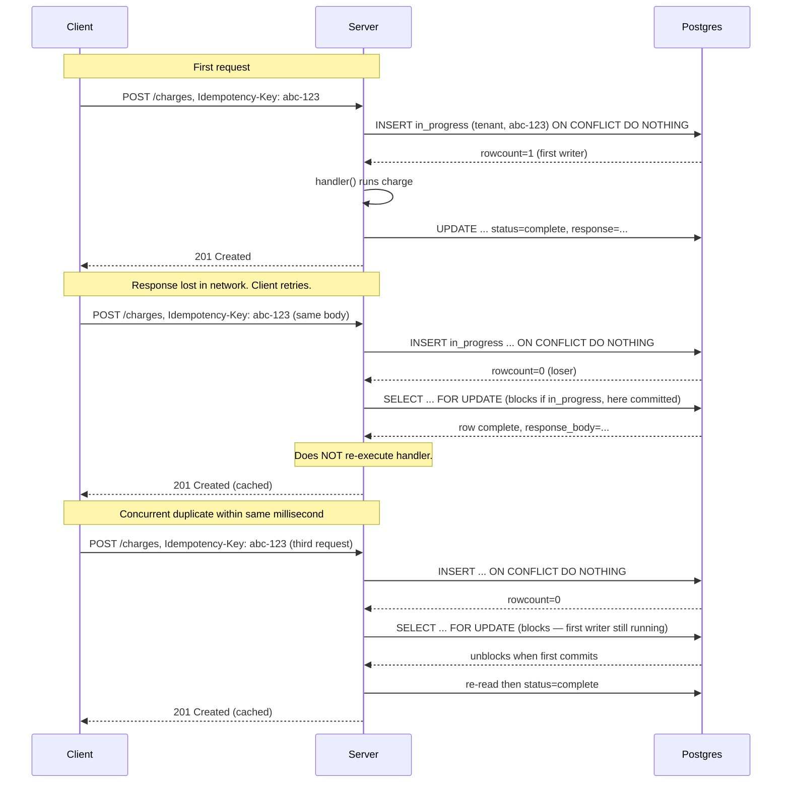

# Lesson 02: Server-Side Idempotency and Retries

*An `IdempotencyRecord` table for `Boardly` keyed by `(tenant_id, key)`, a `with_idempotency` route wrapper that uses `ON CONFLICT DO NOTHING` for first-writer-wins and `SELECT ... FOR UPDATE` for the loser-waits path, a TTL on `in_progress` for crash recovery, and a body-hash check that refuses a key reused with a different body.*

**You're at Lesson 2 of Section 17 — the canonical lesson for the *advanced* angle of Idempotency.**

The client does not know whether its request reached the server. The network dropped the request, or the server processed it and the response was lost, or the server crashed mid-flight. From the client's view these are indistinguishable, so the client retries — and that retry may double-charge a customer, double-post an update, or double-send an email. Server-side idempotency is the answer: the client supplies an idempotency key; the server stores the key, the request body's hash, and the response; on a retry with the same key, the server returns the cached response instead of re-executing. This lesson is the server-side counterpart to the HTTP-side view taught in [[02-Web-and-HTTP/Idempotency-Safe-Retries-Pagination]]. Take your time. Type every line. **This is how you learn.**


#architecture #idempotency #reliability #http

## Learning Objectives

By the end of this lesson you will be able to:

1. **Implement a server-side idempotency store** keyed by `(tenant_id, key)` with `in_progress`, `complete`, and `failed` states.
2. **Use `INSERT ... ON CONFLICT DO NOTHING`** for the first-writer-wins atomic insert, and `SELECT ... FOR UPDATE` for the loser-waits path.
3. **Handle the partial-failure case** (server crashed mid-execution) via a TTL on the `in_progress` state with a take-over path.
4. **Handle the "same key, different body" case** (client bug) by hashing the body and refusing with 422 if the hash differs.
5. **Cache the full response** — status code, headers, body — not just the body, so a `201 Created` with a `Location` header is reproduced identically.
6. **Use the same session for the idempotency record and the business write** so they commit together or not at all.
7. **Decide between Postgres and Redis** for the store, and justify Postgres for anything that touches money.
8. **Recognise the eight common idempotency mistakes** — using the key as the entity ID, separate transactions, Redis-only, refusing instead of waiting for concurrent duplicates, no TTL, partial response caching, cross-tenant key collision, and trusting `exactly-once` from a broker.

## Prerequisites

Before starting, you need:

- **The HTTP-side idempotency lesson** — [[02-Web-and-HTTP/Idempotency-Safe-Retries-Pagination]]. The `Idempotency-Key` HTTP header, safe methods, the client-side retry contract. This lesson does *not* re-explain those; it builds on them.
- **The transactions lesson** — [[06-SQL-Fundamentals/Transactions-Isolation-Locks]]. The idempotency record and the business write must be in the same transaction; the row-level lock via `SELECT ... FOR UPDATE` is what gives the "loser waits" behavior.
- **The session/transaction lesson** — [[07-SQLAlchemy/05-Session-and-Transaction-Management]]. The session runs the transaction.
- **The DI lesson** — [[03-FastAPI-Core/Dependency-Injection]]. The `Idempotency-Key` header is a dependency; the `with_idempotency` route wrapper is a callable, not a middleware (we discuss why).
- **The multi-tenancy lesson** — [[17-Advanced-Architecture/Multi-Tenancy]]. The idempotency record is tenant-scoped; its primary key is `(tenant_id, key)` so a client cannot accidentally use the same key for two tenants.

## The Problem

The client does not know whether its request reached the server. The network dropped the request, or the server processed it and the response was lost, or the server crashed mid-flight. From the client's view these are indistinguishable, so the client retries — and that retry may double-charge a customer, double-post an update, or double-send an email.

Server-side idempotency is the answer. The client supplies an idempotency key (typically a UUIDv4 generated client-side, sent in the `Idempotency-Key` HTTP header). The server's job is to answer: "have I seen this key before, in this tenant, with this body?"

The state machine has four branches:

- **No** -> record `(tenant_id, key, body_hash, status=in_progress)` in a table, execute the request, record `(status=complete, response=...)`, return the response.
- **Yes, same body, status=complete** -> return the stored response. Do not re-execute.
- **Yes, same body, status=in_progress** -> another concurrent request with the same key is executing. Either wait for it (return its response when it finishes) or refuse (409). We wait via `SELECT ... FOR UPDATE`.
- **Yes, same body, status=in_progress, but the lock is stale (older than TTL)** -> the previous attempt crashed. Take over the lock and re-execute.
- **Yes, different body** -> the client is misusing the key. Refuse with 422 and an explanatory message.

Two correctness properties:

1. **The idempotency record and the business write are in the same transaction.** If the business write commits, the record commits; if it rolls back, the record rolls back. Otherwise a retry sees `complete` with no underlying state, or sees `in_progress` after the business write succeeded — both are bugs.
2. **The first insert of the record wins, the rest are blocked.** A unique constraint on `(tenant_id, key)` plus `INSERT ... ON CONFLICT DO NOTHING` makes "first writer wins" atomic. The losers then read the row and either wait, refuse, or take over after TTL.

**Tip — Think like a senior systems architect: idempotency is a durability contract, not a request feature.**

Don't think of idempotency as "the client sends a key and we cache the response." That framing puts the client in charge of correctness, and the client is the least-reliable component in the system (it crashes, it loses connectivity, it retries with a new key because its retry library's default is to generate a fresh UUID, it runs in a browser tab the user closed). The senior view is: idempotency is a **durability contract** between the server and the side effect — a guarantee that, *no matter what fails* (the network, the server process, the database connection, the LLM provider, the clock), the side effect of a single logical request happens exactly once. The architect's question is not "should we cache the response?" — that's a perf question. The architect's question is "if every component between the client and the database crashes exactly once during this request, what invariant guarantees that the customer is charged exactly once?" The answer, in this lesson's design, has four pillars: (1) the `IdempotencyRecord` and the business write commit in the *same Postgres transaction* — a single WAL flush makes them atomic, so a crash between them is impossible (Postgres's crash recovery replays the WAL or it doesn't, there is no half-state); (2) the `(tenant_id, key)` unique constraint is enforced by the B-tree index — Postgres refuses two `in_progress` rows for the same key at the page level, without an application lock and without a race window; (3) the `failed` state and the TTL `in_progress` state both have explicit *take-over* paths — a crashed attempt does not block retries forever, and the take-over path re-runs the handler on the assumption that the handler's side effects are themselves idempotent or compensable; (4) the body-hash check refuses a reused key with a different body — the client cannot "upgrade" a $10 charge to a $1000 charge by reusing the key. If any one of these four pillars is missing, the contract has a hole. The architect reviews the design by walking each pillar and asking "what failure does this catch, and what failure slips through?" — and the answer shapes the post-mortem template before the first incident.


## The Code

Here is the complete `Boardly` idempotency implementation. Read it through once; we will go line by line afterwards.

### The model

```python
# boardly/models.py (additions)
import uuid
from datetime import datetime
from sqlalchemy import DateTime, func, Index, Integer, JSON, LargeBinary, String, UUID
from sqlalchemy.orm import Mapped, mapped_column

from boardly.db.base import Base


class IdempotencyRecord(Base):
 __tablename__ = "idempotency_records"
 # Composite primary key: tenant_id + key. One key per tenant.
 tenant_id: Mapped[uuid.UUID] = mapped_column(UUID(as_uuid=True), primary_key=True)
 key: Mapped[str] = mapped_column(String(255), primary_key=True)
 body_hash: Mapped[str] = mapped_column(String(64), nullable=False) # sha256 hex
 status: Mapped[str] = mapped_column(String(16), nullable=False) # in_progress | complete | failed
 started_at: Mapped[datetime] = mapped_column(
 DateTime(timezone=True), server_default=func.now(), nullable=False
 )
 completed_at: Mapped[datetime | None] = mapped_column(DateTime(timezone=True), nullable=True)
 response_status: Mapped[int | None] = mapped_column(Integer, nullable=True)
 response_body: Mapped[bytes | None] = mapped_column(LargeBinary, nullable=True)
 response_headers: Mapped[dict | None] = mapped_column(JSON, nullable=True)
 __table_args__ = (
 Index("ix_idempotency_started_at", "started_at"),
 )
```

### The route wrapper

```python
# boardly/idempotency.py
import hashlib
import json
from datetime import datetime, timedelta, timezone
from typing import Annotated, Awaitable, Callable

from fastapi import HTTPException, Request, Response
from sqlalchemy import text
from sqlalchemy.dialects.postgresql import insert as pg_insert
from sqlalchemy.ext.asyncio import AsyncSession

from boardly.db.session import SessionDep
from boardly.tenancy import TenantDep

# An idempotency-protected route is a callable that takes its dependencies
# (session, tenant, body) and returns (status_code, headers, body_bytes).
IdempotentHandler = Callable[..., Awaitable[tuple[int, dict[str, str], bytes]]]

IN_PROGRESS_TTL = timedelta(minutes=5)


def _hash_body(body: bytes) -> str:
 return hashlib.sha256(body).hexdigest()


async def with_idempotency(
 request: Request,
 session: SessionDep,
 tenant: TenantDep,
 body: bytes,
 key: str | None,
 handler: IdempotentHandler,
) -> Response:
 # 1. No key => the route is not idempotency-protected; just execute.
 if key is None:
 status, headers, payload = await handler()
 return Response(content=payload, status_code=status, headers=headers)

 body_hash = _hash_body(body)

 # 2. Try to insert the in_progress row. Unique on (tenant_id, key).
 stmt = pg_insert(IdempotencyRecord).values(
 tenant_id=tenant.tenant_id,
 key=key,
 body_hash=body_hash,
 status="in_progress",
 ).on_conflict_do_nothing(index_elements=["tenant_id", "key"])
 result = await session.execute(stmt)

 if result.rowcount == 1:
 # We are the first writer. Execute, store, return.
 try:
 status, headers, payload = await handler()
 except Exception:
 # Mark failed so the next retry can take over immediately.
 await session.execute(
 text("""
 UPDATE idempotency_records
 SET status='failed', completed_at=now()
 WHERE tenant_id=:tid AND key=:k
 """),
 {"tid": str(tenant.tenant_id), "k": key},
 )
 await session.commit()
 raise

 await session.execute(
 text("""
 UPDATE idempotency_records
 SET status='complete', completed_at=now(),
 response_status=:s, response_body=:b, response_headers=:h
 WHERE tenant_id=:tid AND key=:k
 """),
 {
 "tid": str(tenant.tenant_id), "k": key,
 "s": status, "b": payload,
 "h": json.dumps(headers),
 },
 )
 await session.commit()
 return Response(content=payload, status_code=status, headers=headers)

 # 3. We are not the first. Lock the existing row and decide.
 row = await session.execute(
 text("""
 SELECT body_hash, status, started_at, response_status,
 response_body, response_headers
 FROM idempotency_records
 WHERE tenant_id=:tid AND key=:k
 FOR UPDATE
 """),
 {"tid": str(tenant.tenant_id), "k": key},
 )
 rec = row.one()

 # 3a. Body mismatch => client bug.
 if rec.body_hash != body_hash:
 raise HTTPException(422, "Idempotency-Key reused with a different request body")

 # 3b. Complete => return cached response.
 if rec.status == "complete":
 return Response(
 content=rec.response_body,
 status_code=rec.response_status,
 headers=json.loads(rec.response_headers or "{}"),
 )

 # 3c. Failed => a previous attempt died cleanly. Take over.
 if rec.status == "failed":
 await _take_over_and_run(session, tenant.tenant_id, key, handler)
 # _take_over_and_run commits and returns Response — fall through is unreachable
 raise RuntimeError("unreachable")

 # 3d. In-progress, within TTL => refuse. Client should retry later.
 if rec.status == "in_progress" and \
 datetime.now(timezone.utc) - rec.started_at.replace(tzinfo=timezone.utc) < IN_PROGRESS_TTL:
 raise HTTPException(409, "A request with this Idempotency-Key is in progress")

 # 3e. In-progress, past TTL => the previous attempt died. Take over.
 await _take_over_and_run(session, tenant.tenant_id, key, handler)
 raise RuntimeError("unreachable")


async def _take_over_and_run(
 session: AsyncSession,
 tenant_id: uuid.UUID,
 key: str,
 handler: IdempotentHandler,
) -> Response:
 """Take over an in_progress (past TTL) or failed row, execute the handler,
 store the response. Commits and returns the Response."""
 await session.execute(
 text("""
 UPDATE idempotency_records
 SET status='in_progress', started_at=now()
 WHERE tenant_id=:tid AND key=:k
 """),
 {"tid": str(tenant_id), "k": key},
 )
 try:
 status, headers, payload = await handler()
 except Exception:
 await session.execute(
 text("""
 UPDATE idempotency_records
 SET status='failed', completed_at=now()
 WHERE tenant_id=:tid AND key=:k
 """),
 {"tid": str(tenant_id), "k": key},
 )
 await session.commit()
 raise
 await session.execute(
 text("""
 UPDATE idempotency_records
 SET status='complete', completed_at=now(),
 response_status=:s, response_body=:b, response_headers=:h
 WHERE tenant_id=:tid AND key=:k
 """),
 {"tid": str(tenant_id), "k": key,
 "s": status, "b": payload, "h": json.dumps(headers)},
 )
 await session.commit()
 return Response(content=payload, status_code=status, headers=headers)
```

### The route that uses it

```python
# boardly/api/charges.py
from typing import Annotated
from fastapi import APIRouter, Header, Request, Response

from boardly.deps import SessionDep
from boardly.idempotency import with_idempotency
from boardly.schemas import ChargeCreate, ChargeRead
from boardly.services import charges as charge_service
from boardly.tenancy import TenantDep

router = APIRouter(prefix="/charges", tags=["charges"])


@router.post("", response_model=ChargeRead, status_code=201)
async def create_charge(
 request: Request,
 session: SessionDep,
 tenant: TenantDep,
 payload: ChargeCreate,
 idempotency_key: Annotated[str | None, Header(alias="Idempotency-Key")] = None,
) -> Response:
 body_bytes = await request.body()

 async def handler() -> tuple[int, dict[str, str], bytes]:
 charge = await charge_service.create(session, tenant, payload)
 # Serialize the actual response that will be cached.
 payload_bytes = ChargeRead.model_validate(charge).model_dump_json().encode()
 return 201, {"content-type": "application/json"}, payload_bytes

 return await with_idempotency(
 request, session, tenant, body_bytes, idempotency_key, handler
 )
```

### The cleanup job

```python
# scripts/cleanup_idempotency.py
"""Delete idempotency records older than the longest client retry window."""
import asyncio

from sqlalchemy import text
from sqlalchemy.ext.asyncio import create_async_engine

from boardly.config import settings


async def cleanup(days: int = 30) -> None:
 engine = create_async_engine(settings.database_url)
 async with engine.connect() as conn:
 await conn.execute(
 text("DELETE FROM idempotency_records WHERE completed_at < now() - :days * INTERVAL '1 day'"),
 {"days": days},
 )
 await conn.commit()
 await engine.dispose()


if __name__ == "__main__":
 asyncio.run(cleanup())
```

## Line-by-Line Deep Dive

### `boardly/models.py`: The `IdempotencyRecord`

#### Lines 11–12: The composite primary key

```python
tenant_id: Mapped[uuid.UUID] = mapped_column(UUID(as_uuid=True), primary_key=True)
key: Mapped[str] = mapped_column(String(255), primary_key=True)
```

**What it does:** The primary key is `(tenant_id, key)`. One idempotency key per tenant.

**Why composite:**

- If the primary key were just `key`, a client sending the same key for two tenants would get the wrong tenant's cached response. The composite key `(tenant_id, key)` makes the lookup tenant-scoped.
- The composite key is also the unique constraint — `INSERT ... ON CONFLICT DO NOTHING` on the primary key gives us "first writer wins" for free.

**Danger — Always scope the idempotency key by tenant.**

Without `tenant_id` in the primary key, two tenants using the same key collide. The second tenant's request returns the first tenant's cached response — a cross-tenant data leak. The composite key is the fix.


#### Line 13: `body_hash`

```python
body_hash: Mapped[str] = mapped_column(String(64), nullable=False) # sha256 hex
```

**What it does:** Stores the SHA-256 hash of the request body, hex-encoded (64 chars).

**Why hash the body:**

- A client that sends the same `Idempotency-Key` with two different request bodies is either buggy or malicious. Storing one body's response and serving it for another body's request is wrong.
- The hash catches this: the record stores the body hash, and a request whose hash does not match gets a 422.
- Why hash instead of storing the body? Privacy and size. The body might contain sensitive data; the hash is one-way. The body might be large; the hash is 64 bytes.

#### Line 14: `status`

```python
status: Mapped[str] = mapped_column(String(16), nullable=False) # in_progress | complete | failed
```

**What it does:** The state of the request. `in_progress` (handler is running), `complete` (response stored), `failed` (handler raised).

**Why three states instead of two:**

- Two states (`in_progress`, `complete`) cannot represent "the previous attempt crashed" — the row would stay `in_progress` forever, and the next retry would refuse 409 forever. Customers see "request in progress" eternally.
- The `failed` state lets the next retry observe "the previous attempt died cleanly" and take over immediately (no TTL wait).
- `failed` is set in the `except Exception` block of the handler call. If the handler raises *before* `failed` is set (e.g. the server crashes between the `raise` and the `UPDATE`), the row stays `in_progress` — and the TTL take-over path (3e) catches this.

**Tip — Maintainability thinking: the state machine is the documentation.**

The senior engineer's rule for the `IdempotencyRecord.status` field: the allowed values (`in_progress`, `complete`, `failed`) and the *transitions* between them are the system's contract — they are not an implementation detail. The code that ships must encode the transitions in a way that a reader can hold the whole state machine in their head at once. This means: (a) **the states are named for the reader, not the database** — `in_progress` (not `1`), `complete` (not `2`), `failed` (not `3`); a `SELECT status FROM idempotency_records` in a 3 AM incident is self-documenting; (b) **the transitions live in one function** — `with_idempotency` is the *only* place that calls `UPDATE idempotency_records SET status=...`; an engineer who wants to add a new transition (say, `cancelled` for a user-aborted request) knows where to look; (c) **the failure paths are explicit, not implicit** — the `except Exception` block sets `failed` *before* `raise`-ing, because the order is the contract: the record's state must reflect the handler's outcome before control leaves the function; (d) **the unreachable `raise RuntimeError("unreachable")` lines are not paranoia** — they are a runtime assertion that documents the *expected* control flow and fails loudly if a refactor introduces a path that reaches them (a future engineer who restructures the branches will trip the assertion in tests); (e) **the `_take_over_and_run` helper exists because two paths converge on the same logic** — the senior engineer resists the urge to inline it for "performance" because the duplication cost (two copies of the commit-and-raise dance drifting apart over time) is higher than the call overhead. The most important line of code in this module is the `raise RuntimeError("unreachable")` after `_take_over_and_run` — it says "I have thought about every path, and this one cannot be reached; if you reach it, the bug is in the state machine, not in the data." A state machine without an `unreachable` assertion is a state machine the author has not finished thinking about.


#### Lines 15–18: `started_at`, `completed_at`

```python
started_at: Mapped[datetime] = mapped_column(
 DateTime(timezone=True), server_default=func.now(), nullable=False
)
completed_at: Mapped[datetime | None] = mapped_column(DateTime(timezone=True), nullable=True)
```

**What it does:** `started_at` is when the `in_progress` row was inserted (or the take-over happened). `completed_at` is when the row went `complete` or `failed`.

**Why both:**

- `started_at` is what the TTL check reads. If `now() - started_at > TTL`, the row is stale and can be taken over.
- `completed_at` is what the cleanup job reads. Records older than 30 days are deleted.

#### Lines 19–21: The response columns

```python
response_status: Mapped[int | None] = mapped_column(Integer, nullable=True)
response_body: Mapped[bytes | None] = mapped_column(LargeBinary, nullable=True)
response_headers: Mapped[dict | None] = mapped_column(JSON, nullable=True)
```

**What it does:** Stores the full response: status code, body bytes, headers JSON.

**Why the full response:**

- A `201 Created` with a `Location: /charges/123` header cached as `200` is a different response. The status code matters.
- The headers matter — the `Location` header tells the client where the new resource is; the `Content-Type` matters for parsing; the `ETag` matters for conditional requests.
- The body matters — the client uses the body to know the charge ID.
- Caching only the body (a common shortcut) loses the status and headers. Cache the whole response.

**Why `LargeBinary` for the body and `JSON` for the headers?**

The body is bytes — the raw HTTP response body. We store it as bytes (not as text) so we can return it byte-for-byte without re-serializing. The headers are a dict — `{"content-type": "application/json", "location": "/charges/123"}`. JSON is the natural Postgres type for a dict.


### `boardly/idempotency.py`: The `with_idempotency` wrapper

#### Lines 23–25: The `IN_PROGRESS_TTL`

```python
IN_PROGRESS_TTL = timedelta(minutes=5)
```

**What it does:** The TTL on the `in_progress` state. If a row is `in_progress` for longer than 5 minutes, the next retry can take it over.

**Why 5 minutes:**

- The TTL should be longer than the 99th-percentile of handler duration, plus buffer. A charge handler that talks to Stripe typically takes 1–3 seconds. 5 minutes is generous.
- Too short a TTL means a slow handler (say, 6 minutes) is taken over mid-flight — the second attempt runs concurrently with the still-running first attempt, which is worse than the original problem.
- Too long a TTL means a crashed server's `in_progress` row blocks retries for too long.

#### Lines 28–29: The `_hash_body`

```python
def _hash_body(body: bytes) -> str:
 return hashlib.sha256(body).hexdigest()
```

**What it does:** SHA-256 hashes the request body, returns hex.

**Why SHA-256:**

- SHA-256 is collision-resistant for any practical input size. A collision would let two different bodies share a hash — but the chance of a SHA-256 collision is `2^-128`, which is effectively zero.
- SHA-256 is fast enough for any reasonable body size (a few MB per second).
- The hex encoding is 64 chars, which fits in a `String(64)` column.

#### Lines 32–40: The function signature and the no-key path

```python
async def with_idempotency(
 request: Request,
 session: SessionDep,
 tenant: TenantDep,
 body: bytes,
 key: str | None,
 handler: IdempotencyHandler,
) -> Response:
 if key is None:
 status, headers, payload = await handler()
 return Response(content=payload, status_code=status, headers=headers)
```

**What it does:** If the request has no `Idempotency-Key` header, just execute the handler and return its response. No idempotency record is created.

**Why the no-key path:**

- The idempotency key is optional (per the IETF draft). A request without a key is not idempotency-protected — it executes normally. This is the right behavior for non-mutating routes (GETs) and for routes where the developer chose not to require idempotency.
- The `key: str | None` parameter is what makes this optional. The route handler in `charges.py` declares `idempotency_key: Annotated[str | None, Header(alias="Idempotency-Key")] = None` — the default is `None` if the header is missing.

#### Lines 43–49: The first-writer insert

```python
stmt = pg_insert(IdempotencyRecord).values(
 tenant_id=tenant.tenant_id,
 key=key,
 body_hash=body_hash,
 status="in_progress",
).on_conflict_do_nothing(index_elements=["tenant_id", "key"])
result = await session.execute(stmt)
```

**What it does:** Tries to `INSERT` an `in_progress` row keyed by `(tenant_id, key)`. If a row with the same key already exists, the `ON CONFLICT DO NOTHING` clause makes the insert a no-op.

**Why `ON CONFLICT DO NOTHING`:**

- Two requests with the same key arrive simultaneously. Without `ON CONFLICT`, both inserts would fail with `unique_violation`. The handler would have to catch the exception, retry with a `SELECT`, etc. — race-prone.
- With `ON CONFLICT DO NOTHING`, one insert succeeds (the first writer), the other is a no-op. The `result.rowcount` distinguishes them: 1 = first writer, 0 = not the first.
- This is the atomic "first writer wins" — no race possible.
- The `pg_insert` is the Postgres-specific `insert` from `sqlalchemy.dialects.postgresql`. It supports `on_conflict_do_nothing(index_elements=...)`. The generic `sqlalchemy.insert` does not (it supports `on_conflict_do_nothing()` only with no specific columns).

**Tip — `index_elements` vs. constraint name.**

`on_conflict_do_nothing(index_elements=["tenant_id", "key"])` targets the unique constraint on those columns. You can also use `on_conflict_do_nothing(constraint="idempotency_records_pkey")` to target by constraint name. The `index_elements` form is more portable — it works even if the constraint is unnamed (the primary key on `(tenant_id, key)` is unnamed by default).


**What happens inside Postgres when `INSERT ... ON CONFLICT DO NOTHING` runs.**

Postgres does not insert-then-check. The path is: (1) the executor (`ExecInsert` in `nodeModifyTable.c`) takes the row-to-be-inserted, computes its tuple from the column values, and for *each* unique index on the target table (here, the primary-key B-tree on `(tenant_id, key)`) calls `index_insert` (in `indexam.c`); (2) the B-tree index AM (`btinsert` in `nbtree/nbtree.c`) walks the index pages to find the leaf page where the new entry belongs, taking a *buffer lock* on that page (an `LW_LOCK` on the buffer's `BT_WRITE` lock); (3) it checks whether an entry with the same key already exists on the page; if not, it inserts the entry and returns success; if yes, it would normally raise `ERROR: duplicate key value violates unique constraint` *unless* the executor has indicated an `ON CONFLICT` clause; (4) with `ON CONFLICT DO NOTHING`, the executor's `ExecOnConflictCheck` intercepts the conflict *before* the error is raised — the `ON CONFLICT` clause's `arbiterIndexes` (the set of unique indexes whose violation triggers the conflict path) is consulted, and if the violated index is in the arbiter set, the insert is rolled back at the *subtransaction* level (no error raised, no row written, no WAL for the row itself) and the executor returns `INSERT 0 0` (0 rows inserted); (5) the row lock on the conflicting existing row is held for the *duration of the surrounding transaction* — the second writer's transaction, having observed `rowcount=0`, then issues `SELECT ... FOR UPDATE` on the existing row, which *blocks* on the row's `XID` lock (the first writer's transaction implicitly holds a `FOR UPDATE`-equivalent lock because the row's `xmin` is the first writer's `xid` and the row is not yet committed). The senior engineer who knows this can reason about: "what if two writers race exactly simultaneously?" (the B-tree page lock serializes them — one wins, one observes `rowcount=0`); "what if the first writer rolls back?" (the second writer's `FOR UPDATE` unblocks, re-reads the row, sees nothing — the row was rolled back too — and falls through to a fresh `INSERT`, succeeding as the new first writer); "what if the unique index is on a different column set than the primary key?" (the `ON CONFLICT (tenant_id, key)` clause must name an arbiter — you cannot `ON CONFLICT DO NOTHING` without specifying which unique constraint you're conflicting on, and Postgres must match it; if you change the table's unique constraint later, the `index_elements` form silently no-ops against the new constraint, which is a bug — the `constraint="..."` form is more brittle but more honest).


#### Lines 51–73: The first-writer execute-and-store path

```python
if result.rowcount == 1:
 try:
 status, headers, payload = await handler()
 except Exception:
 await session.execute(text("""
 UPDATE idempotency_records
 SET status='failed', completed_at=now()
 WHERE tenant_id=:tid AND key=:k
 """), {"tid": str(tenant.tenant_id), "k": key})
 await session.commit()
 raise

 await session.execute(text("""
 UPDATE idempotency_records
 SET status='complete', completed_at=now(),
 response_status=:s, response_body=:b, response_headers=:h
 WHERE tenant_id=:tid AND key=:k
 """), {"tid": str(tenant.tenant_id), "k": key,
 "s": status, "b": payload, "h": json.dumps(headers)})
 await session.commit()
 return Response(content=payload, status_code=status, headers=headers)
```

**What it does:** If we are the first writer (`rowcount == 1`), we execute the handler. If the handler raises, we mark the row `failed` and re-raise. If it succeeds, we store the response and mark the row `complete`, commit, and return the response.

**Why the `except Exception` block sets `failed` and commits:**

- If the handler raises (e.g. Stripe returned a 500), the row should be marked `failed` so the next retry can take over immediately (no TTL wait).
- The `failed` write and the `commit` happen *before* the `raise` re-raises the exception. This is critical — if we raised first, the `failed` write would never happen (the function exits), and the row would stay `in_progress` until the TTL expired.
- The `raise` re-raises the original exception so FastAPI's exception handlers can translate it into a proper HTTP response (e.g. a 502 for a Stripe failure).

**Why the `complete` write commits before returning:**

- The `complete` write and the business write (inside the handler) must commit together. If we returned the response *before* committing the `complete` write, a crash between the return and the commit would leave the row `in_progress` — and the next retry would re-execute the handler, double-charging the customer.
- The `await session.commit()` commits both the business write (inside the handler) and the `complete` write. They are atomic.

**Danger — The idempotency record and the business write MUST commit together.**

If they are in separate transactions, a crash between them produces either:
- A `complete` record with no underlying charge (the record committed, the charge rolled back). The next retry returns the cached "complete" response, but the charge does not exist. The customer sees a successful response but no charge.
- A charge with no `complete` record (the charge committed, the record rolled back). The next retry re-executes the handler, creating a second charge. The customer is double-charged.

Both are bugs. The fix: the same session runs the business write and the idempotency write, and they commit together. The `SessionDep` in the route signature is the same session that `with_idempotency` uses — they share the transaction.


#### Lines 75–91: The not-first-writer SELECT FOR UPDATE

```python
row = await session.execute(
 text("""
 SELECT body_hash, status, started_at, response_status,
 response_body, response_headers
 FROM idempotency_records
 WHERE tenant_id=:tid AND key=:k
 FOR UPDATE
 """),
 {"tid": str(tenant.tenant_id), "k": key},
)
rec = row.one()
```

**What it does:** We are not the first writer. We `SELECT ... FOR UPDATE` on the existing row, which blocks until the first writer commits or rolls back. Then we read the row.

**Why `FOR UPDATE`:**

- Without `FOR UPDATE`, our `SELECT` reads the row as it was at the time of the SELECT. If the first writer is still `in_progress`, we see `in_progress` and refuse 409. But the first writer might commit a millisecond later — and the next retry (a millisecond after that) would have to refuse 409 again, indefinitely.
- `FOR UPDATE` *blocks* on the row lock. If the first writer is `in_progress`, our `SELECT` waits until the first writer commits (releasing the row lock). Then our `SELECT` re-reads, sees `complete`, and returns the cached response.
- This is the "loser waits" path: the duplicate request waits for the original, then returns its response. The client gets the right answer without re-executing.

**`FOR UPDATE` blocks on row locks.**

When you `SELECT ... FOR UPDATE` on a row that is currently locked by another transaction (because that transaction also did `SELECT FOR UPDATE` or did an `UPDATE`), your `SELECT` blocks until the other transaction commits or rolls back. Then your `SELECT` re-reads the row's current state. This is the Postgres row-level lock semantics, covered in [[06-SQL-Fundamentals/Transactions-Isolation-Locks]].


#### Lines 94–96: Body mismatch check

```python
if rec.body_hash != body_hash:
 raise HTTPException(422, "Idempotency-Key reused with a different request body")
```

**What it does:** If the existing record's body hash differs from the current request's body hash, refuse with 422.

**Why:**

- The client sent the same `Idempotency-Key` for two different request bodies. Either the client is buggy (it generated the same key twice for different requests — a UUIDv4 collision is astronomically unlikely, but a code bug reusing the key is common) or malicious.
- Storing one body's response and serving it for another body's request is wrong — the responses are for different requests.
- The 422 tells the client to fix its key generation. The IETF draft recommends this behavior.

#### Lines 99–104: The complete path

```python
if rec.status == "complete":
 return Response(
 content=rec.response_body,
 status_code=rec.response_status,
 headers=json.loads(rec.response_headers or "{}"),
 )
```

**What it does:** If the existing record is `complete`, return the cached response.

**Why:**

- This is the "retry after success" path. The first writer completed, the response was lost (network), the client retried with the same key. We return the cached response without re-executing the handler.
- The response is byte-for-byte identical to the original: same status, same headers (parsed from JSON), same body. The client cannot distinguish "fresh response" from "cached response".

#### Lines 107–112: The failed path

```python
if rec.status == "failed":
 await _take_over_and_run(session, tenant.tenant_id, key, handler)
 raise RuntimeError("unreachable")
```

**What it does:** If the existing record is `failed`, take over and re-execute.

**Why:**

- `failed` means the previous attempt died cleanly (the handler raised, the `except` block set `failed` and committed). The next retry can take over immediately, without waiting for the TTL.
- The take-over path re-runs the handler. The handler's writes must be idempotent (because we are re-executing them). This is the property the client is asking for by sending an idempotency key — the client is saying "if you need to retry, retry; do not double-charge me."

#### Lines 115–117: The in-progress within TTL path

```python
if rec.status == "in_progress" and \
 datetime.now(timezone.utc) - rec.started_at.replace(tzinfo=timezone.utc) < IN_PROGRESS_TTL:
 raise HTTPException(409, "A request with this Idempotency-Key is in progress")
```

**What it does:** If the existing record is `in_progress` and was started less than 5 minutes ago, refuse with 409.

**Why:**

- The first writer is still running (we know this because we just `SELECT FOR UPDATE`d the row and saw `in_progress`). Wait — if we `SELECT FOR UPDATE`'d and saw `in_progress`, that means the first writer has not committed yet. But our `FOR UPDATE` blocked on the first writer's row lock; when the first writer commits, our `SELECT` unblocks and re-reads. So if we see `in_progress` *after* `FOR UPDATE`, the first writer must have committed with status=`in_progress` (i.e. committed without updating to `complete`).
- Actually, no — the first writer's transaction holds the row lock for the entire transaction. If the first writer commits with `complete`, our `FOR UPDATE` unblocks and we see `complete`. If the first writer rolls back (the transaction failed), our `FOR UPDATE` unblocks and we see... nothing (the row was never inserted, because the transaction rolled back). So the only way we see `in_progress` after `FOR UPDATE` is if the first writer committed with `in_progress` — which would happen if the first writer crashed between the `INSERT` and the `UPDATE to complete` and the connection pool returned the connection to Postgres with the transaction committed (because of `autocommit` semantics).
- In practice, the `in_progress` state after `FOR UPDATE` is rare — it means the first writer crashed mid-flight. The TTL check is the safety net.
- The 409 refusal is the right behavior: the client should retry later (after the TTL).

#### Lines 120–122: The take-over path

```python
await _take_over_and_run(session, tenant.tenant_id, key, handler)
raise RuntimeError("unreachable")
```

**What it does:** If we got here, the row is `in_progress` past the TTL — the previous attempt crashed. Take over and re-execute.

**Why:**

- The TTL is the "presumed dead" threshold. A row `in_progress` for longer than the TTL is presumed to belong to a crashed attempt. The next retry can take over.
- The take-over path resets `started_at` and re-runs the handler. The handler's writes must be idempotent — the same constraint as the failed path.

#### Lines 125–156: The `_take_over_and_run` helper

```python
async def _take_over_and_run(session, tenant_id, key, handler) -> Response:
 await session.execute(text("""
 UPDATE idempotency_records
 SET status='in_progress', started_at=now()
 WHERE tenant_id=:tid AND key=:k
 """), {"tid": str(tenant_id), "k": key})
 try:
 status, headers, payload = await handler()
 except Exception:
 await session.execute(text("""
 UPDATE idempotency_records
 SET status='failed', completed_at=now()
 WHERE tenant_id=:tid AND key=:k
 """), {"tid": str(tenant_id), "k": key})
 await session.commit()
 raise
 await session.execute(text("""
 UPDATE idempotency_records
 SET status='complete', completed_at=now(),
 response_status=:s, response_body=:b, response_headers=:h
 WHERE tenant_id=:tid AND key=:k
 """), {"tid": str(tenant_id), "k": key,
 "s": status, "b": payload, "h": json.dumps(headers)})
 await session.commit()
 return Response(content=payload, status_code=status, headers=headers)
```

**What it does:** Resets the row to `in_progress` with a fresh `started_at`, executes the handler, stores the response, commits, returns. On exception, marks `failed` and re-raises.

**Why this is a helper:**

- The `failed` path and the in-progress-past-TTL path both call this. The two paths converge on the same logic: re-execute, store, return. The helper avoids duplication.

### `boardly/api/charges.py`: The route

```python
@router.post("", response_model=ChargeRead, status_code=201)
async def create_charge(
 request: Request,
 session: SessionDep,
 tenant: TenantDep,
 payload: ChargeCreate,
 idempotency_key: Annotated[str | None, Header(alias="Idempotency-Key")] = None,
) -> Response:
 body_bytes = await request.body()

 async def handler() -> tuple[int, dict[str, str], bytes]:
 charge = await charge_service.create(session, tenant, payload)
 payload_bytes = ChargeRead.model_validate(charge).model_dump_json().encode()
 return 201, {"content-type": "application/json"}, payload_bytes

 return await with_idempotency(
 request, session, tenant, body_bytes, idempotency_key, handler
 )
```

**What it does:** A `POST /charges` route that wraps the charge creation in `with_idempotency`. The `handler` closure does the actual work and returns the serialized response.

**Why the `handler` is a closure:**

- The `handler` is a callable that returns `(status, headers, body_bytes)`. It is what `with_idempotency` calls when it decides to execute the request (either as the first writer or as a take-over).
- The closure captures `session`, `tenant`, `payload` — these are the dependencies that the route received. The handler uses them to create the charge and serialize the response.
- The closure returns *bytes*, not a Pydantic model, because the cached response must be byte-for-byte identical on retry. We serialize once (in the handler) and cache the bytes; the retry returns the cached bytes directly.

**Why a closure and not a middleware?**

A FastAPI `@app.middleware("http")` could intercept every request with an `Idempotency-Key` header, run the route, cache the response. The advantage: every route opts in for free. The disadvantage: the middleware must re-read the request body (which is a stream that can only be read once), and the middleware must reproduce the response object (which means re-serializing the Pydantic model on every request — defeating the cache). The closure pattern is cleaner: the route knows what to cache (the bytes it would return), and the cache is byte-for-byte identical.


**Spot the bug — what if the route declares `payload: ChargeCreate` AND reads `body_bytes` via `await request.body()`?**

Answer: the request body stream can only be read once. If FastAPI's dependency injection reads it to parse `payload` first, then `await request.body()` in the route returns `b''`. The fix: either (a) parse the body manually and pass it as `payload_bytes` to the handler (which then re-parses it for `payload`), or (b) skip the typed `payload` parameter and parse it manually inside the handler. We chose (b) by reading the body once in the route and passing it to `with_idempotency`; the handler parses it inside. The closure pattern lets you control the read order.


## Execution Trace

Three scenarios, in order:

1. **First request** — client POSTs `/charges` with `Idempotency-Key: abc-123`. Server inserts `in_progress` row (unique constraint succeeds), runs the handler, stores the response with `complete`, returns `201`.
2. **Retry (network lost response)** — same key, same body. Server tries to insert; conflict; locks the existing row; reads `complete`; returns the cached `201` without re-running the handler.
3. **Concurrent duplicate** — two requests with `Idempotency-Key: abc-123` arrive within 10 ms. The first inserts `in_progress` and starts the handler. The second's insert returns 0 rows; it `SELECT ... FOR UPDATE` on the existing row, blocking until the first commits. Then it re-reads: `complete`; returns the cached response.



**You have server-side idempotency.**

The client can retry safely. The server caches the response and returns it byte-for-byte on retry. The same session runs the business write and the idempotency write — they commit together or not at all. Concurrent duplicates wait for the first writer and return its response.


## Common Mistakes

### Mistake 1: Using the idempotency key as the primary key of the business entity

```python
# WRONG
charge = Charge(id=idempotency_key, amount=payload.amount, ...)
```

**Symptom:** Two different requests with the same idempotency key but different bodies collide. The body-hash check rejects the second, but if the developer bypasses the check, the second request overwrites the first.

**Fix:** The entity's ID is separate (`uuid.uuid4()` server-side). The idempotency key is a *request* identifier, not an *entity* identifier.

### Mistake 2: Storing the idempotency record in a different transaction than the business write

```python
# WRONG
async def handler():
 charge = await charge_service.create(other_session, tenant, payload)
 # ^ this commits in a different session
 ...
 return 201, {}, payload_bytes
```

**Symptom:** A crash between the business commit and the idempotency commit produces a `complete` record with no underlying charge, or a charge with no record and a duplicate retry.

**Fix:** The same session runs the business write and the idempotency write. The `SessionDep` is the same session throughout.

### Mistake 3: Caching the response in Redis instead of Postgres

**Symptom:** Redis flushes -> retries re-execute -> double-charge.

**Fix:** Use Postgres as the system of record; Redis only as a read-through cache if you must. For anything that touches money, Postgres only.

### Mistake 4: Refusing the second concurrent request instead of waiting

```python
# WRONG (refuses immediately on conflict)
if result.rowcount == 0:
 raise HTTPException(409, "in progress")
```

**Symptom:** Legitimate retries (where the network genuinely duplicated the request) are refused 409. The client cannot make progress.

**Fix:** Wait via `FOR UPDATE` and serve the cached response — the duplicate did not happen at the client's intent.

### Mistake 5: No TTL on `in_progress`

**Symptom:** A crashed server leaves the row `in_progress` forever. Every retry returns 409. Customers see "request in progress" eternally.

**Fix:** Always have a TTL and a take-over path.

### Mistake 6: Caching the response without the status code and headers

**Symptom:** A `201 Created` with a `Location` header cached as `200` is a different response. The client's logic that reads `Location` breaks.

**Fix:** Cache the whole response: status, headers, body.

### Mistake 7: Trusting the `Idempotency-Key` header across tenants

**Symptom:** A client sends the same key for two tenants and (without `tenant_id` in the primary key) gets the wrong tenant's cached response.

**Fix:** The composite primary key `(tenant_id, key)` prevents this.

### Mistake 8: Trusting `exactly-once` from a broker

**Symptom:** A consumer that relies on the broker's "exactly-once" delivery does not deduplicate. A redelivery double-processes.

**Fix:** Compose exactly-once: at-least-once delivery + idempotent consumer. See [[Event-Driven-Basics]].

**Warning — When production breaks: customer reports a duplicate charge.**

It's 9 AM Monday. Customer support escalates: a customer says they were charged twice for the same `Idempotency-Key`, 4 minutes apart, on Saturday at 11 PM. Don't panic. The senior engineer's response, in order: (1) **Pull the idempotency record.** `SELECT * FROM idempotency_records WHERE tenant_id = $1 AND key = $2;` — there will be exactly one row per `(tenant_id, key)`. Its `status` tells you which path executed; its `started_at` and `completed_at` tell you when. If `status='complete'` with one charge ID in the response body, the duplicate charge is *not* in your idempotency layer — it's either at the payment processor (a separate idempotency layer on their side failed, or your request to them was retried without an idempotency key on *their* API), or in a different system entirely (a retry of a *different* logical request that happened to charge the same card). (2) **Pull the business table.** `SELECT * FROM charges WHERE tenant_id = $1 AND customer_id = $2 ORDER BY created_at;` — if there are two rows for the same customer/amount/currency within 5 minutes, the double-charge is real and your idempotency layer failed to deduplicate. The four root causes, in order of likelihood: (a) the client rotated the key — two different UUIDs, two different rows, two different charges — fix by documenting that the client must retry with the *same* key, not generate a new one (link to [[02-Web-and-HTTP/Idempotency-Safe-Retries-Pagination]]); (b) the TTL took over mid-handler — the first handler was slow (say, the LLM provider took 6 minutes), the TTL was 5 minutes, a retry came in and took over, both handlers committed — fix by raising the TTL above the 99th-percentile handler duration, and add an alert on handler-duration p99 approaching the TTL; (c) the handler raised before the `INSERT INTO idempotency_records` ran — the request left no idempotency record, the retry ran the handler from scratch — fix by wrapping the *first* statement in the handler in the same transaction as the `INSERT` (the lesson's design already does this, but a route that bypasses `with_idempotency` does not); (d) the `failed` state was set but the take-over ran the handler twice — this is a bug in `_take_over_and_run`; check the logs for two `complete` writes to the same key, and add a regression test. (3) **Refund the duplicate charge.** Compensating action first, root-cause second — the customer does not care about the post-mortem. (4) **Write the post-mortem.** The question is not "who broke it?" — it is "what invariant did we believe held, and how did it fail?" If the answer is (a), the fix is a client SDK that handles retries correctly. If (b), the fix is monitoring on handler-duration percentiles and alerting when p99 approaches the TTL. If (c) or (d), the fix is a regression test in `tests/test_idempotency.py` that reproduces the failure path. The post-mortem should ship with both the refund receipt and the merged PR — anything less leaves the next incident only a refactor away.


## Engineering Trade-Offs

- **Postgres table vs. Redis.** Postgres is correct-by-construction (same transaction as the business write); Redis is faster but not transactional with Postgres. We pick Postgres for anything that touches money; Redis for view-counters and notifications where a duplicate is not catastrophic.
- **`ON CONFLICT DO NOTHING` vs. `DO UPDATE`.** `DO NOTHING` plus a follow-up `SELECT FOR UPDATE` is cleaner because it separates "am I the first writer?" from "what should I do about not being first?". `DO UPDATE` returning the row is terser but obscures the path.
- **Refuse 409 vs. wait for the in-progress request.** Waiting via `FOR UPDATE` is correct for legitimate retries; refusing 409 protects against clients that hammer the same key. We wait up to a request timeout and refuse only if the in-progress row is past TTL.
- **Hashing the whole body vs. hashing a subset.** The whole body catches every difference; hashing only fields that affect the response (e.g. excluding a client-supplied timestamp) is more forgiving of benign differences. We hash the whole body — clients should not vary the body if they want the same response.
- **TTL of 5 minutes vs. 30 minutes.** Shorter TTL means faster take-over after a crash; longer TTL means more slack for genuinely slow handlers. Match the TTL to the 99th percentile of handler duration, plus buffer.
- **Closure (route-wrapper) vs. middleware.** The closure pattern is what we use — the route knows what to cache. The middleware pattern is terser but loses byte-for-byte caching (the middleware must re-serialize the response object). We pick the closure.

**Scalability thinking: the idempotency table is a write-hot spot.**

At 100 charges/day, the `idempotency_records` table is 100 rows/day — nobody thinks about it. At 100,000 charges/day, the table is 36.5M rows/year, the `(tenant_id, key)` primary-key index is multiple gigabytes, and *every charge insert goes to the leaf page for that key* — Postgres's B-tree must take a buffer lock on the leaf page, and if multiple high-traffic tenants hash to nearby keys, you get page-level contention (the same leaf page is locked repeatedly, inserts serialize). The senior architect's first move is **partitioning by `tenant_id`** (Postgres 13+ supports partitioned unique indexes, so the `ON CONFLICT` path works per-partition) — this turns one write-hot B-tree into N B-trees, one per tenant shard, and a single tenant's traffic only contends with itself. The second move is **TTL-based cleanup**: the lesson's `scripts/cleanup_idempotency.py` deletes rows older than 30 days, but at 100k/day you need `pg_partman` (or native partition-by-range on `created_at`) to drop whole partitions of 30-day-old data in one `DROP TABLE` instead of a slow `DELETE` that bloats the table and produces dead tuples that `VACUUM` has to reclaim. The third move is **caching the read path**: the *write* path (first-writer `INSERT`) must hit Postgres (the durability contract requires it), but the *retry* path (read an existing `complete` record) can hit Redis first, falling through to Postgres on miss — this requires careful cache-invalidation logic (a `complete` write to Postgres must invalidate the Redis key before the next retry can read it, or the retry gets `in_progress` from Redis and refuses 409 even though Postgres has `complete`). The fourth move is **sharding the idempotency store itself past ~1M tenants** — at that scale, the PK index lookup is the p99 latency contributor, and you partition the store across multiple Postgres clusters by `tenant_id` hash. The senior engineer asks "what is the *next* bottleneck, and how do I prepare for it before it hits?" — the answer at 10 charges/day is "nothing"; at 10k/day it is "partitioning and partition-based cleanup"; at 1M/day it is "shard the store." Planning the partitioning scheme at 1k charges/day is dramatically cheaper than discovering the contention at 100k/day.


### Self-asking Q&A: the five design questions

**Why does idempotency need a server-side store at all?**

Because the client cannot prove it sent the first request, and the server cannot prove it received one. Without a server-side record keyed by `Idempotency-Key`, the only way for the server to answer "did I already process this?" is to inspect the side effects — which means reading every table the request might have written to, which is expensive and unreliable (the side effect might be a no-op for a legitimate reason). The `idempotency_keys` table is a side-channel log of "I saw this key on this date and produced this response." Without it, a retry after a network timeout either (a) double-charges the customer (no protection) or (b) requires the client to inspect the response and decide (offloading correctness to the least-reliable component). The store is what makes idempotency a server-side guarantee the client can rely on.

**When does an idempotency key actually fail to deduplicate?**

Four cases. (1) The handler raises before the `INSERT INTO idempotency_keys ... ON CONFLICT DO NOTHING` runs — the request leaves no record, so the retry runs the handler from scratch. (2) The client rotates the key prematurely — different UUID, different row, full double-charge. (3) The TTL takes over mid-handler — the first request is still in-flight at `created_at + ttl`, a second request comes in, sees the in-flight row past TTL, takes over, and runs the handler a second time. (4) The body differs — the second request comes in with the same key but a different body, gets a 422, and the client mistakes the 422 for "the original failed, retry with a new key." Each of these is documented in Common Mistakes above; the structural fixes are the state machine (`in_progress` → `complete`/`failed`), the `FOR UPDATE` wait, the TTL take-over, and the body hash check.

**Why a state machine (`in_progress` → `complete`/`failed`) instead of just two states?**

Because the failure mode of a two-state ("pending"/"done") machine is silent corruption. Consider: the handler crashes after `INSERT INTO charges ...` but before the `UPDATE idempotency_keys SET status='done'`. With two states, the row stays `pending` forever — the next retry with the same key sees `pending`, waits via `FOR UPDATE`, times out, returns 409. The customer is double-charged *eventually* (when a manual retry with a new key runs) and the operator has no record of what happened. With three states, the `failed` state is the explicit "this key errored, retry is safe" signal — the next retry can take over the row, transition it back to `in_progress`, and re-run the handler. The `failed` state also lets the take-over logic distinguish "the original is still working" (wait) from "the original gave up" (take over). Two states collapse this distinction and force a 409 or a silent re-run, both wrong.

**How do you test idempotency under concurrent duplicates?**

Three layers, like multi-tenancy. (1) *Sequential unit* — send the same key twice in series, assert the handler runs once and both responses have the same body and status. (2) *Concurrent integration* — fire two `asyncio.gather()` calls to the same endpoint with the same key, assert exactly one handler invocation, both responses identical, and exactly one row written to the business table. This is the test that catches a `DO UPDATE`-without-`FOR UPDATE` race. (3) *Crash-recovery* — use a test fixture that raises mid-handler on the first invocation (after the `INSERT` but before the `UPDATE`), then send a retry with the same key, assert the take-over logic runs the handler once and the final state is `complete`. This is the test that catches a TTL-take-over bug — set the TTL to 1 second, raise, sleep 2 seconds, retry, assert take-over. Layer 3 is the only one that finds the most insidious bug class: a handler that "succeeds" twice because the first failure was not recorded.

**Why is the idempotency record tenant-scoped?**

Because keys are not globally unique — they are client-chosen UUIDs and two tenants may independently choose the same UUID without collision being meaningful. The composite key `(tenant_id, key)` makes the uniqueness constraint scoped to the tenant, so tenant A's `Idempotency-Key: 7f9e2a1b-...` and tenant B's `Idempotency-Key: 7f9e2a1b-...` are different rows, can be in different physical shards, and never interact. This is also why the `tenant_id` must come from the JWT (via the `TenantContext` dependency from [[17-Advanced-Architecture/Multi-Tenancy]]), not from the request body — a body-supplied `tenant_id` lets a malicious client impersonate another tenant by reusing their key.

## Exercises

- **Beginner:** Add a `GET /charges/{id}` endpoint and explain why it does NOT need idempotency protection. (Hint: GETs are safe; the network can retry them; the server has no business write to protect.)
- **Intermediate:** Replace the route-wrapper style with a FastAPI `@app.middleware("http")` that intercepts requests with an `Idempotency-Key` header. Discuss what is lost (the body must be re-readable, the response must be re-serialized) and what is gained (every route opts in for free). Document the trade-off.
- **Advanced:** Implement a Redis-backed fast path in front of the Postgres store: on a request, check Redis first; if the cached response is present, return it without touching Postgres; otherwise fall through to the Postgres path. Discuss the cache-invalidation problem (the Redis cache can serve a stale response after a Postgres `complete` write that has not yet propagated to Redis). Pick a TTL for Redis that is short enough to mask staleness but long enough to be useful.

## Verification

```bash
# Run the idempotency test suite
uv run pytest tests/test_idempotency.py -q

# Manual test: send the same key twice, expect the same response and the
# handler to run only once (check the call counter in the test fixture).
curl -X POST http://localhost:8000/charges \
 -H "Authorization: Bearer $TOKEN" \
 -H "Idempotency-Key: 7f9e2a1b-..." \
 -H "Content-Type: application/json" \
 -d '{"amount": 1000, "currency": "USD"}'

curl -X POST http://localhost:8000/charges \
 -H "Authorization: Bearer $TOKEN" \
 -H "Idempotency-Key: 7f9e2a1b-..." \
 -H "Content-Type: application/json" \
 -d '{"amount": 1000, "currency": "USD"}'
# Expect: same 201 response and charge id, only one charge created.

# Body-mismatch test: same key, different body
curl -X POST http://localhost:8000/charges \
 -H "Authorization: Bearer $TOKEN" \
 -H "Idempotency-Key: 7f9e2a1b-..." \
 -H "Content-Type: application/json" \
 -d '{"amount": 5000, "currency": "USD"}'
# Expect: 422 Unprocessable Entity.

# Concurrent duplicate test: fire two requests with the same key at the same time
for i in 1 2; do
 curl -X POST http://localhost:8000/charges \
 -H "Authorization: Bearer $TOKEN" \
 -H "Idempotency-Key: concurrent-test-1" \
 -H "Content-Type: application/json" \
 -d '{"amount": 100, "currency": "USD"}' &
done
wait
# Expect: both get 201 with the same charge id; only one charge was created.
```

## Previously Learned Here

- **Idempotency (HTTP-side view)** — first taught in [[02-Web-and-HTTP/Idempotency-Safe-Retries-Pagination]]. The new detail is the *server-side* store: the `Idempotency-Key` header becomes the primary key of a row in `idempotency_records`, with state machine `in_progress -> complete | failed` and a TTL.
- **Transactions** — first taught in [[06-SQL-Fundamentals/Transactions-Isolation-Locks]]. The new detail is that the idempotency record's `INSERT`/`UPDATE` and the business write must be in the same transaction, and the row-level lock via `SELECT ... FOR UPDATE` is what gives the "loser waits" behavior.
- **Session/AsyncSession** — first taught in [[07-SQLAlchemy/05-Session-and-Transaction-Management]]. The new detail is that the same session that runs the business handler also runs the idempotency record's writes — they commit together or not at all.
- **Dependency injection** — first taught in [[03-FastAPI-Core/Dependency-Injection]]. The new detail is the `Idempotency-Key` header dependency (`Annotated[str | None, Header(alias="Idempotency-Key")]`), and the route wrapper that lifts the request body and the handler into a callable.
- **Multi-tenancy** — first taught in [[17-Advanced-Architecture/Multi-Tenancy]]. The new detail is the `tenant_id` in the composite primary key — the multi-tenancy dimension.

## What's Next

The idempotency pattern from this lesson is the foundation for consumer idempotency in [[Event-Driven-Basics]]. A consumer that processes a message and crashes before ACKing will see the message again (at-least-once delivery). The consumer deduplicates by `event_id` using the *same pattern* as this lesson's HTTP idempotency:

- `INSERT INTO processed_events (event_id, consumer) VALUES (...) ON CONFLICT DO NOTHING`.
- If the insert returns 1, process the event; if 0, the event was already processed — return early.

The transactional outbox in [[Event-Driven-Basics]] also uses the same session-for-both-writes property: the business write and the outbox insert commit together.

The portfolio project [[18-Portfolio-Projects/02-Multi-Tenant-Billing-SaaS]] exercises this lesson end-to-end: a multi-tenant payments API with idempotent `POST /charges`.

## Sources

- Stripe — Idempotent Requests — <https://docs.stripe.com/api/idempotent_requests> — the canonical description of the pattern, including the `Idempotency-Key` header.
- IETF — The Idempotency-Key HTTP Header Field — <https://datatracker.ietf.org/doc/draft-ietf-httpapi-idempotency-key-header/>.
- AWS API Gateway — Idempotency in REST APIs — <https://docs.aws.amazon.com/apigateway/latest/developerguide/api-gateway-method-request-validation.html>.
- PostgreSQL — `INSERT ... ON CONFLICT` — <https://www.postgresql.org/docs/current/sql-insert.html>.
- PostgreSQL — `SELECT ... FOR UPDATE` — <https://www.postgresql.org/docs/current/sql-select.html#SQL-FOR-UPDATE-SHARE>.
- Brandur — "Stripe's idempotency key" write-up — <https://brandur.org/idempotency-keys>.
- See [[21-Reference-Library/Source-Register]] for the full source list with dates accessed.

## What We Learned

- A server-side idempotency store keyed by `(tenant_id, key)` with `in_progress`/`complete`/`failed` states.
- `INSERT ... ON CONFLICT DO NOTHING` for the atomic first-writer-wins; `SELECT ... FOR UPDATE` for the loser-waits path.
- A TTL on `in_progress` (5 minutes) for crash recovery — a row past the TTL can be taken over.
- The `failed` state lets the next retry take over immediately without waiting for the TTL.
- The body hash catches a client reusing a key with a different body — 422.
- The idempotency record and the business write commit in the same transaction (same session) — atomic.
- The full response (status, headers, body) is cached byte-for-byte — the retry returns an identical response.
- Postgres is the system of record for anything that touches money; Redis is for low-stakes flows.

---

**Tags:** #architecture #idempotency #reliability #http #canonical #review
**Previous:** [[17-Advanced-Architecture/Multi-Tenancy]]
**Next:** [[17-Advanced-Architecture/Event-Driven-Basics]] →
