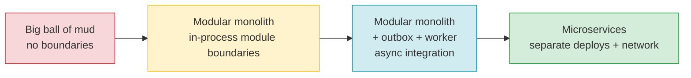
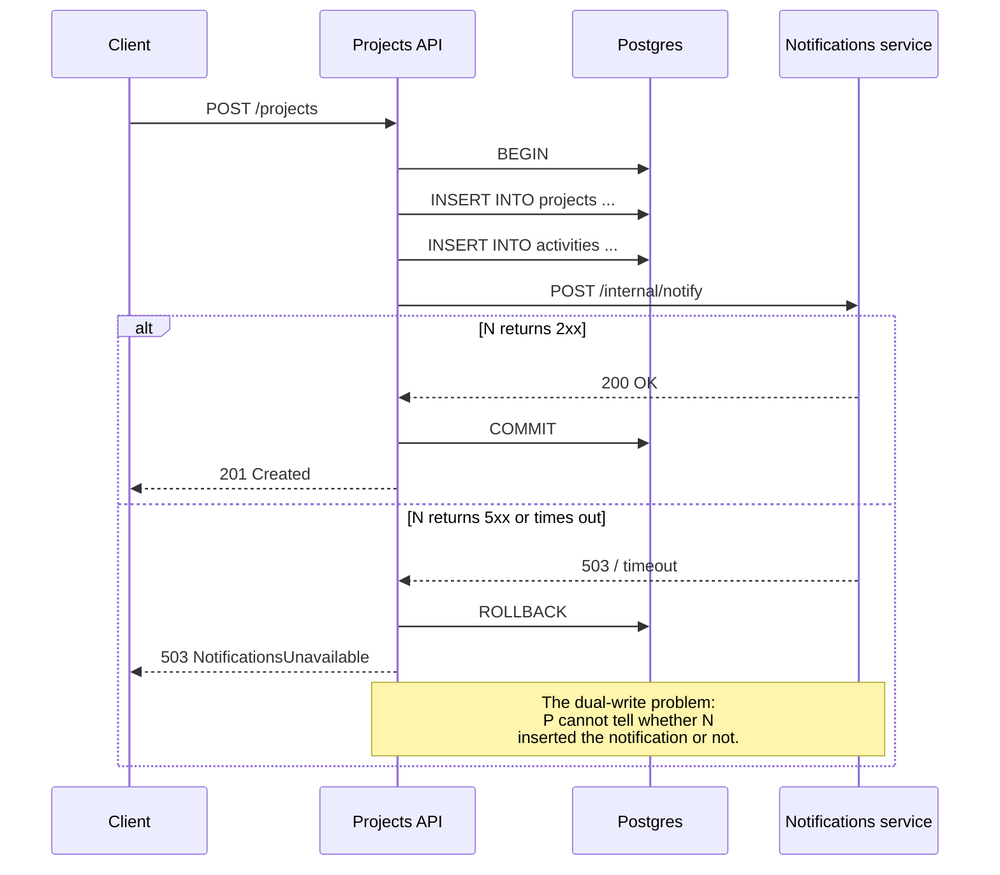
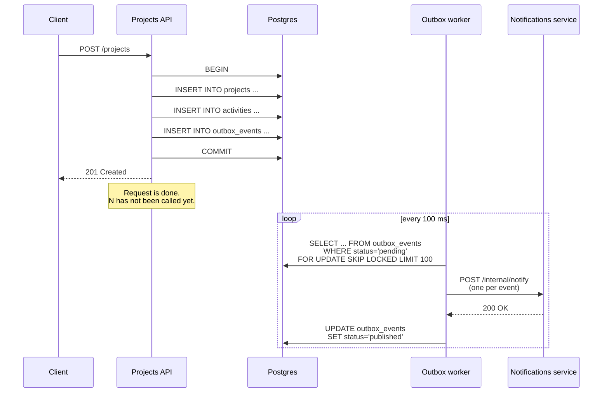

# Lesson 04: Modular Monolith vs Microservices – When to Use What

*The same `Boardly` feature — `POST /projects` followed by a notification fan-out to members, the activity feed, and an external webhook — implemented three times: as a module in a monolith with an in-process call, as an extracted service with a synchronous HTTP call, and as an extracted service with a transactional outbox plus a worker. One feature, three architectures, three failure modes.*

**You're at Lesson 4 of Section 17 — the comparison lesson.**

Every senior backend interview eventually asks the same question: "When do you split a monolith into microservices?" The wrong answer is "as soon as you can." The right answer is "after you have built it as a well-factored monolith, and only when a specific module needs a different deploy cadence, a different scaling profile, or a different team." That distinction is the entire lesson. Take your time. Type all three implementations. Read every line of the failure modes. **This is how you learn.**


#architecture #modular-monolith #microservices #comparison

## Learning Objectives

By the end of this lesson you will be able to:

1. **Describe the architecture spectrum** from "big ball of mud" through "modular monolith" and "modular monolith with async integration" to "microservices" — and name the property that distinguishes each step from the next.
2. **Articulate Conway's Law** as an architectural constraint: the team structure shapes the architecture, not the other way around.
3. **Quantify the cost of a network call vs. a function call** — latency, failure modes, observability, transactional integrity — and explain why "just split it into services" is almost always premature.
4. **Implement the same feature three ways** in `Boardly`: as a module-in-a-monolith, as an extracted service with a synchronous HTTP call, and as an extracted service with a transactional outbox and a worker.
5. **Diagnose the dual-write problem** in the synchronous HTTP variant and explain why the outbox variant is the canonical fix.
6. **Reason about distributed transactions** honestly: why two-phase commit is rarely used, why the outbox is the practical replacement, and what "eventual consistency" actually means in this context.
7. **Apply the "extract service" pattern** to a specific module: identify the three signals (different deploy cadence, different scaling profile, different team ownership) that justify extraction.
8. **Recognise the seven classic microservices mistakes** — premature split, synchronous chains, shared database, distributed transactions, one queue for everything, ignoring Conway, distributed monolith.

## Prerequisites

Before starting, you need:

- **The layered architecture lesson** — [[05-Project-Architecture/Layered-FastAPI-Apps]]. You should know what a router/service/repository split is and why we use it. This lesson treats that as the baseline; a "modular monolith" is a layered app where modules *also* have hard boundaries.
- **The service-and-repository lesson** — [[05-Project-Architecture/Service-and-Repository-Patterns]]. The "module" in a modular monolith is a service-plus-repository pair with a stable interface.
- **The transactional outbox lesson** — [[14-Caching-and-Background-Processing/Transactional-Outbox]]. The outbox is the bridge pattern that makes a "modular monolith with async integration" and "microservices with a broker" the *same code* at the producer side. We will reuse it, not re-explain it.
- **The event-driven basics lesson** — [[17-Advanced-Architecture/Event-Driven-Basics]]. The relay process, the consumer idempotency, and the dead-letter queue are all taught there.
- **The migration ordering lesson** — [[16-Deployment-and-DevOps/Migration-Ordering-and-Rollback]]. A module extraction is a schema migration plus a deploy, and it must follow the expand-contract pattern.

**The most common gap: Conway's Law.**

Most architecture primers jump straight to "monolith vs microservices" and skip the social-science preface. Conway's Law — "organizations which design systems are constrained to produce designs which are copies of the communication structures of these organizations" — is the *reason* microservices work for some companies and are a disaster for others. We will return to it three times in this lesson. If you have never read the original 1968 essay, the link is in [[#Sources]]; it is two pages and worth your time.


## The Problem

You shipped `Boardly`. The monolith has routers, services, and repositories. A `POST /projects` request creates a project row, notifies the project's members (in-app notification), updates the activity feed, and fires a webhook to an external integration provider. The codebase is 12,000 lines. The team is four engineers. Deploys are twice a week. Nothing is broken.

The question that comes up at every architecture review is: "should we split this into microservices?" The honest answer is almost always "not yet." But "not yet" is unsatisfying — it does not tell you *when*. This lesson gives you the *when*.

The failure modes at the two extremes are symmetric:

1. **Premature split.** You split the monolith into six services before you have module boundaries, before you have a separate team per service, before you have a deploy pipeline that can ship six services independently. The result is a "distributed monolith" — all the costs of microservices (network failure modes, distributed transactions, cross-service schema evolution) and none of the benefits (independent deploys, independent scaling, team autonomy). You deploy six services in lockstep. You are paying for a service mesh to do what one process could do.
2. **Premature unification.** You refuse to split a monolith that has *genuinely different* deploy cadences — say, the API changes weekly but the analytics pipeline changes once a quarter and the AI assistant changes daily. The team ships the analytics pipeline's release on the API's cadence, holding back features for weeks. Or you have six teams trying to ship through one monolith's CI pipeline, blocking each other on every PR.

The architecture decision is not "monolith or microservices." It is "where on the spectrum are we, and where do we need to be?" The spectrum has four named points, each with a distinct property:

| Stage | Property | What you have |
|-------|----------|---------------|
| Big ball of mud | No boundaries | One process, every layer touches every layer |
| Modular monolith | In-process module boundaries | One process, modules call each other through stable interfaces |
| Modular monolith with async integration | Outbox + worker | One logical service, separate worker process for fan-out |
| Microservices | Separate deploys + network calls | Multiple processes, multiple deploy pipelines, broker between them |

This lesson walks each step on the spectrum by implementing the same `Boardly` feature all four ways. (We will treat "big ball of mud" as the failure mode to *avoid* — its implementation is what happens when you skip the other three.)

**Note — Historical context — the microservices hype cycle and the correction**

Microservices as a term was popularised around 2014 (the term predates this; the *hype* dates from then). Between 2014 and 2019, the default answer to "should we split this?" was "yes." Several high-profile adopters (Segment, Invision, Amazon itself in some internal reports) walked back from microservices to monoliths in the 2019–2024 window, citing the operational cost of distributed systems and the failure mode of distributed monoliths. The 2024–2026 consensus, reflected in the engineering blog posts of companies like GitHub, Shopify, and Basecamp, is closer to: "start as a modular monolith, extract services only when a module has a different team, deploy cadence, or scaling profile." The biggest public reversal was Segment's 2019 essay "Goodbye Microservices," which described their 200+ service distributed monolith and the year-long migration back to a single deployable. The lesson you are reading reflects the 2026 consensus, not the 2014 hype.


## The Code

Here is the same `Boardly` feature — `POST /projects` followed by notification fan-out — implemented three times. Read it through once; we will go line by line afterwards. The three implementations share the same `projects` table and the same `POST /projects` API surface. What differs is *how* the fan-out happens.

### Variant A: Module in a monolith (in-process call)

```python
# boardly/projects_service.py (Variant A — modular monolith)
"""Project creation with in-process fan-out.

The projects module owns its own table and its own service.
The notifications module, the activity feed, and the webhook
adapter are separate modules in the same process. Fan-out
is a set of in-process function calls inside one transaction.
"""
from sqlalchemy.ext.asyncio import AsyncSession

from boardly.activities.service import record_activity
from boardly.integrations.webhooks import fire_webhook
from boardly.models import Project
from boardly.notifications.service import notify_members


async def create_project(
    session: AsyncSession,
    *,
    owner_id: str,
    name: str,
    member_ids: list[str],
) -> Project:
    """Create the project row and fan out notifications in one transaction.

    All four side effects (project row, member notifications, activity feed,
    webhook) commit atomically. If any one fails, the project is not created.
    """
    project = Project(owner_id=owner_id, name=name)
    session.add(project)
    await session.flush()  # populate project.id without committing

    # In-process calls: same transaction, same process, same Python frame.
    await notify_members(session, project_id=project.id, member_ids=member_ids)
    await record_activity(session, actor_id=owner_id, verb="created",
                          target_id=project.id)
    await fire_webhook(session, event="project.created",
                       payload={"project_id": str(project.id), "name": name})

    await session.commit()
    return project
```

### Variant B: Extracted service with a synchronous HTTP call

```python
# boardly/projects_service.py (Variant B — extracted notifications service)
"""Project creation with a synchronous HTTP call to a notifications service.

The notifications module is now its own process. The projects service
calls it over HTTP. The dual-write problem appears: if the HTTP call
fails, we have to decide whether to roll back the project row.
"""
import httpx
from sqlalchemy.ext.asyncio import AsyncSession

from boardly.activities.service import record_activity
from boardly.config import settings
from boardly.integrations.webhooks import fire_webhook
from boardly.models import Project


async def create_project(
    session: AsyncSession,
    *,
    owner_id: str,
    name: str,
    member_ids: list[str],
    http_client: httpx.AsyncClient,
) -> Project:
    project = Project(owner_id=owner_id, name=name)
    session.add(project)
    await session.flush()

    # In-process: same transaction.
    await record_activity(session, actor_id=owner_id, verb="created",
                          target_id=project.id)
    await fire_webhook(session, event="project.created",
                       payload={"project_id": str(project.id), "name": name})

    # Cross-process: a synchronous HTTP call to the notifications service.
    # This is the dual-write problem.
    resp = await http_client.post(
        f"{settings.notifications_url}/internal/notify",
        json={"project_id": str(project.id), "member_ids": member_ids},
        timeout=5.0,
    )
    if resp.status_code >= 500:
        # Notifications service is down. We must decide: commit the project
        # anyway (notifications lost) or roll back (project not created).
        # Neither answer is good. Both are correct in different contexts.
        raise NotificationsUnavailable(
            f"notifications returned {resp.status_code}; rolling back project")

    await session.commit()
    return project


class NotificationsUnavailable(Exception):
    """Raised when the notifications service returns 5xx; causes rollback."""
```

**Danger — How an attacker thinks: the `notifications_url` is user-controllable if it round-trips through a tenant setting.**

If the projects service reads `settings.notifications_url` from a per-tenant configuration table (a common SaaS pattern: "configure your integration URL"), an attacker who controls a tenant's settings can set `notifications_url = "http://169.254.169.254/latest/meta-data/"` — the projects service dutifully `POST`s the project payload (with `member_ids`, `owner_id`, the works) to the AWS instance-metadata endpoint, leaking internal state to the attacker-controlled response. This is classic SSRF (OWASP API Security Top 10 2023, API10 "Unsafe Consumption of Third-Party APIs"). The defence is layered: (a) `notifications_url` is a deployment-level setting (env var, not a tenant setting); (b) if it must be per-tenant, validate against an allowlist of hostnames (`integrations.example.com`, `hooks.slack.com`) and reject anything else with a 422; (c) run the projects service in a network namespace with no route to `169.254.169.254` or RFC-1918 space — the egress firewall is the last line of defence. The synchronous HTTP call in Variant B is the attack surface the outbox in Variant C does not have (the outbox never makes an outbound call from the request path). See [[11-Authentication-and-Security/OWASP-API-Top-10]] and [[11-Authentication-and-Security/Threat-Model-First]] for the SSRF angle.


### Variant C: Extracted service with a transactional outbox and a worker

```python
# boardly/projects_service.py (Variant C — outbox + worker)
"""Project creation with a transactional outbox.

The notifications service is still its own process. But the projects
service does not call it synchronously. Instead, the projects service
writes a row to the outbox in the same transaction as the project row.
A separate worker process polls the outbox and publishes.
"""
from sqlalchemy.ext.asyncio import AsyncSession

from boardly.activities.service import record_activity
from boardly.integrations.webhooks import fire_webhook
from boardly.models import OutboxEvent, Project


async def create_project(
    session: AsyncSession,
    *,
    owner_id: str,
    name: str,
    member_ids: list[str],
) -> Project:
    project = Project(owner_id=owner_id, name=name)
    session.add(project)
    await session.flush()

    # In-process, same transaction.
    await record_activity(session, actor_id=owner_id, verb="created",
                          target_id=project.id)
    await fire_webhook(session, event="project.created",
                       payload={"project_id": str(project.id), "name": name})

    # Outbox: same transaction. The worker will publish later.
    session.add(OutboxEvent(
        event_type="project.created",
        payload={
            "project_id": str(project.id),
            "owner_id": owner_id,
            "name": name,
            "member_ids": member_ids,
        },
    ))

    await session.commit()
    return project
```

The three variants have the same line count and the same shape. The difference is one line: `await notify_members(...)` vs. `await http_client.post(...)` vs. `session.add(OutboxEvent(...))`. That one line is the whole architecture decision.

## Line-by-Line Deep Dive

This section is the heart of the lesson. Read it twice. Don't skip.

### The spectrum, drawn

Before we walk the code, draw the spectrum we are walking along. The diagram below is the mental model to walk away with — every other piece of this lesson fits onto it.



Each arrow costs something and buys something:

- **A → B** costs *discipline* (you have to enforce module boundaries with code review, lint rules, or `import-linter`). It buys *the ability to extract a module later* — a module with a stable interface can be lifted out as a service with one PR; a module with no boundary cannot.
- **B → C** costs *an outbox table and a worker process*. It buys *the dual-write problem goes away* — the producer no longer cares whether the consumer is up.
- **C → D** costs *a broker, a separate deploy pipeline, and a network call*. It buys *independent deploy cadence* — the notifications team ships on their own schedule, not the projects team's.

**Tip — Where does this lesson place the default `Boardly`?**

`Boardly` as it exists in the rest of the vault is at **stage B** — a modular monolith with one process per deployable. The transactional-outbox lessons in Sections 14 and 17 push it to **stage C** — same logical service, separate worker process for fan-out. **Stage D** (microservices) is what this lesson teaches you to *defer*, not to reach for. The default answer for `Boardly` is: stay at stage C. Move to stage D only when you can name the module, the team, and the deploy-cadence mismatch that justifies the move.


**Why does the team-structure determine the architecture?**

Conway's Law. If one team owns the projects module and the notifications module, splitting them into two services buys nothing — the team still has to coordinate every deploy. The independent-deploy benefit of microservices appears only when *different teams* own the two services. The architecture follows the org chart. Reorganising the codebase without reorganising the team is the single most common cause of distributed-monolith failure.


### Lines 1–25 of Variant A: the modular-monolith module

```python
"""Project creation with in-process fan-out.

The projects module owns its own table and its own service.
The notifications module, the activity feed, and the webhook
adapter are separate modules in the same process. Fan-out
is a set of in-process function calls inside one transaction.
"""
from sqlalchemy.ext.asyncio import AsyncSession

from boardly.activities.service import record_activity
from boardly.integrations.webhooks import fire_webhook
from boardly.models import Project
from boardly.notifications.service import notify_members
```

**What it does:** Declares the module's docstring and pulls in the collaborators — the activity service, the webhook adapter, the `Project` model, and the notifications service.

**Why these imports matter:** Every `from boardly.X import Y` is a *module boundary*. A modular monolith enforces its module boundaries through the import graph: a module may import another module's *public* service interface, but it must not reach into the other module's tables, models, or private helpers. In a real codebase you enforce this with `import-linter` (a lint tool that fails the build if a forbidden import is detected) or with package-level `__all__` declarations.

**Warning — The "modular" in modular monolith is a property of the code, not the deployment.**

A monolith where every router imports every other router's models is *not* a modular monolith — it is a big ball of mud with a misleading name. The "modular" property is the *enforced import boundary* between modules. Without it, the monolith cannot be split later, because every part depends on every other part.


**Example — What `import-linter` enforces, in one rule**

A typical `import-linter` config for `Boardly`:
```ini
[importlinter]
root_packages = boardly

[importlinter:contract:projects-module]
name = Projects module must not import notifications internals
type = forbidden
source_modules = boardly.projects
forbidden_modules = boardly.notifications.repository, boardly.notifications.models
```
This fails the build if the projects module ever reaches into the notifications module's repository or models — it may only import `boardly.notifications.service` (the public interface). The rule is enforced at CI time, not at review time. Review-time enforcement drifts; CI-time enforcement sticks.


### Lines 27–47 of Variant A: the in-process fan-out

```python
async def create_project(
    session: AsyncSession,
    *,
    owner_id: str,
    name: str,
    member_ids: list[str],
) -> Project:
    """Create the project row and fan out notifications in one transaction.

    All four side effects (project row, member notifications, activity feed,
    webhook) commit atomically. If any one fails, the project is not created.
    """
    project = Project(owner_id=owner_id, name=name)
    session.add(project)
    await session.flush()  # populate project.id without committing

    # In-process calls: same transaction, same process, same Python frame.
    await notify_members(session, project_id=project.id, member_ids=member_ids)
    await record_activity(session, actor_id=owner_id, verb="created",
                          target_id=project.id)
    await fire_webhook(session, event="project.created",
                       payload={"project_id": str(project.id), "name": name})

    await session.commit()
    return project
```

**What it does:** Creates the project row, calls three in-process collaborators inside the same transaction, and commits.

**Why this is the cheapest correct implementation:** All four side effects (project, notifications, activity, webhook) are in one transaction. If any one fails, the transaction rolls back and *none* of them happened. There is no dual-write problem. There is no distributed transaction. The "atomicity" guarantee is just `session.commit()` — Postgres does the work, in one process, with one set of row locks.

**What it costs:** Every collaborator must be in the same process. If `notify_members` takes 200 ms (it sends emails), the request takes 200 ms + everything else. If the email service is down, the project is not created. The "synchronous" property is the trade-off — atomicity in exchange for coupling.

**When does a network call cost more than a function call?**

Three ways. (1) Latency: a function call is ~10 ns; a network call to a service in the same datacenter is ~500 μs to 5 ms — 50,000× slower. (2) Failure modes: a function call has exactly two outcomes (returns or raises); a network call has at least six (success, timeout, DNS failure, connection refused, 4xx, 5xx, retry-storm). (3) Transactional integrity: a function call can participate in your database transaction; a network call cannot, by definition — the network call's effect on the remote service's database is a separate transaction. The last one is the cost that turns a one-line code change into an architectural decision.


**Tip — Don't confuse "in-process" with "free."**

Even in Variant A, the four calls are sequential. If each takes 100 ms, the request takes 400 ms. If you can run them in parallel with `asyncio.gather(notify_members(...), record_activity(...), fire_webhook(...))`, the request takes 100 ms — a 4× improvement at zero architectural cost. The first thing to try, when the in-process fan-out is too slow, is `gather`. The last thing to try is splitting into services.


**Production reality: a modular monolith's blast radius is the whole process.**

A memory leak in `boardly.notifications.service` OOM-kills the whole `uvicorn` worker, taking down `projects`, `activities`, and `integrations` with it — one module's bug is every module's outage. The same is true of deploys: one Docker image ships all modules, so a regression in the notifications module's release blocks the projects module's release even though they have nothing in common. The mitigations are the three that define the modular-monolith trade: (1) per-module graceful degradation (`notify_members` catches `SMTPException` and writes a `pending_notifications` row instead of raising, so an email outage does not block project creation); (2) per-module circuit breakers around external collaborators (the in-process call to `fire_webhook` is wrapped so a downstream's outage returns a sentinel, not an exception); (3) feature-flagged module rollout (the notifications module's new version is behind a flag, the projects module is unaffected). The blast radius is the price of the in-process call's atomicity — accept it, or move to stage C with the outbox. See [[03-FastAPI-Core/Application-and-Lifespan]] for the lifespan-scoped healthcheck pattern and [[15-External-Integrations/Circuit-Breakers]] for the in-process breaker pattern.


### Lines 19–33 of Variant B: the synchronous HTTP call

```python
    # Cross-process: a synchronous HTTP call to the notifications service.
    # This is the dual-write problem.
    resp = await http_client.post(
        f"{settings.notifications_url}/internal/notify",
        json={"project_id": str(project.id), "member_ids": member_ids},
        timeout=5.0,
    )
    if resp.status_code >= 500:
        # Notifications service is down. We must decide: commit the project
        # anyway (notifications lost) or roll back (project not created).
        # Neither answer is good. Both are correct in different contexts.
        raise NotificationsUnavailable(
            f"notifications returned {resp.status_code}; rolling back project")

    await session.commit()
    return project
```

**What it does:** Calls the notifications service over HTTP and raises an exception that causes the transaction to roll back if the service returns 5xx.

**Why this is the wrong architecture 90% of the time:** The `if resp.status_code >= 500: raise` line is the dual-write problem made concrete. The projects service has a transaction open with the project row, the activity feed row, and the webhook outbox row all uncommitted. The notifications service has done *something* on its side — maybe it inserted a notification, maybe it crashed before that, maybe it crashed after that but before sending the response back. The projects service has no way to know which.

The four possible states after a 5xx response:

1. Notifications service inserted nothing (crashed before its DB write). Rolling back the project is correct.
2. Notifications service inserted a notification (crashed after its DB write, before the response). Rolling back the project means the notification points at a project that no longer exists. The notification is now garbage.
3. Notifications service inserted the notification, then the network response was lost. Same as 2.
4. Notifications service is *not* down; a transient network blip caused a 5xx-looking response. Rolling back is fine; retrying would have worked too.

You cannot distinguish these states from the projects service. There is no correct answer. This is why the synchronous-cross-service-call pattern is the *failure mode* that the transactional outbox exists to fix.

**Danger — The dual-write problem is not solvable by retries.**

Adding retries to `http_client.post` makes the *latency* better but the *correctness* worse. If the first call inserted a notification and the response was lost, a retry inserts a *second* notification. Now the user has two notifications for one project creation. The fix for duplicates is *consumer-side idempotency* — the notifications service has to deduplicate by `project_id`. Once you have consumer-side idempotency, you have effectively re-derived the outbox pattern, just over HTTP instead of over a broker. Skip the intermediate step. Use the outbox.


**Warning — When this breaks: a synchronous chain exhausts the projects service's connection pool and the cascade looks like a projects-service outage.**

When the notifications service's p99 climbs from 50 ms to 5 s (a stuck DB lock on its side), the projects service's `httpx.AsyncClient` pool fills with in-flight requests waiting on the notifications service. Within seconds, every projects-service worker is blocked on a notifications-service response, and `POST /projects` returns 503 to the client — but the client's dashboard blames the projects service because that is what returned the 503. The diagnosis is to grep the projects service's structured logs for `httpx.TimeoutException` and `pool_overflow` and to check the projects service's `httpx.Limits` metrics for `acquired` saturating at `max`. The fix is the circuit breaker (open after 5 consecutive 5xx/timeout, half-open after 30 s) so the projects service fails fast instead of queueing — see [[15-External-Integrations/Circuit-Breakers]] — combined with a tight per-request timeout (`timeout=2.0`, not the default infinity) — see [[15-External-Integrations/HTTP-Clients-Timeouts-Retries]]. The longer-term fix is Variant C: the outbox decouples the projects service's request path from the notifications service's availability entirely.


### Lines 17–34 of Variant C: the outbox row

```python
    # Outbox: same transaction. The worker will publish later.
    session.add(OutboxEvent(
        event_type="project.created",
        payload={
            "project_id": str(project.id),
            "owner_id": owner_id,
            "name": name,
            "member_ids": member_ids,
        },
    ))

    await session.commit()
    return project
```

**What it does:** Writes a row to the `outbox_events` table in the *same transaction* as the project row, the activity feed row, and the webhook outbox row. The transaction commits atomically. A separate worker process polls the outbox table and publishes the event to the notifications service.

**Why this is the canonical fix for the dual-write problem:** The producer no longer cares whether the consumer is up. The producer writes the outbox row and commits — that's the atomic guarantee. The consumer's availability is decoupled from the producer's transaction. If the notifications service is down when the project is created, the outbox row waits. When the notifications service comes back up, the worker publishes the row and the consumer catches up.

**What you trade away:** The notifications are no longer synchronous. The user who creates the project does not see "members notified" until some time later (typically seconds; minutes at worst). For a notification fan-out, that trade is almost always fine. For a payment, it usually is not — you do not want to tell a user "your payment will be processed eventually" when they are staring at a confirmation screen. The lesson here is: *pick the right primitive for the latency tolerance of the operation*.

**This is the same `OutboxEvent` model from Event-Driven-Basics.**

We are deliberately not re-explaining the outbox row, the relay process, the `FOR UPDATE SKIP LOCKED` poll, or the consumer-side `processed_events` table. Those are in [[17-Advanced-Architecture/Event-Driven-Basics]]. If you skipped that lesson, go back. The outbox is a prerequisite for the "modular monolith with async integration" stage of the spectrum.


**If Variant C is the same code as Variant A plus an outbox row, why is it a different stage on the spectrum?**

Because Variant C has a *separate process* (the worker) that owns the fan-out. The worker can be deployed independently of the API. The API can ship a new version of `create_project` while the worker still runs the old publish logic. That *separate deploy* is the property that distinguishes stage C from stage B. Stage D (microservices) is what you get when you make the same property true *for the producer side* — the projects module and the notifications module are now in separate deployables.


**Warning — When this breaks: a stalled relay looks like the consumer is down, and the team debugs the consumer for a day before checking the producer.**

The symptom: `payment.succeeded` events stopped arriving at the receipt-emailer at 14:32, the broker's consumer-lag metric is climbing, the on-call pages the consumer team. The consumer team's investigation: their service is up, their DB is up, their `processed_events` table has no new rows since 14:32 — but no error in their logs. The actual cause is the relay process on the producer side crashed at 14:31 (an OOM after a deploy that turned on verbose logging), and no one noticed because the relay has no alerts. The outbox table is growing — `SELECT count(*) FROM outbox_events WHERE status='pending'` returns 480,000 rows and climbing. The diagnosis is on the producer side, not the consumer side: `SELECT max(created_at) FROM outbox_events WHERE status='pending'` should be less than 30 s old; if it is hours old, the relay is stalled. The fix is a relay-health alert on that query (a 1-minute-stale `pending` row pages the producer team's on-call) and a relay-liveness probe (`/healthz/relay` returns 200 only if the last poll was less than 5 s ago — see [[02b-Backend-Foundations/Health-Checks-and-Probes]]). See [[13-Performance-and-Observability/Structured-Logging-and-Request-IDs]] for the cross-service trace that would have shown "no messages since 14:32" in one dashboard instead of two.


## Execution Trace

Time to run all three variants. In your terminal:

```bash
# Bring up the dev stack from Section 16 / Lesson 2.
docker compose up -d postgres redis

# Apply migrations.
uv run alembic upgrade head

# Variant A: the modular monolith. Run the app and create a project.
uv run uvicorn boardly.main:app --reload
# In another terminal:
curl -X POST http://localhost:8000/projects \
    -H "Content-Type: application/json" \
    -d '{"name":"alpha","member_ids":["m1","m2"]}'
```

What happens, in order:

1. **The request hits the `POST /projects` route** in `boardly/routers/projects.py`.
2. **The router calls `create_project(session, owner_id=..., name=..., member_ids=...)`** with a fresh `AsyncSession`.
3. **The session opens a Postgres transaction.** All subsequent writes — the project row, the activity row, the notifications rows, the webhook outbox row — go into this one transaction.
4. **`session.add(project); await session.flush()`** runs an `INSERT INTO projects ...` and populates `project.id` from the `RETURNING` clause, without committing.
5. **The three in-process collaborators run**, each issuing its own `INSERT` against the same session — same transaction, same connection.
6. **`await session.commit()`** commits the transaction. All four side effects are now durable.
7. **The router returns `{"id": "...", "name": "alpha"}`** to the client. The client sees the project created; the notifications and the webhook fire happened in the same transaction.

For Variant B, the trace has an extra hop:



For Variant C, the trace has a different extra hop — asynchronous, decoupled, durable:



**You've just traced the same feature through three architectures.**

The client response is identical in all three: `{"id": "...", "name": "alpha"}`, status 201. What differs is the *internal* story — synchronous in-process calls, synchronous cross-process calls, or asynchronous cross-process calls via a durable outbox. The client cannot tell. The operational characteristics are entirely different.


## Common Mistakes

### Mistake 1: Premature split

```python
# WRONG: a four-person team splits a six-month-old monolith into eight services.
```

**Symptom:** Every deploy requires coordinating releases across eight services. Every PR touches three services because the boundaries are wrong. The team spends more time in service-to-service code review than writing features.

**Why:** Microservices' independent-deploy benefit only materialises when *different teams* own the services. One team operating eight services is a distributed monolith — all the costs, none of the benefits.

**Fix:** Collapse back into a modular monolith. Keep the module boundaries (those are good) but ship them as one process. Re-extract a service only when a *different team* will own it.

**Warning — The team-size heuristic.**

A four-engineer team should own one deployable. An eight-engineer team should own one or two. A sixteen-engineer team should own two to four. A team operating more than two to three services is almost certainly operating a distributed monolith.


### Mistake 2: Synchronous chains across services

```python
# WRONG: an API request fans out through four synchronous HTTP calls in sequence.
# router -> projects service -> notifications service -> email service -> SMS gateway
```

**Symptom:** p99 latency of 4 seconds on a "create project" endpoint that used to take 50 ms. The team blames the network. The real cause is the chain.

**Why:** Each synchronous cross-service call adds a network round-trip *and* a failure mode. Four calls in sequence is four round-trips (4 × 5 ms = 20 ms of pure network) and four chances for timeout. The API cannot return until every downstream service has returned.

**Fix:** Two options. (1) Move the fan-out to an outbox + worker (Variant C in this lesson). The API returns immediately; the fan-out happens asynchronously. (2) If the fan-out must be synchronous, call the downstream services in parallel with `asyncio.gather(...)` — the latency becomes `max(downstream_latencies)` instead of `sum(downstream_latencies)`. Option 1 is the right answer when the consumer does not need to see the fan-out's result. Option 2 is the right answer when it does.

### Mistake 3: Shared database across services

```python
# WRONG: the projects service and the notifications service share one Postgres database.
# Both services have models that map to the same tables.
```

**Symptom:** A schema migration in the projects service breaks the notifications service's queries. The two services are coupled at the database layer, even though they were supposed to be independent.

**Why:** The database schema *is* the contract. If two services share a database, they share a schema, which means they share a deploy cadence (any schema change has to ship in lockstep). That is the opposite of the microservices benefit.

**Fix:** Each service owns its own database. They communicate via events or via an API. The schema migration for the projects service cannot break the notifications service because the notifications service has no direct dependency on the projects service's schema. (Yes, this means you have to maintain multiple databases. That is the operational cost of microservices. Pay it, or stay a monolith.)

**Danger — How an attacker thinks: a SQL-injection vulnerability in service A reaches service B's tables because they share one database.**

A shared database means a shared blast radius for injection. The projects service has a parameterised query (`SELECT * FROM projects WHERE owner_id = :owner_id`) but the analytics service has a string-formatted query (`f"SELECT * FROM activities WHERE actor_id = '{user_input}'"`) — the standard SQL-injection pattern from [[06-SQL-Fundamentals/SQL-Injection-and-Parameterized-Queries]]. Because the two services share one Postgres database and one DB role, the analytics service's injection exfiltrates the projects service's `projects` table (which the analytics service was never supposed to read). The defence is database-per-service (each service has its own DB and its own DB role with `GRANT SELECT, INSERT, UPDATE ON activities TO analytics_role` — no access to the `projects` table). In a modular monolith this is harder (the modules share one DB), but you can still enforce it at the role level: each module's repository connects with a different DB role that has `GRANT` only on its own tables. The migration to stage D (microservices) makes this enforcement trivial; the in-house [[08-PostgreSQL/Roles-Permissions-Security]] lesson covers the role design. See [[11-Authentication-and-Security/Threat-Model-First]] for the blast-radius framing.


### Mistake 4: Distributed transactions (a.k.a. two-phase commit)

```python
# WRONG: trying to atomically commit across two databases with a coordinator.
```

**Symptom:** A distributed transaction coordinator that holds locks across both databases for the duration of the transaction. Latency is high. Failures leave both databases in an indeterminate state until manual reconciliation.

**Why:** Distributed transactions (two-phase commit, XA, etc.) are the textbook solution to "I want atomic writes across two databases." They are almost never used in practice because the cost is unacceptable: locks are held across the network, the coordinator is a single point of failure, and the failure mode is "stuck transaction" that requires manual intervention.

**Fix:** Use the outbox pattern. The producer's transaction is atomic against *its own* database. The consumer's transaction is atomic against *its own* database. The two transactions are *not* atomic with respect to each other — but the outbox row ensures that the producer's effect is durable, and the consumer deduplicates. The composition of "at-least-once delivery + idempotent consumer" is what we call "effectively-once." It is the practical replacement for distributed transactions.

### Mistake 5: One queue for everything

```python
# WRONG: every event in the system goes to one Kafka topic named "events".
```

**Symptom:** A consumer that cares about `payment.succeeded` events has to wade through 100,000 `page.viewed` events per second. The consumer falls behind. The broker's retention policy kicks in and the consumer loses messages.

**Why:** Topic design is part of the architecture. A topic is a stream of events that one consumer cares about. Mixing unrelated event types into one topic means every consumer has to filter, every consumer has to scale to the throughput of the noisiest producer, and a poison message in one event type blocks the consumer for the others.

**Fix:** One topic per event type (or per group of related event types that share a consumer). `payment.succeeded` is its own topic. `page.viewed` is its own topic. Consumers subscribe to the topics they care about, at the throughput they need.

### Mistake 6: Ignoring Conway

```
# WRONG: reorganising the codebase without reorganising the team.
```

**Symptom:** A "platform team" of two engineers owns the projects service, the notifications service, the analytics service, and the AI service. Four services, two engineers. Each service has its own deploy pipeline, but the same two engineers run all four deploys.

**Why:** Microservices' independent-deploy benefit assumes the deployers are different people. If the deployers are the same people, the "independent" part is fiction — the team still ships in lockstep because the team *is* a single coordination unit.

**Fix:** Either (a) reorganise the team — split into four teams of three, each owning one service — or (b) consolidate the services into one deployable. Option (a) is right when the team has the headcount and the services are genuinely independent. Option (b) is right when the team is small and the services are coupled. Most companies choose (a) for the wrong reasons (org-chart politics) and end up needing (b) eighteen months later.

### Mistake 7: The distributed monolith

```
# WRONG: split into services, but the services must be deployed in lockstep
# because they share a schema, share a library that breaks across versions,
# or share a CI pipeline.
```

**Symptom:** A "microservices architecture" where every release touches all eight services. The CI pipeline takes 90 minutes because it builds and tests every service on every PR. The deploys are gated by a coordinator because service N requires service N-1 to be on the new version first.

**Why:** The "independent deploy" property requires that the services are *actually* independent. If they share a protobuf package that has to ship in lockstep, they are not independent. If they share a database schema, they are not independent. If they share a CI pipeline that builds all of them, they are not independent.

**Fix:** Either consolidate (collapse the eight services into a modular monolith with eight modules) or genuinely decouple (split the shared library, split the shared database, split the CI pipelines). The half-measure — split the deployables but couple the schema and the CI — is the worst of both worlds.

**Warning — The distributed monolith is more expensive than the monolith.**

A monolith pays one set of costs: the build, the deploy, the schema migration, the CI pipeline. A distributed monolith pays the monolith's costs *plus* the network-failure costs *plus* the distributed-transaction costs — and it gets none of the independent-deploy benefits. It is strictly worse. If you find yourself in a distributed monolith, the right move is almost always to consolidate.


**Production reality: the 90-minute CI pipeline is the symptom, not the disease.**

Eight services × 11 minutes per build = 88 minutes of CI on every PR, and that is before the integration tests run. For a team of four engineers opening 10 PRs a day, that is 880 engineer-minutes of CI per day, of which 770 minutes are spent rebuilding services the PR did not touch. The cost compounds: PRs sit in the queue, deploys are batched (because no one wants to wait for the 88-minute pipeline twice in one afternoon), and the batched deploy's blast radius is larger when something breaks. The disease is the shared CI pipeline that builds every service on every PR; the symptom is the 88-minute wait. The cure is per-service CI (each service has its own workflow triggered by path filters — `paths: services/projects/**` — so a PR touching only `services/projects` runs only the projects CI). Per-service CI is the technical half of the independent-deploy property; the social half is per-service ownership. See [[16-Deployment-and-DevOps/GitHub-Actions-CI]] for the path-filter pattern and [[12-Testing-and-Quality/CI-Pipelines]] for the per-service CI design.


## Engineering Trade-Offs

### Module boundary enforcement: `import-linter` vs. package-level `__all__` vs. nothing

`import-linter` fails the build when a forbidden import is detected. Package-level `__all__` is a Python convention that signals "these are the public symbols" but does not *prevent* anyone from importing private ones. Nothing is just code review.

- **`import-linter`**: enforced at CI time, cannot drift. Costs one config file and one CI step. The right choice for any team larger than one person.
- **Package-level `__all__`**: documentation, not enforcement. Costs nothing to set up. The right choice for a one-person codebase or a small team that trusts itself.
- **Nothing**: relies on code review catching every forbidden import. Drifts within months. The wrong choice for any production codebase.

In `Boardly`, we use `import-linter`. The configuration is in `.importlinter`; the CI step is one line in the workflow file from [[16-Deployment-and-DevOps/GitHub-Actions-CI]].

### Synchronous vs. asynchronous fan-out

Variant A (synchronous, in-process) and Variant C (asynchronous, outbox) are the two ends of this trade-off. The decision is per-side-effect:

- **Notification to a user that they were added to a project**: asynchronous is fine. The user sees the project immediately; the notification arrives seconds later. Use the outbox.
- **Charge to a payment provider**: synchronous is mandatory. The user is staring at the "Confirm" button; they need to know whether the charge succeeded before they close the tab. Use Variant A or, if the payment is its own service, use Variant B with retries and idempotency keys (see [[17-Advanced-Architecture/Idempotency-and-Retries]]).

**Can a single `create_project` call use both?**

Yes, and most real systems do. The payment is synchronous (Variant A or B); the notifications are asynchronous (Variant C). The rule of thumb: synchronous for "the user needs to know the result before they move on"; asynchronous for "the user does not care about the timing." The outbox is the right tool for the asynchronous half; the in-process call (or the HTTP call with idempotency) is the right tool for the synchronous half.


### Extract service now vs. keep as a module

The three signals that justify extraction:

1. **Different deploy cadence.** The projects module ships weekly; the notifications module ships daily (because the AI recommendation model that powers "smart notifications" changes daily). The notifications module's daily deploys are blocked by the projects module's weekly release. Extract.
2. **Different scaling profile.** The projects module handles 10 req/s; the notifications module handles 10,000 req/s (because it serves a fan-out to many members per project). Scaling the projects module to 10,000 req/s wastes resources; keeping them coupled means the notifications module cannot scale independently. Extract.
3. **Different team ownership.** The projects module is owned by the "Core" team; the notifications module is owned by the "Growth" team. The two teams have different roadmaps, different on-call rotations, different release managers. Extract.

If *any* of these is true, extraction is justified. If *none* is true, extraction is premature. The most common error is extracting for "scaling" when the scaling profile is the same — you pay the network cost for no benefit.

**Tip — The "extract on the second pain point" rule.**

The *first* pain point ("the monolith is too big to reason about") is fixed with module boundaries, not services. The *second* pain point ("this module has a different deploy cadence from the rest") is the signal to extract. The first pain is the one everyone hits; the second pain is the one that justifies the cost of services. Skip ahead and you will end up with a distributed monolith.


### Database-per-service vs. shared database

Microservices best practice is "database per service." Each service owns its own schema; services communicate via events or APIs, not by querying each other's tables. The trade-off:

- **Database per service**: each service can evolve its schema independently. A migration in the projects service does not affect the notifications service. The cost is that you cannot `JOIN` across services — to get "project name + notification status" you have to make two API calls or maintain a denormalised read model.
- **Shared database**: services can `JOIN` across each other's tables, which is convenient. The cost is that a schema migration in one service can break the others, and the services are coupled at the schema layer.

In a modular monolith (stage B or C), the database is shared but the *module* boundaries are enforced by `import-linter`. Each module has its own tables, but the tables live in one Postgres database. At stage D (microservices), the database is split — each service owns its own Postgres database (or its own schema in a shared instance, if you accept that compromise).

## Exercises

**Tip — The 20-minute rule**

If you're stuck on an exercise for more than 20 minutes, re-read the relevant section above, then move on and come back. Learning isn't linear.


**Exercise 1 — Draw the spectrum for your current codebase.** Take the production system you work on (or, if you are between jobs, the last one). Place it on the four-stage spectrum. Write a paragraph defending the placement. Identify the *one* module that, if you extracted it, would unlock the most value. Name the team that would own it. If you cannot name the team, you have your answer: do not extract.

**Exercise 2 — Implement Variant B with retries and idempotency.** Take the Variant B code above. Add a retry loop (3 attempts, exponential backoff) and an idempotency key sent as a header. The notifications service deduplicates by idempotency key. Verify, with a test, that two retries (where the first one actually succeeded but the response was lost) do not produce two notifications. This exercise makes the "if you have idempotency you have effectively re-derived the outbox" claim concrete.

**Exercise 3 — Convert a Variant A module to Variant C.** Pick one side effect in your current `Boardly` implementation — say, `record_activity`. Move it behind an outbox: instead of calling `record_activity(session, ...)` in the `create_project` transaction, write an `outbox_events` row with `event_type="activity.recorded"` and the payload. Write a worker that polls the outbox and calls `record_activity`. Verify that the activity feed is eventually consistent. Measure the latency between "project created" and "activity feed updated."

**Exercise 4 — Refactor a "distributed monolith" into a modular monolith.** Find (or imagine) a system where two services share a database and a CI pipeline. Write a one-page proposal to collapse them into one modular monolith with two modules enforced by `import-linter`. Name the cost savings (one deploy, one CI pipeline, no distributed transactions, no network failure modes) and the lost benefits (the independent deploy of the second service). Argue why the consolidation is the right move.

**Exercise 5 — Spot the architecture mistake.** A team of three engineers splits their monolith into six services. They share a Postgres database. They have one CI pipeline that builds all six services. They deploy with a coordinator script that ships the six services in a specific order. Name the mistake(s). (Spoiler: distributed monolith, shared database, lockstep deploy, ignored Conway.)

**Exercise 6 — Verify module boundaries with `import-linter` (Debugging).** Write a `.importlinter` config that defines the `projects-module` contract: `boardly.projects` may import `boardly.notifications.service` (the public interface) but must not import `boardly.notifications.repository` or `boardly.notifications.models` (the internals). Add a temporary forbidden import (`from boardly.notifications.repository import NotificationsRepository`) in `boardly/projects/service.py`. Run `uv run lint-imports` and verify it exits non-zero with the contract-violation message naming the contract and the forbidden module. Remove the forbidden import and re-run; verify it exits 0. Then write a `tests/test_import_linter.py` that subprocess-runs `lint-imports` against a temp fixture with the forbidden import and asserts the exit code. Verify: `uv run lint-imports` exits 0 with the import removed; `uv run lint-imports` exits 1 with the import present; `uv run pytest tests/test_import_linter.py -v -k contract_blocks_forbidden_repository_import` passes.

**Exercise 7 — Measure the cost of a network call vs a function call (Production).** Write a benchmark that times 10,000 in-process calls to a trivial function (`def noop(): pass`) against 10,000 HTTP `GET /noop` calls to a localhost FastAPI endpoint that calls the same function. Use `time.perf_counter_ns()` for nanosecond precision. Verify the 50,000× ratio (in-process ~100 μs total; HTTP ~5 s total). Write the benchmark as `boardly/benchmarks/call_cost.py` and a `tests/test_call_cost_ratio.py` that asserts the HTTP-to-in-process ratio is at least 10,000× (a conservative floor; the real ratio is closer to 50,000×). Verify: `uv run python -c "import asyncio; from boardly.benchmarks.call_cost import run; asyncio.run(run())"` prints `in-process: ~100 us; HTTP: ~5 s; ratio: ~50,000x`; `uv run pytest tests/test_call_cost_ratio.py -v -k http_to_in_process_ratio_at_least_10000x` passes.

**Exercise 8 — Reproduce the dual-write problem with a network partition (Debugging).** Set up Variant B with a mock notifications service. Use `toxiproxy` (or `tc qdisc add dev lo root netem loss 100%`) to introduce a network partition mid-request. Send a `POST /projects` request. Verify the projects service returns 503 `NotificationsUnavailable`. Inspect the database state and confirm one of the four indistinguishable states: depending on the partition's timing, either (a) the notifications service inserted nothing (no notification row), or (b) the notifications service inserted a notification before the response was lost (a notification row exists pointing at a project that was rolled back — the "garbage notification"). Write a `tests/test_dual_write_inconsistency.py` that simulates the partition with `toxiproxy-cli` and asserts the garbage-notification state (state b). Verify: `psql -c "SELECT count(*) FROM projects"` returns 0 (the project was rolled back); `psql -c "SELECT count(*) FROM notifications"` returns 0 (state a) or 1 (state b — the garbage notification); `uv run pytest tests/test_dual_write_inconsistency.py -v -k state_b_inserted_then_response_lost` passes.

**Exercise 9 — Implement the strangler-fig extraction with a feature flag (Production).** Take Variant A. Add three feature flags: `NOTIFICATIONS_VIA_IN_PROCESS` (default, Variant A), `NOTIFICATIONS_VIA_HTTP` (Variant B), `NOTIFICATIONS_VIA_OUTBOX` (Variant C). The `notify_members` call is routed through the selected variant via a `get_notifier(settings)` factory. Verify all three paths produce the same end state (project created, members notified) with the same test suite. Then incrementally roll out: 1% of traffic via `NOTIFICATIONS_VIA_OUTBOX`, monitor for 24h, ramp to 100%. Write a `tests/test_strangler_fig.py` that runs the `create_project` test suite under each flag value and asserts the end state is identical. Verify: `NOTIFICATIONS_VIA_IN_PROCESS=1 uv run pytest tests/test_create_project.py -v` passes; `NOTIFICATIONS_VIA_HTTP=1 uv run pytest tests/test_create_project.py -v` passes; `NOTIFICATIONS_VIA_OUTBOX=1 uv run pytest tests/test_create_project.py -v` passes; `uv run pytest tests/test_strangler_fig.py -v -k all_three_variants_produce_same_end_state` passes.

**Exercise 10 — Audit a codebase for distributed-monolith smells (Debugging).** Write a `scripts/audit_distributed_monolith.py` that takes a repo path and checks three signals: (a) shared CI pipeline (parse `.github/workflows/*.yml` for a single workflow that builds all `services/*`); (b) shared database (parse each service's `settings.py` for `DATABASE_URL` and check if they point to the same DB); (c) lockstep deploy (parse `scripts/deploy.sh` for a sequence of `kubectl apply -f services/X` calls without parallelism). Print a report: `shared CI: yes; shared DB: yes; lockstep deploy: yes; verdict: distributed monolith`. Run against a sample repo (or a fixture under `tests/fixtures/sample-distributed-monolith/`). Write a `tests/test_audit_distributed_monolith.py` that runs the audit against the fixture and asserts all three smells are flagged. Verify: `uv run python scripts/audit_distributed_monolith.py --repo ./tests/fixtures/sample-distributed-monolith` prints the verdict; `uv run pytest tests/test_audit_distributed_monolith.py -v -k flags_all_three_smells` passes.

**Exercise 11 — Conway's Law audit (Production).** Map your team's communication structure: list each team (from the org chart), the deployables they own (from the deploy script), and the deploys per week per deployable (from the deploy log). If one team owns more than 2-3 deployables, flag it as a Conway violation (the team is the coordination unit, not the deployable). Write the audit as a one-page memo with a table: `team | deployables_owned | deploys_per_week | conway_violation`. Implement `scripts/conway_audit.py` that reads `./.teams.yaml` and `./.deployments.json` and prints the table. Write a `tests/test_conway_audit.py` that asserts a team owning more than 3 deployables is flagged. Verify: `uv run python scripts/conway_audit.py --teams-yaml ./.teams.yaml --deployments-json ./.deployments.json` prints the table; `uv run pytest tests/test_conway_audit.py -v -k flags_team_owning_more_than_3_deployables` passes.

## Verification

To verify your understanding, write down the answers to these questions from memory, then check against the lesson:

```text
1. Name the four stages of the architecture spectrum and the property that distinguishes each.

2. State Conway's Law in one sentence.

3. Quantify: how much slower is a network call than an in-process function call?

4. In Variant B (synchronous HTTP call), name the four states the notifications
   service can be in after a 5xx response. Why is there no correct answer?

5. In Variant C (outbox + worker), what is the trade-off compared to Variant A?
   What is the trade-off compared to Variant B?

6. Name the three signals that justify extracting a module as a service.

7. What is a "distributed monolith"? Why is it worse than either a monolith
   or a real microservices architecture?

8. What is `import-linter`? Why is it the right tool to enforce module
   boundaries in a modular monolith?
```

Expected answer shape (do not check until you have written your own):

```
1. Big ball of mud (no boundaries) -> modular monolith (in-process module
   boundaries) -> modular monolith + outbox + worker (async integration)
   -> microservices (separate deploys + network calls).

2. "Organizations which design systems are constrained to produce designs
   which are copies of the communication structures of these organizations."

3. A function call is ~10 ns; a same-datacenter network call is ~500 μs to
   5 ms — 50,000x slower.

4. (a) inserted nothing; (b) inserted then crashed before response;
   (c) inserted then network response lost; (d) transient blip. No correct
   answer because P cannot distinguish (a) from (b).

5. vs A: latency goes from "synchronous" to "eventual." vs B: dual-write
   problem disappears, but the consumer is now async.

6. Different deploy cadence, different scaling profile, different team ownership.

7. A distributed monolith is multiple services deployed in lockstep. It is
   worse than a monolith because it has the network costs and distributed-
   transaction costs without the independent-deploy benefits.

8. A lint tool that fails the build when a forbidden import is detected.
   Right because CI-time enforcement cannot drift, unlike review-time
   enforcement.
```

## Previously Learned Here

These concepts were taught in earlier lessons. We link back instead of re-explaining:

- **Transactional outbox** — [[14-Caching-and-Background-Processing/Transactional-Outbox]]. The new detail is the spectrum placement: the outbox is the bridge pattern that turns a modular monolith into a "modular monolith with async integration" (stage B to stage C) and that turns a microservices producer into a reliable publisher (stage D). The outbox code is the same in all three placements.
- **Event-driven basics** — [[17-Advanced-Architecture/Event-Driven-Basics]]. The new detail is that the consumer idempotency and the DLQ pattern from that lesson are *prerequisites* for splitting a monolith along event lines — without consumer idempotency, every redelivery is a duplicate; without a DLQ, a poison message blocks the consumer forever.
- **Layered FastAPI apps** — [[05-Project-Architecture/Layered-FastAPI-Apps]]. The new detail is that a "module" in a modular monolith is a layered sub-app: its own routers, services, repositories, models. The module is the unit of extraction.
- **Service-and-repository patterns** — [[05-Project-Architecture/Service-and-Repository-Patterns]]. The new detail is that the service interface is the contract across the module boundary; the repository is private to the module.
- **Migration ordering** — [[16-Deployment-and-DevOps/Migration-Ordering-and-Rollback]]. The new detail is that an extraction is a schema migration (move the table to a new database) plus a deploy (run the new service). Both must follow the expand-contract pattern.

## What's Next

The portfolio projects in [[18-Portfolio-Projects/00-Projects-MOC]] exercise the spectrum:

- [[18-Portfolio-Projects/01-ForgeTrack-Manufacturing-Operations]] is a modular monolith (stage B) — one process, one database, strict module boundaries between orgs, jobs, inventory, and audit.
- [[18-Portfolio-Projects/02-Multi-Tenant-Billing-SaaS]] is a "modular monolith with async integration" (stage C) — the billing API writes the outbox, a separate worker process publishes to Stripe and to internal consumers.
- [[18-Portfolio-Projects/06-RealTime-Collaboration-Notifications]] is at stage C — the comment API writes the outbox, the SSE worker reads it and fans out to live connections.
- [[18-Portfolio-Projects/07-AI-Augmented-Support-Backend]] is at stage C — the ticket-message API writes the message row + an `embedding.generate` outbox event in one transaction; a separate arq worker reads the outbox, calls the embedding API, and writes the pgvector row. Same pattern as Project 02 and Project 06, applied to AI primitives (embeddings, not notifications or billing).

No project in the vault is at stage D (microservices). That is deliberate. The vault's position is that *stage D is what you graduate to*, not what you start with. The portfolio projects defend stages B and C; the move to stage D is the next step after the portfolio is shipped.

If you want to deepen this lesson specifically, read the canonical sources below (Brandur's outbox posts, Fowler's monolith-first essay, Newman's microservices book) and Segment's "Goodbye Microservices" post-mortem.

### Forward references (taught later, but visible from here)

These concepts show up in this lesson's reading — but they are formally taught in other sections. Skim now for shape; the canonical lessons will re-teach them:

- **Idempotency (advanced angle)** — [[17-Advanced-Architecture/Idempotency-and-Retries]]. The retry-and-idempotency pattern for the synchronous HTTP call (Variant B) is the same pattern, just across a network boundary instead of within a database transaction.
- **Multi-tenancy** — [[17-Advanced-Architecture/Multi-Tenancy]]. The tenant boundary is the most natural first module boundary in a SaaS — if your monolith has a "tenant-scoped" module and a "platform-wide" module, that's the easiest first extraction.
- **Circuit breakers** — [[15-External-Integrations/Circuit-Breakers]]. The synchronous HTTP call in Variant B should be wrapped in a circuit breaker; otherwise, a downstream outage cascades into the projects service.

## Sources

- **Conway, M. E. — "How Do Committees Invent?" (1968)** — <http://www.melconway.com/research/committees.html> — accessed 2026-10-19 — the original essay behind Conway's Law. Two pages; the punchline is in the second-to-last paragraph.
- **Martin Fowler — "MonolithFirst"** — <https://martinfowler.com/bliki/MonolithFirst.html> — accessed 2026-10-19 — the canonical argument for starting with a monolith and extracting services only when the pain is specific. This lesson's "extract on the second pain point" rule is Fowler's, slightly tightened.
- **Sam Newman — "Building Microservices" (2nd ed., 2020)** — O'Reilly — accessed 2026-10-19 — the book-length treatment of the spectrum and the operational cost of services. Chapters 1 (what and why) and 10 (from monolith to microservices) are the most directly relevant.
- **Brandur — "Transactionally Outbox" pattern posts** — <https://brandur.org/request-coalescing> and follow-ups — accessed 2026-10-19 — the canonical producer pattern for stage C and stage D. Same code in both stages; the difference is whether the relay publishes in-process or to an external broker.
- **Segment — "Goodbye Microservices" (2019)** — <https://segment.com/blog/goodbye-microservices/> — accessed 2026-10-19 — the public post-mortem of a distributed monolith and the migration back to a single deployable. Worth reading before any microservices adoption.
- **Strangler Fig pattern (Fowler)** — <https://martinfowler.com/bliki/StranglerFigApplication.html> — accessed 2026-10-19 — the canonical pattern for *gradually* extracting a service from a monolith without a big-bang migration.
- **Pat Helland — "Life beyond Distributed Transactions"** — <https://www.ics.uci.edu/~cs223/papers/cidr07p15.pdf> — accessed 2026-10-19 — the canonical argument for why distributed transactions are the wrong abstraction, and why idempotent receivers are the right one.
- **import-linter** — <https://import-linter.readthedocs.io/> — accessed 2026-10-19 — the tool we recommend for enforcing module boundaries in a modular monolith at CI time.
- See [[21-Reference-Library/Source-Register]] for the full source list with dates accessed.

## What We Learned

Let's recap. In this lesson you:

- **Named the four-stage spectrum** — big ball of mud, modular monolith, modular monolith with async integration, microservices — and the property that distinguishes each step from the next.
- **Articulated Conway's Law** as an architectural constraint: the team structure shapes the architecture. Reorganising the code without reorganising the team is the most common cause of distributed-monolith failure.
- **Quantified the cost of a network call vs. a function call** — 50,000× slower, with six failure modes instead of two, and no participation in your database transaction.
- **Implemented the same `Boardly` feature three ways** — as a module in a monolith with an in-process call, as an extracted service with a synchronous HTTP call (and the dual-write problem), and as an extracted service with a transactional outbox and a worker (the canonical fix).
- **Diagnosed the dual-write problem** in Variant B and named the four indistinguishable states the notifications service can be in after a 5xx.
- **Reasoned about distributed transactions honestly** — why two-phase commit is rarely used, why the outbox is the practical replacement, what "eventual consistency" actually means.
- **Applied the extract-service pattern** with three signals — different deploy cadence, different scaling profile, different team ownership. None of those signals means: do not extract.
- **Recognised the seven classic microservices mistakes** — premature split, synchronous chains, shared database, distributed transactions, one queue for everything, ignoring Conway, distributed monolith.

Here's the mental model to walk away with: *the architecture spectrum is not a ladder you climb; it is a set of properties you adopt when they pay for themselves. A modular monolith with an outbox is the right answer for 80% of SaaS backends. Microservices are the right answer when a specific module needs a different deploy cadence or a different team — not before.*

---

> A note from your teacher
You just walked the same feature through three architectures. The lesson is not "Variant A is best" or "Variant C is best" — it is that the three variants are *the same feature* with *different operational characteristics*. The code is almost identical. The one-line difference between `await notify_members(...)` and `session.add(OutboxEvent(...))` is the whole architecture decision. Sit with that. The next time someone tells you "we should split this into services," ask them which module, which team, and which deploy-cadence mismatch. If they cannot answer, you have your answer. See you in the portfolio projects.


---

**Tags:** #architecture #modular-monolith #microservices #comparison #review
**Previous:** [[17-Advanced-Architecture/Event-Driven-Basics]]
**Next:** [[18-Portfolio-Projects/00-Projects-MOC]] →
