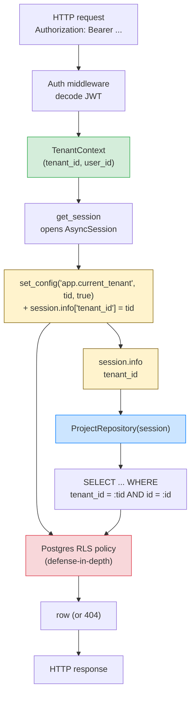

# Lesson 01: Multi-Tenancy – Isolation Models and a Shared-Schema Implementation

*A `TenantMixin` on every `Boardly` model, a `TenantContext` loaded by a FastAPI dependency, a `tenant_session()` that sets `app.current_tenant` via `set_config`, a generic `TenantRepository` that refuses to operate without a tenant and enforces `WHERE tenant_id = ...` on every query, and an RLS policy as defense-in-depth.*

**You're at Lesson 1 of Section 17 — the canonical lesson for Multi-tenancy.**

Multi-tenancy is the first architectural question a SaaS backend answers: how do you keep customer A's data out of customer B's hands when both live in the same application? The answer is a structural property of your schema and your data access layer, not a property you can bolt on later with a `WHERE tenant_id =` clause sprinkled around. Getting it wrong is a security incident. Getting it right is a one-time decision that constrains every query you write for the rest of the project. Take your time. Type every line. **This is how you learn.**


#architecture #multi-tenant #security #sqlalchemy

## Learning Objectives

By the end of this lesson you will be able to:

1. **Compare shared-everything (RLS), shared-schema, and database-per-tenant** on cost, isolation, blast radius, and query complexity.
2. **Justify shared-schema as the default** and identify the cases that demand database-per-tenant or RLS.
3. **Implement a `TenantMixin`** that adds a non-nullable `tenant_id` to every tenant-scoped model and a composite unique constraint that allows the same logical key in two tenants.
4. **Implement a `TenantContext` FastAPI dependency** that extracts the `tenant_id` from the JWT and a `tenant_session()` context manager that sets `app.current_tenant` on the session.
5. **Implement a generic `TenantRepository`** that refuses to operate if the session has no tenant and enforces `WHERE tenant_id = ...` on every `get`/`list`/`add`.
6. **Configure an RLS policy** as a defense-in-depth backstop so a raw `session.execute(text("SELECT * FROM users"))` outside the repository still returns only the current tenant's rows.
7. **Avoid the seven classic multi-tenancy mistakes** — forgetting `tenant_id` on a new model, cross-tenant joins, tenant in URL but not in session, `SELECT *` bypassing the repository, forgetting RLS on a new table, per-tenant DB connection exhaustion, migrating only one tenant's DB.
8. **Add the `tenant_id` column to an existing table** as an expand-contract migration (linking back to [[16-Deployment-and-DevOps/Migration-Ordering-and-Rollback]]).

## Prerequisites

Before starting, you need:

- **The DI lesson** — [[03-FastAPI-Core/Dependency-Injection]]. Tenant resolution is a dependency.
- **The session/transaction lesson** — [[07-SQLAlchemy/05-Session-and-Transaction-Management]]. The session carries the tenant context.
- **The repository pattern lesson** — [[05-Project-Architecture/Service-and-Repository-Patterns]]. The repository is where the `tenant_id` filter is enforced, not the route.
- **The transactions lesson** — [[06-SQL-Fundamentals/Transactions-Isolation-Locks]]. RLS policies are evaluated in the transaction.
- **The expand-contract lesson** — [[16-Deployment-and-DevOps/Migration-Ordering-and-Rollback]]. Adding `tenant_id` to an existing table is an expand-contract change.

## The Problem

Multi-tenancy is the first architectural question a SaaS backend answers: how do you keep customer A's data out of customer B's hands when both live in the same application? The answer is a structural property of your schema and your data access layer, not a property you can bolt on later with a `WHERE tenant_id =` clause sprinkled around.

Three canonical isolation models exist, in increasing order of isolation and cost:

1. **Shared-everything with RLS** — one database, one schema, one row set. Postgres Row-Level Security policies enforce that every query sees only rows where `tenant_id = current_setting('app.current_tenant', true)`. The application does not need to remember to filter; the database refuses to leak.
2. **Shared-schema** — one database, one schema, one row set. The application *must* filter every query by `tenant_id`. The database does not enforce isolation; correctness is the application's responsibility, enforced at the repository layer.
3. **Database-per-tenant** — one database per tenant. Isolation is structural: a connection to tenant A's database cannot read tenant B's rows because they are not in it. The application routes each request to the right database.

Each model trades something:

- **Shared-everything (RLS)** has the lowest operational cost (one DB to back up) and the strongest defense-in-depth (the DB refuses leaks even when the application has a bug). Cost: RLS policies are subtle to write and test, and you must set the session variable on every connection.
- **Shared-schema** has the lowest *infrastructure* cost (one DB) and the highest *application* cost (every query must filter). It is the most common SaaS choice because it scales well to thousands of tenants on a single cluster.
- **Database-per-tenant** has the highest operational cost (N databases, N backup schedules, N migration runs) but the strongest blast-radius isolation: a bad migration only breaks one tenant, and noisy-neighbor problems are structurally impossible. Used for financial, healthcare, and large enterprises where one tenant's load must not degrade another's.

We teach shared-schema as the default because it is the most common, with RLS as a defense-in-depth backstop on top, and database-per-tenant as the alternative for compliance-grade isolation.

**Tip — Think like a senior systems architect: the tenant boundary is the load-bearing wall of the SaaS.**

Don't think of `tenant_id` as "a column we filter on." Think of it as the **load-bearing wall** of the entire system — the structural element that determines the physical blast-radius, the compliance posture, and the operational procedure your SaaS will live with for the next five years. The senior architect's question is never "how do I add `WHERE tenant_id = ?` to this query?" — that question is the failure mode. The right questions, asked *before* a single row is written, are: (1) If a developer on a Tuesday morning forgets the filter on a brand-new route, what fails loudly enough that they catch it before merge? (the `TenantRepository.__init__` refusal — a loud `RuntimeError`, not a silent leak); (2) If a developer writes a raw `session.execute(text("SELECT * FROM users"))` outside the repository, what stops the leak? (RLS — the DB refuses, not the application); (3) If a tenant goes bankrupt and demands we delete their data, can we do it without touching another tenant's rows? (`ondelete="RESTRICT"` plus an archive workflow, not `CASCADE`, because the cascade's blast radius is the whole schema); (4) If a regulator walks in and asks "where is tenant X's data physically stored?", can you answer in one sentence? (shared-schema: "in this cluster, partitioned by `tenant_id`"; database-per-tenant: "in tenant X's dedicated database on cluster Y"). The architectural decision — shared-schema vs. database-per-tenant vs. RLS-primary — is a one-way door. You will not "migrate later" without downtime, so the senior architect asks the four questions above *before* committing to a row layout.


## The Code

Here is the complete shared-schema implementation for `Boardly`. Read it through once; we will go line by line afterwards.

### The model layer

```python
# boardly/db/base.py
import uuid
from datetime import datetime
from sqlalchemy import DateTime, ForeignKey, func, String, UniqueConstraint, UUID
from sqlalchemy.orm import DeclarativeBase, Mapped, mapped_column


class Base(DeclarativeBase):
 pass


class TenantMixin:
 """Every tenant-scoped table inherits this. Forgetting it is the bug."""
 tenant_id: Mapped[uuid.UUID] = mapped_column(
 UUID(as_uuid=True),
 ForeignKey("tenants.id", ondelete="RESTRICT"),
 nullable=False,
 index=True,
 )


class TimestampMixin:
 created_at: Mapped[datetime] = mapped_column(
 DateTime(timezone=True), server_default=func.now(), nullable=False
 )
 updated_at: Mapped[datetime] = mapped_column(
 DateTime(timezone=True), server_default=func.now(), onupdate=func.now(), nullable=False
 )
```

```python
# boardly/models.py
import uuid
from sqlalchemy import String, UniqueConstraint, UUID
from sqlalchemy.orm import Mapped, mapped_column

from boardly.db.base import Base, TenantMixin, TimestampMixin


class Tenant(Base):
 __tablename__ = "tenants"
 id: Mapped[uuid.UUID] = mapped_column(
 UUID(as_uuid=True), primary_key=True, default=uuid.uuid4
 )
 name: Mapped[str] = mapped_column(String(200), nullable=False)


class User(TenantMixin, TimestampMixin, Base):
 __tablename__ = "users"
 id: Mapped[uuid.UUID] = mapped_column(
 UUID(as_uuid=True), primary_key=True, default=uuid.uuid4
 )
 email: Mapped[str] = mapped_column(String(320), nullable=False)
 # Composite unique constraint scoping to tenant — same email may exist in two tenants.
 __table_args__ = (
 UniqueConstraint("tenant_id", "email", name="uq_users_tenant_email"),
 )


class Project(TenantMixin, TimestampMixin, Base):
 __tablename__ = "projects"
 id: Mapped[uuid.UUID] = mapped_column(
 UUID(as_uuid=True), primary_key=True, default=uuid.uuid4
 )
 name: Mapped[str] = mapped_column(String(300), nullable=False)
 owner_id: Mapped[uuid.UUID] = mapped_column(
 UUID(as_uuid=True), ForeignKey("users.id"), nullable=False
 )
```

### The tenant context

```python
# boardly/tenancy.py
import uuid
from dataclasses import dataclass
from typing import Annotated

from fastapi import Depends, Header, HTTPException

from boardly.auth import decode_jwt # implementation in Section 11


@dataclass(frozen=True)
class TenantContext:
 tenant_id: uuid.UUID
 user_id: uuid.UUID | None = None


async def get_tenant_context(
 authorization: Annotated[str, Header()],
) -> TenantContext:
 if not authorization.startswith("Bearer "):
 raise HTTPException(401, "missing bearer token")
 claims = decode_jwt(authorization.removeprefix("Bearer "))
 if "tenant_id" not in claims:
 raise HTTPException(401, "token missing tenant_id claim")
 return TenantContext(
 tenant_id=uuid.UUID(claims["tenant_id"]),
 user_id=uuid.UUID(claims["sub"]) if "sub" in claims else None,
 )


TenantDep = Annotated[TenantContext, Depends(get_tenant_context)]
```

### The session factory that carries the tenant

```python
# boardly/db/session.py
from contextlib import asynccontextmanager

from sqlalchemy import create_async_engine, text
from sqlalchemy.ext.asyncio import AsyncSession, async_sessionmaker

from boardly.config import settings
from boardly.db.base import Base # noqa: F401 — ensures mappers are loaded
from boardly.tenancy import TenantContext

engine = create_async_engine(settings.database_url, pool_size=10, max_overflow=20)
SessionLocal = async_sessionmaker(engine, expire_on_commit=False)


@asynccontextmanager
async def tenant_session(ctx: TenantContext) -> AsyncSession:
 """Yields a session that has the tenant_id set as a session variable
 AND that the repository layer can read to scope queries."""
 async with SessionLocal() as session:
 # Set the session variable for RLS policies (defense-in-depth).
 # `true` means transaction-local — the setting is reset when the
 # transaction ends, so a returned connection does not leak the tenant.
 await session.execute(
 text("SELECT set_config('app.current_tenant', :tid, true)"),
 {"tid": str(ctx.tenant_id)},
 )
 # Also stash it on the session.info for repository use.
 session.info["tenant_id"] = ctx.tenant_id
 yield session


# FastAPI dependency wiring
async def get_session(ctx: TenantDep) -> AsyncSession:
 async with tenant_session(ctx) as session:
 yield session


SessionDep = Annotated[AsyncSession, Depends(get_session)]
```

### The base repository enforcing the tenant filter

```python
# boardly/repositories/base.py
import uuid
from typing import Generic, Sequence, TypeVar

from sqlalchemy import select
from sqlalchemy.ext.asyncio import AsyncSession

T = TypeVar("T")


class TenantRepository(Generic[T]):
 """Base class for every repository over a tenant-scoped model.

 Subclasses set `model` and get CRUD methods that always filter by
 the session's tenant_id. There is no way to forget the filter.
 """
 model: type[T]

 def __init__(self, session: AsyncSession) -> None:
 self.session = session
 # The repository refuses to operate if the session has no tenant set.
 if "tenant_id" not in session.info:
 raise RuntimeError("Session has no tenant_id; cannot use TenantRepository")
 self._tenant_id: uuid.UUID = session.info["tenant_id"]

 @property
 def tenant_id(self) -> uuid.UUID:
 return self._tenant_id

 async def get(self, id: uuid.UUID) -> T | None:
 stmt = select(self.model).where(
 self.model.tenant_id == self._tenant_id,
 self.model.id == id,
 )
 result = await self.session.execute(stmt)
 return result.scalar_one_or_none()

 async def list(self, limit: int = 50, offset: int = 0) -> Sequence[T]:
 stmt = (
 select(self.model)
 .where(self.model.tenant_id == self._tenant_id)
 .limit(limit)
 .offset(offset)
 )
 result = await self.session.execute(stmt)
 return result.scalars().all()

 async def add(self, instance: T) -> None:
 # Enforce tenant_id at write time so a caller cannot inject one.
 instance.tenant_id = self._tenant_id # type: ignore[attr-defined]
 self.session.add(instance)
```

### A concrete repository + route

```python
# boardly/repositories/projects.py
from boardly.models import Project
from boardly.repositories.base import TenantRepository


class ProjectRepository(TenantRepository[Project]):
 model = Project
```

```python
# boardly/api/projects.py
import uuid
from typing import Annotated
from fastapi import APIRouter, HTTPException

from boardly.deps import SessionDep
from boardly.models import Project
from boardly.repositories.projects import ProjectRepository
from boardly.schemas import ProjectCreate, ProjectRead

router = APIRouter(prefix="/projects", tags=["projects"])


@router.get("/{project_id}", response_model=ProjectRead)
async def get_project(project_id: uuid.UUID, session: SessionDep) -> ProjectRead:
 repo = ProjectRepository(session)
 project = await repo.get(project_id)
 if project is None:
 raise HTTPException(404)
 return ProjectRead.model_validate(project)


@router.post("", response_model=ProjectRead, status_code=201)
async def create_project(
 payload: ProjectCreate,
 session: SessionDep,
) -> ProjectRead:
 repo = ProjectRepository(session)
 project = Project(name=payload.name, owner_id=payload.owner_id)
 await repo.add(project) # tenant_id set by repo, not by caller
 await session.commit()
 await session.refresh(project)
 return ProjectRead.model_validate(project)
```

### The RLS backstop (one migration, applied once)

```python
# alembic migration — 0009_enable_rls
"""enable RLS on every tenant-scoped table

Revision ID: 0009_enable_rls
Revises: 0008_previous
"""
from alembic import op

revision = "0009_enable_rls"
down_revision = "0008_previous"


def upgrade() -> None:
 # The tenants table itself is exempt: it must be readable for auth.
 # (Actually, the tenants table can also have RLS — the policy would be
 # "the row where id = current_setting('app.current_tenant', true)".)
 # Every tenant-scoped table.
 for table in ("users", "projects", "comments"):
 op.execute(f"ALTER TABLE {table} ENABLE ROW LEVEL SECURITY;")
 op.execute(f"ALTER TABLE {table} FORCE ROW LEVEL SECURITY;")
 op.execute(f"""
 CREATE POLICY tenant_isolation ON {table}
 USING (tenant_id = current_setting('app.current_tenant', true)::uuid);
 """)


def downgrade() -> None:
 for table in ("users", "projects", "comments"):
 op.execute(f"DROP POLICY IF EXISTS tenant_isolation ON {table};")
 op.execute(f"ALTER TABLE {table} NO FORCE ROW LEVEL SECURITY;")
 op.execute(f"ALTER TABLE {table} DISABLE ROW LEVEL SECURITY;")
```

## Line-by-Line Deep Dive

### `boardly/db/base.py`: The `TenantMixin`

#### Lines 12–18: The `TenantMixin`

```python
class TenantMixin:
 """Every tenant-scoped table inherits this. Forgetting it is the bug."""
 tenant_id: Mapped[uuid.UUID] = mapped_column(
 UUID(as_uuid=True),
 ForeignKey("tenants.id", ondelete="RESTRICT"),
 nullable=False,
 index=True,
 )
```

**What it does:** Declares a mixin class that, when inherited by a `Base` subclass, adds a `tenant_id` column.

**Why each option:**

- `UUID(as_uuid=True)` — the column type is Postgres `UUID`. `as_uuid=True` tells SQLAlchemy to bind/unbind as Python `uuid.UUID` objects, not as strings. Smaller storage (16 bytes vs. 36-char string), faster comparisons, and the format is enforced at the DB level.
- `ForeignKey("tenants.id", ondelete="RESTRICT")` — the `tenant_id` references the `tenants` table. `ondelete="RESTRICT"` means you cannot delete a `Tenant` row while any tenant-scoped row references it. (The alternative is `CASCADE`, which would delete every row of every tenant-scoped table when the tenant is deleted — usually too dangerous. We use `RESTRICT` and require an explicit "archive this tenant" workflow.)
- `nullable=False` — every row in a tenant-scoped table must have a tenant. The repository enforces this at write time (it sets `tenant_id` from the session, not from the caller), and the DB enforces it as a last-resort constraint.
- `index=True` — the `tenant_id` column gets its own index. Every query that filters by tenant (which is almost every query) can use this index. In practice, every primary-key index becomes a composite `(tenant_id, id)` index — but having the standalone `tenant_id` index is useful for `list()` queries that filter by tenant only.

**Why a mixin instead of adding `tenant_id` to every model manually?**

The single most common multi-tenancy bug is *forgetting `tenant_id` on a new model*. If you write a new `Comment` model and forget `tenant_id`, the model compiles, the migration runs, but the `TenantRepository` will fail at write time (`instance.tenant_id = self._tenant_id` raises `AttributeError` because the column does not exist). The mixin eliminates the bug at the source: every tenant-scoped model inherits `TenantMixin`, which guarantees the column exists. The CI check (see Exercises) scans `Base.metadata.tables` for any table without a `tenant_id` column.


#### Lines 20–25: The `TimestampMixin`

```python
class TimestampMixin:
 created_at: Mapped[datetime] = mapped_column(
 DateTime(timezone=True), server_default=func.now(), nullable=False
 )
 updated_at: Mapped[datetime] = mapped_column(
 DateTime(timezone=True), server_default=func.now(), onupdate=func.now(), nullable=False
 )
```

**What it does:** Adds `created_at` and `updated_at` columns. Unrelated to multi-tenancy; included because every model uses both mixins.

**Why `server_default=func.now()` and not `default=datetime.utcnow`:**

- `server_default=func.now()` is a *server-side* default — Postgres sets the value with `now()` when the row is inserted. This is the right default for any write that goes through SQLAlchemy, because it ensures the value is set even on raw SQL inserts (e.g. from a backfill job).
- `default=datetime.utcnow` is a *client-side* default — SQLAlchemy sets the value when it constructs the ORM object. Wrong if the row is inserted via raw SQL or by another client.

### `boardly/models.py`: The composite unique constraint

```python
class User(TenantMixin, TimestampMixin, Base):
 __tablename__ = "users"
 id: Mapped[uuid.UUID] = mapped_column(UUID(as_uuid=True), primary_key=True, default=uuid.uuid4)
 email: Mapped[str] = mapped_column(String(320), nullable=False)
 __table_args__ = (
 UniqueConstraint("tenant_id", "email", name="uq_users_tenant_email"),
 )
```

**What it does:** Adds a composite unique constraint on `(tenant_id, email)`. The same email can exist in two different tenants, but not twice in the same tenant.

**Why composite:**

- A plain `UNIQUE (email)` would mean an email can exist in only one tenant — wrong for a SaaS where the same person might be a user of two tenants.
- The composite `(tenant_id, email)` means "within one tenant, email is unique". The same email can exist in tenant A and tenant B.

**Tip — The composite-FK pattern.**

For relationships between tenant-scoped tables (e.g. `projects.owner_id -> users.id`), the *plain* FK `owner_id -> users.id` lets a project in tenant A reference a user in tenant B — a cross-tenant leak. The fix is the *composite* FK `(tenant_id, owner_id) -> users(tenant_id, id)`, which makes the DB refuse the cross-tenant reference. The cost is more index space; the benefit is structural correctness. We do not implement composite FKs in this lesson's code for brevity, but the Exercise at the end walks through it.


### `boardly/tenancy.py`: The `TenantContext` dependency

#### Lines 14–17: The dataclass

```python
@dataclass(frozen=True)
class TenantContext:
 tenant_id: uuid.UUID
 user_id: uuid.UUID | None = None
```

**What it does:** Declares a frozen dataclass that carries the `tenant_id` and (optionally) the `user_id`.

**Why `frozen=True`:**

- A frozen dataclass is immutable. Once constructed, its fields cannot be changed. This prevents a route handler from accidentally mutating the tenant context mid-request (e.g. setting `ctx.tenant_id = some_other_tenant` to "read another tenant's data"). The repository's `tenant_id` is read from the context once, at construction time, and is the same value for the whole request.
- Frozen dataclasses are also hashable, which lets them be used as dict keys if needed (e.g. for a per-tenant cache).

**Why a dataclass instead of a Pydantic model:**

- A dataclass is lighter weight than a Pydantic model. For an internal context object that does not need validation (the JWT was already validated by `decode_jwt`), a dataclass is the right tool.
- Pydantic models are for *external* data (request bodies, response models, settings). Dataclasses are for *internal* data (context objects, value objects).

#### Lines 20–33: The `get_tenant_context` dependency

```python
async def get_tenant_context(
 authorization: Annotated[str, Header()],
) -> TenantContext:
 if not authorization.startswith("Bearer "):
 raise HTTPException(401, "missing bearer token")
 claims = decode_jwt(authorization.removeprefix("Bearer "))
 if "tenant_id" not in claims:
 raise HTTPException(401, "token missing tenant_id claim")
 return TenantContext(
 tenant_id=uuid.UUID(claims["tenant_id"]),
 user_id=uuid.UUID(claims["sub"]) if "sub" in claims else None,
 )


TenantDep = Annotated[TenantContext, Depends(get_tenant_context)]
```

**What it does:** Declares a FastAPI dependency that:

1. Reads the `Authorization` header.
2. Strips the `Bearer ` prefix.
3. Decodes the JWT (the `decode_jwt` function is in Section 11).
4. Checks that the `tenant_id` claim is present.
5. Constructs and returns a `TenantContext`.

**Why a dependency instead of inline code in every route:**

- The dependency runs once per request, before the route handler. The route handler can assume `ctx.tenant_id` is set; it does not need to re-parse the JWT or check the claim.
- The `TenantDep = Annotated[TenantContext, Depends(get_tenant_context)]` alias means route handlers just declare `ctx: TenantDep` and FastAPI wires it up. Two lines saved per route, and the dependency is the *only* place where the JWT is parsed.
- The dependency is the *only* place where `tenant_id` is derived. The URL does not carry it (see Mistake 3 below). A route handler that tried to read `tenant_id` from the URL path would have to bypass the dependency — which we forbid.

**Danger — Do not trust `tenant_id` from the URL.**

A common multi-tenancy anti-pattern is to put `tenant_id` in the URL: `/tenants/{tenant_id}/projects`. If the auth layer does not verify that the URL's `tenant_id` matches the token's `tenant_id`, an attacker can read another tenant's data by simply changing the URL.

The fix: derive `tenant_id` from the token only. The URL does not carry it. The dependency is the only source of truth. If you must put `tenant_id` in the URL (e.g. for a public API that does not use Bearer tokens), the route must verify that the URL's `tenant_id` matches the authenticated user's `tenant_id` — and even then, derive the authoritative `tenant_id` from the token, not the URL.


### `boardly/db/session.py`: The `tenant_session` context manager

#### Lines 21–36: The `tenant_session`

```python
@asynccontextmanager
async def tenant_session(ctx: TenantContext) -> AsyncSession:
 async with SessionLocal() as session:
 await session.execute(
 text("SELECT set_config('app.current_tenant', :tid, true)"),
 {"tid": str(ctx.tenant_id)},
 )
 session.info["tenant_id"] = ctx.tenant_id
 yield session
```

**What it does:** Opens an `AsyncSession`, sets the Postgres session variable `app.current_tenant` to the request's tenant_id, stashes the tenant_id on `session.info` for the repository to read, and yields the session.

**Why two places to store the tenant:**

- **`set_config('app.current_tenant', :tid, true)`** — sets the Postgres GUC (Grand Unified Configuration) variable `app.current_tenant` for the *current transaction*. The `true` argument means "transaction-local" — the setting is reset when the transaction commits or rolls back. This is what RLS policies read.
- **`session.info["tenant_id"] = ctx.tenant_id`** — `session.info` is a Python-side dict on the SQLAlchemy session that lives for the session's lifetime. This is what the `TenantRepository` reads.
- The two stores are belt and braces: RLS does not read `session.info`; the repository's WHERE clause does not read the GUC. If you only set the GUC, the repository has no tenant to filter by; if you only set `session.info`, RLS has no tenant to filter by. Both are needed for the defense-in-depth.

**Why `set_config(..., true)` (transaction-local) instead of `SET LOCAL`:**

- `SET LOCAL app.current_tenant = '...'` is the SQL syntax; `set_config('app.current_tenant', '...', true)` is the function-call syntax. They are equivalent.
- The `true` (transaction-local) is critical: when the session returns to the pool, the GUC is reset, so the next request that picks up the same connection does not inherit the previous tenant. Without transaction-local, the GUC persists for the connection's lifetime, and a returned connection leaks the tenant.

**Belt and braces: why two stores for the tenant?**

- **RLS** is the DB-side enforcement. It catches bugs where the application's WHERE clause is missing `tenant_id`. But RLS only fires if you set the GUC.
- **`session.info`** is the app-side enforcement. The `TenantRepository` reads it to construct the WHERE clause. Without it, the repository would have no tenant to filter by.
- Both stores are set in `tenant_session`. The application is the primary enforcement (the repository); RLS is the secondary. The combination is defense-in-depth: even if a developer writes a raw `session.execute(text("SELECT * FROM users"))` outside the repository, RLS still returns only the current tenant's rows.


**What happens inside Postgres when `set_config('app.current_tenant', :tid, true)` runs.**

The driver sends a single `SELECT set_config(...)` statement over the connection. Postgres's executor parses it, resolves `set_config` to the C function `set_config_by_name` (declared in `src/backend/utils/config/guc.c`), and validates that `app.current_tenant` is a *custom* GUC — a setting in a dotted namespace, which is the convention for arbitrary user-defined configuration parameters (any name with a dot is treated as custom; the `app.` prefix is the documented convention for application-defined settings). The third argument `true` is `is_local` — when true, Postgres pushes the new value onto a *transaction-local* GUC stack instead of replacing the session-level value. The stack is a linked list of `(name, value, is_local)` records; on transaction commit or rollback, `AtEOXact_GUC` walks the stack and pops every record marked `is_local=true`, restoring the prior value (or unsetting it if there was none). This is why a returned connection does not leak the tenant: the pool returns the connection *after* the transaction commits, and the commit-time pop restores the GUC to its pre-transaction value (typically unset / `NULL`). RLS policies are evaluated by `ExecCheckRowSecurity` (in `src/backend/executor/execMain.c`), which calls `current_setting('app.current_tenant')` — itself a C function that walks the GUC stack top-down and returns the first (innermost) value found. If no value is set anywhere on the stack, the policy's `current_setting('app.current_tenant', true)::uuid` evaluates to `NULL::uuid`, and rows where `tenant_id = NULL::uuid` are filtered out — which (because `tenant_id` is `NOT NULL`) means *zero rows*, not every row. The senior engineer who knows this can reason about: "what happens if a developer forgets to call `set_config`?" (the policy evaluates `tenant_id = NULL::uuid`, returns zero rows — the leak is prevented *and* the bug is visible as "empty result" rather than as a silent data leak); "what happens if the session is reused mid-transaction?" (the GUC stack is per-transaction, not per-session, so reuse is safe — but a subtransaction rollback pops only the inner stack frame, the outer value is visible again, which is what you want for nested savepoints in a complex handler).


### `boardly/repositories/base.py`: The generic `TenantRepository`

#### Lines 17–26: The constructor

```python
class TenantRepository(Generic[T]):
 model: type[T]

 def __init__(self, session: AsyncSession) -> None:
 self.session = session
 if "tenant_id" not in session.info:
 raise RuntimeError("Session has no tenant_id; cannot use TenantRepository")
 self._tenant_id: uuid.UUID = session.info["tenant_id"]
```

**What it does:** Constructs the repository. Reads `tenant_id` from `session.info`. Refuses to operate if the session has no tenant.

**Why the refusal:**

- A developer who writes a new route and forgets to use `tenant_session` (e.g. they use a raw `SessionLocal()` directly) will end up with a session that has no `tenant_id` in `session.info`. The repository's `__init__` raises `RuntimeError` immediately — at route construction, not at first query.
- This is the "fail loudly" principle: a misconfigured session that would silently leak data instead crashes loudly. The crash is the bug report.

**Tip — Maintainability thinking: the repository is the *only* place tenancy lives.**

The senior engineer's rule for multi-tenancy is: the *only* string in the codebase that mentions `tenant_id` outside `boardly/repositories/` should be the `TenantMixin` declaration. Every route handler, every service function, every background job reads and writes tenant-scoped data through a `TenantRepository` subclass — the `WHERE tenant_id = ?` clause appears exactly once in the codebase, in `boardly/repositories/base.py`. This is not about DRY as an aesthetic — it is about the next engineer. When a new developer joins and writes a route, they do not need to know that `tenant_id` exists; the repository's `__init__` refuses to operate without it, so they get a loud `RuntimeError` at first call, fix it by using the `SessionDep` dependency, and never have to learn the rule by reading docs. The architectural payoff is in the bug rate: the team that sprinkles `WHERE tenant_id = ?` across 200 routes ships a cross-tenant leak every quarter; the team that centralises it in one base class ships one every five years (and the leak is in the one raw-SQL admin endpoint that someone wrote to bypass the repository — caught by RLS, the backstop). Names matter too: `TenantRepository.get` is a *verb* that means "get this entity for the current tenant, full stop" — there is no `get_all_tenants` method, because the class refuses the question. The most important line of code is the line you *don't* write: a single base class spares the codebase 200 `WHERE` clauses that would each be a maintenance burden and a security-review surface.


**Why `Generic[T]` and `model: type[T]`:**

- The repository is generic over the model type `T`. Subclasses set `model = Project` (or `User`, or `Comment`).
- The `model` attribute is what the `get`/`list` methods use to construct `select(self.model)`. Without it, the base class would not know which table to query.
- `Generic[T]` is the Python typing mechanism for generic classes. `TenantRepository[Project]` is a specific type; mypy can check that `ProjectRepository.get(id)` returns `Project | None`, not `Any`.

#### Lines 33–40: The `get` method

```python
async def get(self, id: uuid.UUID) -> T | None:
 stmt = select(self.model).where(
 self.model.tenant_id == self._tenant_id,
 self.model.id == id,
 )
 result = await self.session.execute(stmt)
 return result.scalar_one_or_none()
```

**What it does:** Queries for a row by `id` *and* `tenant_id`. Returns the row or `None`.

**Why the double WHERE:**

- `self.model.tenant_id == self._tenant_id` — the tenant filter. This is the load-bearing line; without it, a request from tenant A could read tenant B's data.
- `self.model.id == id` — the row filter. Without it, the query returns every row of every tenant.
- The two together return the row *if it belongs to the current tenant*. A row that exists in another tenant is `None` — which the route handler turns into a `404`.
- Returning `None` (and the route handler turning it into `404`) means the API never distinguishes "this row does not exist" from "this row exists in another tenant". This is correct — leaking the existence of a row in another tenant is itself a security leak.

**Tip — Always return 404 (not 403) for cross-tenant access.**

A `403 Forbidden` tells the attacker "this row exists, but you cannot read it" — which confirms the row exists. A `404 Not Found` tells the attacker "this row does not exist" — which is what they would see if the row genuinely did not exist. The 404 prevents existence-leak. The route handler turns `repo.get(id)` returning `None` into a `404`, regardless of whether the row exists in another tenant.


**Spot the bug — what happens if you put `tenant_id` in the URL path AND in the JWT, and only check the URL's value?**

Answer: an attacker with a valid JWT for tenant A can read tenant B's data by changing the URL from `/tenants/A/projects` to `/tenants/B/projects`. The auth check verifies the URL's `tenant_id` matches the JWT's `tenant_id` — but if the route handler reads the URL's `tenant_id` (not the JWT's) when constructing queries, the attacker wins. The fix: derive `tenant_id` from the token only, never from the URL. The dependency is the only source of truth.


#### Lines 42–49: The `list` method

```python
async def list(self, limit: int = 50, offset: int = 0) -> Sequence[T]:
 stmt = (
 select(self.model)
 .where(self.model.tenant_id == self._tenant_id)
 .limit(limit)
 .offset(offset)
 )
 result = await self.session.execute(stmt)
 return result.scalars().all()
```

**What it does:** Lists rows for the current tenant, with pagination.

**Why the tenant filter is in the WHERE:**

- Without `WHERE tenant_id = ...`, the query would return rows from *every* tenant. That is the leak.
- The tenant filter is in the `WHERE`, not in a `filter()` call on the query, because it is *mandatory* — there is no `list_all_tenants` method. The repository does not expose unfiltered queries.

#### Lines 51–54: The `add` method

```python
async def add(self, instance: T) -> None:
 instance.tenant_id = self._tenant_id
 self.session.add(instance)
```

**What it does:** Sets the `tenant_id` on the instance (overwriting whatever the caller set), then adds it to the session.

**Why overwrite the caller's `tenant_id`:**

- A caller could try to write a row to a different tenant: `Project(tenant_id=other_tenant, ...)`. Without the overwrite, this would succeed — a write-side leak.
- The repository overwrites `instance.tenant_id` with `self._tenant_id`, which is the session's tenant. The caller's value is ignored. The write is to the current tenant, period.

**Danger — Without the overwrite, a malicious caller could inject a `tenant_id` in the request body.**

If `ProjectCreate` Pydantic schema accepted a `tenant_id` field, the caller could set it to any tenant. The repository's overwrite prevents this even if the schema is sloppy. But the right fix is at the schema level: `ProjectCreate` should not have a `tenant_id` field at all — the caller should not be able to specify it. The repository's overwrite is the defense-in-depth backstop.


### `boardly/api/projects.py`: The route

```python
@router.get("/{project_id}", response_model=ProjectRead)
async def get_project(project_id: uuid.UUID, session: SessionDep) -> ProjectRead:
 repo = ProjectRepository(session)
 project = await repo.get(project_id)
 if project is None:
 raise HTTPException(404)
 return ProjectRead.model_validate(project)
```

**What it does:** A `GET /projects/{project_id}` route that uses the `ProjectRepository` to load the project.

**Why this route is short:**

- The route is four lines of meaningful logic. The tenant filter is in the repository, not in the route. The route does not know (or care) that the project is multi-tenant — it just calls the repository, which handles the tenant.
- This is the *architectural payoff* of the repository pattern: the multi-tenancy logic is in *one* place (the `TenantRepository`), not sprinkled across every route. A developer who writes a new route gets the tenant filter for free, because the repository enforces it.
- The `session: SessionDep` is the `Annotated[AsyncSession, Depends(get_session)]` alias from `boardly/db/session.py`. `get_session` calls `tenant_session(ctx)`, which sets the GUC and `session.info`. The route gets a session that is *already* scoped to the current tenant.

### The RLS backstop migration

```python
for table in ("users", "projects", "comments"):
 op.execute(f"ALTER TABLE {table} ENABLE ROW LEVEL SECURITY;")
 op.execute(f"ALTER TABLE {table} FORCE ROW LEVEL SECURITY;")
 op.execute(f"""
 CREATE POLICY tenant_isolation ON {table}
 USING (tenant_id = current_setting('app.current_tenant', true)::uuid);
 """)
```

**What it does:** For each tenant-scoped table, enables RLS, forces it (so even the table owner is subject to the policy), and creates a policy that restricts rows to those where `tenant_id = current_setting('app.current_tenant', true)`.

**Why each clause:**

- `ENABLE ROW LEVEL SECURITY` — turns on RLS for the table. Without this, the policy does nothing.
- `FORCE ROW LEVEL SECURITY` — applies the policy to the table owner too. By default, RLS does not apply to the table owner (a superuser-bypass feature). Forcing it means even the application's DB user (which is often the table owner) is subject to the policy. This is what makes RLS a real defense-in-depth — without `FORCE`, a bug that runs queries as the table owner would bypass the policy.
- `CREATE POLICY tenant_isolation ON {table} USING (...)` — the policy. The `USING` clause is evaluated for each row; rows where the expression is `true` are visible. `current_setting('app.current_tenant', true)::uuid` reads the GUC and casts to UUID.

**RLS policies are evaluated per row.**

When you run `SELECT * FROM users`, Postgres evaluates the `USING` clause for every row. Rows where `tenant_id = current_setting('app.current_tenant', true)::uuid` is `true` are returned; rows where it is `false` (or `NULL`, because the GUC is not set) are filtered out. The filtering is invisible to the query — the query sees only its own tenant's rows, even if it has no `WHERE` clause.


## Execution Trace

A request to `GET /projects/{id}` in a multi-tenant app:

1. **ASGI middleware authenticates the JWT**, extracts `tenant_id` (the actual auth is in Section 11; here we just trust the `Authorization` header).
2. **`get_tenant_context`** runs as a FastAPI dependency. It reads the header, decodes the JWT, checks for the `tenant_id` claim, and constructs a `TenantContext(tenant_id=..., user_id=...)`.
3. **`get_session`** runs as the next dependency (it depends on `TenantDep`). It calls `tenant_session(ctx)`, which opens an `AsyncSession`, runs `set_config('app.current_tenant', tid, true)` (setting the GUC for the transaction), and stashes `tenant_id` on `session.info`.
4. **`ProjectRepository(session)`** is constructed in the route. Its `__init__` reads `session.info["tenant_id"]` (refusing if absent) and stores it as `self._tenant_id`.
5. **`repo.get(id)`** issues `SELECT * FROM projects WHERE tenant_id = :tid AND id = :id`. Postgres evaluates the RLS policy *on top* of the WHERE clause; the policy restricts to rows where `tenant_id = current_setting('app.current_tenant', true)::uuid`, which is the same `tid`. So even if the WHERE clause had a bug (say, forgot `tenant_id`), the policy would still drop cross-tenant rows.
6. **The route** serializes the project. If the project does not exist in the tenant's scope, `repo.get(id)` returns `None`, and the route raises `404` — never `403`, to avoid leaking existence.



**You have multi-tenancy with defense-in-depth.**

The application layer (the `TenantRepository`) is the primary enforcement — every query filters by `tenant_id`. The DB layer (RLS) is the secondary — even if a developer writes a raw `session.execute(text("SELECT * FROM users"))` outside the repository, the policy still returns only the current tenant's rows. A bug in the application cannot leak cross-tenant data, because the DB refuses to return it.


## Common Mistakes

### Mistake 1: Forgetting `tenant_id` on a new model

```python
# WRONG
class Comment(TimestampMixin, Base):
 __tablename__ = "comments"
 id: Mapped[uuid.UUID] = mapped_column(UUID(as_uuid=True), primary_key=True)
 # No TenantMixin!
 body: Mapped[str] = mapped_column(Text)
```

**Symptom:** The `TenantRepository`'s `__init__` raises `RuntimeError("Session has no tenant_id; cannot use TenantRepository")` *at the route handler's first call to `repo.add(comment)`* — actually, the error happens when `instance.tenant_id = self._tenant_id` runs and `tenant_id` does not exist on the model, raising `AttributeError`.

**Fix:** Inherit `TenantMixin`. Add a CI check that scans `Base.metadata.tables` and fails if any table lacks a `tenant_id` column.

### Mistake 2: Cross-tenant joins

```python
# WRONG
stmt = select(Project, Comment).join(Comment, Comment.project_id == Project.id)
```

**Symptom:** A `Comment` from tenant A attaches to a `Project` from tenant B. The join has no `AND Comment.tenant_id = Project.tenant_id` clause, so the DB does not refuse the cross-tenant reference.

**Fix:** Use composite FKs `(tenant_id, project_id) -> projects(tenant_id, id)` so the DB structurally refuses the cross-tenant reference. The join in SQLAlchemy automatically uses the composite FK.

### Mistake 3: Tenant in URL but not in session

```python
# WRONG
@router.get("/tenants/{tenant_id}/projects")
async def list_projects(tenant_id: uuid.UUID, session: SessionDep) -> list[ProjectRead]:
 # Reads tenant_id from the URL. Does not verify it matches the token's tenant_id.
 repo = ProjectRepository(session) # session.info has the TOKEN's tenant_id, not the URL's
 return [ProjectRead.model_validate(p) for p in await repo.list()]
```

**Symptom:** The route returns the projects of the *token's* tenant (because the session was opened with the token's tenant). An attacker changing the URL's `tenant_id` sees no change — but if the route also used the URL's `tenant_id` for some logic (e.g. logging), it would be inconsistent.

**Fix:** Derive `tenant_id` from the token only. The URL does not carry it. The dependency is the only source of truth.

### Mistake 4: `SELECT *` in raw SQL bypassing the repository

```python
# RISKY (but RLS catches it)
async def admin_export(session: AsyncSession) -> list[dict]:
 rows = await session.execute(text("SELECT * FROM users"))
 return [dict(r._mapping) for r in rows]
```

**Symptom:** Without RLS, this returns *every* user of *every* tenant — a leak. With RLS, this returns only the current tenant's users — but the function did not set the GUC, so `current_setting('app.current_tenant', true)` is `NULL`, and the policy filters to rows where `tenant_id = NULL::uuid` — i.e. *no rows* (since `tenant_id` is `NOT NULL`).

**Fix:** Do not bypass the repository without also setting the GUC. Better: use the repository. If you must use raw SQL, run it through `tenant_session` so the GUC is set.

### Mistake 5: Forgetting to set RLS on a new table

**Symptom:** A new table with `tenant_id` but no RLS policy is *world-readable* to anyone with `SELECT` — including via the join path (a query that joins the new table to a tenant-scoped table without filtering on the new table's `tenant_id`).

**Fix:** Lint: a CI check that scans for tables with `tenant_id` but no RLS policy.

### Mistake 6: Per-tenant DB connection exhaustion

**Symptom:** Database-per-tenant with 1000 tenants and a pool of 10 each is 10k connections — Postgres will not thank you.

**Fix:** Use a connection broker (PgBouncer) or shard. Or pick shared-schema (one DB, one pool).

**Scalability thinking: what breaks first as you grow from 10 to 10,000 tenants.**

At 10 tenants on shared-schema, your single Postgres instance has 200 connections and a 10 GB database — you don't think about scaling. At 100 tenants, you start noticing that one tenant's nightly aggregate is making the other 99's p50 latency spike — you add `statement_timeout` per-request and `pg_stat_statements` to find the noisy query. At 1,000 tenants, the `tenant_id` B-tree index on every tenant-scoped table is now bigger than the table's heap (high cardinality on a UUID), `VACUUM` runs longer than the maintenance window, and a connection-pool ceiling of `pool_size=10 × workers=8 × replicas=6 = 480` is approaching Postgres's `max_connections=500` — you deploy PgBouncer in transaction-pooling mode and drop the SQLAlchemy app-side pool to 5. At 10,000 tenants, shared-schema starts to crack: a single bad migration touches every tenant's rows at once, a single corrupted index hurts everyone, and the noisy-neighbor problem is now structural, not tunable. This is where the senior architect calls the question: which tenants are the long tail of small customers (stay on shared-schema) and which are the top-50 enterprise tenants whose workload demands isolation (migrate to database-per-tenant with a per-tenant `pg_advisory_lock`-gated deploy job)? The decision is not "shared-schema or database-per-tenant" — it's "shared-schema now, with a documented threshold above which we partition." That threshold is usually 500–2,000 tenants depending on workload; planning for it at tenant 50 is dramatically cheaper than discovering it at tenant 5,000.


### Mistake 7: Migrating only one tenant's DB

**Symptom:** In database-per-tenant, the deploy job iterates over all tenant DBs. Forgetting one tenant leaves their schema stale and the new code crashes *only for them* — silent until they complain.

**Fix:** The deploy job enumerates tenants from a registry (e.g. a `tenants` table in a control-plane DB) and runs migrations against each. Fail the deploy if any tenant's migration fails. See [[16-Deployment-and-DevOps/Migration-Ordering-and-Rollback]] for the deploy-job pattern.

**Warning — When production breaks: cross-tenant data shows up in customer A's UI.**

It's 2 AM. Customer support reports that tenant A is seeing tenant B's project names in their dashboard. Don't panic. The senior engineer's response, in order: (1) **Stop the bleeding** — if the leak is a single endpoint, disable that route at the edge (the gateway/WAF) before touching code. A user-facing error page is cheaper than another hour of leaked data. (2) **Don't touch the database yet.** Resist the urge to "fix" the bad rows — you do not know which rows are wrong, and ad-hoc `UPDATE`s can make things worse. Take a snapshot first: `pg_dump --table=projects --table=users > /tmp/leak-$(date +%s).sql`. (3) **Reproduce the leak in staging** with two test tenants and the same JWT/path. If you cannot reproduce it, the leak is not deterministic — it's a stale cache, a connection-pool-reuse bug, or a code path you haven't found yet. Reproduce *before* you fix. (4) **Find the missing filter.** The usual cause is a route that constructs its own `select(...)` instead of going through `TenantRepository` — `grep` the codebase for `session.execute(select(` outside `boardly/repositories/`. The RLS backstop should have caught it; if it didn't, RLS is either not enabled on this table or the GUC wasn't set — check `SELECT tablename, rowsecurity FROM pg_tables WHERE schemaname='public'` and look for `rowsecurity = f`. (5) **Roll out the fix in order**: enable RLS on the missing table (one migration), switch the route to use `TenantRepository`, ship. (6) **Notify the affected tenants.** Compliance (GDPR Article 33) likely requires notifying your data protection officer within 72 hours of a personal-data breach. The post-mortem is not for blame — the question is "what system allowed a route to bypass the repository and reach production?" The fix is structural: a CI lint that fails if `session.execute(select(` appears outside `boardly/repositories/`, plus the existing `pytest` check that scans `Base.metadata.tables` for any table lacking a `tenant_id` column.


## Engineering Trade-Offs

- **Shared-schema vs. shared-everything (RLS).** RLS is strictly safer — even an application bug cannot leak. The cost is writing and testing the policies, and the cost of forgetting to enable RLS on a new table is *worse* than forgetting `tenant_id` in a query (you think you are protected; you are not). We recommend: implement shared-schema with repository enforcement AND RLS as backstop, so the application layer is the primary and the DB is the secondary.
- **Shared-schema vs. database-per-tenant.** Shared-schema is right when tenants are similar in size and you can tolerate noisy-neighbor risk. Database-per-tenant is right when one tenant's bad query must not affect another, or when compliance (HIPAA, regional data residency) demands physical separation.
- **`tenant_id` UUID vs. integer.** UUID prevents enumeration; integer is smaller and joins faster. We default to UUID for the security property; the storage and index cost is real but not load-bearing for most SaaS.
- **Composite FKs vs. plain FK.** Composite `(tenant_id, post_id) -> (tenant_id, id)` makes the DB refuse cross-tenant references. Plain FK `post_id -> posts.id` lets a comment reference another tenant's post. The cost of composite FKs is more index space; the benefit is structural correctness.
- **Session variable vs. session.info.** The session variable is what RLS reads. `session.info` is what the repository reads. We use both because RLS does not read `session.info`, and the repository's WHERE clause does not read the session variable. Belt and braces.

### Self-asking Q&A: the five design questions

**Why is shared-schema the default, not RLS?**

Because the failure modes are asymmetric. Forgetting `tenant_id` in a single query is a localized bug — one route leaks for one tenant, and the repository's `__init__` refusal catches most cases at code time. Forgetting to enable RLS on a *new table* is systemic: every query against that table is unprotected, and you think you are protected when you are not. The repository's `WHERE tenant_id = ...` is also easier to lint (a CI check on `Base.metadata.tables` plus a `grep` for `session.execute` outside the repository catches 80% of misses) and easier to fix in code review. We add RLS *on top* as defense-in-depth — not as the primary — because the application-layer enforcement is what catches bugs at code-review time, while RLS catches them at runtime when they have already happened.

**When does database-per-tenant actually pay off?**

When one of three conditions holds. (1) Compliance — HIPAA, regional data residency (e.g., EU customer data must not cross the Atlantic), or contractual clauses requiring physical separation. (2) Noisy-neighbor risk that shared-schema cannot absorb — one tenant running a 30-second aggregate must not block another tenant's 50-ms lookup, and no amount of `statement_timeout` tuning fixes this for a tenant whose workload is genuinely large. (3) Per-tenant schema divergence — some enterprise tenants demand custom columns, custom indexes, or custom enum values that do not belong in the shared schema. The cost is operational: N databases to back up, N migration runs per deploy (with `pg_advisory_lock` per-tenant to prevent races), and a connection-pool ceiling of `tenants × pool_size` that forces PgBouncer or sharding past ~50 tenants. Below that threshold, shared-schema wins on every axis.

**What is the failure mode of forgetting the `tenant_id` filter?**

Three flavors, each worse than the last. (1) The query is in the repository but the developer added a new `select(...)` that bypasses the base filter — without RLS, this returns every tenant's rows (a security incident); with RLS and the GUC set, the DB still filters and the leak is invisible in the response but the query plan is full-scan (slow). (2) Raw SQL outside the repository, with RLS enabled but the GUC not set (e.g., an admin endpoint that didn't call `tenant_session`) — the policy evaluates `tenant_id = NULL::uuid` and returns *zero* rows — silent data loss masquerading as "empty result." (3) Raw SQL outside the repository, RLS not enabled on this table — full leak, every tenant's rows returned. The structural fix is the `TenantRepository.__init__` refusal: a developer who skips the repository has to also skip the GUC, and the failure is loud (an immediate `RuntimeError`) rather than silent.

**Why use both the Postgres GUC and `session.info` for the tenant?**

Because the two stores have two different readers. The GUC (`app.current_tenant`, set via `set_config(..., true)`) is what Postgres RLS policies read — it is the DB-side enforcement. `session.info["tenant_id"]` is a Python-side dict on the SQLAlchemy `AsyncSession` that lives for the session's lifetime — it is what the `TenantRepository` reads to construct its `WHERE` clause. RLS does not read `session.info`; the repository's WHERE clause does not read the GUC. If you only set the GUC, the repository has no tenant to filter by (it raises `RuntimeError`); if you only set `session.info`, RLS has no tenant to filter by (the policy evaluates to `NULL` and either blocks everything or leaks everything depending on `FORCE ROW LEVEL SECURITY`). Belt and braces — and the belt is the application, the braces are the DB.

**How do you test multi-tenant isolation?**

Three layers, each catching different bugs. (1) *Unit* — a pytest fixture that creates two tenants, inserts a project in each, and asserts that `TenantRepository.list()` for tenant A returns only A's project (not B's). This catches a repository whose `WHERE` clause is wrong. (2) *Integration* — the same scenario through the HTTP layer with two JWTs: assert that tenant A's `GET /projects` returns 200 with one project, and that tenant A's `GET /projects/{B_project_id}` returns 404 (not 403 — see the `**Tip —**` callout in the `get` method deep-dive above). This catches a route that bypasses the dependency. (3) *RLS verification* — a `psql` script (or a pytest case using a raw connection that skips the application) that runs `SET app.current_tenant = 'A'; SELECT count(*) FROM projects;` then `SET app.current_tenant = 'B'; SELECT count(*) FROM projects;` and asserts the counts differ. Layer 3 is the only one that catches a *missing RLS policy* that the application layer masks — and that is the bug you most want to find before production.

## Exercises

- **Beginner:** Add a `comments` table that is tenant-scoped and uses a composite FK to `projects(tenant_id, id)`. Write a test that creates two tenants, a project in each, and verifies that tenant A cannot read tenant B's comments.
- **Intermediate:** Add a CI check (a pytest test) that scans `Base.metadata.tables` and fails if any table has a `tenant_id` column but no RLS policy. Use `sqlalchemy.inspect`. Run the check in the GitHub Actions CI from [[16-Deployment-and-DevOps/GitHub-Actions-CI]].
- **Advanced:** Implement database-per-tenant for a single endpoint (`/admin/tenants/:id/export`) that connects to the tenant's own database, runs a query, and returns the result. Use `create_async_engine` with a per-tenant `URL` and a small LRU cache of engines. Document the migration story — how does a deploy run migrations across all tenant DBs? (Hint: link to [[16-Deployment-and-DevOps/Migration-Ordering-and-Rollback]] — the deploy job enumerates tenants from the control-plane DB and runs `alembic upgrade head` against each, with a `pg_advisory_lock` per-tenant to prevent races.)

## Verification

```bash
# Run the multi-tenant test suite
uv run pytest tests/test_tenancy.py -q

# Verify RLS is enabled on every tenant-scoped table
psql -c "SELECT tablename, rowsecurity FROM pg_tables WHERE schemaname='public';"
# Every tenant-scoped table should show rowsecurity = t.

# Manual isolation test
psql -c "SET app.current_tenant = '00000000-0000-0000-0000-000000000001'; SELECT count(*) FROM projects;"
psql -c "SET app.current_tenant = '00000000-0000-0000-0000-000000000002'; SELECT count(*) FROM projects;"
# Expect different counts.

# Verify the repository refuses without a tenant
uv run python -c "
import asyncio
from boardly.db.session import SessionLocal
from boardly.repositories.projects import ProjectRepository

async def main():
 async with SessionLocal() as s:
 try:
 ProjectRepository(s)
 except RuntimeError as e:
 print('OK:', e)
 return
 print('FAIL: should have raised')

asyncio.run(main())
"
```

## Previously Learned Here

- **Dependency injection** — first taught in [[03-FastAPI-Core/Dependency-Injection]]. The new detail is a *frozen dataclass* `TenantContext` returned by a dependency, and its propagation into the session via another dependency.
- **Session/AsyncSession** — first taught in [[07-SQLAlchemy/05-Session-and-Transaction-Management]]. The new detail is `session.info["tenant_id"]` as a side-channel for the repository, and `set_config(..., true)` for transaction-local settings.
- **Repository pattern** — first taught in [[05-Project-Architecture/Service-and-Repository-Patterns]]. The new detail is a *generic* base repository that mixes in `tenant_id` enforcement so subclasses cannot forget.
- **Transactions** — first taught in [[06-SQL-Fundamentals/Transactions-Isolation-Locks]]. The new detail is that RLS policies are evaluated against the transaction's `current_setting`, so the `SET LOCAL` (or `set_config(..., true)`) must be inside the transaction.

## What's Next

The multi-tenancy layer is the foundation for the next two lessons in Section 17:

- **[[Idempotency-and-Retries]]** — the `IdempotencyRecord` table is itself tenant-scoped; its primary key is `(tenant_id, key)`. The `TenantContext` from this lesson is what the idempotency dependency uses to scope keys.
- **[[Event-Driven-Basics]]** — events carry `tenant_id` in their envelope; consumers partition by tenant for isolation. The transactional outbox writer uses the same `AsyncSession` that the `tenant_session` from this lesson produces.

The multi-tenant schema change story is itself an expand-contract pattern: adding `tenant_id` to an existing table is a five-phase change (add nullable -> backfill -> set NOT NULL -> enforce in code -> add RLS). See [[16-Deployment-and-DevOps/Migration-Ordering-and-Rollback]] for the expand-contract pattern.

The portfolio project [[18-Portfolio-Projects/02-Multi-Tenant-Billing-SaaS]] is the canonical project that exercises this lesson end-to-end.

## Sources

- Microsoft — Multi-tenant SaaS patterns — <https://learn.microsoft.com/azure/architecture/guide/multitenant/considerations/tenancy-models> — pool-vs-bridge-vs-silo models.
- AWS — SaaS architecture — <https://aws.amazon.com/saas/>.
- PostgreSQL — Row Security Policies — <https://www.postgresql.org/docs/current/ddl-rowsecurity.html>.
- PostgreSQL — `set_config` / `current_setting` — <https://www.postgresql.org/docs/current/functions-admin.html>.
- SQLAlchemy — `Session.info` — <https://docs.sqlalchemy.org/en/20/orm/session_api.html>.
- Citus / Microsoft — "Building a multi-tenant SaaS with Postgres" — <https://www.citusdata.com/blog/2017/07/17/efficiently-scaling-multi-tenant-workloads/>.
- See [[21-Reference-Library/Source-Register]] for the full source list with dates accessed.

## What We Learned

- Three isolation models: shared-everything (RLS), shared-schema (tenant_id column), database-per-tenant. Shared-schema with RLS as backstop is the default.
- `TenantMixin` adds a non-nullable `tenant_id` to every tenant-scoped model; forgetting it is the most common bug, so the mixin eliminates it at the source.
- The `TenantContext` is a frozen dataclass returned by a FastAPI dependency; `tenant_id` is derived from the JWT, never from the URL.
- `tenant_session()` sets `app.current_tenant` via `set_config(..., true)` (transaction-local) and stashes `tenant_id` on `session.info`. Both stores are needed: RLS reads the GUC; the repository reads `session.info`.
- The `TenantRepository` refuses to operate without a tenant; its `get`/`list` enforce `WHERE tenant_id = ...`; its `add` overwrites any caller-supplied `tenant_id`.
- A `404` (not `403`) for cross-tenant access prevents existence-leak.
- RLS is the defense-in-depth backstop; `FORCE ROW LEVEL SECURITY` makes it apply even to the table owner.
- Composite FKs `(tenant_id, X_id) -> (tenant_id, id)` make the DB refuse cross-tenant references at the constraint level.

---

**Tags:** #architecture #multi-tenant #security #sqlalchemy #canonical #review
**Previous:** [[17-Advanced-Architecture/00-Advanced-Architecture-MOC]]
**Next:** [[17-Advanced-Architecture/Idempotency-and-Retries]] →
