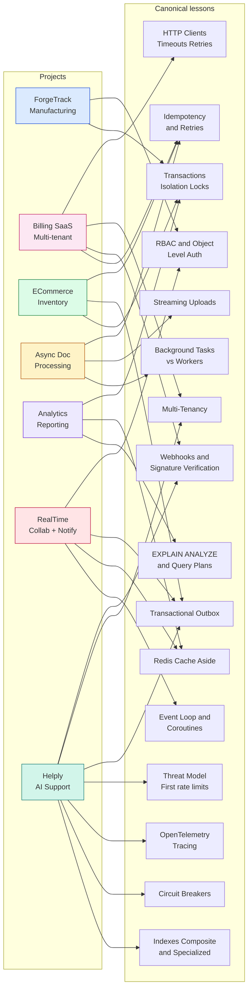
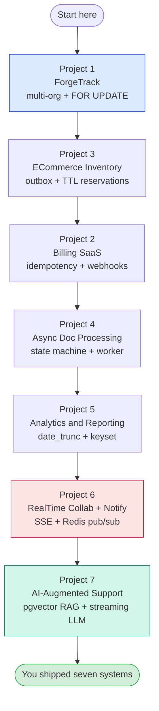

# Portfolio Projects MOC

*The seven systems you build when you stop reading lessons and start shipping them.*

**You finished the lessons. Now build seven things you would actually put on a résumé.**

The seven projects in this folder are deliberately sized like real production systems: multi-table schemas, transactional state machines, security boundaries, observability hooks, and Dockerized dev environments. They are not "todo apps." Each one ships with a runnable starter (models, at least one router, two tests, five Alembic revisions) and a clear `# complete this:` surface where you take over and finish the job.

#portfolio #projects #moc #capstone

---

## Why a portfolio section at all

The academy teaches one concept at a time across Phases 1–11. A single lesson on `SELECT ... FOR UPDATE` shows you the lock; a single lesson on the transactional outbox shows you the dual-write problem. But you do not really *understand* row locks until you have shipped a system where two warehouse workers clicking "issue stock" at the same instant must not over-commit the same bin. You do not really understand the outbox until you have shipped a system where a webhook retry must not double-charge a customer.

Phase 12 of [[00-Start-Here/Complete-Learning-Roadmap]] asks you to assemble those concepts into systems you can defend in an interview and ship to a recruiter. Seven is enough to cover the recurring archetypes of backend engineering — including the 2026 AI-augmented archetype — without forcing you to repeat yourself:

- a **multi-organization line-of-business app** (ForgeTrack — manufacturing operations)
- a **billing and subscription SaaS** (Multi-Tenant Billing)
- an **e-commerce inventory workflow** (ECommerce Inventory)
- an **asynchronous file-processing pipeline** (Async Document Processing)
- a **high-write analytics API** (Analytics and Reporting)
- a **realtime collaboration and notifications system** (RealTime Collaboration)
- an **AI-augmented customer support backend** (Helply — pgvector RAG + streaming LLM + per-tenant cost controls) — the 2026 AI capstone

If you can ship all seven, you will have implemented every concept in [[00-Start-Here/Concept-Registry]] at least twice in different shapes, plus the AI-augmented primitives (pgvector HNSW, RAG, streaming LLM, circuit breaker for LLM providers, OpenTelemetry spans on AI calls) that no earlier project teaches. You will be able to talk about each one in an interview from the angle of *something you have actually built*.

**How these differ from the lessons**

The lessons are *narrow and deep*: one concept, one file, one running trace. The portfolio projects are *wide and integrated*: many concepts at once, a real folder structure, many running traces. Lessons tell you what `with_for_update` does; projects show you the moment in a real workflow where you would be wrong to leave it out.

---

## The seven projects at a glance

| # | Project | Archetype | Hardest concept | Starter LOC | Lesson it links to most |
|---|---------|-----------|-----------------|--------------|--------------------------|
| 1 | [[18-Portfolio-Projects/01-ForgeTrack-Manufacturing-Operations]] | Multi-org ERP | Concurrency-safe inventory (`SELECT ... FOR UPDATE`) | ~900 (full starter) | [[06-SQL-Fundamentals/Transactions-Isolation-Locks]] |
| 2 | [[18-Portfolio-Projects/02-Multi-Tenant-Billing-SaaS]] | Multi-tenant SaaS | Idempotent billing + webhooks + provider adapter | ~450 | [[17-Advanced-Architecture/Idempotency-and-Retries]], [[15-External-Integrations/Webhooks-and-Signature-Verification]] |
| 3 | [[18-Portfolio-Projects/03-ECommerce-Inventory]] | E-commerce | Stock reservations with TTL + transactional outbox | ~400 | [[14-Caching-and-Background-Processing/Transactional-Outbox]] |
| 4 | [[18-Portfolio-Projects/04-Async-Document-Processing]] | Async pipeline | Durable worker retries + state machine + MIME sniffing | ~350 | [[14-Caching-and-Background-Processing/Background-Tasks-vs-Workers]] |
| 5 | [[18-Portfolio-Projects/05-Analytics-Reporting-API]] | Analytics | High-write ingestion + `date_trunc` aggregation + keyset pagination | ~350 | [[08-PostgreSQL/EXPLAIN-ANALYZE-and-Query-Plans]] |
| 6 | [[18-Portfolio-Projects/06-RealTime-Collaboration-Notifications]] | Realtime | SSE + Redis pub/sub + `FOR UPDATE SKIP LOCKED` outbox worker | ~600 | [[10-Async-Python/Event-Loop-and-Coroutines]] |
| 7 | [[18-Portfolio-Projects/07-AI-Augmented-Support-Backend]] | AI-augmented SaaS | pgvector HNSW RAG + streaming LLM + per-tenant cost controls + circuit breaker | ~700 | [[08-PostgreSQL/Indexes-Composite-and-Specialized]], [[15-External-Integrations/Circuit-Breakers]], [[13-Performance-and-Observability/OpenTelemetry-Tracing]] |

**Tip — One-liners**

- **ForgeTrack** — Plants, machines, jobs, work orders, and an inventory bin that two operators must not double-issue.
- **Billing SaaS** — Tenants, plans, usage metering, idempotent subscription creation, and a webhook from a payment provider you do not control.
- **ECommerce Inventory** — Products, variants, carts, orders, stock reservations that expire, and a transactional outbox so the order-confirmation email is never lost.
- **Async Document Processing** — File uploads with size and MIME guards, a state machine for processing status, a worker that retries, and progress tracking.
- **Analytics and Reporting** — Ingest a million events an hour, aggregate by time bucket with `date_trunc`, cache reports, export CSV streams, paginate by keyset.
- **RealTime Collaboration** — Projects, comments, an activity feed, notifications via SSE, Redis pub/sub fan-out, and an outbox worker using `FOR UPDATE SKIP LOCKED`.
- **AI-Augmented Support Backend (Helply)** — Tickets, KB articles, pgvector HNSW RAG retrieval, streaming LLM completions over SSE, an arq worker reading the outbox for embeddings, per-tenant token-bucket rate limits, a circuit breaker on the LLM provider, HMAC-signed CRM webhooks, and OpenTelemetry spans on every AI call.

---

## The concept map across projects

The same canonical lessons show up repeatedly. The diagram below shows the **primary** reuse; every project also touches FastAPI fundamentals, Pydantic, SQLAlchemy, Alembic, and Docker as a baseline. Treat this map as a study guide: if a lesson feels weak after the project, go back to the lesson with the project in mind.

**Note — Why some lessons appear in more than one project**

Concurrency primitives (`SELECT ... FOR UPDATE`, idempotency keys, outbox) appear in three or four projects because they appear in three or four real archetypes. The point of the portfolio is to see the same primitive solving *different* problems. If `FOR UPDATE SKIP LOCKED` shows up in the e-commerce outbox and the realtime outbox and the AI-backend embedding outbox, it is because the same problem (durable, parallel, de-duplicated background work) appears in all three domains.

**Project 07 is the only project that touches AI primitives**

pgvector, HNSW, RAG, streaming LLM completions, per-tenant AI cost controls, the circuit breaker applied to an LLM provider, OpenTelemetry spans on AI calls — none of these appear in Projects 1–6. The 2026 hiring market is dominated by AI-augmented backend features; Project 07 closes that gap. See `21-Reference-Library/Engineering-Decision-Log.md` D-011 for the decision record.

---

## The quality bar (read this before you start)

Every project in this folder is held to the same bar. Before you mark one "done," check all of these.

### 1. It runs from `docker compose up`

A new developer cloning the repo must be able to run `cp .env.example .env && docker compose up --build` and see the app on `http://localhost:8000/docs` with the migrations already applied. No "first run this script, then that one, then install Postgres locally." The compose file owns the whole world.

### 2. It has at least one passing test per primary workflow

ForgeTrack has a test that two concurrent stock-issuing transactions do not over-commit. Billing SaaS has a test that a retried subscription creation does not double-charge. ECommerce has a test that a stock reservation with a TTL is released. We do not ask for 100% coverage; we ask for *the* test that proves the hardest concept works.

### 3. It uses the verified Oct 2026 stack

- FastAPI **0.148.0**, Starlette **1.9.0**, Pydantic **v2.14.1**
- SQLAlchemy **2.1.5** with `Mapped[T]` / `mapped_column()` (no legacy `Query` / `declarative_base`)
- Alembic **1.20.0** with `--sql` review and a reversible migration history
- PostgreSQL **17.x**, Redis **7.x**
- Python **3.12**, `uv 0.13.1` for dependency management

If a project uses something else, it is wrong. Fix it before you ship.

### 4. Every architectural decision is explained in the spec

The spec for each project includes a `## Database Design`, a `## Security Model`, a `## Performance Considerations`, and an `## Error Handling` section. Each one explains *why*, not just *what*. If a decision seems mysterious, it belongs in an Obsidian callout — usually `**Note**` for context, `**Warning —**` for a footgun, `**Q**` for a "you should be able to defend this" prompt.

### 5. The starter code is honest

The starter code in each project actually runs. If a router is incomplete, it is marked with `# complete this:` comments and a `**Warning —**` block in the spec. We do not ship code that looks finished but silently no-ops.

### 6. The resume bullets are specific and quantified

If the project's "Resume Bullet Examples" section says "Built a FastAPI app," the project is not done. The bullets must say things like "Reduced p99 inventory reservation latency by 40% by introducing a composite index on `(product_id, status, reserved_until)`." Vague bullets are the surest signal of a junior portfolio. Be specific.

**Why is the quality bar this strict?**

Because the bar between a "project on your GitHub" and a "project that gets you an on-site" is exactly this strict. A reviewer who clones your repo, runs `docker compose up`, and sees passing tests with a real Postgres and Redis will keep reading. A reviewer who has to install Postgres locally and figure out your `.env` will close the tab. The quality bar is the hiring funnel.

---

## How to read a project spec

Each project spec follows the 24-section outline in [[23-Templates/Project-Template]]. Read them in this order:

1. **`## Problem Statement`** — the user pain and the business context. Read this first; if it does not interest you, pick a different project.
2. **`## Target Users`** — who uses it; roles, permissions, scale targets.
3. **`## Requirements and Non-Goals`** — what we *will* build and what we *refuse* to build. The non-goals matter; they are how we keep the project scoped.
4. **`## Architecture Diagram`** — the shape at the service level (clients, API, workers, data stores, external integrations).
5. **`## ER Diagram`** — the tables and their relationships. Print this and the Architecture Diagram out and pin them to your monitor before you start coding.
6. **`## Sequence Diagrams`** — the workflow traces for the two or three operations that carry the hardest concurrency/security requirements.
7. **`## API Specification`** — the endpoint table. Skim to know what surface the project exposes.
8. **`## Folder Structure`** — the actual layout, with one-line descriptions. Use this to navigate the source code.
9. **`## Database Design`** — the constraints and the index strategy. Internalize the indexes before you write a query.
10. **`## Security Model`** — auth, authorization layers, secrets, audit.
11. **`## Milestones`** — the ordered completion criteria. Use this as a checklist as you implement.
12. **`## Implementation Chapters`** — wikilinks back to the canonical lessons each milestone depends on. Open these as references; do not deep-read.
13. **`## Complete Source Code`** — the actual starter. Type it in; do not copy-paste.
14. **`## Automated Tests`** — what is covered and how to run them.
15. **`## Docker and Environment`** — `Dockerfile`, `compose.yaml`, `.env.example`.
16. **`## Migration History`** — the ordered Alembic revisions. Apply them in this order; do not let autogenerate reorder them.
17. **`## Error Handling`** — the mapping of domain errors to HTTP responses. Internalize this before you start, because every router depends on it.
18. **`## Performance Considerations`** — the bottlenecks, the indexes, the caches, and what *not* to optimize.
19. **`## Deployment Guide`** — how to ship it to a real platform.
20. **`## README`** — the project README, in a fenced markdown block. This is what a recruiter sees first when they click the GitHub repo.
21. **`## Resume Bullet Examples`** — what to write on your résumé when you are done. Three specific, quantified bullets per project.
22. **`## Interview Discussion Questions`** — five things you should be able to defend in a 45-minute interview.
23. **`## Future Enhancements`** — what to build next if you want to deepen the project.
24. **`## What We Learned`** — the recap. The mental model to walk away with.

**Tip — The "complete this:" markers**

Each starter code file has `# complete this:` comments at the points where we expect you to finish the job. These are not busywork — they are the *interesting* parts of the project, the parts that prove you understood the lesson. The first project (ForgeTrack) is the only one with a full starter; the other six start at a "substantial" level (models, one router, two tests) and leave more for you.

---

## A suggested order through the projects

You do not have to do them in numeric order. But if you want a curriculum inside the curriculum, here is the order that minimizes the "I do not know enough yet" feeling:

Why this order? ForgeTrack teaches you the *core* of transactional correctness in a multi-org app, which is the foundation everything else stands on. ECommerce introduces the outbox, which is the foundation of all durable background work. Billing layers idempotency on top of both. Async Document Processing is the first project where the worker is the *main* character rather than the request. Analytics flips the workload from low-write-high-read to high-write-batch-read. RealTime is the first project with user-facing streams over SSE. Project 07 — the 2026 AI capstone — stacks pgvector RAG + streaming LLM + per-tenant cost controls + circuit breakers + OpenTelemetry on top of everything you learned in the first six, and is the most 2026-resume-relevant of the seven.

**If you have time for only one**

Do **ForgeTrack**. It is the project that most directly answers "show me a system where transactional correctness, multi-tenancy, RBAC, audit, and pagination all show up in the same codebase." It is also the only project with full starter code, so you can run it end-to-end before deciding whether the archetype is the one you want to deepen.

---

## Versions, sources, and trust

- Verified Oct 2026 versions in [[21-Reference-Library/Source-Register]]: FastAPI 0.148.0 (released 2026-10-19), Starlette 1.9.0, Pydantic v2.14.1, SQLAlchemy 2.1.5, Alembic 1.20.0, PostgreSQL 17.x, Redis 7.x, uv 0.13.1, Python 3.12.
- Every code sample uses the modern `Annotated[T, Depends(...)]` form (FastAPI 0.95+), Pydantic v2 idioms (`model_dump`, `ConfigDict`, `Field`, `model_validate`), and SQLAlchemy 2.x typed ORM (`Mapped[T]`, `mapped_column()`, `select()`, `AsyncSession`, `async_sessionmaker`, `with_for_update`). No legacy `Query` or `declarative_base()`.
- No real credentials. Every secret in `.env.example` is a placeholder; every integration adapter is a sandbox stub.

---

## A note on the "Boardly" through-line

The lessons in Sections 03, 07, 08, 11, 13, and 14 all grow the same example app — a small project-management API called **Boardly**. Two of the portfolio projects (Project 5 — Analytics, and Project 6 — RealTime Collaboration) deliberately extend Boardly, so the analytics events and the comment threads feel like *your* app's data, not a toy dataset. Projects 1–4 are standalone domains (manufacturing, billing, e-commerce, document processing) where the Boardly metaphor would be artificial; we let them stand on their own.

If you have not built Boardly yet, that is fine — the two projects that extend it include the small additional schema they need, and you can read the code without having built the lessons. But if you have, you will recognize the table names and the dependency patterns.

---

## What to do right now

1. Pick a project from the table above. Any one is fine; if you cannot pick, pick ForgeTrack.
2. Read its `## Problem Statement` and `## Architecture Diagram` first. Do not read the code yet.
3. Read its `## Requirements and Non-Goals`. If a non-goal disappoints you, that is the right reaction — non-goals are how we keep a project finishable.
4. Clone the starter repo (or type it in from the spec). Run `cp .env.example .env && docker compose up --build`. Confirm the app boots and `/docs` renders.
5. Run the tests. Confirm they pass.
6. Read the `## Implementation Chapters` section. Open the canonical lessons it links to. Skim, do not deep-read — you are using them as references now, not as the curriculum.
7. Pick the first `# complete this:` marker. Implement it. Run the tests you wrote for it. Move on.
8. When every `# complete this:` is done and the tests pass, write the resume bullets. Then write the interview answers in your own words. Then ship the project to a public URL and put it on your résumé.

**That is the whole game.**

Seven projects. Each one defends a different archetype — and the seventh (Project 07, AI-augmented) is the most 2026-resume-relevant of the set. By the end you will not be "a person who has read about FastAPI" — you will be "a person who has shipped seven production-shaped systems in FastAPI, including one with pgvector RAG and streaming LLM completions." That is a different person, and the difference is exactly the one a 2026 hiring manager is looking for.

---

## The projects

- [[18-Portfolio-Projects/01-ForgeTrack-Manufacturing-Operations]] — multi-organization manufacturing operations, with full starter code
- [[18-Portfolio-Projects/02-Multi-Tenant-Billing-SaaS]] — multi-tenant billing, subscriptions, webhooks, sandbox provider adapter
- [[18-Portfolio-Projects/03-ECommerce-Inventory]] — products, variants, stock reservations with TTL, transactional outbox
- [[18-Portfolio-Projects/04-Async-Document-Processing]] — file uploads, MIME sniffing, durable worker retries, state machine
- [[18-Portfolio-Projects/05-Analytics-Reporting-API]] — high-write event ingestion, `date_trunc` aggregations, keyset pagination, CSV export
- [[18-Portfolio-Projects/06-RealTime-Collaboration-Notifications]] — comments, activity feeds, SSE, Redis pub/sub, `FOR UPDATE SKIP LOCKED` outbox
- [[18-Portfolio-Projects/07-AI-Augmented-Support-Backend]] — multi-tenant AI support; pgvector HNSW RAG, streaming LLM over SSE, arq embedding worker, per-tenant token-bucket + monthly budget, circuit breaker on the LLM provider, HMAC-signed CRM webhooks, OpenTelemetry spans on every AI call

**Tags:** #portfolio #moc #capstone
**Next:** [[18-Portfolio-Projects/01-ForgeTrack-Manufacturing-Operations]] (start here) or pick from the table above.
