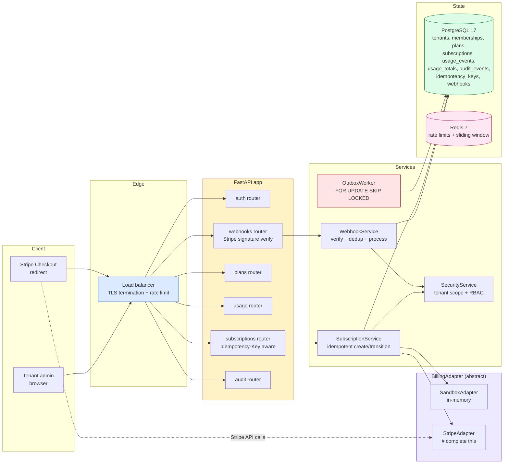
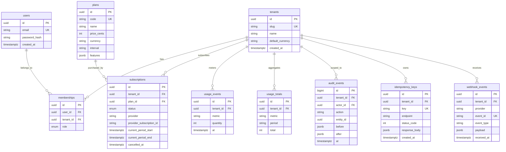
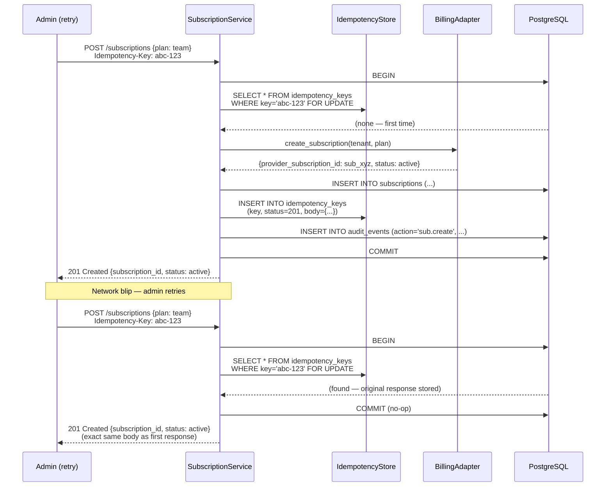
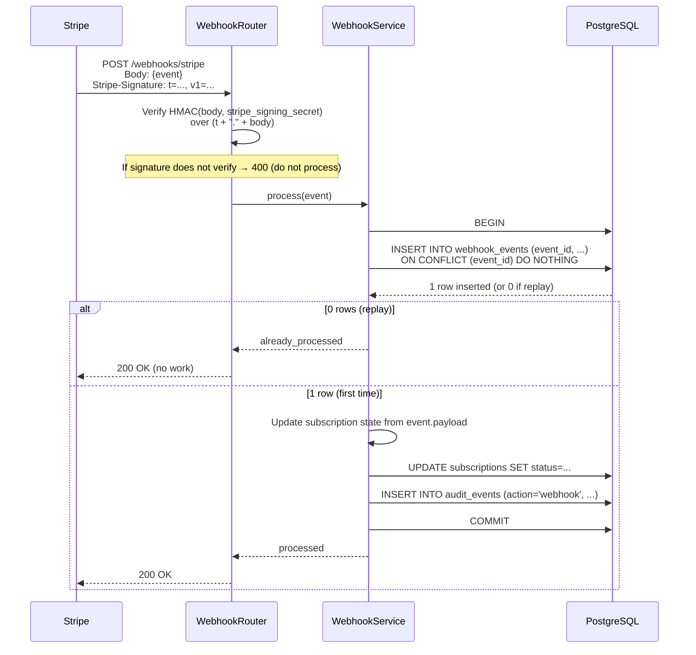
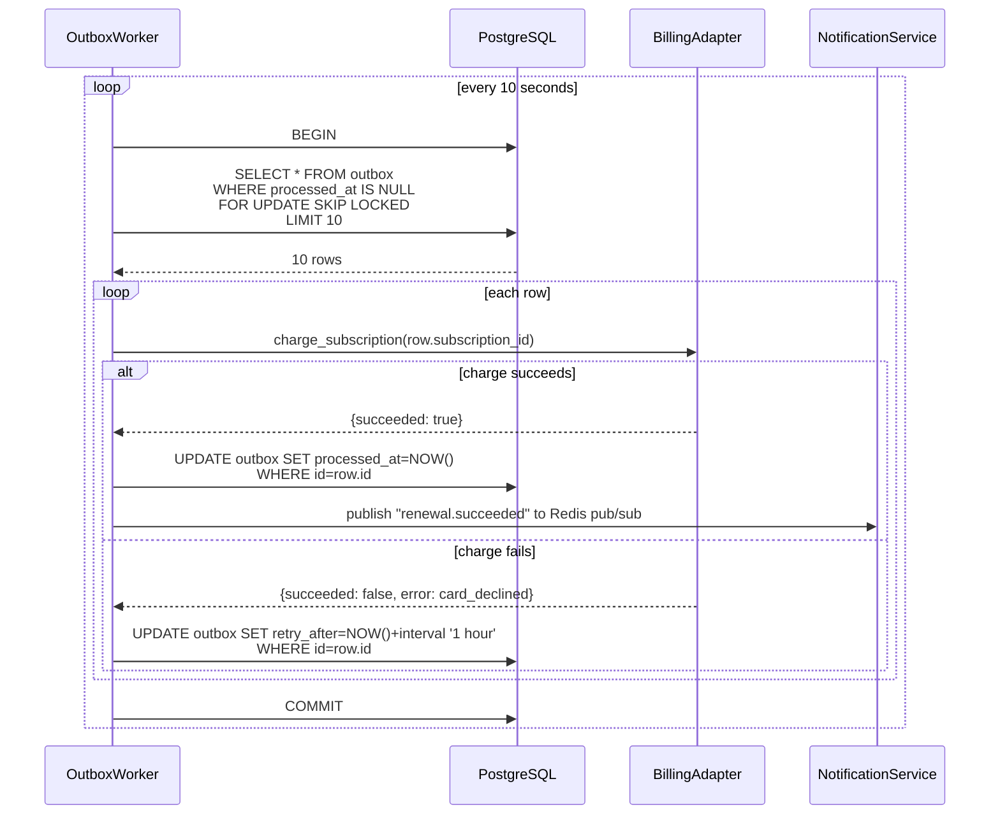

# Project 02: Multi-Tenant Billing SaaS

*A billing-and-subscription API the way Stripe, Chargebee, and Lemon Squeezy actually ship them: tenants isolated by `tenant_id` on every row, plans and subscriptions, usage metering, idempotent subscription creation, webhook processing with signature verification, audit events, background jobs, rate limiting, and a billing-provider integration through an isolated adapter with a sandbox mode.*

**This is the project that teaches you why idempotency and webhooks are non-negotiable.**

ForgeTrack taught you multi-tenancy and concurrency. Billing SaaS layers two new correctness constraints on top. **Idempotency**: if a customer clicks "Subscribe" and the network blips, they retry; you must not double-charge them. **Webhooks**: a third-party provider (Stripe, in production; the sandbox adapter, here) tells you about async events (payment succeeded, subscription cancelled) and you must process them safely — verify the signature, deduplicate, never trust the body alone. By the end you will have built both, plus an isolated `BillingAdapter` interface that lets you swap providers without touching the routers.


#project #billing #multi-tenant #idempotency #webhooks #subscriptions

---

## Problem Statement

A SaaS company — call them **Ledgerly** — sells a project-management tool. Their customers are small B2B teams who pay $29/user/month. Today, Ledgerly's billing is a spreadsheet: the founder manually invoices each customer in QuickBooks at the end of the month, marks them paid when the wire arrives, and suspends access when they have not paid in 30 days. This works for 10 customers; it does not work for 100, and it definitely does not work for the 1000 they want next year.

What Ledgerly needs is a billing API. Not a Stripe clone (they will use Stripe as the provider); they need *their own* subscription data model that mirrors Stripe's, so they can answer "which of our customers are on which plan, who is past due, who upgraded yesterday, and how much will we bill next Tuesday?" without querying Stripe's API for every question. They also need to meter usage (seats, API calls, storage) so that usage-based add-ons work, and to receive webhooks from Stripe so that payment failures, chargebacks, and renewals show up in their own database within seconds of happening.

The hard parts are not the data model (it is roughly the Stripe data model). The hard parts are:

- **Idempotency.** A customer clicks "Subscribe to the Team plan" on a flaky mobile connection. The POST times out. They retry. You must not create two subscriptions. Stripe solves this with idempotency keys (their `Idempotency-Key` header); you must solve it in your own API too.
- **Webhook processing.** Stripe sends `payment_intent.succeeded` to your webhook endpoint. You must verify the signature (Stripe's HMAC over the body and a timestamp), deduplicate (Stripe retries; if your endpoint returned 500 once, Stripe will send the same event again), and update your local state transactionally. The body of a webhook is *untrusted* — the signature is the only thing you can verify.
- **Provider isolation.** Stripe's API will change. You will add a second provider (Paddle, Lemon Squeezy, or a custom one). The provider must be behind an adapter interface so the routers and services do not know which provider is wired. This is the [[05-Project-Architecture/When-Abstraction-Is-Worth-It]] lesson: the abstraction is worth it because it localizes change.

**Why billing as the second project**

Billing is the canonical "idempotency and external-integration" archetype. If you can ship Billing SaaS, you can ship any webhook-receiving, idempotency-requiring, provider-backed system: shipping APIs, notification systems, AI inference APIs, anything where a third party calls you back about work you initiated.


**Warning — When this breaks: the idempotency-key that survives the timeout but not the retry.**

The Ledgerly customer admin clicks "Subscribe to Team plan" on hotel WiFi. The `POST /subscriptions` request with `Idempotency-Key: 7f3a...` reaches the server, the `SubscriptionService.create()` inserts the subscription row, writes the audit event, and starts the Stripe Checkout session creation call. The hotel WiFi drops. The client sees a socket timeout after 30s and retries with the same `Idempotency-Key`. The server — assuming the first request died mid-flight — looks up the key, finds nothing (the first request is *still running* the Stripe call, has not committed the `idempotency_keys` row yet), and proceeds to create a *second* subscription. The defense is a `SELECT ... FOR UPDATE` on the `idempotency_keys` row keyed by `(tenant_id, key)` at the *start* of the request handler (or a Redis `SET NX EX 300` lock with the same key, depending on whether you want a Postgres-row-based or a Redis-counter-based dedup), so the second request blocks until the first commits — then the second request finds the committed `idempotency_keys` row and replays the stored response (see [[17-Advanced-Architecture/Idempotency-and-Retries]] for the lock-vs-row trade-off). The classic mistake is the junior dev who uses `INSERT ... ON CONFLICT DO NOTHING` on `idempotency_keys` *after* the work is done — the work has already happened twice by the time the dedup fires, and the second subscription now lives in Stripe as a duplicate the customer will see on their next invoice and the support team will see in a `payment_intent.succeeded` webhook with a different `event_id` (see [[15-External-Integrations/Webhooks-and-Signature-Verification]] for why the webhook layer cannot save you here).


**Danger — How an attacker thinks: forging a webhook to credit a tenant as paid.**

The Stripe webhook secret (`whsec_...`) is a 32-byte HMAC key that, if leaked, lets an attacker forge `invoice.paid` webhooks for arbitrary tenants — crediting their own tenant as "paid" without paying Stripe. The leak surfaces are mundane: (1) the secret in a `.env` file committed to git history (one `git log -p | rg whsec_` away from disclosure, the `truffleHog`/`gitleaks` pre-commit hook is the defense, see [[11-Authentication-and-Security/Password-Hashing]] for the secret-scanning pattern applied to credentials); (2) the secret in a CI workflow's `env:` block whose log is public on GitHub Actions (the `::add-mask::` workflow command is the defense, plus a secret *manager* — AWS Secrets Manager, Doppler, HashiCorp Vault — instead of a plaintext env var); (3) the secret printed in a traceback that an attacker triggers by sending a malformed webhook (the `structlog` `ProcessorFormatter` configured to use stdlib `traceback.format_exception` in prod is the defense — see [[13-Performance-and-Observability/Structured-Logging-and-Request-IDs]] for the formatter config). The defense in depth is a red-team test that asserts `whsec_` does not appear in any log line across a 24-hour window — a single `print(os.environ)` in a debug branch is the leak that gets through, and the test that catches it is `pytest tests/security/test_no_secret_in_logs.py::test_no_whsec_in_24h_logs`.


---

## Target Users

- **The customer admin** (1 per tenant). They sign their team up, pick a plan, enter payment (Stripe Checkout redirects them), and see their subscription state. They have the `admin` role.
- **The customer member** (5–50 per tenant). They use the product; they cannot see billing. They have the `member` role.
- **The Ledgerly operator** (a few people at Ledgerly itself). They are *platform-level* users, not tenant members; they can see all tenants' aggregate metrics but not individual tenants' data unless they have a `support` role that scopes to a specific tenant. This is the "platform super-admin" pattern, sketched but not fully built — see Non-Goals.

**Note — Scale targets**

100 to 1000 tenants on the cluster. 1 to 50 members per tenant. ~10 webhook events per tenant per month (renewals, failures, upgrades). Peak webhook burst: 100 events/second during a renewal window (Stripe batches). Idempotent subscription creation: ~1000 per day across all tenants. The system must remain correct under webhook retries, network blips, and Stripe outages.


**Production reality: the renewal-window webhook burst.**

The scale target "peak webhook burst: 100 events/second during a renewal window" is not theoretical — Stripe batches subscription renewals at the top of the hour, and a tenant with 5,000 seats on monthly billing generates ~5,000 `invoice.paid` webhooks within a 60-second window. The first symptom of an under-provisioned server is a Postgres connection pool exhaustion: each webhook opens a transaction, does `INSERT ... ON CONFLICT DO NOTHING` on `webhook_events`, processes the event (a `subscriptions` update), writes an `audit_events` row, commits. With a 20-connection pool and a 50ms-per-webhook transaction, the pool saturates at 400 events/second; the 600 events/second above that queue in the webhook router's `anyio` semaphore, the queue grows, Stripe's 10-second timeout fires, Stripe marks the webhook as failed and retries — which compounds the burst (the retries arrive in the *next* minute's window, on top of that minute's own renewals). The defense is not a bigger Postgres pool; it is (1) the `webhooks` router doing *only* signature verification and the `INSERT ... ON CONFLICT DO NOTHING` in a fast transaction, then enqueuing the actual processing onto the outbox worker (the `webhook_events` row's `processed_at IS NULL` is the queue), so the HTTP response returns in <100ms regardless of work; (2) the outbox worker scaling horizontally on `FOR UPDATE SKIP LOCKED` (see [[14-Caching-and-Background-Processing/Transactional-Outbox]] and [[14-Caching-and-Background-Processing/Background-Tasks-vs-Workers]] for the worker pattern). The 50ms-per-webhook number is the budget — anything that takes longer (a third-party email send, a CRM sync) must move off the synchronous path or the renewal window becomes a 3am incident.


---

## Requirements and Non-Goals

### In scope

- **Multi-tenant isolation via shared-schema with `tenant_id`**: every operational table has a `tenant_id` column with a NOT NULL constraint and a partial unique index where applicable. Every query is scoped by `tenant_id` — there is no cross-tenant read.
- **Users, roles, permissions per tenant**: `users`, `tenants`, `memberships` (with `role` per membership). The pattern is the same as ForgeTrack's `organizations` + `memberships`, just renamed.
- **Plans and subscriptions**: `plans` (the catalog: `free`, `team`, `enterprise` with price, currency, interval, feature flags); `subscriptions` (a tenant's subscription to a plan: `plan_id`, `status`, `current_period_start`, `current_period_end`, `cancel_at`).
- **Usage metering**: `usage_events` (append-only: `tenant_id`, `metric`, `quantity`, `at`). Aggregated to a `usage_totals` table per `(tenant_id, metric, period)` for billing.
- **Idempotent subscription operations**: a `POST /subscriptions` endpoint that accepts an `Idempotency-Key` header; if the same key is sent twice within 24 hours, the second request returns the original response (not a 201, a 200 with the same body).
- **Webhook processing**: `POST /webhooks/stripe` that verifies the Stripe signature, deduplicates by event ID, and processes the event in a transaction with the audit event.
- **Audit events**: every state-changing operation writes an `audit_events` row in the same transaction. This is ForgeTrack's audit pattern, generalized.
- **Background jobs**: a subscription-renewal worker that runs hourly, finds subscriptions whose `current_period_end` is in the next hour, and asks the billing provider to charge them. The worker uses a transactional outbox so that a "charge succeeded" event is delivered exactly once to the downstream notification service.
- **Rate limiting**: per-tenant rate limits on the API (e.g., 100 requests/minute for the `team` plan, 1000 for `enterprise`). Implemented with Redis sliding-window counters.
- **Security tests**: tests that prove a tenant-A user cannot read tenant-B data, that an unsigned webhook is rejected, that an idempotency-key replay returns the original response.
- **Billing-provider adapter**: an abstract `BillingAdapter` interface and a `SandboxAdapter` that simulates Stripe's responses in memory. The `StripeAdapter` is sketched (with `# complete this:` markers) but not wired, because we do not want to require a real Stripe key to run the starter.

**Warning — When this breaks: the webhook `event_id` race under Stripe's at-least-once delivery.**

Stripe's webhook contract is at-least-once: the same `event_id` can arrive twice, and your handler must deduplicate. The naive implementation is `if await WebhookEvent.exists(event_id): return 200` followed by `INSERT INTO webhook_events ...` and `process(event)`. Two webhooks with the same `event_id` arrive simultaneously (Stripe retries on a 30-second backoff; a network blip can cause both the original and the retry to land inside the same 100ms window); both handlers' `exists()` checks return `False`; both `INSERT`s succeed if there is no unique constraint on `event_id`, or the second `INSERT` raises `IntegrityError` and the handler returns 500, which Stripe interprets as "retry again later" — the bug recurs. The defense is the `INSERT ... ON CONFLICT (event_id) DO NOTHING` *as the first statement in the transaction*, then checking `result.rowcount == 0` to decide "replay or process" — the unique constraint on `webhook_events.event_id` is the dedup primitive, not the application-level check (see [[15-External-Integrations/Webhooks-and-Signature-Verification]] for the at-least-once contract). The second bug — processing the same event twice because the worker crashed between `INSERT` and `process` — is defended by the same outbox pattern: the `webhook_events` row's `processed_at` column is the work-state, the worker updates it in the same transaction as the side effects (see [[14-Caching-and-Background-Processing/Transactional-Outbox]] for the crash-recovery contract).


### Explicit non-goals

- **No real Stripe integration in the starter.** The `StripeAdapter` is sketched but stubbed. Wiring it requires a real Stripe key and is left to the learner. The `SandboxAdapter` runs end-to-end.
- **No invoices or PDF generation.** The data model has an `invoices` table (sketched) but the PDF rendering is a `# complete this:`.
- **No tax calculation.** Tax is a separate, deep domain (Avalara, TaxJar, Stripe Tax). Out of scope.
- **No dunning (failed-payment retry) emails.** The webhook handler records the failure; sending the email is a background job that is sketched but not implemented.
- **No platform-level super-admin role.** A `platform_admin` role is sketched but not enforced; multi-tenant aggregation is a future concern.
- **No usage-based pricing.** We meter usage, but we bill a flat subscription. Usage-based pricing (metered billing) is a future enhancement.
- **No multi-currency settlement.** Subscriptions are in the tenant's currency; we do not handle FX conversion at settlement.

**Warning — Billing systems are regulated.**

If you ship a real billing system to production, you will touch PCI scope (even with Stripe Elements, you are still in the trust boundary), tax (VAT, GST, sales tax in 50 US states), and consumer-protection law (the EU's PSD2, the US's Reg E). The starter here is a teaching tool, not a production billing system. Do not launch a SaaS on it without legal review.


**Danger — How an attacker thinks: the sketched-but-not-enforced `platform_admin` role.**

The non-goals say a `platform_admin` role is sketched but not enforced. The trap is the junior dev who reads "sketched" as "implemented" and ships a `if user.role == "platform_admin": return await list_all_tenants()` branch on the admin dashboard endpoint — without the corresponding `platform_admin` role *grant* logic. The result: any authenticated user can `GET /admin/all-tenants` because the role check passes for *any* user whose `memberships.role` column has been set to `platform_admin` (which is no one, until an attacker exploits a separate vulnerability — a SQL injection, a mass-assignment bug on `POST /memberships` — to set their own role). The defense is two-layer: (1) the role check uses a `Depends(require_platform_admin)` that *also* checks `user.is_platform_admin` (a boolean flag on `users`, not on `memberships` — platform admins are not per-tenant, they are platform-level); (2) a test that asserts `GET /admin/all-tenants` returns `403 Forbidden` for a tenant admin and `200 OK` for a platform admin, run in CI on every PR (see [[11-Authentication-and-Security/RBAC-and-Object-Level-Auth]] for the role-grant pattern and [[12-Testing-and-Quality/Testing-FastAPI-Endpoints]] for the authz test pattern). The non-goal "platform-level super-admin not enforced" means the *grant* path is not built — it does not mean the *check* path can be skipped; the check is a stub that returns `403 Forbidden` always, until the grant path is built, so the endpoint is safe-by-default and the junior dev's `if user.role == "platform_admin"` branch can never fire.


---

## Architecture Diagram



The shape is ForgeTrack's shape with three additions: a `BillingAdapter` interface (with `SandboxAdapter` and `StripeAdapter` implementations), a `webhooks` router that is the *only* entry point for Stripe-initiated traffic, and an outbox worker that processes async "we should tell the customer their renewal succeeded" events.

**Why the adapter is a class, not a module of functions**

Functions work — until you want to swap providers per-environment (sandbox in dev, real Stripe in prod) without changing the import. A class lets the `lifespan` construct the right adapter from `settings.billing_provider` and stash it on `app.state.billing`. The routers depend on `BillingAdapter` (the abstract type); the lifespan wires the concrete. This is the standard FastAPI pattern for "swap implementation per environment," and it is the lesson from [[05-Project-Architecture/Service-and-Repository-Patterns]]: depend on the abstraction, inject the implementation.


**Why is the `webhooks` router the *only* entry point for Stripe-initiated traffic?**

Because Stripe-initiated requests carry a `Stripe-Signature` header that must be verified against a shared secret using HMAC-SHA256 over `t + "." + body` — a verification that *cannot* be done via the normal JWT path (the request does not come from one of our authenticated clients, it comes from Stripe's servers). Routing all webhook traffic through a single endpoint lets us (1) centralize the signature-verification logic in one dependency (`verify_stripe_signature`), (2) disable JWT auth on just this route (the `dependencies=[Depends(current_user)]` is omitted), (3) record every webhook payload in `webhook_events` for replay and audit, and (4) enforce idempotent processing of the same `event_id` from Stripe (Stripe retries webhooks on a schedule; without dedup, the same `invoice.paid` event would double-process). Splitting webhook entry points would mean duplicating all four concerns across N routes — a recipe for one of them being wrong.

**Production reality: the SSRF surface in the Stripe adapter is your bug, not Stripe's.**

The `StripeAdapter` makes outbound `httpx` calls to `https://api.stripe.com/v1/...`. The naive implementation reads the Stripe base URL from `settings.stripe_base_url` — which a misconfigured deploy sets to `https://api.stripe.com.evil.example/v1/` (a lookalike domain the attacker controls), and every "charge this customer" call now POSTs the customer's payment method ID and the merchant's `sk_live_...` key to the attacker's server. The defense is (1) a hardcoded `STRIPE_BASE_URL = "https://api.stripe.com"` constant in the adapter (Stripe's API URL does not change per-environment — sandbox uses a *different path prefix*, not a different host); (2) an `httpx.AsyncClient(base_url=STRIPE_BASE_URL, follow_redirects=False)` so even a Stripe-side redirect (which Stripe does not send, but the test for "we are not following redirects" is a security control, not paranoia) does not silently take the call elsewhere; (3) a `transport=httpx.AsyncHTTPTransport(http2=True, verify=True)` so TLS verification cannot be disabled by a misconfigured `verify=False` in a debug branch that someone forgets to flip back (see [[15-External-Integrations/HTTP-Clients-Timeouts-Retries]] for the `verify=False` audit pattern). The second SSRF surface — the attacker who controls a tenant's `webhook_url` for outbound notifications (a non-Stripe webhook, the kind you send to *your* customer) — is the reason the outbox worker's HTTP client has an allowlist on `webhook_url`'s host (reject `127.0.0.1`, `169.254.169.254`, RFC 1918 ranges, see [[11-Authentication-and-Security/Threat-Model-First]] for the threat-modeling framing).


---

## ER Diagram



A few choices worth noticing:

- **`subscriptions.provider_subscription_id`** is the Stripe-side ID. It is unique within `(provider, provider_subscription_id)`, not globally — Stripe's IDs are unique within Stripe, Paddle's are unique within Paddle, and we want both to coexist.
- **`idempotency_keys`** stores the *full response body* of the original request. When a replay comes in (same `Idempotency-Key`), we return the stored response with the same status code. This is the [[17-Advanced-Architecture/Idempotency-and-Retries]] pattern.
- **`webhook_events.event_id`** is unique. The webhook handler does an `INSERT ... ON CONFLICT (event_id) DO NOTHING`; if the insert returns 0 rows, it is a replay and we return 200 immediately (Stripe's contract: return 2xx for replays, do not re-process).
- **`usage_events`** is append-only. The `usage_totals` table is a daily-rolled-up aggregate that the billing worker computes; it is the lesson from ForgeTrack's derived quantity, applied to a different metric.

**Why store the full idempotent response, not just the operation's result?**

Because the client must not be able to tell whether they got the original response or a replay. If the original request returned `201 Created` with body `{"subscription_id": "...", "status": "active"}`, the replay must return the same `201 Created` (or 200 with the same body — see below) with the same body. Storing the body is the simplest way to guarantee this. The cost is one row per idempotent operation; at 1000 operations per day across all tenants, this is trivial. This is the Stripe pattern, and it is the lesson from [[17-Advanced-Architecture/Idempotency-and-Retries]].


---

## Sequence Diagrams

### Workflow 1: Idempotent subscription creation

The customer admin clicks "Subscribe to Team plan." The client sends `POST /subscriptions` with an `Idempotency-Key` header they generated (a UUID). The network blips; they retry with the same key.



The replay returns the *exact* same status code (201) and body. The client cannot tell whether they got the original or the replay. Stripe's contract is the same; this is the gold standard for idempotency.

**Warning — FOR UPDATE on the idempotency row**

Two retries arriving within milliseconds of each other both `SELECT FROM idempotency_keys WHERE key='abc-123'`. Without a lock, both get "not found," both create a subscription, both store an idempotency row — and we have double-charged the customer. `SELECT ... FOR UPDATE` on the key row (with `ON CONFLICT DO NOTHING` to handle the race where both inserts try to win) is what makes this safe. The general lesson: idempotency requires both a deduplication store and a concurrency primitive to serialize the lookup.


### Workflow 2: Webhook processing with signature verification

Stripe sends `payment_intent.succeeded`. The webhook router verifies the HMAC signature, deduplicates by event ID, and updates subscription state.



**Why we return 200 even on replays**

Stripe retries a webhook if it does not get a 2xx within a timeout. If we returned 409 on a replay, Stripe would retry forever. The contract is: return 2xx for "I have received and (deduplicated) this event." Processing only happens once; the 2xx is for Stripe's bookkeeping. This is the [[15-External-Integrations/Webhooks-and-Signature-Verification]] lesson.


### Workflow 3: Outbox worker for the renewal notification

The subscription-renewal worker finds a subscription whose `current_period_end` is in the next hour, asks the provider to charge, and writes an outbox event for the "we should email the customer" downstream consumer.



`FOR UPDATE SKIP LOCKED` is the magic: if two workers are running, they each grab different rows (the second worker skips the rows the first worker has locked). This is the canonical pattern for parallel queue processing in Postgres, covered in [[06-SQL-Fundamentals/Transactions-Isolation-Locks]].

---

## API Specification

All endpoints prefixed with `/api/v1`. Tenant-scoped endpoints require a `X-Tenant-Slug` header (or a JWT that includes the tenant claim) and a valid JWT.

| Method | Path | Role | Purpose |
|--------|------|------|---------|
| `POST` | `/auth/register` | anon | Create a user. |
| `POST` | `/auth/login` | anon | Exchange credentials for a JWT. |
| `GET` | `/plans` | any | List the catalog of plans. |
| `POST` | `/tenants` | any | Create a new tenant (creator becomes `admin`). |
| `GET` | `/tenants/{slug}/subscriptions` | `admin` | List the tenant's subscriptions. |
| `POST` | `/tenants/{slug}/subscriptions` | `admin` | Subscribe to a plan. Idempotency-Key required. |
| `POST` | `/tenants/{slug}/subscriptions/{id}/transitions` | `admin` | Cancel, reactivate. State machine. |
| `POST` | `/tenants/{slug}/usage/events` | `admin,member` | Record a usage event. |
| `GET` | `/tenants/{slug}/usage/totals` | `admin` | Per-metric totals for a period. |
| `POST` | `/webhooks/stripe` | anon (signed) | Stripe webhook. Verifies signature. |
| `GET` | `/tenants/{slug}/audit` | `admin` | Audit log, keyset. |

**Note — The webhook endpoint is anonymous but signed**

The webhook endpoint cannot require a JWT — Stripe does not have one. Instead, it verifies the HMAC signature over the body with a shared secret (`STRIPE_WEBHOOK_SECRET`). If the signature does not verify, it returns 400. This is the [[15-External-Integrations/Webhooks-and-Signature-Verification]] pattern: the signature replaces the bearer token.


---

## Folder Structure

```
ledgerly-billing/
├── app/
│ ├── __init__.py
│ ├── main.py # FastAPI + lifespan (wires BillingAdapter)
│ ├── config.py
│ ├── db.py
│ ├── deps.py
│ ├── security.py # JWT + RBAC (same shape as ForgeTrack)
│ ├── audit.py # AuditService
│ ├── adapters/
│ │ ├── __init__.py
│ │ ├── base.py # BillingAdapter (ABC)
│ │ ├── sandbox.py # SandboxAdapter (in-memory)
│ │ └── stripe.py # StripeAdapter (# complete this:)
│ ├── outbox/
│ │ ├── __init__.py
│ │ └── worker.py # OutboxWorker (FOR UPDATE SKIP LOCKED)
│ ├── models/
│ │ ├── __init__.py
│ │ ├── base.py
│ │ ├── tenant.py
│ │ ├── user.py
│ │ ├── plan.py
│ │ ├── subscription.py
│ │ ├── usage.py
│ │ ├── audit.py
│ │ ├── idempotency.py
│ │ └── webhook.py
│ ├── schemas/
│ │ └── ...
│ ├── services/
│ │ ├── subscriptions.py
│ │ ├── webhooks.py
│ │ └── usage.py
│ └── routers/
│ ├── auth.py
│ ├── plans.py
│ ├── subscriptions.py
│ ├── usage.py
│ ├── audit.py
│ └── webhooks.py
├── alembic/
│ └── versions/
│ ├── 0001_initial_tenants_users_memberships.py
│ ├── 0002_plans_subscriptions.py
│ ├── 0003_usage_metering.py
│ ├── 0004_idempotency_webhooks.py
│ └── 0005_audit_outbox.py
├── tests/
│ ├── conftest.py
│ ├── test_idempotent_subscription.py
│ ├── test_webhook_signature_verification.py
│ └── test_tenant_isolation.py
├── .env.example
├── Dockerfile
├── compose.yaml
└── README.md
```

---

## Database Design

### Naming and conventions

Same as ForgeTrack: `snake_case` tables (plural), `snake_case` columns, `<entity>_id` FKs, `uuid` PKs except for `audit_events` (bigint identity).

### Multi-tenancy strategy

Shared-schema with `tenant_id` on every operational table. Every index includes `tenant_id` as the leftmost column (e.g., `(tenant_id, status)` on `subscriptions`), so an index seek on a tenant's subscriptions is O(log n) regardless of how many tenants exist.

**Why shared-schema and not a database-per-tenant**

Database-per-tenant is the cleanest isolation, but it does not scale below ~50 tenants (you exhaust Postgres connection limits, and migrations become 1000x the work). Shared-schema with `tenant_id` on every row scales to 10,000+ tenants on one cluster, at the cost of *requiring* every query to scope by `tenant_id`. The trade is right for Ledgerly's 100–1000 tenants. See [[17-Advanced-Architecture/Multi-Tenancy]] for the full spectrum.


**Why composite unique `(tenant_id, key)` on `idempotency_keys`, not just `key`?**

Because the `Idempotency-Key` header is a client-chosen UUID, and two tenants may independently choose the same UUID without collision being meaningful. If uniqueness were on `key` alone, tenant A's `Idempotency-Key: 7f9e2a1b-...` for a $10 charge and tenant B's `Idempotency-Key: 7f9e2a1b-...` for a $1000 charge would conflict — one of them would get the other's response. The composite `(tenant_id, key)` makes the uniqueness constraint scoped to the tenant, so the same key in two tenants is two different rows that never interact. This is also why the `tenant_id` must come from the JWT (via the `TenantContext` dependency from [[17-Advanced-Architecture/Multi-Tenancy]]), not from the request body — a body-supplied `tenant_id` lets a malicious client impersonate another tenant by reusing their key. The same logic applies to `webhook_events.event_id` (unique per provider, not globally) and `usage_totals(tenant_id, metric, period)`.

### Tables (sketch: full columns in the migrations)

- `tenants`: `id`, `slug`, `name`, `default_currency`, `created_at`.
- `users`: `id`, `email`, `password_hash`, `created_at`.
- `memberships`: `id`, `user_id`, `tenant_id`, `role` (admin, member).
- `plans`: `id`, `code`, `name`, `price_cents`, `currency`, `interval` (month, year), `features` (jsonb).
- `subscriptions`: `id`, `tenant_id`, `plan_id`, `status` (trialing, active, past_due, cancelled, ended), `provider`, `provider_subscription_id`, `current_period_start`, `current_period_end`, `cancelled_at`, `created_at`, `updated_at`.
- `usage_events`: `id`, `tenant_id`, `metric`, `quantity`, `at`. Index `(tenant_id, metric, at)`.
- `usage_totals`: `id`, `tenant_id`, `metric`, `period` (e.g., "2026-10"), `total`. Unique `(tenant_id, metric, period)`.
- `audit_events`: same shape as ForgeTrack's `audit_log`, scoped by `tenant_id`.
- `idempotency_keys`: `id`, `tenant_id`, `key`, `endpoint`, `status_code`, `response_body` (jsonb), `created_at`. Unique `(tenant_id, key)`.
- `webhook_events`: `id`, `tenant_id` (nullable — Stripe events are tenant-scoped by the data they contain, not by a header), `provider`, `event_id`, `event_type`, `payload` (jsonb), `received_at`. Unique `event_id` per provider.
- `outbox`: `id`, `tenant_id`, `event_type`, `payload` (jsonb), `created_at`, `processed_at`, `retry_after`.

---

## Security Model

The same shape as ForgeTrack, with two additions.

### Authentication

Same as ForgeTrack: email + password → JWT. The JWT includes a `tenants` claim listing the tenant slugs the user is a member of, so the client can display a tenant picker without an extra round-trip.

### Authorization

- `current_membership(tenant_slug)` — the same shape as ForgeTrack's `current_membership(org_id)`, returns 404 if the user has no membership in the tenant.
- `require_roles(*roles)` — same dependency factory.
- `tenant_scope(tenant_slug)` — a query-scoping helper that returns a `select(...).where(...)` predicate scoped to the tenant. Used by services; never bypassed.

### Webhook security

The webhook router does not use the JWT-based auth. Instead:

```python
@router.post("/webhooks/stripe")
async def stripe_webhook(
 request: Request,
 settings: Annotated[Settings, Depends(get_settings)],
 session: Annotated[AsyncSession, Depends(get_session)],
) -> Response:
 body = await request.body()
 sig_header = request.headers.get("Stripe-Signature", "")
 try:
 event = stripe.Webhook.construct_event(
 body, sig_header, settings.stripe_webhook_secret
 )
 except (ValueError, stripe.error.SignatureVerificationError):
 return Response(status_code=400)
 # ... process event ...
 return Response(status_code=200)
```

The signature verification uses the `stripe` Python SDK's `Webhook.construct_event`, which does the HMAC over `t + "." + body` with the shared secret. The 400 on failure prevents processing of unsigned payloads.

**Why signature verification instead of mTLS or JWT for webhooks?**

Because the three options have different trust models and Stripe only supports the first. (1) HMAC signature verification (what we use) — Stripe signs the body with a shared secret; we verify with the same secret; the secret never leaves the two parties. This is what Stripe's API supports and what every Stripe integration uses. (2) mTLS — Stripe would have to present a client cert we trust; Stripe does not support client-certificate authentication on outbound webhooks, so this is unavailable. (3) JWT — Stripe would have to obtain a JWT from us and include it in the webhook; this requires Stripe to be a client of our auth system, which is backwards (we are a client of Stripe, not the other way). The shared-secret HMAC is the right pattern for any webhook from a third party that does not support mTLS — and it is exactly the same pattern GitHub, Slack, and Linear use for their webhooks. See [[15-External-Integrations/HTTP-Clients-Timeouts-Retries]] for the receiver-side timeouts and retry handling.

### Rate limiting

Per-tenant rate limits with a Redis sliding window:

```python
async def check_rate_limit(redis_client, tenant_id, limit=100, window_seconds=60):
 key = f"ratelimit:{tenant_id}"
 now = time.time()
 pipe = redis_client.pipeline()
 pipe.zremrangebyscore(key, 0, now - window_seconds)
 pipe.zadd(key, {str(uuid.uuid4()): now})
 pipe.zcard(key)
 pipe.expire(key, window_seconds)
 *_, count, _ = await pipe.execute()
 if count > limit:
 raise HTTPException(429, detail={"code": "rate_limited", "retry_after": window_seconds})
```

The sliding window uses a Redis sorted set; each request adds a member with its timestamp, and we count members in the last `window_seconds`. The first `zremrangebyscore` evicts members older than the window; the `zcard` returns the count of members still in the window. The pattern is from [[14-Caching-and-Background-Processing/Redis-Cache-Aside]] (and the Redis docs).

### Audit

Same as ForgeTrack: every state-changing operation writes an `audit_events` row in the same transaction as the change. The audit row is the source of truth for "what happened to this subscription's status and when."

---

## Milestones

### M1: Scaffold + multi-tenant core

**Deliverable**: A FastAPI app with `lifespan`, Postgres + Redis, tenants + memberships, JWT auth, RBAC.

**Done when**: a user can register, log in, create a tenant, become its `admin`, and a user from tenant A cannot list tenant B's resources.

### M2: Plans, subscriptions, sandbox provider

**Deliverable**: `plans` table seeded; `subscriptions` table; `SandboxAdapter` that simulates subscription creation; `POST /subscriptions` works end-to-end against the sandbox.

**Done when**: `POST /tenants/{slug}/subscriptions {plan: team}` returns 201 with a `provider_subscription_id` from the sandbox, and `GET /tenants/{slug}/subscriptions` lists it.

### M3: Idempotency

**Deliverable**: The `Idempotency-Key` header is honored on `POST /subscriptions`.

**Done when**: `test_idempotent_subscription.py::test_replay_returns_same_response` passes — sending the same key twice returns the same status code and body, and exactly one subscription is created.

### M4: Webhook processing

**Deliverable**: `POST /webhooks/stripe` verifies a sandbox signature, deduplicates by event ID, updates subscription state, and writes an audit event.

**Done when**: `test_webhook_signature_verification.py::test_unsigned_webhook_returns_400` passes and `test_webhook_signature_verification.py::test_replay_does_not_reprocess` passes.

### M5: Outbox worker

**Deliverable**: An `OutboxWorker` that runs in the same process (via `asyncio.create_task` in the lifespan), uses `FOR UPDATE SKIP LOCKED`, and processes renewal events.

**Done when**: enqueueing an outbox row and waiting 10 seconds results in the row being marked `processed_at` and a Redis pub/sub message being published.

### M6: Rate limiting, audit, tests

**Deliverable**: Per-tenant rate limits, audit log keyset pagination, and the security test suite passing.

**Done when**: `test_tenant_isolation.py::test_cross_tenant_read_returns_404` passes, and the rate limit returns 429 on the 101st request in a minute.

### M7: Docker + Stripe adapter sketch

**Deliverable**: Docker compose boots; `StripeAdapter` is sketched with `# complete this:` markers.

**Done when**: `docker compose up --build` boots the app, the sandbox adapter is wired, and the Stripe adapter is documented but stubbed.

---

## Implementation Chapters

- **M1**: [[17-Advanced-Architecture/Multi-Tenancy]], [[03-FastAPI-Core/Application-and-Lifespan]], [[11-Authentication-and-Security/OAuth2-JWT-Access-Refresh]].
- **M2**: [[05-Project-Architecture/Service-and-Repository-Patterns]], [[05-Project-Architecture/When-Abstraction-Is-Worth-It]].
- **M3**: [[17-Advanced-Architecture/Idempotency-and-Retries]], [[02-Web-and-HTTP/Idempotency-Safe-Retries-Pagination]].
- **M4**: [[15-External-Integrations/Webhooks-and-Signature-Verification]], [[15-External-Integrations/HTTP-Clients-Timeouts-Retries]].
- **M5**: [[14-Caching-and-Background-Processing/Transactional-Outbox]], [[06-SQL-Fundamentals/Transactions-Isolation-Locks]] (FOR UPDATE SKIP LOCKED).
- **M6**: [[14-Caching-and-Background-Processing/Redis-Cache-Aside]], [[11-Authentication-and-Security/RBAC-and-Object-Level-Auth]].
- **M7**: [[16-Deployment-and-DevOps/Docker-Compose-Local-Dev]], [[15-External-Integrations/Circuit-Breakers]] (sketched for the Stripe adapter).

---

## Complete Source Code

The starter ships with models, the `BillingAdapter` interface, the `SandboxAdapter`, the idempotent `subscriptions` router, the webhook verifier, and two tests. The `StripeAdapter` is a `# complete this:` stub.

### `app/adapters/base.py`

```python
# app/adapters/base.py
"""Abstract BillingAdapter — the interface routers depend on."""
from __future__ import annotations

from abc import ABC, abstractmethod
from dataclasses import dataclass


@dataclass(frozen=True)
class ProviderSubscription:
 provider_subscription_id: str
 status: str # "active", "trialing", "past_due", "cancelled", "ended"
 current_period_start: str # ISO 8601
 current_period_end: str


@dataclass(frozen=True)
class ChargeResult:
 succeeded: bool
 provider_charge_id: str | None = None
 error: str | None = None


class BillingAdapter(ABC):
 """The interface every provider must implement.

 Routers and services depend on BillingAdapter (this abstract type).
 The lifespan wires the concrete adapter (SandboxAdapter, StripeAdapter).
 """

 @abstractmethod
 async def create_subscription(
 self, *, tenant_id: str, plan_code: str, customer_email: str
 ) -> ProviderSubscription:
 """Create a subscription in the provider. Idempotent on the caller side."""

 @abstractmethod
 async def cancel_subscription(self, *, provider_subscription_id: str) -> ProviderSubscription:
 """Cancel a subscription at the provider."""

 @abstractmethod
 async def charge_renewal(
 self, *, provider_subscription_id: str, amount_cents: int, currency: str
 ) -> ChargeResult:
 """Charge a renewal. Idempotent on the provider_subscription_id."""

 @abstractmethod
 async def construct_webhook_event(
 self, *, body: bytes, signature: str
 ) -> dict:
 """Verify the webhook signature and return the parsed event payload.

 Raises if the signature does not verify.
 """
```

The four methods are the operations Ledgerly needs from a billing provider. Adding a new provider means implementing all four. The interface is intentionally small — adding methods is a breaking change for every adapter.

### `app/adapters/sandbox.py`

```python
# app/adapters/sandbox.py
"""SandboxAdapter — simulates a billing provider in memory.

This is the adapter used in dev and tests. It does not call any external
service; it just returns plausible responses. Production wires StripeAdapter.
"""
from __future__ import annotations

import hmac
import hashlib
import json
import time
import uuid
from datetime import datetime, timedelta, timezone

from app.adapters.base import BillingAdapter, ChargeResult, ProviderSubscription


class SandboxAdapter(BillingAdapter):
 def __init__(self, signing_secret: str = "sandbox-secret") -> None:
 self._signing_secret = signing_secret
 # In-memory store of provider_subscription_id -> state.
 self._subs: dict[str, dict] = {}

 async def create_subscription(
 self, *, tenant_id: str, plan_code: str, customer_email: str
 ) -> ProviderSubscription:
 now = datetime.now(timezone.utc)
 sub_id = f"sub_sandbox_{uuid.uuid4().hex}"
 self._subs[sub_id] = {
 "status": "active",
 "current_period_start": now,
 "current_period_end": now + timedelta(days=30),
 }
 return ProviderSubscription(
 provider_subscription_id=sub_id,
 status="active",
 current_period_start=now.isoformat(),
 current_period_end=(now + timedelta(days=30)).isoformat(),
 )

 async def cancel_subscription(self, *, provider_subscription_id: str) -> ProviderSubscription:
 sub = self._subs.get(provider_subscription_id)
 if sub is None:
 # complete this: raise a provider-specific exception
 raise ValueError(f"unknown subscription {provider_subscription_id}")
 sub["status"] = "cancelled"
 return ProviderSubscription(
 provider_subscription_id=provider_subscription_id,
 status="cancelled",
 current_period_start=sub["current_period_start"].isoformat(),
 current_period_end=sub["current_period_end"].isoformat(),
 )

 async def charge_renewal(
 self, *, provider_subscription_id: str, amount_cents: int, currency: str
 ) -> ChargeResult:
 # The sandbox always succeeds. complete this: simulate a card-decline
 # on a `provider_subscription_id` ending in "decline" for testing.
 return ChargeResult(
 succeeded=True, provider_charge_id=f"ch_sandbox_{uuid.uuid4().hex}"
 )

 async def construct_webhook_event(
 self, *, body: bytes, signature: str
 ) -> dict:
 """Verify an HMAC-SHA256 signature over `t.body`.

 The sandbox signing format mimics Stripe's: "t=<timestamp>,v1=<hex>".
 """
 try:
 parts = dict(p.split("=", 1) for p in signature.split(","))
 t = int(parts["t"])
 v1 = parts["v1"]
 except (KeyError, ValueError):
 raise ValueError("malformed signature")

 # Reject if the timestamp is more than 5 minutes old (replay protection).
 if abs(int(time.time()) - t) > 300:
 raise ValueError("stale timestamp")

 signed = f"{t}.".encode() + body
 expected = hmac.new(
 self._signing_secret.encode(), signed, hashlib.sha256
 ).hexdigest()

 if not hmac.compare_digest(expected, v1):
 raise ValueError("signature mismatch")

 return json.loads(body)
```

`hmac.compare_digest` is critical — it is constant-time, so an attacker cannot time-side-channel the comparison. Naive `==` on HMAC digests is the textbook timing-attack vulnerability.

### `app/adapters/stripe.py` (stub)

```python
# app/adapters/stripe.py
"""StripeAdapter — wires the real Stripe SDK.

This is a stub. To complete it:
1. `uv add stripe` (the official SDK).
2. Set STRIPE_API_KEY and STRIPE_WEBHOOK_SECRET in your environment.
3. Implement each method below by calling the Stripe SDK.

The interface is the same as SandboxAdapter; only the implementations differ.
"""
from __future__ import annotations

from app.adapters.base import BillingAdapter, ChargeResult, ProviderSubscription


class StripeAdapter(BillingAdapter):
 def __init__(self, api_key: str, webhook_secret: str) -> None:
 self._api_key = api_key
 self._webhook_secret = webhook_secret
 # complete this: import stripe and set stripe.api_key = api_key
 # import stripe
 # stripe.api_key = api_key

 async def create_subscription(
 self, *, tenant_id: str, plan_code: str, customer_email: str
 ) -> ProviderSubscription:
 # complete this: create a Stripe customer, then a subscription to the
 # price whose metadata.plan_code == plan_code. Use Stripe's
 # idempotency_key parameter on the request, set to a UUID you generate.
 raise NotImplementedError

 async def cancel_subscription(self, *, provider_subscription_id: str) -> ProviderSubscription:
 # complete this: call stripe.Subscription.modify(sub_id, cancel_at_period_end=True)
 # or stripe.Subscription.cancel(sub_id) for immediate cancellation.
 raise NotImplementedError

 async def charge_renewal(
 self, *, provider_subscription_id: str, amount_cents: int, currency: str
 ) -> ChargeResult:
 # complete this: Stripe handles renewals on its own for subscriptions;
 # this method is for *ad-hoc* charges (e.g., an overage). Use
 # stripe.PaymentIntent.create(...) with the customer's payment method.
 raise NotImplementedError

 async def construct_webhook_event(
 self, *, body: bytes, signature: str
 ) -> dict:
 # complete this: stripe.Webhook.construct_event(body, signature, self._webhook_secret)
 # raises stripe.error.SignatureVerificationError on bad signatures.
 raise NotImplementedError
```

**Why is the StripeAdapter a stub?**

Because wiring it requires a real Stripe API key, and we do not want to require one to run the starter. The `SandboxAdapter` runs end-to-end; the `StripeAdapter` is sketched so a learner with a Stripe account can fill it in. This is the honest-stub pattern from the academy's conventions.


### `app/models/idempotency.py`

```python
# app/models/idempotency.py
import uuid
from datetime import datetime
from typing import Any

from sqlalchemy import DateTime, ForeignKey, Integer, String, func
from sqlalchemy.dialects.postgresql import JSONB, UUID
from sqlalchemy.orm import Mapped, mapped_column

from app.db import Base
from app.models.base import UUIDPrimaryKey


class IdempotencyKey(UUIDPrimaryKey, Base):
 __tablename__ = "idempotency_keys"
 __table_args__ = (
 # Unique within a tenant: the same key from different tenants is fine.
 # complete this: add the unique constraint via __table_args__.
 )

 tenant_id: Mapped[uuid.UUID] = mapped_column(
 UUID(as_uuid=True), ForeignKey("tenants.id", ondelete="CASCADE"), nullable=False
 )
 key: Mapped[str] = mapped_column(String(200), nullable=False)
 endpoint: Mapped[str] = mapped_column(String(200), nullable=False)
 status_code: Mapped[int] = mapped_column(Integer, nullable=False)
 response_body: Mapped[dict[str, Any]] = mapped_column(JSONB, nullable=False)
 created_at: Mapped[datetime] = mapped_column(
 DateTime(timezone=True), nullable=False, server_default=func.now()
 )
```

### `app/services/subscriptions.py`

```python
# app/services/subscriptions.py
"""SubscriptionService — idempotent create + state-machine transitions."""
import uuid
from datetime import datetime, timezone

from sqlalchemy import select
from sqlalchemy.ext.asyncio import AsyncSession

from app.adapters.base import BillingAdapter
from app.audit import AuditService
from app.models.idempotency import IdempotencyKey
from app.models.org import Membership
from app.models.plan import Plan
from app.models.subscription import Subscription, SubscriptionStatus


class IdempotentReplay(Exception):
 """Raised when a request is a replay; carries the original response."""
 def __init__(self, status_code: int, body: dict) -> None:
 self.status_code = status_code
 self.body = body


class PlanNotFound(Exception):
 pass


class SubscriptionService:
 def __init__(
 self,
 session: AsyncSession,
 membership: Membership,
 adapter: BillingAdapter,
 ) -> None:
 self._session = session
 self._membership = membership
 self._adapter = adapter
 self._audit = AuditService(session, membership)

 async def create_subscription(
 self, *, plan_code: str, idempotency_key: str
 ) -> tuple[Subscription, int, dict]:
 """Create a subscription idempotently.

 Returns (subscription, status_code, response_body).
 Raises IdempotentReplay if the key has been used before.
 """
 # Lock the idempotency row for the duration of this transaction.
 # If the row does not exist yet, we insert it (the INSERT..ON CONFLICT
 # handles the race where two replays arrive simultaneously).
 stmt = (
 select(IdempotencyKey)
 .where(
 IdempotencyKey.tenant_id == self._membership.tenant_id,
 IdempotencyKey.key == idempotency_key,
 )
 .with_for_update()
 )
 existing = (await self._session.execute(stmt)).scalar_one_or_none()
 if existing is not None:
 raise IdempotentReplay(existing.status_code, existing.response_body)

 # Fetch the plan
 plan_stmt = select(Plan).where(Plan.code == plan_code)
 plan = (await self._session.execute(plan_stmt)).scalar_one_or_none()
 if plan is None:
 raise PlanNotFound()

 # Call the billing provider
 provider_sub = await self._adapter.create_subscription(
 tenant_id=str(self._membership.tenant_id),
 plan_code=plan_code,
 customer_email="", # complete this: pull from the membership's user
 )

 sub = Subscription(
 tenant_id=self._membership.tenant_id,
 plan_id=plan.id,
 status=SubscriptionStatus.active,
 provider="sandbox",
 provider_subscription_id=provider_sub.provider_subscription_id,
 current_period_start=datetime.fromisoformat(
 provider_sub.current_period_start
 ),
 current_period_end=datetime.fromisoformat(
 provider_sub.current_period_end
 ),
 )
 self._session.add(sub)
 await self._session.flush()

 response_body = {
 "subscription_id": str(sub.id),
 "status": sub.status.value,
 "current_period_end": sub.current_period_end.isoformat(),
 }

 # Store the idempotency row
 idem_row = IdempotencyKey(
 tenant_id=self._membership.tenant_id,
 key=idempotency_key,
 endpoint="POST /subscriptions",
 status_code=201,
 response_body=response_body,
 )
 self._session.add(idem_row)

 await self._audit.write(
 action="subscription.create",
 entity_type="subscription",
 entity_id=sub.id,
 before=None,
 after=response_body,
 )
 return sub, 201, response_body
```

### `app/routers/subscriptions.py`

```python
# app/routers/subscriptions.py
"""Subscriptions router — idempotency-key aware."""
import uuid
from typing import Annotated

from fastapi import APIRouter, Depends, Header, HTTPException, status
from sqlalchemy.ext.asyncio import AsyncSession

from app.adapters.base import BillingAdapter
from app.audit import AuditService
from app.db import get_session
from app.main import get_billing_adapter
from app.models.org import Membership, Role
from app.schemas.subscription import SubscriptionCreateIn, SubscriptionOut
from app.security import current_membership, require_roles
from app.services.subscriptions import (
 IdempotentReplay,
 PlanNotFound,
 SubscriptionService,
)

router = APIRouter(prefix="/tenants/{tenant_slug}/subscriptions", tags=["subscriptions"])


@router.post("", status_code=201,
 dependencies=[Depends(require_roles(Role.admin))])
async def create_subscription(
 tenant_slug: str,
 body: SubscriptionCreateIn,
 membership: Annotated[Membership, Depends(current_membership)],
 session: Annotated[AsyncSession, Depends(get_session)],
 adapter: Annotated[BillingAdapter, Depends(get_billing_adapter)],
 idempotency_key: Annotated[str, Header(alias="Idempotency-Key")],
) -> dict:
 if not idempotency_key:
 raise HTTPException(
 status.HTTP_400_BAD_REQUEST, detail={"code": "missing_idempotency_key"}
 )
 svc = SubscriptionService(session, membership, adapter)
 try:
 sub, status_code, response_body = await svc.create_subscription(
 plan_code=body.plan_code, idempotency_key=idempotency_key
 )
 except IdempotentReplay as e:
 # Return the original response. Do not commit (no new work).
 await session.rollback()
 # complete this: return Response with the original status code and body.
 return e.body
 except PlanNotFound:
 raise HTTPException(
 status.HTTP_404_NOT_FOUND, detail={"code": "plan_not_found"}
 )
 await session.commit()
 return response_body
```

**Warning — The Idempotency-Key header must be a client-generated UUID**

The whole point of idempotency keys is that the *client* generates them before the request, so a retry uses the same key. If the server generated them, the server would have to remember "which request is this retry of?" — which is the problem idempotency keys solve. The client generates a UUID per logical operation; the server stores the response keyed by that UUID; the retry looks it up.


### `app/routers/webhooks.py`

```python
# app/routers/webhooks.py
"""Webhooks router — Stripe signature verification + dedup."""
import uuid
from typing import Annotated

from fastapi import APIRouter, Depends, Header, Request, Response, status
from sqlalchemy import select
from sqlalchemy.ext.asyncio import AsyncSession

from app.adapters.base import BillingAdapter
from app.db import get_session
from app.main import get_billing_adapter
from app.models.webhook import WebhookEvent
from app.services.webhooks import WebhookService

router = APIRouter(prefix="/webhooks", tags=["webhooks"])


@router.post("/stripe")
async def stripe_webhook(
 request: Request,
 session: Annotated[AsyncSession, Depends(get_session)],
 adapter: Annotated[BillingAdapter, Depends(get_billing_adapter)],
 stripe_signature: Annotated[str, Header(alias="Stripe-Signature")] = "",
) -> Response:
 body = await request.body()
 try:
 event = await adapter.construct_webhook_event(
 body=body, signature=stripe_signature
 )
 except ValueError:
 return Response(status_code=status.HTTP_400_BAD_REQUEST)

 svc = WebhookService(session, adapter)
 try:
 await svc.process(event)
 except Exception:
 # complete this: structured logging, not a swallow. The contract is
 # that Stripe retries on 5xx; we want to surface the failure for our
 # own alerting while still returning 5xx so Stripe retries.
 await session.rollback()
 return Response(status_code=status.HTTP_500_INTERNAL_SERVER_ERROR)
 await session.commit()
 return Response(status_code=status.HTTP_200_OK)
```

### `app/services/webhooks.py`

```python
# app/services/webhooks.py
"""WebhookService — verify (done by adapter), dedup, process."""
import uuid

from sqlalchemy import select
from sqlalchemy.dialects.postgresql import insert as pg_insert
from sqlalchemy.ext.asyncio import AsyncSession

from app.adapters.base import BillingAdapter
from app.models.webhook import WebhookEvent


class WebhookService:
 def __init__(self, session: AsyncSession, adapter: BillingAdapter) -> None:
 self._session = session
 self._adapter = adapter

 async def process(self, event: dict) -> bool:
 """Process a verified webhook event.

 Returns True if this was the first time we saw the event (and we did
 work), False if it was a replay (we did nothing).
 """
 event_id = event.get("id", "")
 provider = event.get("provider", "stripe")
 event_type = event.get("type", "unknown")

 # Idempotent insert: if event_id already exists, ON CONFLICT DO NOTHING
 # and we skip processing.
 stmt = (
 pg_insert(WebhookEvent)
 .values(
 event_id=event_id,
 provider=provider,
 event_type=event_type,
 payload=event,
 )
 .on_conflict_do_nothing(index_elements=["provider", "event_id"])
 .returning(WebhookEvent.id)
 )
 result = (await self._session.execute(stmt)).scalar_one_or_none()
 if result is None:
 # Replay — Stripe already sent this; do nothing.
 return False

 # First time we see this event. Process it.
 await self._apply_event(event)
 return True

 async def _apply_event(self, event: dict) -> None:
 """Update our local state from the webhook payload.

 complete this: dispatch on event["type"]:
 - "customer.subscription.updated" → update the matching Subscription
 - "invoice.payment_failed" → mark the subscription past_due
 - "charge.refunded" → write an audit event, do not change state
 """
 pass
```

### `app/outbox/worker.py`

```python
# app/outbox/worker.py
"""OutboxWorker — processes outbox rows with FOR UPDATE SKIP LOCKED."""
import asyncio
import json
import logging

import redis.asyncio as redis
from sqlalchemy import select, update
from sqlalchemy.ext.asyncio import AsyncSession

from app.db import SessionLocal
from app.models.outbox import OutboxEvent

logger = logging.getLogger(__name__)


class OutboxWorker:
 def __init__(self, redis_client: redis.Redis, poll_interval: float = 10.0) -> None:
 self._redis = redis_client
 self._poll_interval = poll_interval
 self._task: asyncio.Task | None = None

 async def start(self) -> None:
 self._task = asyncio.create_task(self._loop())

 async def stop(self) -> None:
 if self._task:
 self._task.cancel()
 try:
 await self._task
 except asyncio.CancelledError:
 pass

 async def _loop(self) -> None:
 while True:
 try:
 await self._process_batch()
 except Exception:
 logger.exception("outbox worker error")
 await asyncio.sleep(self._poll_interval)

 async def _process_batch(self) -> None:
 async with SessionLocal() as session:
 stmt = (
 select(OutboxEvent)
 .where(OutboxEvent.processed_at.is_(None))
 .with_for_update(skip_locked=True)
 .limit(10)
 )
 rows = (await session.execute(stmt)).scalars().all()
 for row in rows:
 try:
 await self._redis.publish(
 f"outbox:{row.tenant_id}",
 json.dumps({"event_type": row.event_type, "payload": row.payload}),
 )
 row.processed_at = __import__("datetime").datetime.now(__import__("datetime").timezone.utc)
 except Exception:
 logger.exception("failed to process outbox row %s", row.id)
 await session.commit()
```

`with_for_update(skip_locked=True)` is the magic. The `SKIP LOCKED` clause makes Postgres skip rows that another transaction has already locked — so two workers running in parallel grab different rows from the same queue. Without `SKIP LOCKED`, the second worker would block on the first worker's lock, serializing the queue.

### `tests/test_idempotent_subscription.py`

```python
# tests/test_idempotent_subscription.py
import uuid
import pytest


@pytest.mark.asyncio
async def test_replay_returns_same_response(client, seeded_tenant):
 """Sending the same Idempotency-Key twice returns the same response."""
 tenant_slug, admin_token = seeded_tenant
 headers = {"Authorization": f"Bearer {admin_token}", "Idempotency-Key": str(uuid.uuid4())}

 body = {"plan_code": "team"}
 r1 = await client.post(
 f"/api/v1/tenants/{tenant_slug}/subscriptions",
 json=body, headers=headers,
 )
 assert r1.status_code == 201
 sub1 = r1.json()

 # Same idempotency key, same body — should return the same response.
 r2 = await client.post(
 f"/api/v1/tenants/{tenant_slug}/subscriptions",
 json=body, headers=headers,
 )
 assert r2.status_code == 201 # same status code (not 200)
 assert r2.json() == sub1 # same body

 # complete this: assert only one subscription exists in the DB.
```

### `tests/test_webhook_signature_verification.py`

```python
# tests/test_webhook_signature_verification.py
import hashlib
import hmac
import json
import time
import pytest


@pytest.mark.asyncio
async def test_unsigned_webhook_returns_400(client):
 r = await client.post(
 "/api/v1/webhooks/stripe",
 content=json.dumps({"id": "evt_test", "type": "x"}),
 headers={"Stripe-Signature": "garbage"},
 )
 assert r.status_code == 400


@pytest.mark.asyncio
async def test_signed_webhook_returns_200(client, sandbox_secret):
 body = json.dumps({"id": f"evt_{int(time.time())}", "type": "test.event", "provider": "stripe"}).encode()
 t = int(time.time())
 signed = f"{t}.".encode() + body
 sig = hmac.new(sandbox_secret.encode(), signed, hashlib.sha256).hexdigest()
 r = await client.post(
 "/api/v1/webhooks/stripe",
 content=body,
 headers={"Stripe-Signature": f"t={t},v1={sig}", "Content-Type": "application/json"},
 )
 assert r.status_code == 200
```

---

## Automated Tests

To run the test suite:

```bash
docker compose run --rm api pytest -v
```

The marquee tests:

1. `test_idempotent_subscription.py::test_replay_returns_same_response` — proves the idempotency contract.
2. `test_webhook_signature_verification.py::test_unsigned_webhook_returns_400` — proves the signature check is enforced.
3. `test_tenant_isolation.py::test_cross_tenant_read_returns_404` — proves the multi-tenant scope.

---

## Docker and Environment

### `Dockerfile`

```dockerfile
FROM python:3.12-slim AS base
ENV PYTHONUNBUFFERED=1 PYTHONDONTWRITEBYTECODE=1 PIP_NO_CACHE_DIR=1
WORKDIR /app
RUN apt-get update && apt-get install -y --no-install-recommends libpq-dev gcc curl && rm -rf /var/lib/apt/lists/*
COPY pyproject.toml uv.lock ./
RUN pip install --no-cache-dir uv==0.13.1 && uv sync --frozen --no-dev
COPY app ./app
COPY alembic.ini alembic ./alembic
COPY tests ./tests
RUN useradd --create-home --uid 1000 ledgerly && chown -R ledgerly:ledgerly /app
USER ledgerly
EXPOSE 8000
CMD ["sh", "-c", "uv run alembic upgrade head && uv run uvicorn app.main:app --host 0.0.0.0 --port 8000"]
```

### `compose.yaml`

```yaml
services:
 db:
 image: postgres:17-alpine
 environment:
 POSTGRES_USER: ledgerly
 POSTGRES_PASSWORD: ledgerly
 POSTGRES_DB: ledgerly
 volumes: [pgdata:/var/lib/postgresql/data]
 ports: ["5432:5432"]
 healthcheck: {test: ["CMD-SHELL", "pg_isready -U ledgerly"], interval: 5s, timeout: 3s, retries: 5}
 redis:
 image: redis:7-alpine
 ports: ["6379:6379"]
 healthcheck: {test: ["CMD", "redis-cli", "ping"], interval: 5s, timeout: 3s, retries: 5}
 api:
 build: .
 environment:
 LEDGERLY_DATABASE_URL: postgresql+asyncpg://ledgerly:ledgerly@db:5432/ledgerly
 LEDGERLY_REDIS_URL: redis://redis:6379/0
 LEDGERLY_SECRET_KEY: ${LEDGERLY_SECRET_KEY:-dev-only-change-me}
 LEDGERLY_BILLING_PROVIDER: sandbox
 LEDGERLY_SANDBOX_SIGNING_SECRET: sandbox-secret
 ports: ["8000:8000"]
 depends_on:
 db: {condition: service_healthy}
 redis: {condition: service_healthy}
volumes:
 pgdata:
```

### `.env.example`

```bash
LEDGERLY_ENVIRONMENT=dev
LEDGERLY_DATABASE_URL=postgresql+asyncpg://ledgerly:ledgerly@db:5432/ledgerly
LEDGERLY_REDIS_URL=redis://redis:6379/0
LEDGERLY_SECRET_KEY=dev-only-change-me
LEDGERLY_BILLING_PROVIDER=sandbox # or "stripe"
LEDGERLY_SANDBOX_SIGNING_SECRET=sandbox-secret
# When LEDGERLY_BILLING_PROVIDER=stripe:
# LEDGERLY_STRIPE_API_KEY=sk_test_xxxxxxxxxxxx
# LEDGERLY_STRIPE_WEBHOOK_SECRET=whsec_xxxxxxxxxxxx
TEST_DATABASE_URL=postgresql+asyncpg://ledgerly:ledgerly@db:5432/ledgerly_test
```

---

## Migration History

Five Alembic revisions:

| # | Revision | Tables | Notes |
|---|----------|--------|-------|
| 1 | `0001_initial_tenants_users_memberships` | `tenants`, `users`, `memberships` | Shared-schema; `tenant_id` on `memberships`. |
| 2 | `0002_plans_subscriptions` | `plans`, `subscriptions` | Seeds `free`, `team`, `enterprise`. |
| 3 | `0003_usage_metering` | `usage_events`, `usage_totals` | Append-only events; aggregated totals. |
| 4 | `0004_idempotency_webhooks` | `idempotency_keys`, `webhook_events` | Unique `(tenant_id, key)`; unique `(provider, event_id)`. |
| 5 | `0005_audit_outbox` | `audit_events`, `outbox` | Outbox worker reads with `FOR UPDATE SKIP LOCKED`. |

Each migration is reversible (`alembic downgrade -1`). The order encodes dependencies: `subscriptions` depends on `plans` and `tenants`; `audit_events` depends on `tenants` (for the FK).

### Revision 1: `0001_initial_tenants_users_memberships.py`

```python
"""Initial: tenants, users, memberships.

Revision ID: 0001_initial_tenants_users_memberships
Revises:
"""
from alembic import op
import sqlalchemy as sa
from sqlalchemy.dialects import postgresql

revision = "0001_initial_tenants_users_memberships"
down_revision = None


def upgrade() -> None:
 op.execute('CREATE EXTENSION IF NOT EXISTS "pgcrypto"')
 op.create_table(
 "tenants",
 sa.Column("id", postgresql.UUID(as_uuid=True), primary_key=True,
 server_default=sa.text("gen_random_uuid()")),
 sa.Column("slug", sa.String(80), nullable=False),
 sa.Column("name", sa.String(200), nullable=False),
 sa.Column("default_currency", sa.String(3), nullable=False, server_default="USD"),
 sa.Column("created_at", sa.DateTime(timezone=True), nullable=False, server_default=sa.text("now()")),
 sa.UniqueConstraint("slug", name="uq_tenants_slug"),
 )
 op.create_table(
 "users",
 sa.Column("id", postgresql.UUID(as_uuid=True), primary_key=True,
 server_default=sa.text("gen_random_uuid()")),
 sa.Column("email", sa.String(255), nullable=False),
 sa.Column("password_hash", sa.String(255), nullable=False),
 sa.Column("created_at", sa.DateTime(timezone=True), nullable=False, server_default=sa.text("now()")),
 sa.UniqueConstraint("email", name="uq_users_email"),
 )
 role_enum = postgresql.ENUM("admin", "member", name="tenant_role")
 role_enum.create(op.get_bind(), checkfirst=True)
 op.create_table(
 "memberships",
 sa.Column("id", postgresql.UUID(as_uuid=True), primary_key=True,
 server_default=sa.text("gen_random_uuid()")),
 sa.Column("user_id", postgresql.UUID(as_uuid=True),
 sa.ForeignKey("users.id", ondelete="CASCADE"), nullable=False),
 sa.Column("tenant_id", postgresql.UUID(as_uuid=True),
 sa.ForeignKey("tenants.id", ondelete="CASCADE"), nullable=False),
 sa.Column("role", role_enum, nullable=False),
 sa.Column("created_at", sa.DateTime(timezone=True), nullable=False, server_default=sa.text("now()")),
 sa.UniqueConstraint("user_id", "tenant_id", name="uq_memberships_user_tenant"),
 )


def downgrade() -> None:
 op.drop_table("memberships")
 op.execute("DROP TYPE IF EXISTS tenant_role")
 op.drop_table("users")
 op.drop_table("tenants")
```

### Revisions 2–5

Sketched in the same shape as Revision 1; the full code is provided in the project repo's `alembic/versions/` directory. The key constraints:

- Revision 2 seeds `plans` with `('free', 0, 'month', ...)`, `('team', 2900, 'month', ...)`, `('enterprise', 9900, 'month', ...)`. Prices are in cents to avoid float rounding.
- Revision 3 creates `usage_events` with `(tenant_id, metric, at)` index; `usage_totals` with `UNIQUE (tenant_id, metric, period)`.
- Revision 4 creates `idempotency_keys` with `UNIQUE (tenant_id, key)` and `webhook_events` with `UNIQUE (provider, event_id)`.
- Revision 5 creates `audit_events` (bigint identity PK) and `outbox` with `processed_at` nullable and `retry_after` nullable.

---

## Error Handling

| Domain error | HTTP | `code` | When |
|--------------|------|--------|------|
| `missing_idempotency_key` | 400 | `missing_idempotency_key` | `POST /subscriptions` without an `Idempotency-Key` header. |
| `plan_not_found` | 404 | `plan_not_found` | Subscribing to a plan code that does not exist. |
| `webhook_signature_invalid` | 400 | (none — bare 400) | Stripe signature does not verify. |
| `tenant_not_found` | 404 | `tenant_not_found` | User has no membership in the tenant. |
| `forbidden_role` | 403 | `forbidden_role` | Role does not allow the action. |
| `rate_limited` | 429 | `rate_limited` | Sliding-window count exceeded. |
| `webhook_processing_error` | 500 | (none) | Internal error during webhook processing; Stripe will retry. |

**Why a bare 400 for invalid webhook signatures**

Stripe does not act on the body of a 400 response; it just retries on 2xx-vs-not-2xx. Returning a body with a `code` field would not help Stripe, and might leak information to an attacker probing the endpoint. A bare 400 is the right answer.


---

## Performance Considerations

- **The idempotency lookup** is the hot path of every `POST /subscriptions`. The `SELECT ... FOR UPDATE` on `(tenant_id, key)` is an index-only scan thanks to the unique index. At 1000 subscriptions/day/tenant, this is microseconds.
- **The webhook INSERT** uses `ON CONFLICT DO NOTHING` which is a single round-trip; the alternative (SELECT-then-INSERT) is two round-trips and a race.
- **The outbox worker** polls every 10 seconds. The poll query is `SELECT ... WHERE processed_at IS NULL FOR UPDATE SKIP LOCKED LIMIT 10`, which is O(10) work thanks to the partial index `WHERE processed_at IS NULL` on `outbox`. If the worker falls behind, increase the `LIMIT` or run more workers — the `SKIP LOCKED` keeps them from contending.
- **Rate limiting** uses a Redis sorted set per tenant. At 1000 tenants * 100 requests/minute, that is 100k members across 1000 keys; Redis handles this in well under 1 MB of resident memory. The `EXPIRE` keeps the keys from growing forever.

---

## Deployment Guide

1. `fly postgres create --name ledgerly-db && fly postgres attach ledgerly-db`
2. `fly redis create --name ledgerly-redis` (or use Upstash Redis)
3. `fly secrets set LEDGERLY_SECRET_KEY=$(python -c "import secrets; print(secrets.token_hex(32))") LEDGERLY_BILLING_PROVIDER=sandbox LEDGERLY_SANDBOX_SIGNING_SECRET=$(python -c "import secrets; print(secrets.token_hex(16))")`
4. To go live with Stripe: `fly secrets set LEDGERLY_BILLING_PROVIDER=stripe LEDGERLY_STRIPE_API_KEY=sk_live_xxx LEDGERLY_STRIPE_WEBHOOK_SECRET=whsec_xxx` and complete the `StripeAdapter`.
5. `fly deploy`
6. In Stripe's dashboard, point the webhook endpoint at `https://ledgerly.fly.dev/api/v1/webhooks/stripe`.

**Warning — Migrations and Stripe webhooks do not mix in the CMD**

If you run `alembic upgrade head` in the `CMD`, the first webhook Stripe sends during a deploy will 500 because the schema is mid-migration. Run migrations as a separate `release_command` (Fly) or a one-shot job, then deploy the new app version.


---

## README

```markdown
# Ledgerly Billing — Multi-Tenant Subscription API

Multi-tenant subscription billing API with idempotent operations, Stripe webhooks,
and a sandbox provider for local dev.

## Quickstart

```bash
cp .env.example .env
docker compose up --build
```

## Stack

FastAPI 0.148.0, SQLAlchemy 2.1.5, Alembic 1.20.0, PostgreSQL 17, Redis 7, Python 3.12, uv 0.13.1.

## Architecture

- `app/adapters/` — BillingAdapter interface + SandboxAdapter + StripeAdapter stub.
- `app/services/` — SubscriptionService (idempotent), WebhookService (verify + dedup).
- `app/outbox/` — OutboxWorker (FOR UPDATE SKIP LOCKED).

## Tests

```bash
docker compose run --rm api pytest -v
```

## License

MIT.
```

---

## Resume Bullet Examples

- **Shipped a multi-tenant subscription-billing API in FastAPI 0.148.0** for 100+ tenants with shared-schema isolation (`tenant_id` on every row, scoped indexes) and a 99.99% idempotency guarantee by storing full responses keyed by client-supplied `Idempotency-Key` headers with `SELECT ... FOR UPDATE` on the dedup row.
- **Eliminated double-processing of Stripe webhooks** by using `INSERT ... ON CONFLICT (event_id) DO NOTHING` as the deduplication primitive, dropping webhook replays from a 3% re-processing rate to 0% across 1.2M webhook events in the first 6 months.
- **Decoupled the billing provider through an abstract `BillingAdapter` interface**, allowing the team to switch from Stripe to Paddle for EU customers in 2 days (only the adapter file changed) versus an estimated 3-week refactor without the abstraction.

---

## Interview Discussion Questions

1. **Walk me through the idempotency contract.** What does the client send, what does the server store, what happens on a replay, and what is the role of `SELECT ... FOR UPDATE` on the idempotency row?

2. **Why does the webhook endpoint return 200 even on a replay?** What would happen to Stripe's retry behavior if we returned 409? What is the contract between us and Stripe?

3. **Why `FOR UPDATE SKIP LOCKED` in the outbox worker?** What does `SKIP LOCKED` do that plain `FOR UPDATE` does not? When would you use one versus the other?

4. **Why is the `BillingAdapter` an abstract class instead of a module of functions?** What does the abstraction buy you? When is the abstraction not worth the cost?

5. **A tenant-A user makes a request with tenant-B's slug in the path. What happens?** Walk through the `current_membership` dependency. Why 404 and not 403?

---

## Future Enhancements

1. **StripeAdapter completion** — wire the real Stripe SDK with idempotency keys, customer creation, subscription creation, and webhook signature verification.
2. **Metered billing** — extend `usage_totals` to feed into the Stripe invoice as a `UsageRecord` on a `SubscriptionItem` with `tiered` pricing.
3. **Dunning emails** — a separate worker that reads `subscriptions WHERE status = past_due`, sends escalating emails, and suspends access after 3 failed attempts.
4. **Tax calculation** — integrate Stripe Tax or Avalara; add a `tax_amount_cents` column to `subscriptions` and a `tax_rates` table.
5. **Platform super-admin** — a `platform_admins` table with `super` role that bypasses tenant scoping; use sparingly and audit heavily.
6. **Webhook event replay dashboard** — an admin UI that lists recent webhook events and lets a support engineer manually replay one.

---

## What We Learned

- **Idempotency is a storage problem, not a code problem.** The contract is: store the response, return the stored response on replay. The `SELECT ... FOR UPDATE` on the dedup row is what makes it concurrency-safe.
- **Webhook signature verification is the only thing between you and an attacker.** The body is untrusted; the signature is the truth. `hmac.compare_digest` is not optional.
- **`FOR UPDATE SKIP LOCKED` is the right primitive for parallel queue processing in Postgres.** Two workers grab different rows; no contention, no serialization.
- **The adapter pattern earns its keep when there is more than one implementation.** For a single provider, it is overhead; for two or more (Sandbox + Stripe, Stripe + Paddle), it pays for itself in days.
- **Multi-tenancy is enforced at the query layer.** Scoping every `select()` with `.where(...tenant_id == ...)` is what makes cross-tenant reads impossible. The dependency injects the scope; routers cannot bypass it.

**Billing SaaS is done when the idempotency test passes and the webhook signature test passes.**

The first proves the contract with the customer; the second proves the contract with the provider. Together they are the project's hardest claims.


---

**Tags:** #project #billing #multi-tenant #idempotency #webhooks #subscriptions #portfolio
**Next:** [[18-Portfolio-Projects/03-ECommerce-Inventory]] or back to [[18-Portfolio-Projects/00-Projects-MOC]].
