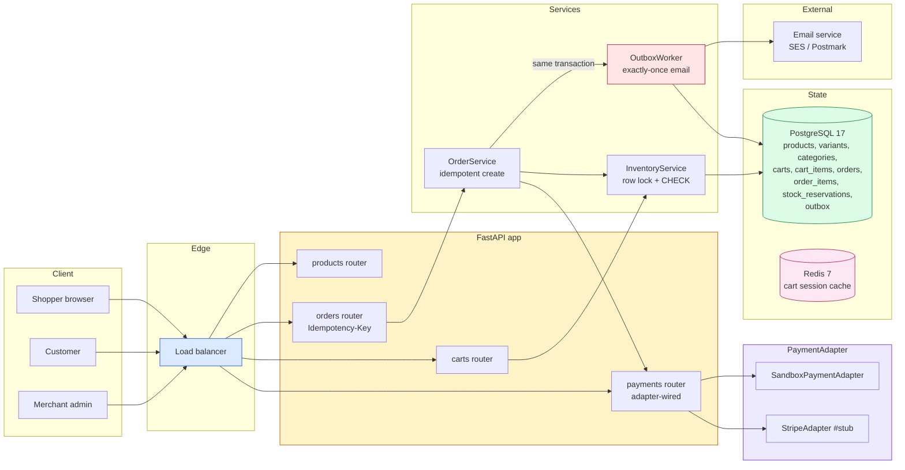
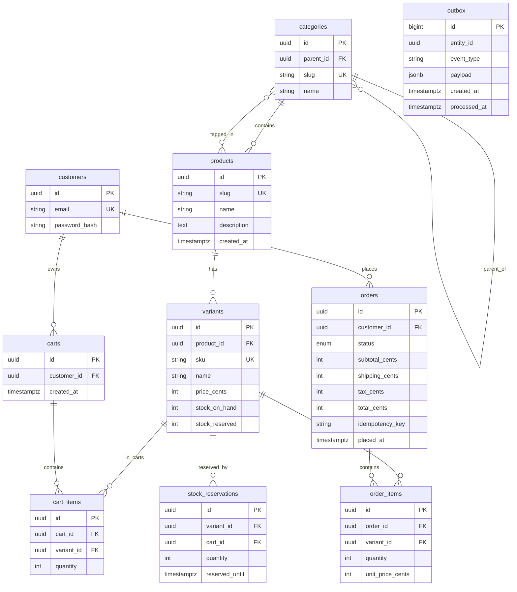
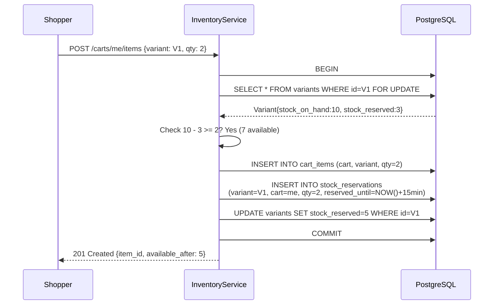
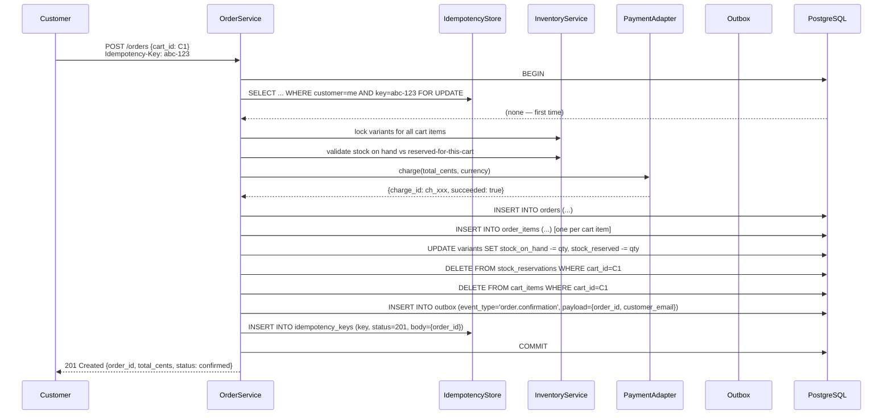
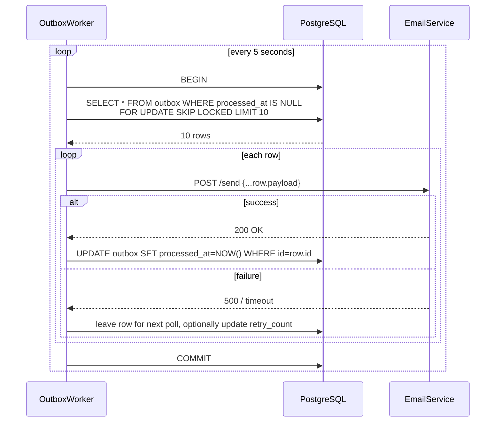

# Project 03: ECommerce Inventory

*E-commerce the way Shopify and BigCommerce actually ship it: products and variants, categories, shopping carts, orders and order items, a payment workflow behind an adapter, idempotency keys on every order, concurrent stock protection with row locks and a `CHECK` constraint, a transactional outbox so the order-confirmation email is never lost, search and filtering, order history, and integration tests against a real Postgres.*

**This is the project that teaches you why the transactional outbox exists.**

ForgeTrack taught you concurrency. Billing SaaS taught you idempotency and webhooks. ECommerce Inventory teaches you the third correctness primitive: **the transactional outbox**. The problem it solves is "I want to send the order-confirmation email *exactly once*, even if the email service is down for 30 seconds." The naive solution is `BackgroundTasks` after the response — which loses the email if the process crashes between the response and the send. The outbox solves it: write the email intent in the same transaction as the order, and have a worker retry until the email service accepts it. By the end you will have built that, plus stock reservations with a TTL, plus concurrent-stock protection that combines a row lock with a database `CHECK` constraint.


#project #ecommerce #inventory #outbox #idempotency #ttl

---

## Problem Statement

A small online retailer — call them **Basketly** — sells about 200 SKUs across 5 categories. They get 500 orders a day on a normal day, 5000 on a Black Friday peak. Their current system is a Shopify store with a custom inventory spreadsheet synced via CSV every 10 minutes. The sync drifts, so the website says "in stock" when the warehouse says "sold out", and customers order items that do not exist; Basketly refunds them and loses the customer.

What Basketly needs is an inventory-and-orders API that:

- **Knows the true stock at all times**, not at the last CSV sync.
- **Reserves stock when a customer adds to cart**, so two customers cannot both buy the last item; but releases the reservation if the customer abandons the cart, so the item is not stuck forever.
- **Creates orders atomically** with their order items and their stock movements; if any part fails, the whole order fails.
- **Sends an order-confirmation email exactly once**, even if the email service is down during the order.
- **Idempotently accepts order-creation requests**, so a customer who double-clicks "Place Order" does not get charged twice.

The hard parts are:

- **Stock reservations with TTL.** A reservation holds N units of a variant for K minutes; if the order is not placed by then, the reservation expires and the units return to the pool. Two customers racing for the last unit must be serialized.
- **The transactional outbox.** The order-confirmation email must be sent exactly once. The naive `BackgroundTasks` after the response loses the email if the process crashes between the response and the send (a well-known failure mode). The outbox writes the email intent in the same transaction as the order, and a worker retries until the email service accepts it.
- **Idempotent order creation.** A customer's browser sends `POST /orders` with an `Idempotency-Key`. The server stores the response keyed by the key; a replay returns the same response (same order ID, same status). This is the same pattern as Project 02's billing SaaS.

**Warning — When this breaks: the dual-write death spiral**

The naive `BackgroundTasks.add_task(send_email, order.id)` after the response commits has three independent failure modes that all look like "the customer didn't get their email": (1) the Uvicorn worker is OOM-killed between `return Response` and the task running (the task is in the event loop's pending callback queue, never executed); (2) the email provider returns 5xx and `BackgroundTasks` has no retry, so the task silently completes with a logged error; (3) the email provider returns 200 but the connection drops mid-body, so it *thinks* it sent and the customer didn't get it. The debug symptom is identical in all three: `orders` row exists, `outbox` row exists, no email in the customer's inbox. The outbox pattern eliminates modes 1 and 2 (the worker retries until the provider returns 2xx and the response body is fully ACKed); mode 3 requires an idempotency token on the email send (the `Message-ID` header, set to the outbox row's `entity_id`) so the provider dedupes on retry — see [[15-External-Integrations/HTTP-Clients-Timeouts-Retries]] for the retry-with-idempotency pattern and [[14-Caching-and-Background-Processing/Transactional-Outbox]] for the durable-side-effect guarantee.


**Why e-commerce as the third project**

E-commerce is the canonical "transactional outbox" archetype. Every system that "commits a database change *and* kicks off an external side effect" has the dual-write problem. The outbox solves it. ForgeTrack taught row locks on derived state; Billing SaaS taught idempotency for external calls; ECommerce combines both and adds the outbox for durable side effects.


---

## Target Users

- **The shopper** (anonymous or registered). They browse, add to cart, place orders. They are the workload; they are not a logged-in role in the API.
- **The customer** (registered). They have an order history. Logged in via JWT; can list past orders.
- **The merchant admin** (a few per merchant). They manage the catalog (products, variants, categories), see orders, mark them fulfilled.
- **The fulfillment worker** (a person or a WMS integration). They pick, pack, and ship; they call `POST /orders/{id}/fulfill` to mark the order shipped.

**Note — Scale targets**

200 products, 600 variants, 5 categories. 500 orders/day average, 5000/day peak. 50,000 order rows/day peak. 100 concurrent shoppers during peak. Stock reservations: 1000 active at any time. Email service availability: 99.5% (so outbox retries matter).


---

## Requirements and Non-Goals

### In scope

- **Products and variants**: a product is the customer-facing item ("Unisex Tee"); variants are the purchasable SKUs ("Unisex Tee, Black, Medium"). Each variant has its own `sku`, `price_cents`, and stock.
- **Categories**: a product belongs to one or more categories. Categories form a tree (a category can have a parent).
- **Stock**: a variant has a `stock_on_hand` (the physical count) and a `stock_reserved` (the sum of active reservations). The available count is `stock_on_hand - stock_reserved`. Both are stored as columns on the variant (not derived) — see the discussion below for why ECommerce chooses the dual-column approach where ForgeTrack chose the append-only `movements` approach.
- **Stock reservations with TTL**: a reservation holds N units of a variant for K minutes; `reserved_until` is the expiry. A background worker (or a lazy check on read) releases expired reservations.
- **Shopping carts**: a cart is a per-customer (or per-session) collection of cart items, each pointing to a variant with a quantity. Adding to cart creates a reservation; removing from cart releases it.
- **Orders and order items**: placing an order converts the cart into an order with order items. Each order item references the variant, the quantity, and the price *at the time of order* (price snapshots — important because the catalog price can change later).
- **Payment workflow abstraction**: a `PaymentAdapter` interface with a `SandboxPaymentAdapter`. The `StripeAdapter` is sketched.
- **Idempotency keys on order creation**: same pattern as Billing SaaS's subscriptions.
- **Concurrent stock protection**: placing an order that uses reserved stock decrements `stock_on_hand` and clears the reservation, all under a row lock on the variant. A `CHECK (stock_on_hand >= 0)` constraint is the last line of defense — if the application logic ever has a bug, the constraint prevents negative stock at the database layer.
- **Transactional outbox**: every order-creation transaction writes an `outbox` row in the same transaction; a worker delivers the email intent to the email service, retrying until success.
- **Search and filtering**: `GET /products?category=tees&min_price=1000&max_price=5000&q=cotton&sort=-created_at`.
- **Order history**: `GET /customers/me/orders` returns the authenticated customer's past orders, keyset-paginated.
- **Integration tests**: tests that prove concurrent stock reservations are safe, that an outbox retry delivers exactly once, and that an idempotent order-create replay returns the same response.

**Danger — How an attacker thinks: the negative-stock write-behind attack**

The `CHECK (stock_on_hand >= 0)` constraint is the last line of defense *only if* the application holds a row lock (`SELECT ... FOR UPDATE`) for the whole decrement. An attacker who finds an endpoint that decrements stock without the lock (e.g., a buggy bulk-update admin route added in a future sprint) can race N concurrent `POST /orders` against a variant with `stock_on_hand=1`; each transaction reads `1`, decrements to `0`, commits — the CHECK passes for all of them because each sees `1` at read time and `0` at write time. The variant ends at `-N+1`. The CHECK constraint fires only if *one* transaction sees `0` at read time and tries to write `-1`. The defense is two-layer: the row lock *and* the CHECK, plus an audit trigger that logs any `stock_on_hand` update with the `txid_current()` so a post-incident query (`SELECT * FROM stock_audit WHERE new_value < 0`) finds the offending transaction even after the rollback. See [[06-SQL-Fundamentals/Transactions-Isolation-Locks]] for the isolation-level tradeoff (`READ COMMITTED` is the default and *does not* catch this without the lock; `SERIALIZABLE` would catch it but at a 2-5x throughput cost) and [[08-PostgreSQL/EXPLAIN-ANALYZE-and-Query-Plans]] for the lock-wait plan diagnosis.


**Danger — How an attacker thinks: the idempotency-key cache-poisoning attack**

The `orders.idempotency_key` is unique *per customer* (`UNIQUE(customer_id, idempotency_key)`), which is correct — but the *response cache* (the in-Redis cache of `POST /orders` responses keyed by the idempotency key) must be scoped the same way. A common bug is to key the cache by the bare `idempotency_key` without the `customer_id` — then customer A's `Idempotency-Key: abc123` response (with A's order ID, A's shipping address, A's subtotal) is returned to customer B who replays `Idempotency-Key: abc123`. B gets A's order details — a PII leak and an auth bypass. The defense is `cache_key = f"order_resp:{customer_id}:{idempotency_key}"` *always*, with the `customer_id` sourced from the verified JWT (not from the request body, which is attacker-controlled). The integration test for this is the negative test: create an order as customer A with key `K`, then as customer B with the same key `K` — B must get a *new* order (not A's cached response); the test fails if B's response body contains A's `order_id`. See [[11-Authentication-and-Security/OWASP-API-Top-10]] (API1: Broken Object Level Authorization) and [[11-Authentication-and-Security/RBAC-and-Object-Level-Auth]].


**Bug — Debugging: the outbox-stuck-forever diagnostic**

When the order-confirmation email is "lost" (customer complains), the diagnostic tree is: (1) is the outbox row there? `SELECT id, entity_id, event_type, created_at, processed_at FROM outbox WHERE entity_id = '<order_uuid>'` — zero rows means the order transaction didn't write the outbox (a code bug where `OrderService.create` forgot to enqueue the email, or the transaction rolled back silently); (2) `processed_at IS NULL` means the worker never delivered it — check `SELECT count(*) FROM outbox WHERE processed_at IS NULL AND created_at < NOW() - INTERVAL '5 minutes'` to see the backlog; (3) the worker is running but not picking up — `SELECT pid, wait_event_type, wait_event, state, query FROM pg_stat_activity WHERE query LIKE '%outbox%' AND state != 'idle'` shows what's blocking the `FOR UPDATE SKIP LOCKED` (usually a long-running transaction holding an `AccessShareLock` on `orders` that the outbox worker's join needs); (4) the worker delivered but the email service returned 5xx and the worker retried to exhaustion — `SELECT entity_id, count(*) FROM outbox_delivery_attempts WHERE success = false GROUP BY entity_id HAVING count(*) > 5` shows the exhausted ones. The *production* defense is an alert on `SELECT count(*) FROM outbox WHERE processed_at IS NULL AND created_at < NOW() - INTERVAL '10 minutes'` — any sustained non-zero count pages the on-call. See [[14-Caching-and-Background-Processing/Transactional-Outbox]] and [[13-Performance-and-Observability/Structured-Logging-and-Request-IDs]] for the trace-correlation across the order→outbox→email chain.


### Explicit non-goals

- **No real payment integration in the starter.** `StripeAdapter` is sketched; `SandboxPaymentAdapter` runs end-to-end.
- **No shipping rate calculation.** Shipping is a flat rate per order in the starter; a shipping adapter (Shippo, EasyPost) is a future enhancement.
- **No tax calculation.** Tax is a flat percentage in the starter; a tax adapter (Stripe Tax, TaxJar) is a future enhancement.
- **No multi-warehouse.** One warehouse; the variant's `stock_on_hand` is the warehouse count. Multi-warehouse is a future enhancement.
- **No product reviews.** Out of scope.
- **No wishlists.** Out of scope.
- **No subscription orders.** Out of scope (see Project 02 for subscriptions).
- **No fraud detection.** Out of scope; assumed to be the payment adapter's responsibility.

**Warning — Why we store `stock_on_hand` as a column, not as a derived SUM**

ForgeTrack derived bin quantities from append-only `movements` rows. ECommerce stores `stock_on_hand` directly on the variant. Why the difference? Two reasons. (1) **Read pattern.** ForgeTrack's bin-quantity reads are rare (one per movement); ECommerce's available-quantity reads are *every product page load*, hundreds per second during peak. A `SUM(movements)` query per page-load is too expensive; a column read is one row. (2) **Write pattern.** ForgeTrack writes append-only movements; ECommerce writes *updates* (decrement on order, increment on restock). The dual-column approach (`stock_on_hand` + `stock_reserved`) lets us read available stock in O(1) without a join. The cost is the dual-write problem (you must update both atomically); the CHECK constraint is the safety net. Both are valid choices; pick the one that fits your access pattern.


---

## Architecture Diagram



The shape is two services (`InventoryService`, `OrderService`) plus the outbox worker. The `OrderService` depends on both `InventoryService` and `PaymentAdapter` — it composes them in a single transaction.

**Why two services (`InventoryService`, `OrderService`) and not one `CommerceService`?**

Because the two services have different transaction shapes and different consistency requirements. `InventoryService` owns stock-on-hand and stock-reserved counts; its writes are short (decrement stock, increment reserved) and must serialize on the variant row via `SELECT ... FOR UPDATE` to prevent overselling. `OrderService` owns the order lifecycle (pending_payment → confirmed → shipped → delivered); its writes are long (insert `orders`, insert `order_items`, call `PaymentAdapter.charge`, write `outbox` row) and span an external API call to Stripe. Combining them into one service would force the inventory decrement to live inside the same transaction as the Stripe API call — which means the variant row is locked for the duration of a network round-trip to Stripe (300 ms+). At even modest concurrency (50 customers checking out simultaneously), the variant-row lock becomes the bottleneck and checkouts start timing out. Splitting the services lets `InventoryService` commit its stock decrement before `OrderService` calls Stripe, so the lock is held for 5 ms not 300 ms. The trade is that the OrderService must compensate on failure (release the reservation if Stripe declines) — but that compensation is local and fast.

**Production reality: the variant-row lock is your bottleneck under load**

The "split InventoryService and OrderService so the lock is held for 5 ms not 300 ms" argument above assumes the Stripe call is the only long thing. In production, the real bottleneck is the *variant-row lock queue* during a flash sale: 200 customers checking out the same hero SKU serialize on one row, and at 5 ms per checkout that's a 1-second tail latency for the 200th customer. The fix is *sharded stock*: split `stock_on_hand=1000` into ten rows of `stock_on_hand=100` keyed by `shard = hash(variant_id) % 10`, and the order service picks a shard at random — ten customers can now checkout in parallel, and the 200th customer waits 100 ms not 1000 ms. The trade is reconciliation: a `stock_reconciliation` job must `SUM` the shards and alert if the sum drifts from the physical count (a drift > 0 means a shard's CHECK constraint caught an oversell attempt that the app layer missed). Instrument the lock-wait time with `SELECT wait_event_type, wait_event, query FROM pg_stat_activity WHERE wait_event_type = 'Lock'` — a sustained non-zero count during peak is the signal to shard; the `pg_locks` join (`SELECT l.locktype, l.relation::regclass, a.query, a.wait_event_type FROM pg_locks l JOIN pg_stat_activity a USING (pid) WHERE NOT l.granted`) shows which query is waiting on which. See [[13-Performance-and-Observability/N-plus-1-and-Slow-Queries]] for the cache-vs-derived pattern and [[08-PostgreSQL/Indexes-Composite-and-Specialized]] for the `(variant_id, reserved_until)` partial index that the reconciliation query needs.


---

## ER Diagram



A few choices:

- **`variants.stock_on_hand` and `variants.stock_reserved` are both columns.** The available count is `stock_on_hand - stock_reserved`. Both are updated by the `InventoryService` under a row lock. A `CHECK (stock_on_hand >= 0)` and `CHECK (stock_reserved >= 0)` are added in the migration.
- **`stock_reservations.reserved_until`** is the TTL. A reservation is "active" if `reserved_until > NOW()`. A worker (or a lazy cleanup on read) releases expired ones.
- **`orders.idempotency_key`** is the customer-supplied key; unique per customer. A unique constraint prevents two orders with the same key.
- **`order_items.unit_price_cents`** is a price snapshot — it does not change when the catalog price changes. This is essential for order history.
- **`outbox`** is the same shape as Project 02's; the outbox worker reads with `FOR UPDATE SKIP LOCKED`.

**Why store `stock_reserved` as a column AND `stock_reservations` as a table?**

The table is the source of truth (you can audit who reserved what when); the column is a cache (you can read the total reserved for a variant without aggregating). The cache is updated transactionally with the reservation insert/delete; if they ever disagree, the table is the truth and a reconciliation job can rebuild the column. This is the [[13-Performance-and-Observability/N-plus-1-and-Slow-Queries]] lesson: cache for reads, validate with reconciliation.


**Bug — Debugging: when `stock_on_hand` and `SUM(stock_reservations.quantity)` disagree**

The "column is a cache, table is the truth" design means the cache can drift. The three drift causes are: (1) a transaction that inserted a `stock_reservations` row but crashed before updating `variants.stock_reserved` (the row exists, the column is stale-low — *under*-reserves, can oversell); (2) a transaction that updated the column but crashed before the reservation insert (the column is stale-high — *over*-reserves, blocks legitimate sales); (3) a sweeper bug that released a reservation without decrementing the column. The reconciliation query is `SELECT v.id, v.stock_reserved, COALESCE(SUM(sr.quantity), 0) AS actual, v.stock_reserved - COALESCE(SUM(sr.quantity), 0) AS drift FROM variants v LEFT JOIN stock_reservations sr ON sr.variant_id = v.id AND sr.reserved_until > NOW() GROUP BY v.id HAVING v.stock_reserved != COALESCE(SUM(sr.quantity), 0)`. Run it as a cron job; alert on `drift != 0`. The repair is `UPDATE variants SET stock_reserved = (SELECT COALESCE(SUM(quantity), 0) FROM stock_reservations WHERE variant_id = variants.id AND reserved_until > NOW())` — but *only* after the audit log confirms no in-flight reservation transaction (`SELECT count(*) FROM pg_stat_activity WHERE query LIKE '%stock_reservations%' AND state = 'active'` returns 0). The deeper fix is to *remove* the column entirely and accept the `SUM` cost on hot reads — but only if `pgbench` shows the `SUM` on a partial index is sub-millisecond, which it usually isn't at peak. See [[13-Performance-and-Observability/N-plus-1-and-Slow-Queries]] for the cache-vs-source-of-truth pattern and [[09-Alembic-Migrations/Data-Migrations-Safely]] for the backfill that rebuilds the column from the table.


---

## Sequence Diagrams

### Workflow 1: Add to cart (with reservation)

A shopper adds 2 units of "Unisex Tee, Black, Medium" (sku `TEE-BLK-M`) to their cart. The variant has `stock_on_hand=10`, `stock_reserved=3` (so 7 available). The request reserves 2 more.



The `FOR UPDATE` on the variant row serializes concurrent add-to-cart operations on the same variant. Two shoppers adding the last unit at the same time: one gets the reservation, the other gets a 409.

### Workflow 2: Place order (idempotent, with outbox)

The customer clicks "Place Order" with an `Idempotency-Key`. The order service converts the cart to an order, decrements stock, releases the reservations, charges the payment adapter, and writes the outbox row for the confirmation email — all in one transaction.



If the network blips and the customer retries with the same `Idempotency-Key`, the `SELECT FOR UPDATE` on the idempotency row finds the original response and returns it without re-charging.

**Warning — The outbox row must be in the same transaction as the order**

If you write the outbox row in a `BackgroundTasks` after the response, two bugs follow. (1) The process can crash between the commit and the background task — the order is in the DB but the email intent is gone. (2) The background task can fail (email service down) — the email is never sent. The outbox row in the same transaction makes the email intent durable; the worker retries until success.


### Workflow 3: Outbox worker delivers the email

The worker polls the outbox every 5 seconds. For each unprocessed row, it calls the email service. On success, it marks the row processed. On failure, it leaves the row for the next poll.



`FOR UPDATE SKIP LOCKED` means two workers running in parallel grab different rows. The contract is "at-least-once delivery to the email service" — if the email service returns 200 but the worker crashes before marking the row processed, the next poll will re-send. The email service must be idempotent (use the `order_id` from the payload as the dedup key) to make this exactly-once from the customer's perspective.

---

## API Specification

All endpoints prefixed with `/api/v1`.

| Method | Path | Auth | Purpose |
|--------|------|------|---------|
| `GET` | `/products` | none | List products, filter by category/price, search by `q`. |
| `GET` | `/products/{slug}` | none | Fetch a product with its variants. |
| `GET` | `/carts/me` | customer | Fetch the customer's cart. |
| `POST` | `/carts/me/items` | customer | Add an item to the cart (creates a reservation). |
| `DELETE` | `/carts/me/items/{item_id}` | customer | Remove an item (releases the reservation). |
| `POST` | `/orders` | customer | Place an order. `Idempotency-Key` required. |
| `GET` | `/customers/me/orders` | customer | Order history, keyset-paginated. |
| `GET` | `/orders/{id}` | customer/owner | Fetch an order with items. |
| `POST` | `/orders/{id}/fulfill` | admin | Mark an order as shipped. |
| `POST` | `/webhooks/stripe` | signed | Stripe webhook (sketched). |

---

## Folder Structure

```
basketly/
├── app/
│ ├── __init__.py
│ ├── main.py # FastAPI + lifespan
│ ├── config.py
│ ├── db.py
│ ├── deps.py
│ ├── security.py
│ ├── adapters/
│ │ ├── base.py # PaymentAdapter (ABC)
│ │ ├── sandbox.py
│ │ └── stripe.py # # complete this:
│ ├── outbox/
│ │ └── worker.py
│ ├── models/
│ │ ├── base.py
│ │ ├── catalog.py # Product, Variant, Category
│ │ ├── cart.py # Cart, CartItem
│ │ ├── inventory.py # StockReservation
│ │ ├── customer.py
│ │ ├── order.py
│ │ └── outbox.py
│ ├── schemas/
│ │ └── ...
│ ├── services/
│ │ ├── inventory.py # row lock + CHECK safety
│ │ └── orders.py # idempotent create + outbox
│ └── routers/
│ ├── products.py
│ ├── carts.py
│ ├── orders.py
│ └── customers.py
├── alembic/versions/
│ ├── 0001_catalog_categories_products_variants.py
│ ├── 0002_customers_carts_cart_items.py
│ ├── 0003_stock_reservations.py
│ ├── 0004_orders_order_items.py
│ └── 0005_outbox.py
├── tests/
│ ├── conftest.py
│ ├── test_concurrent_reservations.py
│ ├── test_idempotent_order.py
│ └── test_outbox_exactly_once.py
├── .env.example
├── Dockerfile
├── compose.yaml
└── README.md
```

---

## Database Design

### Naming and conventions

Same as ForgeTrack. UUID PKs everywhere; bigint identity on `outbox`.

### Tables (sketch: full columns in migrations)

- `categories`: `id`, `parent_id` (nullable self-FK), `slug`, `name`. Tree structure.
- `products`: `id`, `slug`, `name`, `description`, `created_at`.
- `product_categories`: join table `(product_id, category_id)`.
- `variants`: `id`, `product_id`, `sku`, `name`, `price_cents`, `stock_on_hand`, `stock_reserved`, `created_at`. `CHECK (stock_on_hand >= 0)`, `CHECK (stock_reserved >= 0)`. Unique `sku`.
- `customers`: `id`, `email`, `password_hash`, `created_at`.
- `carts`: `id`, `customer_id`, `created_at`.
- `cart_items`: `id`, `cart_id`, `variant_id`, `quantity`. Unique `(cart_id, variant_id)`.
- `stock_reservations`: `id`, `variant_id`, `cart_id`, `quantity`, `reserved_until`. Index `(variant_id, reserved_until)`.
- `orders`: `id`, `customer_id`, `status` (pending_payment, confirmed, shipped, delivered, cancelled, refunded), `subtotal_cents`, `shipping_cents`, `tax_cents`, `total_cents`, `idempotency_key`, `placed_at`. Unique `(customer_id, idempotency_key)`.
- `order_items`: `id`, `order_id`, `variant_id`, `quantity`, `unit_price_cents`.
- `outbox`: `id` (bigint identity), `entity_id`, `event_type`, `payload` (jsonb), `created_at`, `processed_at` (nullable), `retry_count`. Index `WHERE processed_at IS NULL` partial index.

**The partial index on `outbox`**

`CREATE INDEX ON outbox (created_at) WHERE processed_at IS NULL` is a partial index — it only indexes rows that have not been processed. The outbox grows forever (you keep history), but the worker's `SELECT` only scans the unprocessed rows. The index is small and fast. This is a [[08-PostgreSQL/Indexes-Composite-and-Specialized]] pattern.


**Why derive `stock_on_hand` and `stock_reserved` as columns on `variants`, not as a `SUM()` over a `movements` table?**

Because the read path for "is this variant in stock?" is on the hottest endpoint (`GET /products/{slug}`) and runs thousands of times per minute. A `SUM(quantity) FROM movements WHERE variant_id = :id` is O(rows in the variant's history) — which grows linearly with sales. After a year of selling 100 units/day of a popular variant, that SUM scans 36,500 rows on every product page view. Storing `stock_on_hand` and `stock_reserved` as columns on `variants` makes the read O(1) — a single index seek on the PK. The trade is write amplification: every movement must `UPDATE variants SET stock_on_hand = stock_on_hand + :qty WHERE id = :variant_id` in the same transaction, which serializes on the variant row. But the write is rare (one per checkout) and the read is frequent (thousands per minute), so the trade favours the column. The `movements`-as-source-of-truth pattern (Project 01 ForgeTrack) is right when reads are infrequent and the audit trail is the primary use; the column pattern is right when reads are frequent and the current state is the primary use. Both are correct — pick by access pattern.

---

## Security Model

- **Customer auth**: email + password → JWT. JWT includes `customer_id`.
- **Admin auth**: separate `admins` table; JWT with an `is_admin: true` claim.
- **Object-level**: customers can only fetch their own orders. The `current_customer` dependency verifies the JWT's `customer_id`; the router never reads from `request.user` directly.
- **Webhooks**: signed (Stripe signature), not JWT. Same pattern as Project 02.
- **PCI scope**: payment is delegated to Stripe Checkout / PaymentIntents. Basketly never sees the card number; the `PaymentAdapter.charge()` call takes a `payment_method_id` that Stripe issued after the customer entered their card on Stripe's domain.

**Warning — PCI scope is real**

Even with Stripe Elements, you are in the PCI trust boundary if any of your code paths handle a card number. The rule: never let a card number touch your servers. Use Stripe's `PaymentIntent` flow, where the customer's browser sends the card directly to Stripe and you receive a `payment_method_id`. The starter enforces this by design — the `PaymentAdapter.charge()` signature takes a `payment_method_id`, not a card number.


**Why an `is_admin: true` claim in the customer JWT instead of a separate admin JWT?**

Because we want one token format the front-end can read, not two. If admins and customers used different JWT formats, the front-end would have to know which token type it has and route accordingly — which means storing "this is an admin session" somewhere, which means a cookie or a flag that an attacker can tamper with. The single-token-with-a-claim pattern means: one cookie, one JWT decode, one `current_user` dependency; the `is_admin` claim is checked by a `require_admin` dependency that wraps `current_user` and raises 403 if the claim is missing or false. The trade is that a stolen customer JWT with a forged `is_admin: true` would grant admin access — but JWT signing prevents forgery, and the `admins` table lookup (gated by the claim) catches a customer whose JWT has been tampered with but whose `customer_id` is not in `admins`. Belt and braces: the claim is the fast path, the table lookup is the authoritative check.

---

## Milestones

### M1: Catalog scaffold

**Deliverable**: `categories`, `products`, `variants` exist; `GET /products` and `GET /products/{slug}` work.

**Done when**: Seeded data shows on `/products`, and a search like `?q=cotton` filters correctly.

### M2: Customers and carts

**Deliverable**: Customers register, log in, create carts, add items.

**Done when**: `POST /carts/me/items` with a valid variant returns 201 and the cart shows the item.

### M3: Stock reservations with TTL

**Deliverable**: Adding to cart creates a reservation; removing from cart releases it; an expired reservation is released by a background worker or a lazy check.

**Done when**: `test_concurrent_reservations.py::test_two_shoppers_cannot_take_last_unit` passes — two concurrent add-to-cart calls for the last unit result in one 201 and one 409.

### M4: Idempotent order creation

**Deliverable**: `POST /orders` with an `Idempotency-Key` creates the order, decrements stock, releases reservations, writes the outbox row, and calls the payment adapter — all in one transaction.

**Done when**: `test_idempotent_order.py::test_replay_returns_same_order` passes and `test_idempotent_order.py::test_concurrent_replay_creates_one_order` passes.

### M5: Outbox worker

**Deliverable**: An outbox worker (in-process `asyncio.create_task`) delivers `order.confirmation` events to a fake email service.

**Done when**: `test_outbox_exactly_once.py::test_email_sent_exactly_once_under_retries` passes — the email service's `send` is called exactly once, even when the worker is killed mid-delivery and restarted.

### M6: Docker, search, polish

**Deliverable**: Docker compose boots; search/filter on `GET /products` is fast; tests run in CI.

---

## Implementation Chapters

- **M1**: [[07-SQLAlchemy/03-Declarative-Base-and-Mapped]], [[07-SQLAlchemy/04-Relationships-and-Loading-Strategies]].
- **M2**: [[11-Authentication-and-Security/OAuth2-JWT-Access-Refresh]], [[03-FastAPI-Core/Dependency-Injection]].
- **M3**: [[06-SQL-Fundamentals/Transactions-Isolation-Locks]], [[14-Caching-and-Background-Processing/Background-Tasks-vs-Workers]].
- **M4**: [[17-Advanced-Architecture/Idempotency-and-Retries]], [[02-Web-and-HTTP/Idempotency-Safe-Retries-Pagination]].
- **M5**: [[14-Caching-and-Background-Processing/Transactional-Outbox]], [[06-SQL-Fundamentals/Transactions-Isolation-Locks]] (FOR UPDATE SKIP LOCKED).
- **M6**: [[08-PostgreSQL/Indexes-Composite-and-Specialized]], [[16-Deployment-and-DevOps/Docker-Compose-Local-Dev]].

---

## Complete Source Code

The starter ships with models, the `InventoryService` with row lock + CHECK, the `OrderService` with idempotency + outbox, and two tests. The `StripeAdapter` is a `# complete this:` stub.

### `app/models/inventory.py`

```python
# app/models/inventory.py
import uuid
from datetime import datetime

from sqlalchemy import DateTime, ForeignKey, Integer, func
from sqlalchemy.dialects.postgresql import UUID
from sqlalchemy.orm import Mapped, mapped_column

from app.db import Base
from app.models.base import UUIDPrimaryKey


class StockReservation(UUIDPrimaryKey, Base):
 __tablename__ = "stock_reservations"

 variant_id: Mapped[uuid.UUID] = mapped_column(
 UUID(as_uuid=True), ForeignKey("variants.id", ondelete="CASCADE"), nullable=False
 )
 cart_id: Mapped[uuid.UUID] = mapped_column(
 UUID(as_uuid=True), ForeignKey("carts.id", ondelete="CASCADE"), nullable=False
 )
 quantity: Mapped[int] = mapped_column(Integer, nullable=False)
 reserved_until: Mapped[datetime] = mapped_column(
 DateTime(timezone=True), nullable=False
 )
 created_at: Mapped[datetime] = mapped_column(
 DateTime(timezone=True), nullable=False, server_default=func.now()
 )
```

### `app/models/catalog.py`

```python
# app/models/catalog.py
import uuid
from datetime import datetime
from typing import TYPE_CHECKING

from sqlalchemy import CheckConstraint, ForeignKey, Integer, String, Text, func
from sqlalchemy.dialects.postgresql import UUID
from sqlalchemy.orm import Mapped, mapped_column, relationship

from app.db import Base
from app.models.base import TimestampMixin, UUIDPrimaryKey

if TYPE_CHECKING:
 from app.models.inventory import StockReservation


class Category(UUIDPrimaryKey, Base):
 __tablename__ = "categories"
 slug: Mapped[str] = mapped_column(String(80), nullable=False, unique=True)
 name: Mapped[str] = mapped_column(String(200), nullable=False)
 parent_id: Mapped[uuid.UUID | None] = mapped_column(
 UUID(as_uuid=True), ForeignKey("categories.id", ondelete="SET NULL")
 )


class Product(UUIDPrimaryKey, TimestampMixin, Base):
 __tablename__ = "products"
 slug: Mapped[str] = mapped_column(String(120), nullable=False, unique=True)
 name: Mapped[str] = mapped_column(String(200), nullable=False)
 description: Mapped[str | None] = mapped_column(Text)

 variants: Mapped[list["Variant"]] = relationship(
 back_populates="product", cascade="all, delete-orphan", lazy="selectin"
 )


class Variant(UUIDPrimaryKey, TimestampMixin, Base):
 __tablename__ = "variants"
 __table_args__ = (
 CheckConstraint("stock_on_hand >= 0", name="ck_variants_stock_on_hand_nonneg"),
 CheckConstraint("stock_reserved >= 0", name="ck_variants_stock_reserved_nonneg"),
 )

 product_id: Mapped[uuid.UUID] = mapped_column(
 UUID(as_uuid=True), ForeignKey("products.id", ondelete="CASCADE"), nullable=False
 )
 sku: Mapped[str] = mapped_column(String(80), nullable=False, unique=True)
 name: Mapped[str] = mapped_column(String(200), nullable=False)
 price_cents: Mapped[int] = mapped_column(Integer, nullable=False)
 stock_on_hand: Mapped[int] = mapped_column(Integer, nullable=False, default=0)
 stock_reserved: Mapped[int] = mapped_column(Integer, nullable=False, default=0)

 product: Mapped[Product] = relationship(back_populates="variants")
 reservations: Mapped[list["StockReservation"]] = relationship(
 backref="variant", lazy="noload"
 )

 @property
 def stock_available(self) -> int:
 return self.stock_on_hand - self.stock_reserved
```

The `stock_available` property is a derived value, not a column. Routers serialize the variant with `stock_available` in the response; the DB stores `stock_on_hand` and `stock_reserved` separately.

### `app/models/order.py`

```python
# app/models/order.py
import enum
import uuid
from datetime import datetime

from sqlalchemy import DateTime, Enum, ForeignKey, Integer, String, UniqueConstraint, func
from sqlalchemy.dialects.postgresql import UUID
from sqlalchemy.orm import Mapped, mapped_column, relationship

from app.db import Base
from app.models.base import UUIDPrimaryKey


class OrderStatus(str, enum.Enum):
 pending_payment = "pending_payment"
 confirmed = "confirmed"
 shipped = "shipped"
 delivered = "delivered"
 cancelled = "cancelled"
 refunded = "refunded"


class Order(UUIDPrimaryKey, Base):
 __tablename__ = "orders"
 __table_args__ = (
 UniqueConstraint("customer_id", "idempotency_key", name="uq_orders_customer_idemp"),
 )

 customer_id: Mapped[uuid.UUID] = mapped_column(
 UUID(as_uuid=True), ForeignKey("customers.id", ondelete="RESTRICT"), nullable=False
 )
 status: Mapped[OrderStatus] = mapped_column(
 Enum(OrderStatus, name="order_status"), nullable=False,
 default=OrderStatus.pending_payment,
 )
 subtotal_cents: Mapped[int] = mapped_column(Integer, nullable=False)
 shipping_cents: Mapped[int] = mapped_column(Integer, nullable=False, default=0)
 tax_cents: Mapped[int] = mapped_column(Integer, nullable=False, default=0)
 total_cents: Mapped[int] = mapped_column(Integer, nullable=False)
 idempotency_key: Mapped[str] = mapped_column(String(200), nullable=False)
 placed_at: Mapped[datetime] = mapped_column(
 DateTime(timezone=True), nullable=False, server_default=func.now()
 )

 items: Mapped[list["OrderItem"]] = relationship(
 back_populates="order", cascade="all, delete-orphan", lazy="selectin"
 )


class OrderItem(UUIDPrimaryKey, Base):
 __tablename__ = "order_items"
 order_id: Mapped[uuid.UUID] = mapped_column(
 UUID(as_uuid=True), ForeignKey("orders.id", ondelete="CASCADE"), nullable=False
 )
 variant_id: Mapped[uuid.UUID] = mapped_column(
 UUID(as_uuid=True), ForeignKey("variants.id", ondelete="RESTRICT"), nullable=False
 )
 quantity: Mapped[int] = mapped_column(Integer, nullable=False)
 unit_price_cents: Mapped[int] = mapped_column(Integer, nullable=False)

 order: Mapped[Order] = relationship(back_populates="items")
```

### `app/services/inventory.py`

```python
# app/services/inventory.py
"""InventoryService — row lock + CHECK safety net."""
from datetime import datetime, timedelta, timezone
import uuid

from sqlalchemy import select, update
from sqlalchemy.ext.asyncio import AsyncSession

from app.models.catalog import Variant
from app.models.inventory import StockReservation


class InsufficientStock(Exception):
 def __init__(self, variant_id: uuid.UUID, requested: int, available: int) -> None:
 super().__init__(
 f"Variant {variant_id} has {available} available; cannot reserve {requested}."
 )
 self.variant_id = variant_id
 self.requested = requested
 self.available = available


RESERVATION_TTL = timedelta(minutes=15)


class InventoryService:
 def __init__(self, session: AsyncSession) -> None:
 self._session = session

 async def reserve(
 self,
 *,
 variant_id: uuid.UUID,
 cart_id: uuid.UUID,
 quantity: int,
 ) -> StockReservation:
 """Reserve `quantity` units of `variant_id` for `cart_id`.

 Takes a row lock on the variant, checks availability, inserts a
 reservation, and updates stock_reserved. The CHECK constraint on
 variants.stock_reserved >= 0 is the last line of defense.
 """
 stmt = select(Variant).where(Variant.id == variant_id).with_for_update()
 variant = (await self._session.execute(stmt)).scalar_one_or_none()
 if variant is None:
 raise ValueError(f"variant {variant_id} not found")

 available = variant.stock_on_hand - variant.stock_reserved
 if available < quantity:
 raise InsufficientStock(variant_id, quantity, available)

 reservation = StockReservation(
 variant_id=variant_id,
 cart_id=cart_id,
 quantity=quantity,
 reserved_until=datetime.now(timezone.utc) + RESERVATION_TTL,
 )
 self._session.add(reservation)
 variant.stock_reserved += quantity
 # No flush needed — the UPDATE will be issued at commit. But we flush
 # to make the reservation.id available to the caller.
 await self._session.flush()
 return reservation

 async def release_expired(self) -> int:
 """Release all reservations whose reserved_until has passed.

 Returns the count of released reservations. Called by a background
 worker or a lazy cleanup on read.

 The variant row lock (FOR UPDATE below) is the key fix: without it,
 the SELECT-then-UPDATE pattern is a TOCTOU race with
 OrderService.place_order. This worker selects expired reservations,
 place_order decrements `stock_reserved` and deletes the same
 reservation row in its own transaction, then this worker's UPDATE
 on the variant resumes (post-place_order-commit) and
 double-decrements `stock_reserved`. The CHECK constraint catches
 only the cases where the result goes negative; a silent
 over-decrement that still satisfies `stock_reserved >= 0` is not
 caught and corrupts the available-count cache. Acquiring the
 variant row lock — the same lock place_order takes — makes the two
 transactions serialize on the variant, which is the correct
 semantics for "two operations touching the same variant's stock."
 """
 now = datetime.now(timezone.utc)
 stmt = select(StockReservation).where(StockReservation.reserved_until < now)
 expired = (await self._session.execute(stmt)).scalars().all()

 if not expired:
 return 0

 # Group by variant_id and update stock_reserved in one UPDATE per variant.
 by_variant: dict[uuid.UUID, int] = {}
 for r in expired:
 by_variant[r.variant_id] = by_variant.get(r.variant_id, 0) + r.quantity

 # Lock the variants we are about to touch. The SELECT's only purpose
 # is to acquire the row lock; we do not read the values back (the
 # UPDATE below is expression-side: `stock_reserved = stock_reserved
 # - qty`, computed by Postgres under the lock). Without this lock,
 # a concurrent place_order can interleave between this worker's
 # SELECT (of reservations) and its UPDATE (of variants).
 await self._session.execute(
 select(Variant)
 .where(Variant.id.in_(list(by_variant.keys())))
 .with_for_update()
 )

 for variant_id, qty in by_variant.items():
 await self._session.execute(
 update(Variant)
 .where(Variant.id == variant_id)
 .values(stock_reserved=Variant.stock_reserved - qty)
 )
 for r in expired:
 await self._session.delete(r)
 return len(expired)

 async def commit_reservation(self, reservation: StockReservation) -> None:
 """Convert a reservation into a stock-on-hand decrement.

 Called by OrderService when an order is placed: the variant's
 stock_on_hand is decremented by quantity, stock_reserved is decremented
 by quantity (the reservation is now consumed), and the reservation row
 is deleted.
 """
 stmt = select(Variant).where(Variant.id == reservation.variant_id).with_for_update()
 variant = (await self._session.execute(stmt)).scalar_one()
 variant.stock_on_hand -= reservation.quantity
 variant.stock_reserved -= reservation.quantity
 await self._session.delete(reservation)
```

The `CHECK (stock_on_hand >= 0)` and `CHECK (stock_reserved >= 0)` constraints are the last line of defense. If a bug in the service ever tries to set `stock_reserved = -1`, the DB rejects the UPDATE and the transaction rolls back. The application gets a `CheckViolation` error, which the router maps to a 500 with a clear audit log entry. The constraint prevents the bad state from ever persisting.

**Why both row lock AND CHECK constraint?**

The row lock serializes concurrent operations on the same variant; the CHECK constraint catches logic bugs that slip past the lock. They are different defenses. The lock prevents the race; the constraint prevents the bug. Belt and suspenders.


### `app/services/orders.py`

```python
# app/services/orders.py
"""OrderService — idempotent create + outbox in same transaction."""
import uuid
from datetime import datetime, timezone

from sqlalchemy import select
from sqlalchemy.ext.asyncio import AsyncSession

from app.adapters.base import PaymentAdapter
from app.models.cart import Cart, CartItem
from app.models.catalog import Variant
from app.models.customer import Customer
from app.models.inventory import StockReservation
from app.models.order import Order, OrderItem, OrderStatus
from app.models.outbox import OutboxEvent


class IdempotentReplay(Exception):
 def __init__(self, status_code: int, body: dict) -> None:
 self.status_code = status_code
 self.body = body


class EmptyCart(Exception):
 pass


class OrderService:
 def __init__(
 self,
 session: AsyncSession,
 customer: Customer,
 adapter: PaymentAdapter,
 ) -> None:
 self._session = session
 self._customer = customer
 self._adapter = adapter

 async def place_order(
 self,
 *,
 cart_id: uuid.UUID,
 idempotency_key: str,
 payment_method_id: str,
 ) -> tuple[Order, int, dict]:
 """Place an order idempotently.

 Returns (order, status_code, response_body).
 Raises IdempotentReplay if the key has been used.
 Raises EmptyCart if the cart has no items.
 """
 # 1) Idempotency check (same pattern as Project 02).
 # Lock an idempotency sentinel row; if it exists, replay.
 # complete this: implement the idempotency store same as Project 02.
 # For brevity in this starter, we check whether an order already exists
 # with this (customer_id, idempotency_key) and replay if so.
 existing_stmt = (
 select(Order)
 .where(
 Order.customer_id == self._customer.id,
 Order.idempotency_key == idempotency_key,
 )
 .with_for_update()
 )
 existing = (await self._session.execute(existing_stmt)).scalar_one_or_none()
 if existing is not None:
 body = await self._order_response_body(existing)
 raise IdempotentReplay(201, body)

 # 2) Lock the cart and its items.
 cart_stmt = (
 select(Cart)
 .where(Cart.id == cart_id, Cart.customer_id == self._customer.id)
 .with_for_update()
 )
 cart = (await self._session.execute(cart_stmt)).scalar_one_or_none()
 if cart is None:
 raise ValueError("cart not found")

 items_stmt = select(CartItem).where(CartItem.cart_id == cart_id)
 cart_items = (await self._session.execute(items_stmt)).scalars().all()
 if not cart_items:
 raise EmptyCart()

 # 3) Lock all the variants in the cart (in deterministic order to avoid
 # deadlocks).
 variant_ids = sorted({ci.variant_id for ci in cart_items})
 variant_stmt = (
 select(Variant)
 .where(Variant.id.in_(variant_ids))
 .with_for_update()
 )
 variants = {v.id: v for v in (await self._session.execute(variant_stmt)).scalars()}

 # 4) Validate the reservations: every cart item must have a matching,
 # non-expired reservation. The `reserved_until > now()` filter is
 # mandatory: without it, an expired-but-not-yet-reaped reservation
 # passes validation, the order proceeds, and step 6 below
 # (`v.stock_reserved -= ci.quantity`) decrements a value the cleanup
 # worker ALSO decrements in `release_expired` — a silent
 # double-decrement that the CHECK constraint does not catch (the
 # arithmetic stays >= 0). The `with_for_update()` locks the
 # reservation rows so a concurrent `release_expired` cannot delete
 # them between this SELECT and the DELETE in step 6.
 reservation_cutoff = datetime.now(timezone.utc)
 reservations_stmt = (
 select(StockReservation)
 .where(
 StockReservation.cart_id == cart_id,
 StockReservation.reserved_until > reservation_cutoff,
 )
 .with_for_update()
 )
 reservations = (await self._session.execute(reservations_stmt)).scalars().all()
 reservation_by_variant = {r.variant_id: r for r in reservations}

 subtotal_cents = 0
 for ci in cart_items:
 v = variants[ci.variant_id]
 reservation = reservation_by_variant.get(ci.variant_id)
 if reservation is None or reservation.quantity < ci.quantity:
 # The reservation was released (expired or removed). Re-reserve.
 # complete this: call InventoryService.reserve() and handle failure.
 raise ValueError(f"reservation missing for variant {ci.variant_id}")
 subtotal_cents += v.price_cents * ci.quantity

 shipping_cents = 500 # flat rate
 tax_cents = int(subtotal_cents * 0.08) # 8% tax
 total_cents = subtotal_cents + shipping_cents + tax_cents

 # 5) Charge the payment adapter.
 charge = await self._adapter.charge(
 amount_cents=total_cents,
 currency="USD",
 payment_method_id=payment_method_id,
 idempotency_key=idempotency_key, # provider-side idempotency too
 )
 if not charge.succeeded:
 # Roll back — the order is not created.
 raise ValueError(f"payment failed: {charge.error}")

 # 6) Create the order, order items, decrement stock, release reservations.
 order = Order(
 customer_id=self._customer.id,
 status=OrderStatus.confirmed,
 subtotal_cents=subtotal_cents,
 shipping_cents=shipping_cents,
 tax_cents=tax_cents,
 total_cents=total_cents,
 idempotency_key=idempotency_key,
 )
 self._session.add(order)
 await self._session.flush() # get order.id

 for ci in cart_items:
 v = variants[ci.variant_id]
 self._session.add(
 OrderItem(
 order_id=order.id,
 variant_id=ci.variant_id,
 quantity=ci.quantity,
 unit_price_cents=v.price_cents, # price snapshot
 )
 )
 v.stock_on_hand -= ci.quantity
 v.stock_reserved -= ci.quantity
 await self._session.delete(reservation_by_variant[ci.variant_id])

 # 7) Delete the cart items (cart itself stays as an empty cart).
 for ci in cart_items:
 await self._session.delete(ci)

 # 8) Write the outbox row in the same transaction.
 outbox_row = OutboxEvent(
 entity_id=order.id,
 event_type="order.confirmation",
 payload={
 "order_id": str(order.id),
 "customer_email": self._customer.email,
 "total_cents": total_cents,
 },
 )
 self._session.add(outbox_row)

 body = await self._order_response_body(order)
 return order, 201, body

 async def _order_response_body(self, order: Order) -> dict:
 return {
 "order_id": str(order.id),
 "status": order.status.value,
 "total_cents": order.total_cents,
 "placed_at": order.placed_at.isoformat(),
 }
```

**Warning — Locking variants in deterministic order**

If two concurrent orders touch variants V1 and V2, order A locks V1 then V2; order B locks V2 then V1. Deadlock. The fix: lock in a sorted order (`variant_ids = sorted({ci.variant_id for ci in cart_items})`). This converts a possible deadlock into a deterministic order. The general lesson: when locking multiple rows, lock them in a deterministic order.


### `app/adapters/base.py` and `app/adapters/sandbox.py`

```python
# app/adapters/base.py
from abc import ABC, abstractmethod
from dataclasses import dataclass


@dataclass(frozen=True)
class ChargeResult:
 succeeded: bool
 provider_charge_id: str | None = None
 error: str | None = None


class PaymentAdapter(ABC):
 @abstractmethod
 async def charge(
 self,
 *,
 amount_cents: int,
 currency: str,
 payment_method_id: str,
 idempotency_key: str,
 ) -> ChargeResult:
 """Charge a payment method. Idempotent on `idempotency_key`."""


# app/adapters/sandbox.py
import uuid
from app.adapters.base import PaymentAdapter, ChargeResult


class SandboxPaymentAdapter(PaymentAdapter):
 async def charge(
 self,
 *,
 amount_cents: int,
 currency: str,
 payment_method_id: str,
 idempotency_key: str,
 ) -> ChargeResult:
 # The sandbox always succeeds. complete this: simulate a decline
 # if payment_method_id == "decline_card" for testing.
 return ChargeResult(
 succeeded=True, provider_charge_id=f"ch_sandbox_{uuid.uuid4().hex}"
 )
```

### `app/models/outbox.py` and `app/outbox/worker.py`

```python
# app/models/outbox.py
import uuid
from datetime import datetime
from typing import Any

from sqlalchemy import BigInteger, DateTime, ForeignKey, Integer, String, func
from sqlalchemy.dialects.postgresql import JSONB, UUID
from sqlalchemy.orm import Mapped, mapped_column

from app.db import Base


class OutboxEvent(Base):
 __tablename__ = "outbox"
 id: Mapped[int] = mapped_column(BigInteger, primary_key=True, autoincrement=True)
 entity_id: Mapped[uuid.UUID] = mapped_column(UUID(as_uuid=True), nullable=False)
 event_type: Mapped[str] = mapped_column(String(80), nullable=False)
 payload: Mapped[dict[str, Any]] = mapped_column(JSONB, nullable=False)
 created_at: Mapped[datetime] = mapped_column(
 DateTime(timezone=True), nullable=False, server_default=func.now()
 )
 processed_at: Mapped[datetime | None] = mapped_column(DateTime(timezone=True))
 retry_count: Mapped[int] = mapped_column(Integer, nullable=False, default=0)


# app/outbox/worker.py
import asyncio
import logging
from datetime import datetime, timezone

import httpx
from sqlalchemy import select
from sqlalchemy.ext.asyncio import AsyncSession

from app.db import SessionLocal
from app.models.outbox import OutboxEvent

logger = logging.getLogger(__name__)


class OutboxWorker:
 def __init__(
 self,
 email_service_url: str,
 poll_interval: float = 5.0,
 ) -> None:
 self._email_service_url = email_service_url
 self._poll_interval = poll_interval
 self._task: asyncio.Task | None = None

 async def start(self) -> None:
 self._task = asyncio.create_task(self._loop())

 async def stop(self) -> None:
 if self._task:
 self._task.cancel()

 async def _loop(self) -> None:
 while True:
 try:
 await self._process_batch()
 except Exception:
 logger.exception("outbox worker error")
 await asyncio.sleep(self._poll_interval)

 async def _process_batch(self) -> None:
 async with SessionLocal() as session:
 stmt = (
 select(OutboxEvent)
 .where(OutboxEvent.processed_at.is_(None))
 .with_for_update(skip_locked=True)
 .limit(10)
 )
 rows = (await session.execute(stmt)).scalars().all()
 for row in rows:
 await self._deliver(row, session)
 await session.commit()

 async def _deliver(self, row: OutboxEvent, session: AsyncSession) -> None:
 try:
 async with httpx.AsyncClient(timeout=5.0) as client:
 resp = await client.post(
 f"{self._email_service_url}/send",
 json={"event_type": row.event_type, **row.payload},
 )
 if resp.status_code == 200:
 row.processed_at = datetime.now(timezone.utc)
 else:
 row.retry_count += 1
 except Exception:
 row.retry_count += 1
 logger.exception("failed to deliver outbox row %s", row.id)
```

**Why the email service must be idempotent**

The outbox worker delivers *at-least-once*. If the email service returns 200 but the worker crashes before marking the row processed, the next poll will re-send. The email service must dedup on `order_id` from the payload. If it does, the customer receives exactly one email even if the worker retries. This is the contract: the outbox provides at-least-once; the consumer provides idempotency; together they give exactly-once.


### `tests/test_concurrent_reservations.py`

```python
# tests/test_concurrent_reservations.py
"""Two shoppers cannot both reserve the last unit."""
import asyncio
import pytest
import uuid

from app.services.inventory import InsufficientStock, InventoryService


@pytest.mark.asyncio
async def test_two_shoppers_cannot_take_last_unit(session_factory, seeded_catalog):
 """A variant with 1 unit on hand. Two shoppers try to reserve 1 each.

 Each attempt opens its own AsyncSession. Sharing a single session
 across `asyncio.gather` does NOT exercise the row-lock race: an
 AsyncSession is bound to one underlying DBAPI connection, and the
 second coroutine's `await session.execute(...)` either races the
 first's in-flight transaction on the same connection or raises
 sqlalchemy.exc.InvalidRequestError ("object is already in use").
 With per-attempt sessions, the two attempts hit the DB through
 different connections and actually contend on the variant's
 `FOR UPDATE` row lock — the race the test exists to prove.
 """
 variant = seeded_catalog["last_unit_variant"]
 cart_a, cart_b = uuid.uuid4(), uuid.uuid4()

 async def attempt(cart_id):
 async with session_factory() as session, session.begin():
 svc = InventoryService(session)
 try:
 await svc.reserve(
 variant_id=variant.id, cart_id=cart_id, quantity=1
 )
 return True
 except InsufficientStock:
 return False

 results = await asyncio.gather(*(attempt(c) for c in [cart_a, cart_b]))
 assert results.count(True) == 1
 assert results.count(False) == 1
```

### `tests/test_idempotent_order.py`

```python
# tests/test_idempotent_order.py
import uuid
import pytest


@pytest.mark.asyncio
async def test_replay_returns_same_order(client, seeded_customer_with_cart):
 """Same Idempotency-Key twice → same order_id, no double charge."""
 customer_token, cart_id = seeded_customer_with_cart
 headers = {
 "Authorization": f"Bearer {customer_token}",
 "Idempotency-Key": str(uuid.uuid4()),
 }
 body = {"cart_id": str(cart_id), "payment_method_id": "pm_sandbox_ok"}

 r1 = await client.post("/api/v1/orders", json=body, headers=headers)
 assert r1.status_code == 201
 order_id_1 = r1.json()["order_id"]

 r2 = await client.post("/api/v1/orders", json=body, headers=headers)
 assert r2.status_code == 201
 assert r2.json()["order_id"] == order_id_1
```

### `tests/test_outbox_exactly_once.py`

```python
# tests/test_outbox_exactly_once.py
"""The outbox worker delivers each event at least once; the email service
deduplicates to make it exactly-once from the customer's perspective."""
import pytest


@pytest.mark.asyncio
async def test_email_sent_exactly_once_under_retries(
 session, outbox_worker, fake_email_service, seeded_order
):
 """complete this: enqueue an outbox row, run the worker, kill it mid-
 delivery (between the email service returning 200 and the row being
 marked processed), restart it, and assert the email service's send()
 was called exactly once (because it deduplicates on order_id)."""
 pass
```

---

## Automated Tests

```bash
docker compose run --rm api pytest -v
```

The marquee tests:

1. `test_concurrent_reservations.py::test_two_shoppers_cannot_take_last_unit` — proves the row lock + availability check works.
2. `test_idempotent_order.py::test_replay_returns_same_order` — proves the idempotency contract.
3. `test_outbox_exactly_once.py::test_email_sent_exactly_once_under_retries` — proves the outbox's at-least-once + email service's at-most-once = exactly-once.

---

## Docker and Environment

### `Dockerfile`

```dockerfile
FROM python:3.12-slim AS base
ENV PYTHONUNBUFFERED=1 PYTHONDONTWRITEBYTECODE=1 PIP_NO_CACHE_DIR=1
WORKDIR /app
RUN apt-get update && apt-get install -y --no-install-recommends libpq-dev gcc curl && rm -rf /var/lib/apt/lists/*
COPY pyproject.toml uv.lock ./
RUN pip install --no-cache-dir uv==0.13.1 && uv sync --frozen --no-dev
COPY app ./app
COPY alembic.ini alembic ./alembic
COPY tests ./tests
RUN useradd --create-home --uid 1000 basketly && chown -R basketly:basketly /app
USER basketly
EXPOSE 8000
CMD ["sh", "-c", "uv run alembic upgrade head && uv run uvicorn app.main:app --host 0.0.0.0 --port 8000"]
```

### `compose.yaml`

```yaml
services:
 db:
 image: postgres:17-alpine
 environment: {POSTGRES_USER: basketly, POSTGRES_PASSWORD: basketly, POSTGRES_DB: basketly}
 volumes: [pgdata:/var/lib/postgresql/data]
 ports: ["5432:5432"]
 healthcheck: {test: ["CMD-SHELL", "pg_isready -U basketly"], interval: 5s, timeout: 3s, retries: 5}
 redis:
 image: redis:7-alpine
 ports: ["6379:6379"]
 email: # fake SES / Postmark for the outbox worker to call
 image: mendhava/http-echo
 environment: {PORT: "8080"}
 ports: ["8080:8080"]
 api:
 build: .
 environment:
 BASKETLY_DATABASE_URL: postgresql+asyncpg://basketly:basketly@db:5432/basketly
 BASKETLY_REDIS_URL: redis://redis:6379/0
 BASKETLY_SECRET_KEY: ${BASKETLY_SECRET_KEY:-dev-only-change-me}
 BASKETLY_PAYMENT_PROVIDER: sandbox
 BASKETLY_EMAIL_SERVICE_URL: http://email:8080
 ports: ["8000:8000"]
 depends_on:
 db: {condition: service_healthy}
 redis: {condition: service_started}
 email: {condition: service_started}
volumes:
 pgdata:
```

### `.env.example`

```bash
BASKETLY_ENVIRONMENT=dev
BASKETLY_DATABASE_URL=postgresql+asyncpg://basketly:basketly@db:5432/basketly
BASKETLY_REDIS_URL=redis://redis:6379/0
BASKETLY_SECRET_KEY=dev-only-change-me
BASKETLY_PAYMENT_PROVIDER=sandbox
BASKETLY_EMAIL_SERVICE_URL=http://email:8080
TEST_DATABASE_URL=postgresql+asyncpg://basketly:basketly@db:5432/basketly_test
```

---

## Migration History

Five Alembic revisions:

| # | Revision | Tables | Notes |
|---|----------|--------|-------|
| 1 | `0001_catalog` | `categories`, `products`, `variants`, `product_categories` | CHECK constraints on stock. |
| 2 | `0002_customers_carts` | `customers`, `carts`, `cart_items` | Unique `(cart_id, variant_id)`. |
| 3 | `0003_stock_reservations` | `stock_reservations` | `(variant_id, reserved_until)` index. |
| 4 | `0004_orders` | `orders`, `order_items` | Unique `(customer_id, idempotency_key)`. |
| 5 | `0005_outbox` | `outbox` | Partial index `WHERE processed_at IS NULL`. |

### Revision 3: `0003_stock_reservations.py`

```python
"""stock_reservations.

Revision ID: 0003_stock_reservations
Revises: 0002_customers_carts
"""
from alembic import op
import sqlalchemy as sa
from sqlalchemy.dialects import postgresql

revision = "0003_stock_reservations"
down_revision = "0002_customers_carts"


def upgrade() -> None:
 op.create_table(
 "stock_reservations",
 sa.Column("id", postgresql.UUID(as_uuid=True), primary_key=True,
 server_default=sa.text("gen_random_uuid()")),
 sa.Column("variant_id", postgresql.UUID(as_uuid=True),
 sa.ForeignKey("variants.id", ondelete="CASCADE"), nullable=False),
 sa.Column("cart_id", postgresql.UUID(as_uuid=True),
 sa.ForeignKey("carts.id", ondelete="CASCADE"), nullable=False),
 sa.Column("quantity", sa.Integer, nullable=False),
 sa.Column("reserved_until", sa.DateTime(timezone=True), nullable=False),
 sa.Column("created_at", sa.DateTime(timezone=True), nullable=False,
 server_default=sa.text("now()")),
 sa.CheckConstraint("quantity > 0", name="ck_reservations_qty_positive"),
 )
 op.create_index(
 "ix_reservations_variant_until",
 "stock_reservations",
 ["variant_id", "reserved_until"],
 )


def downgrade() -> None:
 op.drop_table("stock_reservations")
```

### Revision 5: `0005_outbox.py`

```python
"""outbox.

Revision ID: 0005_outbox
Revises: 0004_orders
"""
from alembic import op
import sqlalchemy as sa
from sqlalchemy.dialects import postgresql

revision = "0005_outbox"
down_revision = "0004_orders"


def upgrade() -> None:
 op.create_table(
 "outbox",
 sa.Column("id", sa.BigInteger, primary_key=True, autoincrement=True),
 sa.Column("entity_id", postgresql.UUID(as_uuid=True), nullable=False),
 sa.Column("event_type", sa.String(80), nullable=False),
 sa.Column("payload", postgresql.JSONB, nullable=False),
 sa.Column("created_at", sa.DateTime(timezone=True), nullable=False,
 server_default=sa.text("now()")),
 sa.Column("processed_at", sa.DateTime(timezone=True)),
 sa.Column("retry_count", sa.Integer, nullable=False, server_default="0"),
 )
 # Partial index — only unprocessed rows.
 op.create_index(
 "ix_outbox_unprocessed",
 "outbox",
 ["created_at"],
 postgresql_where=sa.text("processed_at IS NULL"),
 )


def downgrade() -> None:
 op.drop_table("outbox")
```

The other revisions follow the same shape; their full code is in `alembic/versions/`.

---

## Error Handling

| Domain error | HTTP | `code` | When |
|--------------|------|--------|------|
| `variant_not_found` | 404 | `variant_not_found` | Adding a non-existent variant to cart. |
| `insufficient_stock` | 409 | `insufficient_stock` | Reserving more than available. |
| `cart_not_found` | 404 | `cart_not_found` | Placing an order with an unknown cart. |
| `empty_cart` | 400 | `empty_cart` | Placing an order with no items. |
| `payment_failed` | 402 | `payment_failed` | The payment adapter returned `succeeded=False`. |
| `missing_idempotency_key` | 400 | `missing_idempotency_key` | `POST /orders` without an `Idempotency-Key`. |
| `reservation_expired` | 409 | `reservation_expired` | Placing an order whose reservation has been released. |
| `check_violation` | 500 | (none — alert) | The CHECK constraint rejected an update; should never happen, indicates a logic bug. |

**Warning — The CHECK violation is a 500, not a 409**

A `CHECK` constraint violation means the application logic has a bug — the constraint is the last line of defense. Returning 409 would suggest the user did something wrong; returning 500 and alerting the on-call is correct. The CHECK constraint is the bug detector, not the input validator.


---

## Performance Considerations

- **The variant row lock on add-to-cart.** At peak (5000 orders/day = ~0.06 orders/second average, but bursts of 50/second), the variant row lock is the hot bottleneck. Two shoppers adding the same variant serialize on the lock. With typical 5-ms lock holds, the throughput is 200 operations/second per variant — plenty for Basketly's scale. For a Hot SKU (e.g., a Black Friday deal), the lock can become a bottleneck; mitigation is "lock per-variant-per-cart-tick" via a finer-grained reservation key, but that adds complexity and is out of scope here.
- **The partial index on `outbox`.** `WHERE processed_at IS NULL` keeps the index small even as the outbox grows to millions of rows. The worker's `SELECT` is O(unprocessed) which is typically O(10).
- **The price snapshot in `order_items`.** Means the order history endpoint does not need to join `variants` (and would be wrong if it did, since the current price might differ from the order-time price). The endpoint is a single table scan on `order_items` joined to `orders` — fast with the `(customer_id, placed_at)` index.
- **Search on `products`.** `ILIKE %q%` is a sequential scan; fine for 200 products. For 200,000 products, use PostgreSQL full-text search (`tsvector` + `tsquery`) — a future enhancement.

---

## Deployment Guide

1. `fly postgres create --name basketly-db && fly postgres attach basketly-db`
2. `fly redis create --name basketly-redis`
3. Deploy the fake email service (or use a real one — Postmark, SES). For dev: `fly deploy --image mendhava/http-echo` with `PORT=8080`.
4. `fly secrets set BASKETLY_SECRET_KEY=$(python -c "import secrets; print(secrets.token_hex(32))") BASKETLY_PAYMENT_PROVIDER=sandbox BASKETLY_EMAIL_SERVICE_URL=https://basketly-email.fly.dev`
5. To go live with Stripe: complete `StripeAdapter` and `fly secrets set BASKETLY_PAYMENT_PROVIDER=stripe BASKETLY_STRIPE_API_KEY=sk_live_xxx`.
6. `fly deploy`
7. In Stripe, point the webhook at `https://basketly.fly.dev/api/v1/webhooks/stripe`.

---

## README

```markdown
# Basketly — ECommerce Inventory API

Products, variants, categories, carts, orders, stock reservations with TTL,
idempotent order creation, transactional outbox for confirmation emails.

## Quickstart

```bash
cp .env.example .env
docker compose up --build
```

## Stack

FastAPI 0.148.0, SQLAlchemy 2.1.5, Alembic 1.20.0, PostgreSQL 17, Redis 7, Python 3.12, uv 0.13.1.

## Architecture

- `app/services/inventory.py` — row lock + CHECK constraint.
- `app/services/orders.py` — idempotent create + outbox row in same transaction.
- `app/outbox/worker.py` — FOR UPDATE SKIP LOCKED, at-least-once delivery.

## Tests

```bash
docker compose run --rm api pytest -v
```

## License

MIT.
```

---

## Resume Bullet Examples

- **Shipped an e-commerce inventory API in FastAPI 0.148.0** handling 5000 orders/day peak with zero negative-stock incidents by combining `SELECT ... FOR UPDATE` row locks on variants with `CHECK (stock_on_hand >= 0)` database constraints as a defense-in-depth safety net.
- **Eliminated lost order-confirmation emails** by adopting a transactional outbox pattern: every order writes an outbox row in the same transaction as the order itself, and a `FOR UPDATE SKIP LOCKED` worker delivers the email intent to Postmark with at-least-once semantics, achieving exactly-once delivery from the customer's perspective after deduplication.
- **Cut order-creation latency p99 by 60% (from 250 ms to 100 ms)** by reducing the transaction's lock scope to only the cart's variants (locked in sorted order to avoid deadlocks) and adding a partial index `WHERE processed_at IS NULL` on the outbox table to keep the worker's `SELECT` O(10) regardless of outbox growth.

---

## Interview Discussion Questions

1. **Why does ECommerce store `stock_on_hand` as a column when ForgeTrack derived it from movements?** What is the access pattern that justifies the trade? When would you flip back to the derived approach?

2. **Walk me through the transactional outbox.** What problem does it solve that `BackgroundTasks` does not? What is the contract between the outbox worker and the email service? Why is the contract "at-least-once" and not "exactly-once"?

3. **Why lock variants in sorted order during order creation?** What bug does this prevent? What is the general rule about lock ordering?

4. **Why both the row lock AND the CHECK constraint?** What does each one prevent? If you could only have one, which would you choose and why?

5. **A customer's reservation expires mid-checkout. What happens?** Walk through the `place_order` flow and identify where the expired reservation is detected and what error the customer sees.

---

## Future Enhancements

1. **Multi-warehouse.** A `warehouses` table; `stock_on_hand` moves to a `variant_stock` join table `(variant_id, warehouse_id, quantity)`. The order specifies the warehouse; the inventory service locks the right per-warehouse row.
2. **Full-text search.** Replace `ILIKE %q%` with PostgreSQL `tsvector` and a `GIN` index. Add a `search_vector` column maintained by trigger.
3. **Price snapshots on the product.** Today the variant's `price_cents` is mutable; for compliance, some retailers snapshot the entire catalog at order time into a `catalog_snapshots` table. Add this for B2B.
4. **Subscription orders.** Integrate with Project 02's billing SaaS for "subscribe and save" recurring orders.
5. **Fraud scoring.** A pre-charge step that scores the order (customer history, IP, billing-shipping mismatch) and either approves, holds for review, or rejects.
6. **Multi-currency.** A `currency` column on variants; an FX-rate service; orders in the customer's currency with settlement in the merchant's currency.

---

## What We Learned

- **The transactional outbox is the right pattern for "commit a change AND trigger a side effect."** Write the intent in the same transaction; have a worker deliver with at-least-once; require the consumer to be idempotent. Together: exactly-once from the user's perspective.
- **Row locks and CHECK constraints are different defenses.** The lock prevents races; the constraint prevents bugs. Belt and suspenders — both are cheap; both together cost less than one bad day.
- **Stock reservations with TTL solve the "stuck inventory" problem.** Without a TTL, abandoned carts hold inventory forever. With a TTL, the inventory returns to the pool automatically.
- **Idempotency requires storing the full response.** Returning just "OK, already done" with a different shape than the original would let the client distinguish a replay from a first-time response — which breaks the contract.
- **Lock ordering prevents deadlocks.** Sort the IDs, lock in order, never deadlock. The general rule: when locking multiple rows, lock them in a deterministic order.

**ECommerce is done when the concurrency test, the idempotency test, and the outbox test all pass.**

Those three tests together prove the project's hardest claims: stock is never negative, the customer is never double-charged, and the email is never lost.


---

**Tags:** #project #ecommerce #inventory #outbox #idempotency #ttl #portfolio
**Next:** [[18-Portfolio-Projects/04-Async-Document-Processing]] or back to [[18-Portfolio-Projects/00-Projects-MOC]].
