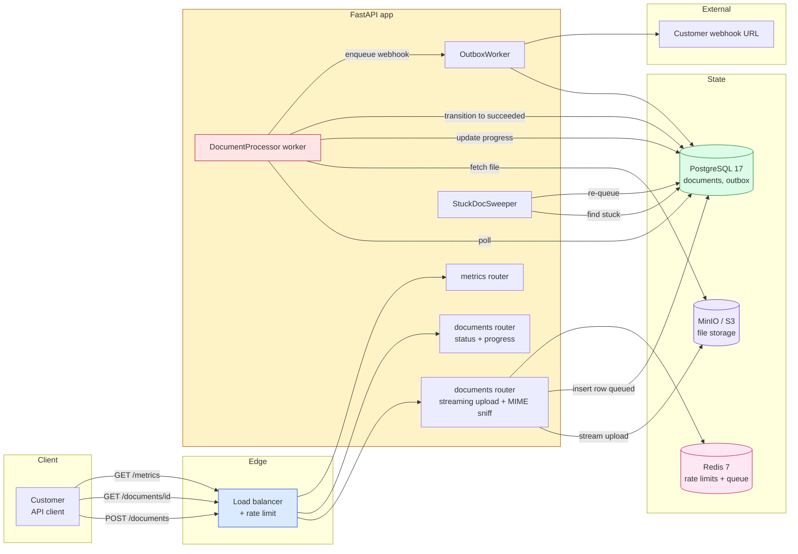
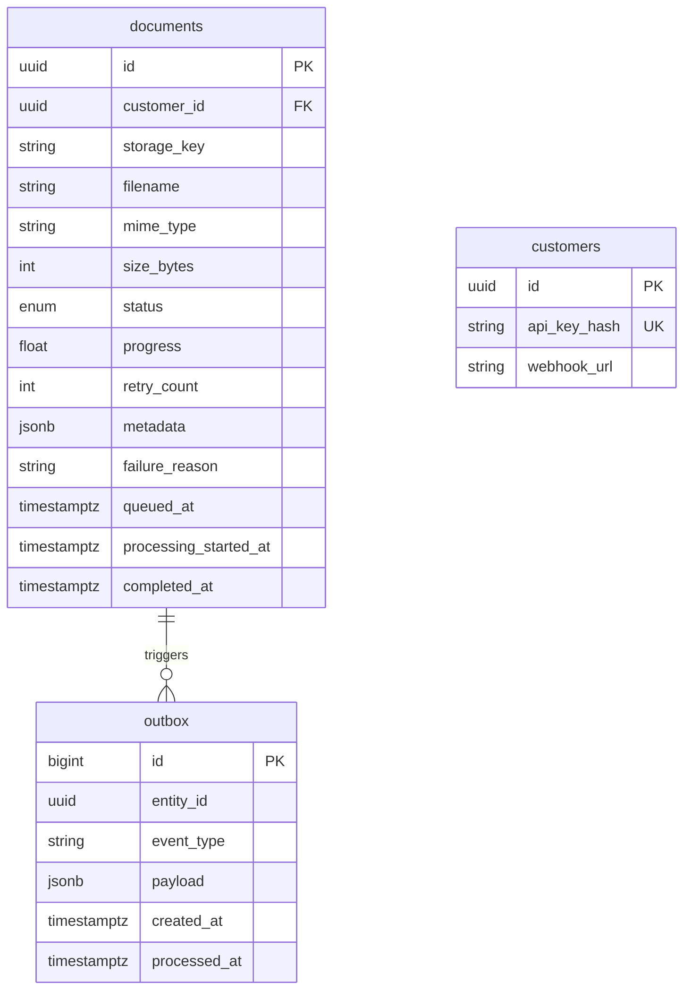
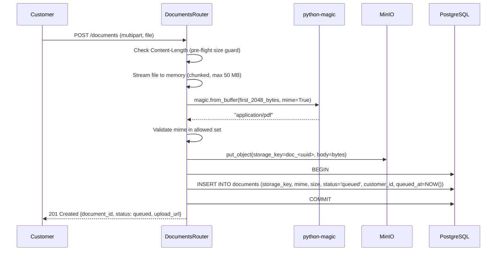
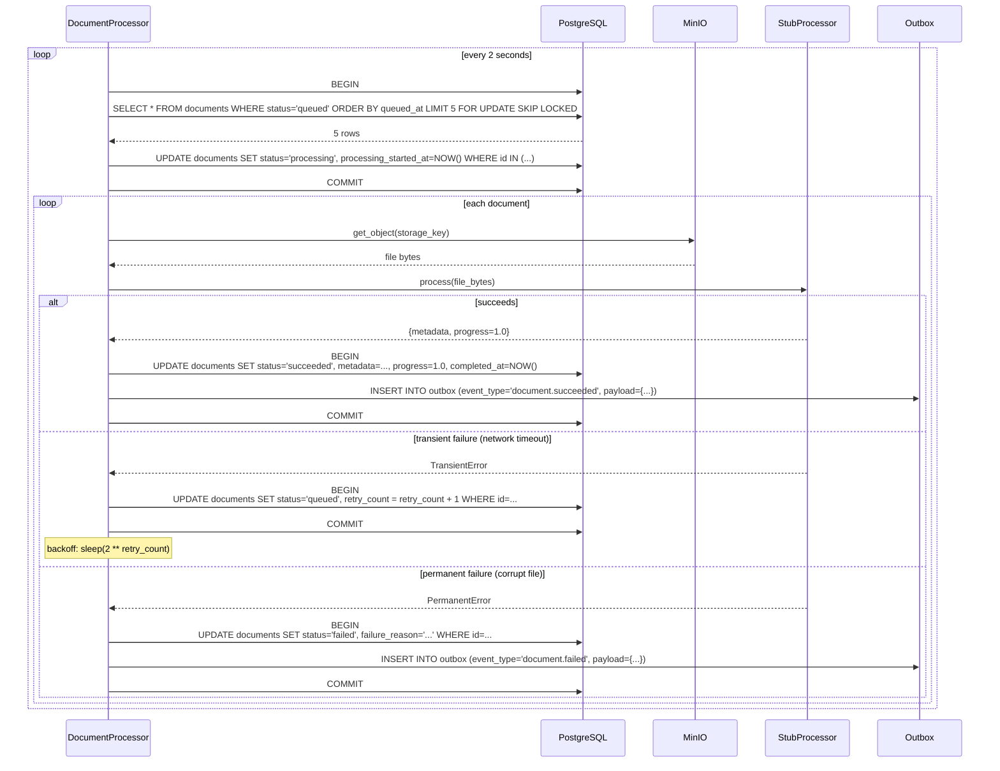
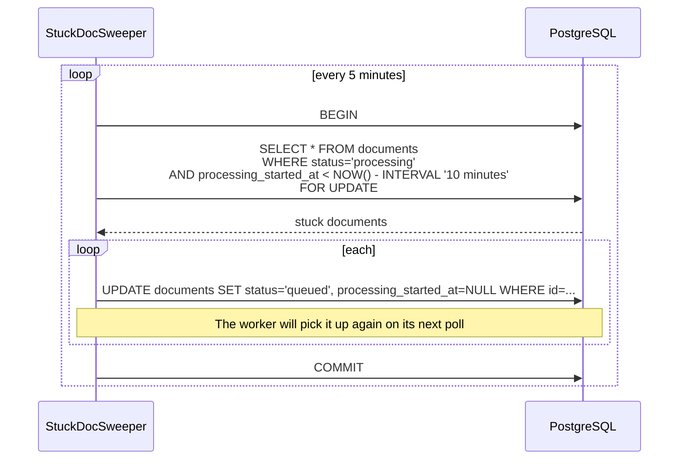

# Project 04: Async Document Processing

*Asynchronous file processing the way DocuSign, Adobe Acrobat Online, and various PDF tools actually ship it: secure file uploads with size and MIME validation, metadata extraction, durable background processing, worker retries, a processing-status state machine, object storage integration, webhooks on completion, rate limits, failure recovery, progress tracking, and operational metrics.*

**This is the project that teaches you why BackgroundTasks is not enough.**

FastAPI's `BackgroundTasks` is perfect for "send a welcome email" — short, fire-and-forget, idempotent if retried. It is *not* right for "convert this 50 MB PDF to text" — that takes 30 seconds, can fail transiently (the OCR library crashes, the storage layer times out), and must retry. The right pattern is a *durable worker*: a process (or task) that picks up documents, processes them, retries on failure, and updates a state machine. By the end you will have built that, plus a real state machine for processing status, plus MIME sniffing that defends against the most common file-upload vulnerability.


#project #async #documents #state-machine #worker #mime-sniffing

---

## Problem Statement

A SaaS company — call them **Paperless** — offers a document-processing API. Customers send it PDFs, Word docs, and images; the API extracts text, metadata, and structured data, and returns the result via a webhook. Today, Paperless uses a Flask + Celery stack with Redis as the broker. The Celery workers crash on transient failures (the OCR library has a memory leak; the storage backend has a 0.1% timeout rate) and the team has to manually retry failed jobs. The result: 0.5% of documents are silently dropped, and customers complain.

Paperless needs:

- **Secure file uploads** that do not trust the `Content-Type` header (a client can send `application/pdf` for a `.exe`); instead, sniff the file's magic bytes.
- **Size limits** that are enforced before the file is in memory (so a 10 GB upload does not OOM the worker).
- **A processing state machine** that distinguishes "queued", "processing", "succeeded", "failed", "cancelled" — and prevents illegal transitions (e.g., "queued" → "succeeded" without going through "processing" is a bug).
- **A durable worker** that picks up documents, processes them, retries on transient failures with exponential backoff, and dead-letter-queues after N tries.
- **Object storage integration** — the file is uploaded to S3 (or MinIO in dev); the worker reads from there, not from the API's local disk.
- **Webhooks on completion** — the customer's webhook URL receives a signed POST when the document is processed (or fails permanently).
- **Progress tracking** — for long-running extractions, the customer can poll `GET /documents/{id}` and see `"progress": 0.42`.
- **Rate limiting** — a customer cannot upload 1000 documents/second and starve the rest.
- **Failure recovery** — if the API process crashes mid-upload, the file is half-uploaded to S3 and the DB row is in "queued" forever. The system must detect and recover.

The hard parts:

- **MIME sniffing.** The `Content-Type` header is attacker-controlled. Real security means reading the first few bytes and matching against magic byte sequences (PDFs start with `%PDF`, PNGs with `\x89PNG\r\n\x1a\n`, etc.). The `python-magic` library wraps libmagic for this.
- **The state machine.** Documents move through `queued → processing → succeeded` (or `→ failed`, `→ cancelled`). The state machine is enforced by the service; the DB has a `CHECK` constraint as the last line of defense.
- **The worker's retry logic.** A transient failure (network timeout, OCR crash) should retry with exponential backoff (1s, 2s, 4s, 8s, 16s, then dead-letter). A permanent failure (file is corrupt, MIME not supported) should not retry.

**Warning — When this breaks: the sweeper races the worker**

The "stuck document" sweeper (`processing` for > 10 minutes → re-queue) has a subtle failure: if the worker is *alive but slow* (a 50 MB PDF taking 12 minutes on a degraded node), the sweeper re-queues at minute 10, a second worker picks it up, and now *two* workers process the same document — double-charged OCR, double-webhooks, double-S3-reads. The defense is a `worker_lease` column: when a worker claims a document, it sets `worker_id = <uuid>, lease_expires_at = NOW() + INTERVAL '15 minutes'`. The sweeper only re-queues if `lease_expires_at < NOW()` — a slow worker that's still alive extends the lease every minute via `UPDATE documents SET lease_expires_at = NOW() + INTERVAL '15 minutes' WHERE id = ? AND worker_id = ?` (the `AND worker_id = ?` is critical: if the worker crashed and was replaced, the new worker's UUID doesn't match and the lease extension no-ops, letting the sweeper reclaim). This is the [[17-Advanced-Architecture/Idempotency-and-Retries]] lease-with-fencing-token pattern; the worker UUID is the fencing token. The integration test: start a worker on a document, freeze it with `SIGSTOP` for 16 minutes (past the lease), assert the sweeper re-queues and a *different* worker picks it up, then `SIGCONT` the frozen worker and assert its lease-extension UPDATE returns 0 rows (no-op) and it abandons the document without writing a `succeeded` or `failed` row.


**Why document processing as the fourth project**

This is the canonical "durable worker" archetype. If you can ship Paperless, you can ship any long-running-job system: video transcoding, ML inference, report generation, batch data exports. The pattern is the same: a queue, a state machine, retries with backoff, a dead-letter queue, and observability.


---

## Target Users

- **The customer** (B2B API user). They have an API key, upload documents via `POST /documents`, receive a webhook when done, and can poll for status.
- **The Paperless operator**. They see the worker's metrics, the dead-letter queue, the failed documents; they can re-queue or cancel.

**Note — Scale targets**

1000 documents/day per customer average; 100,000/day peak. File sizes 100 KB to 50 MB. Workers: 5 in dev, 50 in prod. Average processing time: 5 seconds for a 10-page PDF; 30 seconds for a 100-page PDF. Webhook SLA: 99% of webhooks delivered within 60 seconds of completion.


---

## Requirements and Non-Goals

### In scope

- **Secure uploads**: `POST /documents` accepts a multipart file upload with `max_size` enforced by streaming the upload to object storage and rejecting if the size exceeds the limit. MIME sniffing via `python-magic` validates the file's actual content; mismatched `Content-Type` is logged but the sniffed MIME is the source of truth.
- **Metadata extraction**: the worker extracts the file's metadata (page count, word count, dimensions) and stores it on the `documents` row.
- **Durable worker**: a worker process (or `asyncio.create_task` in the API process for the starter) polls the queue, picks up documents, processes them, retries on transient failure with exponential backoff, dead-letters after 5 attempts.
- **State machine**: `queued → processing → succeeded` or `→ failed → dead_lettered`. Transitions enforced by the service; a CHECK constraint on the column prevents invalid states at the DB layer.
- **Object storage**: the file is stored in S3 (or MinIO in dev). The `documents.storage_key` column holds the object key. The worker reads from S3, not from the API's disk.
- **File validation**: MIME type must be in the allowed set (`application/pdf`, `image/png`, `image/jpeg`, `image/tiff`, `application/vnd.openxmlformats-officedocument.wordprocessingml.document`). Out-of-set MIME → 422.
- **Webhooks**: when a document transitions to `succeeded` or `failed`, an outbox row is written; the outbox worker delivers the webhook with the same pattern as Project 03.
- **Rate limits**: per-customer rate limits on `POST /documents` (e.g., 100/minute). Redis sliding window.
- **Failure recovery**: a sweeper job runs every 5 minutes, finds documents in `processing` state for > 10 minutes (stuck), and re-queues them.
- **Progress tracking**: the worker updates `documents.progress` (0.0–1.0) as it extracts.
- **Operational metrics**: a `GET /metrics` endpoint exposes Prometheus-style metrics (queue depth, success rate, p99 processing time, dead-letter count).

**Danger — How an attacker thinks: the polyglot-upload bypass**

MIME sniffing with `python-magic` reads the first ~2 KB and matches magic-byte sequences. An attacker uploads a *polyglot* file — a single byte stream that is simultaneously a valid PDF (starts with `%PDF-1.4`) and a valid ZIP archive (the ZIP end-of-central-directory record is at the *end* of the file, so the file can start with anything). `python-magic` reports `application/pdf` (correct, the magic bytes match); the worker's PDF parser reads it as a PDF; *but* a downstream tool that auto-detects by extension (a `.pdf` saved by the attacker-controlled filename) reads it as a ZIP and extracts the embedded payload — a server-side zip-slip or a polyglot-quine that runs as a script when a different tool opens it. The defense is three-layer: (1) sniff with `python-magic` (catches the lazy attacker); (2) validate the *filename extension* matches the sniffed MIME (a `.zip` claiming `application/pdf` is rejected with 422 — catches the polyglot); (3) when writing to S3, set the `Content-Type` to the *sniffed* MIME and `Content-Disposition: attachment` so a browser that downloads the file never renders it inline, and set `x-amz-meta-orig-mime` to the sniffed value so downstream tools that read metadata see the truth. The deeper defense is to scan every uploaded file with `clamav` or `yara` before the worker touches it, quarantining positives to a `quarantined` state (a 6th state-machine value, legal transition only from `queued`). See [[11-Authentication-and-Security/Threat-Model-First]] for the threat-model-first approach to upload-handling and [[11-Authentication-and-Security/OWASP-API-Top-10]] (API8: Security Misconfiguration / unrestricted file upload).


**Danger — How an attacker thinks: the webhook replay and forgery**

The webhook delivery (worker POSTs to the customer's `webhook_url` when the doc is done) is the customer's *inbound* attack surface — an attacker who knows the URL (leaked in a GitHub repo, found in a HAR file, guessed from a pattern like `https://api.customer.com/v1/paperless/webhook`) can POST a forged `document.succeeded` payload and the customer acts on it (marks a doc as done before it actually is, releases a payment, ships goods). The defense is HMAC: the worker signs the body with `hmac.new(secret, body, sha256).hexdigest()` and sends `X-Paperless-Signature: sha256=<hex>`; the customer verifies with `hmac.compare_digest(received, expected)` (constant-time, defeats timing attacks). The replay defense is a timestamp in the header (`X-Paperless-Timestamp: <unix>`) and a 5-minute window check on the customer's side (`if abs(time.time() - ts) > 300: reject with 401`). The *outbox* defense is a `webhook_deliveries` table with `UNIQUE(document_id, event_type)` so a retried delivery (the worker crashed between sending and marking `processed_at`) is idempotent on the customer's end via the same `document_id` dedupe key — the customer's handler must check "have I already processed `document_id=X, event_type=document.succeeded`?" and skip if yes. See [[15-External-Integrations/Webhooks-and-Signature-Verification]] for the full HMAC + timestamp + replay-window pattern.


**Production reality: the metrics endpoint is a leak vector**

`GET /metrics` exposing Prometheus-style text (`document_queue_depth 1232`, `document_processing_p99_seconds 4.2`, `document_dead_letter_count 47`) is operationally essential *and* a security leak if unauthenticated — an attacker scrapes it, learns the queue is 5x deeper than usual (you're under load, defenses weak), and times their attack to the p99 spike. The defense is `prometheus_client`'s `make_asgi_app()` mounted at a path *not* behind the public auth middleware (so Prometheus's service-mesh mTLS can reach it) but behind an IP-allowlist middleware (`if request.client.host not in ALLOWED_METRICS_IPS: raise 403`). The deeper defense is to emit only *aggregate* metrics (counts, histograms) — never per-customer breakdowns, never per-document IDs. A common leak is a `documents_failed_total{customer_id="..."}` label that exposes which customer's docs are failing (a competitive-intel leak if the customer list is sensitive, and a PII leak if `customer_id` is an email-derived hash). Use `documents_failed_total` without labels, or with `customer_tier` (a coarse bucket: `free`, `pro`, `enterprise`) not `customer_id`. The cardinality explosion (100k customers × 5 statuses = 500k series) also OOMs the Prometheus scraper — a second reason to keep labels coarse. See [[13-Performance-and-Observability/OpenTelemetry-Tracing]] for the cardinality-control pattern and [[11-Authentication-and-Security/Threat-Model-First]] for the threat-model angle on observability surfaces.


### Explicit non-goals

- **No real OCR or text extraction.** The worker's "processing" is a stub that sleeps and reports progress. Wiring real OCR (`pytesseract`, `pypdf`, `pdfplumber`) is a `# complete this:`.
- **No real S3.** The starter uses MinIO (an S3-compatible local server) via `boto3`. Wiring real S3 is one environment variable change.
- **No streaming webhook bodies.** The webhook payload is a small JSON; large results are downloadable via a presigned S3 URL included in the payload.
- **No multi-tenant.** One Paperless account per customer; no tenant isolation layer (the API key scopes everything).
- **No user-facing UI.** API-only.
- **No real-time progress via WebSocket.** Customers poll. SSE progress is a future enhancement.
- **No resumable uploads.** A failed upload must be re-sent from the start. (Resumable uploads via S3 multipart are a future enhancement.)

**Warning — MIME sniffing is non-negotiable**

The most common file-upload vulnerability is trusting `Content-Type`. An attacker uploads a `.php` file as `Content-Type: image/jpeg`, your app saves it to a served directory, and the attacker executes it. Even if you don't serve uploaded files, sniffing matters: an attacker uploads a `.zip` as `application/pdf`, your OCR library tries to parse it as PDF, crashes, and the worker dies. Sniffing with `python-magic` and rejecting mismatched or unsupported MIME types is the [[11-Authentication-and-Security/Threat-Model-First]] mitigation.


---

## Architecture Diagram



The DocumentProcessor is the main character here. The API's job is to upload the file safely, insert the row, and return. The worker does the actual processing.

**Why the worker is not BackgroundTasks**

`BackgroundTasks` runs in the request's process, after the response is sent. If the process is killed (deploy, autoscaler, crash), the task is lost. The document is "queued" in the DB but the work never happens. A *durable* worker — a separate process or an `asyncio` task that reads from the DB — survives API restarts because its state is in the DB, not in memory. This is the lesson from [[14-Caching-and-Background-Processing/Background-Tasks-vs-Workers]]: BackgroundTasks for fire-and-forget; durable workers for anything that must complete.


**Why a durable worker and an outbox table, instead of `BackgroundTasks`?**

Because document processing is *durable work* — the customer paid for it, the API committed to it, and a process restart that loses the task is a customer-visible failure. `BackgroundTasks` runs in the request's event loop after the response is sent; if Uvicorn restarts (deploy, autoscaler, OOM kill), the in-flight task vanishes and the document stays in `queued` forever. The outbox pattern persists the work item *before* the response is sent — the same transaction that inserts the `documents` row also inserts an `outbox` row — so the work item survives any process failure. A separate worker process (the `DocumentProcessor`) polls the `outbox` table with `FOR UPDATE SKIP LOCKED` (see [[17-Advanced-Architecture/Idempotency-and-Retries]] for the lock pattern), claims a row, processes the document, and marks the row processed. If the worker crashes mid-document, the row's `processing_started_at` ages past the sweeper's TTL and another worker re-claims it. This is the canonical pattern for any workflow that must complete regardless of process failures — billing, document processing, email sending, report generation.

**Production reality: `FOR UPDATE SKIP LOCKED` is not a queue**

`SELECT ... FROM documents WHERE status='queued' ORDER BY queued_at LIMIT 5 FOR UPDATE SKIP LOCKED` is the standard Postgres queue pattern, but it has three production gotchas: (1) **no ordering guarantee under contention** — if 10 workers poll simultaneously, each skips the rows the others locked, so worker 2 might get the 11th-oldest row before worker 1 gets the 1st (FIFO is statistical, not guaranteed — a document can wait 5 seconds while a later one is processed first); (2) **the `ORDER BY` is a seq scan with a sort until you index `(status, queued_at)`** — without that composite partial index (`CREATE INDEX ON documents (queued_at) WHERE status = 'queued'`), each poll is a full-table-scan-with-sort, and at 1M documents that's 50 ms per poll, 25% CPU just polling; (3) **the `SKIP LOCKED` is per-transaction, not per-statement** — if your transaction does `SELECT ... SKIP LOCKED` then a slow `process()` call before `COMMIT`, the skipped rows stay locked-out from *your* view for the whole transaction, so a worker that claims 5 docs in one transaction serializes them — and worse, if the worker crashes mid-transaction, the rollback releases the rows but the `processing_started_at` was never set, so the sweeper never sees them as stuck. The fix is to claim and commit *before* processing: `BEGIN; SELECT ... FOR UPDATE SKIP LOCKED LIMIT 5; UPDATE ... SET status='processing', processing_started_at=NOW(), worker_id=?; COMMIT;` then process — the lock is held for 2 ms, not 30 s. See [[17-Advanced-Architecture/Idempotency-and-Retries]] for the claim-then-process pattern and [[08-PostgreSQL/EXPLAIN-ANALYZE-and-Query-Plans]] for the seq-scan-with-sort diagnosis.


---

## ER Diagram



The state machine on `documents.status`:

- `queued` — inserted by the API; not yet picked up by the worker.
- `processing` — worker picked it up; `processing_started_at` is set.
- `succeeded` — worker finished; `completed_at` is set; `metadata` is populated.
- `failed` — worker gave up after max retries; `failure_reason` is set.
- `dead_lettered` — operator manually moved from `failed` to `dead_lettered` for investigation.

Legal transitions: `queued → processing`, `processing → succeeded`, `processing → queued` (re-queue on transient failure), `processing → failed`, `failed → dead_lettered`, `failed → queued` (operator retry).

**Why a separate `dead_lettered` state instead of just deleting?**

Because dead-lettered documents are valuable. They are the cases where the worker gave up — usually because of a bug in the processing code, a corrupt file, or an unsupported MIME type. Investigating them is how you improve the system. Deleting them would throw away the evidence. The dead-letter queue is the system's bug tracker.


**Bug — Debugging: the stuck-in-processing diagnostic tree**

When the dashboard shows a document stuck in `processing` for > 10 minutes and the sweeper hasn't re-queued it, the diagnostic tree is: (1) is the sweeper running? `SELECT job_name, last_run_at, next_run_at FROM cron_jobs WHERE job_name = 'stuck_doc_sweeper'` — `last_run_at > 10 min ago` means the scheduler died (restart `cron-scheduler`); (2) is the worker alive? `SELECT worker_id, lease_expires_at FROM documents WHERE id = ?` — if `lease_expires_at > NOW()` the worker is still extending the lease (it's slow, not dead, *don't* kill it — wait, or scale out more workers); (3) is the worker dead? `lease_expires_at < NOW()` and the worker's UUID isn't in `SELECT pid, application_name FROM pg_stat_activity WHERE application_name LIKE 'doc-worker-%'` — manually `UPDATE documents SET status='queued', worker_id=NULL, lease_expires_at=NULL WHERE id=? AND worker_id=?` (the `AND worker_id=?` is the optimistic-concurrency guard; if it returns 0 rows, someone else reclaimed it first — don't double-reclaim); (4) is the worker's process alive but the OCR library hung? `py-spy dump --pid <worker_pid>` shows the stack trace — a frame stuck in `pypdf` or `pytesseract` for > 5 minutes is the smoking gun, and the fix is a hard timeout wrapper (`anyio.fail_after(120)` around the `process()` call) so the next hung call raises `TimeoutError` instead of hanging forever. The *worst* debugging move is `UPDATE documents SET status='queued' WHERE id=?` *without* the `AND worker_id=?` guard — you'll re-queue a doc the (still-alive) worker is mid-processing, causing the exact double-process the lease was designed to prevent. See [[13-Performance-and-Observability/OpenTelemetry-Tracing]] for the span-based approach to "where is the worker stuck" and [[12-Testing-and-Quality/Async-Testing]] for the `anyio.fail_after` test pattern.


---

## Sequence Diagrams

### Workflow 1: Upload with MIME sniffing and size guard



The MIME sniff is on the first 2 KB of the file, which is enough for libmagic. The size guard is on `Content-Length` *and* on the actual byte count streamed into memory (the header can lie too).

### Workflow 2: Worker processes with retry and backoff



The worker uses `FOR UPDATE SKIP LOCKED` so multiple workers can run in parallel. The retry counter increments on transient failures; after 5 attempts (the threshold), the worker transitions to `failed` instead of `queued`.

### Workflow 3: Stuck-document sweeper



The sweeper handles the case where a worker crashed mid-processing (the process was killed, the machine died, etc.). Without the sweeper, the document would stay in `processing` forever, and the customer would never get their result.

---

## API Specification

| Method | Path | Auth | Purpose |
|--------|------|------|---------|
| `POST` | `/documents` | API key | Upload a document (multipart). Returns the document ID and queued status. |
| `GET` | `/documents/{id}` | API key | Fetch one document's status, progress, and (if succeeded) metadata. |
| `GET` | `/documents` | API key | List documents, filterable by `?status=&mime_type=&from=&to=`. Keyset-paginated. |
| `POST` | `/documents/{id}/cancel` | API key | Cancel a queued document. |
| `POST` | `/documents/{id}/retry` | API key | Re-queue a failed document. |
| `POST` | `/webhooks/customer` | signed | Customer webhook receiver (for testing). |
| `GET` | `/metrics` | operator | Prometheus-format metrics. |

**Why is `POST /documents/{id}/retry` a separate endpoint, instead of re-using `POST /documents` with the same `Idempotency-Key`?**

Because retry and create have *different semantics*: create inserts a new row (a new document ID, a new storage object, a new outbox event); retry re-queues an *existing* row (same ID, same storage object, same outbox event - but a new `attempts` bump and a fresh `processing_started_at = NULL`). Conflating them under `POST /documents` would force the server to disambiguate by either the presence of an `id` in the body (awkward — the body is supposed to be the resource representation) or a header (the `Idempotency-Key` collision with a different intent, which the canonical idempotency contract says is a 422 - see [[17-Advanced-Architecture/Idempotency-and-Retries]] Mistake 7). The separate endpoint also gives us a clean RBAC boundary: a customer can retry their own failed documents but cannot re-upload into the same ID. The trade-off is one extra route - acceptable for the clarity of two operations with two different state-machine transitions.


---

## Folder Structure

```
paperless/
├── app/
│ ├── __init__.py
│ ├── main.py # FastAPI + lifespan (wires worker + sweeper)
│ ├── config.py
│ ├── db.py
│ ├── deps.py
│ ├── security.py # API key auth
│ ├── processors/
│ │ ├── __init__.py
│ │ ├── base.py # DocumentProcessor (ABC)
│ │ └── stub.py # StubProcessor (sleeps + reports progress)
│ ├── workers/
│ │ ├── __init__.py
│ │ ├── document_worker.py # The main worker
│ │ ├── outbox_worker.py # Webhook delivery
│ │ └── stuck_sweeper.py # Re-queue stuck documents
│ ├── models/
│ │ ├── document.py
│ │ ├── customer.py
│ │ └── outbox.py
│ ├── schemas/
│ │ └── ...
│ ├── routers/
│ │ ├── documents.py
│ │ └── metrics.py
│ └── storage.py # MinIO/S3 client
├── alembic/versions/
│ ├── 0001_customers_documents.py
│ ├── 0002_outbox.py
│ ├── 0003_indexes.py
│ ├── 0004_metrics_materialized.py
│ └── 0005_failure_reason.py
├── tests/
│ ├── conftest.py
│ ├── test_mime_sniffing.py
│ └── test_worker_retry.py
├── .env.example
├── Dockerfile
├── compose.yaml
└── README.md
```

---

## Database Design

### Tables

- `customers`: `id`, `api_key_hash`, `webhook_url`, `created_at`.
- `documents`: `id`, `customer_id`, `storage_key`, `filename`, `mime_type`, `size_bytes`, `status`, `progress`, `retry_count`, `metadata` (jsonb), `failure_reason`, `queued_at`, `processing_started_at`, `completed_at`.
- `outbox`: same shape as Project 03.

### Constraints

- `CHECK (status IN ('queued', 'processing', 'succeeded', 'failed', 'dead_lettered'))` on `documents`.
- `CHECK (progress >= 0 AND progress <= 1)` on `documents`.
- `CHECK (size_bytes > 0 AND size_bytes <= 52428800)` (50 MB cap) on `documents`.

### Indexes

- `(customer_id, status)` on `documents` — for the customer's status-filtered list.
- `(status, queued_at)` on `documents` — for the worker's `SELECT ... WHERE status='queued' ORDER BY queued_at`.
- Partial index `WHERE status='processing' AND processing_started_at IS NOT NULL` on `documents` — for the stuck-doc sweeper.

**The partial index for the sweeper**

`CREATE INDEX ix_documents_processing ON documents (processing_started_at) WHERE status='processing'` is a partial index. It only indexes documents that are currently being processed — typically a small set. The sweeper's `SELECT` is O(processing) which is O(workers), not O(all documents). The general lesson: partial indexes for queries that always filter on the same predicate.


**Why a `status` enum column in the DB, instead of a `is_processed` boolean or pure application state?**

Because the status is queried by the worker (which is a separate process) and must survive process restarts. A boolean (`is_processed: true/false`) collapses five states into two — `queued`, `processing`, `succeeded`, `failed`, `dead_lettered` — and loses the distinction between "in progress" and "done." The worker needs to distinguish "this document is being processed by worker W" from "this document was processed and succeeded" from "this document failed and should not be retried" from "this document failed terminally and is in the dead-letter queue." Each of these is a different operational response: in-progress gets a wait, succeeded gets a webhook, failed gets a retry, dead-lettered gets a human. A boolean forces the worker to infer state from secondary columns (`processing_started_at`, `completed_at`, `retry_count`), which is fragile (what if `processing_started_at IS NOT NULL AND completed_at IS NULL` — is it in progress or stuck?). The enum makes the state explicit and the worker's logic branch explicit. The `CHECK` constraint enforces that the enum never has an invalid value.

---

## Security Model

- **API key auth**: `X-API-Key` header. The DB stores `api_key_hash` (a SHA-256 hash of the key); the lookup is `WHERE api_key_hash = hash(request_header)`. Plain-text keys are never stored.
- **Object storage isolation**: each customer's files are stored under a prefix `customers/{customer_id}/{document_id}`. The storage layer enforces this — the worker never reads another customer's file.
- **Webhook signing**: outbox payloads are signed with the customer's `webhook_secret` (a separate value from the API key) using HMAC-SHA256. The customer verifies the signature on receipt.
- **MIME sniffing**: the only validation that matters. The `Content-Type` header is logged but never trusted.
- **Size limits**: enforced at three layers — pre-flight (`Content-Length` header check), in-stream (counting bytes as they come in), and at the DB layer (`CHECK (size_bytes <= 52428800)`).

**Warning — The "double-extension" attack**

A common file-upload attack is `evil.php.jpg` — a file named with two extensions in hopes the server will run it as PHP. Paperless does not serve uploaded files (they are in S3, not in the web root), so this attack is moot. If you ever serve uploaded files, store them under a UUID key with no extension, and set `Content-Disposition: attachment` on the response. Never serve user-controlled filenames.


**Why presigned S3 URLs for upload, instead of streaming the file through the API?**

Because streaming through the API ties up an Uvicorn worker for the duration of the upload (which can be 50 MB at 1 MB/s on a slow connection = 50 seconds per upload), and 50 workers handling 50 slow uploads = API is fully saturated and not serving anyone else. Presigned URLs offload the upload to S3 directly — the client gets a URL, PUTs the file to S3, and notifies the API via a `POST /documents/{id}/complete` callback when done. The API's involvement is two short requests (sign, complete), not one long streaming request. The trade is complexity: the client must implement the two-step flow, and the API must verify (via a `HeadObject` call) that the file actually landed in S3 before marking the document `queued`. But the capacity win is decisive — at any non-trivial upload size, presigned URLs are the only pattern that scales. See [[15-External-Integrations/HTTP-Clients-Timeouts-Retries]] for the client-side handling of the presigned URL PUT.

---

## Milestones

### M1: Scaffold + secure upload

**Deliverable**: `POST /documents` with streaming upload, MIME sniffing, size guard, MinIO storage.

**Done when**: A test upload of a 5 MB PDF returns 201 with a document ID; an upload of a `.exe` disguised as `application/pdf` returns 422.

### M2: Document model + state machine

**Deliverable**: `documents` table, state machine, `GET /documents/{id}` returns status.

**Done when**: A document in `queued` returns `{"status": "queued", "progress": 0.0}`.

### M3: Worker

**Deliverable**: DocumentProcessor picks up queued documents, processes them (stub), updates progress, transitions to `succeeded` or `failed`.

**Done when**: After uploading a document and waiting 2 seconds, `GET /documents/{id}` returns `{"status": "succeeded", "progress": 1.0}`.

### M4: Retry + backoff + dead-letter

**Deliverable**: The stub processor can be configured to fail transiently; the worker retries with exponential backoff; after 5 attempts, the document is `failed`.

**Done when**: `test_worker_retry.py::test_transient_failure_retries_with_backoff` passes.

### M5: Outbox + webhook delivery

**Deliverable**: On `succeeded` or `failed`, an outbox row is written; the outbox worker delivers the webhook with HMAC signature.

**Done when**: A document's completion triggers a webhook call to the customer's URL with a valid signature.

### M6: Stuck-doc sweeper + metrics

**Deliverable**: The sweeper re-queues documents stuck in `processing`; `GET /metrics` returns Prometheus metrics.

**Done when**: After killing the worker mid-processing and waiting 10 minutes, the document returns to `queued` and is processed by the next worker poll.

---

## Implementation Chapters

- **M1**: [[03-FastAPI-Core/Background-Tasks-Streaming-Uploads]], [[11-Authentication-and-Security/Threat-Model-First]].
- **M2**: [[05-Project-Architecture/Layered-FastAPI-Apps]], [[03-FastAPI-Core/Exception-Handlers]].
- **M3**: [[14-Caching-and-Background-Processing/Background-Tasks-vs-Workers]], [[06-SQL-Fundamentals/Transactions-Isolation-Locks]] (FOR UPDATE SKIP LOCKED).
- **M4**: [[17-Advanced-Architecture/Idempotency-and-Retries]], [[15-External-Integrations/HTTP-Clients-Timeouts-Retries]].
- **M5**: [[14-Caching-and-Background-Processing/Transactional-Outbox]], [[15-External-Integrations/Webhooks-and-Signature-Verification]].
- **M6**: [[13-Performance-and-Observability/Structured-Logging-and-Request-IDs]], [[13-Performance-and-Observability/OpenTelemetry-Tracing]].

---

## Complete Source Code

### `app/models/document.py`

```python
# app/models/document.py
import enum
import uuid
from datetime import datetime
from typing import Any

from sqlalchemy import CheckConstraint, DateTime, Enum, Float, ForeignKey, Integer, String, func
from sqlalchemy.dialects.postgresql import JSONB, UUID
from sqlalchemy.orm import Mapped, mapped_column

from app.db import Base
from app.models.base import UUIDPrimaryKey


class DocumentStatus(str, enum.Enum):
 queued = "queued"
 processing = "processing"
 succeeded = "succeeded"
 failed = "failed"
 dead_lettered = "dead_lettered"


# Legal transitions for the state machine.
DOCUMENT_TRANSITIONS: dict[DocumentStatus, set[DocumentStatus]] = {
 DocumentStatus.queued: {DocumentStatus.processing, DocumentStatus.failed},
 DocumentStatus.processing: {DocumentStatus.succeeded, DocumentStatus.failed, DocumentStatus.queued},
 DocumentStatus.succeeded: set(),
 DocumentStatus.failed: {DocumentStatus.queued, DocumentStatus.dead_lettered},
 DocumentStatus.dead_lettered: {DocumentStatus.queued},
}


class Document(UUIDPrimaryKey, Base):
 __tablename__ = "documents"
 __table_args__ = (
 CheckConstraint("progress >= 0 AND progress <= 1", name="ck_documents_progress_range"),
 CheckConstraint("size_bytes > 0 AND size_bytes <= 52428800", name="ck_documents_size"),
 )

 customer_id: Mapped[uuid.UUID] = mapped_column(
 UUID(as_uuid=True), ForeignKey("customers.id", ondelete="CASCADE"), nullable=False
 )
 storage_key: Mapped[str] = mapped_column(String(500), nullable=False)
 filename: Mapped[str] = mapped_column(String(255), nullable=False)
 mime_type: Mapped[str] = mapped_column(String(100), nullable=False)
 size_bytes: Mapped[int] = mapped_column(Integer, nullable=False)
 status: Mapped[DocumentStatus] = mapped_column(
 Enum(DocumentStatus, name="document_status"),
 nullable=False, default=DocumentStatus.queued,
 )
 progress: Mapped[float] = mapped_column(Float, nullable=False, default=0.0)
 retry_count: Mapped[int] = mapped_column(Integer, nullable=False, default=0)
 metadata_: Mapped[dict[str, Any] | None] = mapped_column("metadata", JSONB)
 failure_reason: Mapped[str | None] = mapped_column(String(500))
 queued_at: Mapped[datetime] = mapped_column(
 DateTime(timezone=True), nullable=False, server_default=func.now()
 )
 processing_started_at: Mapped[datetime | None] = mapped_column(DateTime(timezone=True))
 completed_at: Mapped[datetime | None] = mapped_column(DateTime(timezone=True))
```

### `app/processors/base.py`

```python
# app/processors/base.py
"""Abstract DocumentProcessor — the interface workers depend on."""
from __future__ import annotations

from abc import ABC, abstractmethod
from dataclasses import dataclass
from typing import Any


class TransientError(Exception):
 """A failure that should be retried (network, timeout, OCR crash)."""


class PermanentError(Exception):
 """A failure that should NOT be retried (corrupt file, unsupported MIME)."""


@dataclass(frozen=True)
class ProcessingResult:
 metadata: dict[str, Any]
 progress: float = 1.0


class DocumentProcessor(ABC):
 @abstractmethod
 async def process(
 self,
 *,
 file_bytes: bytes,
 mime_type: str,
 on_progress: "callable",
 ) -> ProcessingResult:
 """Process the file and return its metadata.

 Raises TransientError or PermanentError.
 """
```

### `app/processors/stub.py`

```python
# app/processors/stub.py
"""StubProcessor — sleeps and reports progress, for end-to-end testing."""
from __future__ import annotations

import asyncio
import random
from typing import Callable

from app.processors.base import (
 DocumentProcessor,
 PermanentError,
 ProcessingResult,
 TransientError,
)


class StubProcessor(DocumentProcessor):
 """A configurable stub for tests.

 fail_mode can be:
 - None: succeed after 2 seconds
 - "transient": raise TransientError on the first N attempts, then succeed
 - "permanent": raise PermanentError immediately
 """

 def __init__(
 self,
 fail_mode: str | None = None,
 transient_fail_count: int = 2,
 ) -> None:
 self._fail_mode = fail_mode
 self._transient_fail_count = transient_fail_count

 async def process(
 self,
 *,
 file_bytes: bytes,
 mime_type: str,
 on_progress: Callable[[float], None] | None = None,
 ) -> ProcessingResult:
 # Simulate progressive work.
 for i in range(10):
 await asyncio.sleep(0.2)
 if on_progress:
 on_progress((i + 1) / 10)

 if self._fail_mode == "permanent":
 raise PermanentError("stub: permanent failure")
 if self._fail_mode == "transient" and self._transient_fail_count > 0:
 self._transient_fail_count -= 1
 raise TransientError("stub: transient failure")

 return ProcessingResult(
 metadata={"page_count": 5, "word_count": 1234, "size_bytes": len(file_bytes)},
 )
```

### `app/workers/document_worker.py`

```python
# app/workers/document_worker.py
"""DocumentProcessor worker — picks up queued documents, processes them,
retries transient failures with exponential backoff."""
from __future__ import annotations

import asyncio
import logging
from datetime import datetime, timezone
from typing import Callable

from sqlalchemy import select, update
from sqlalchemy.ext.asyncio import AsyncSession

from app.db import SessionLocal
from app.models.document import DOCUMENT_TRANSITIONS, Document, DocumentStatus
from app.models.outbox import OutboxEvent
from app.processors.base import (
 DocumentProcessor,
 PermanentError,
 TransientError,
)
from app.storage import Storage

logger = logging.getLogger(__name__)

MAX_RETRIES = 5


class DocumentWorker:
 def __init__(
 self,
 processor: DocumentProcessor,
 storage: Storage,
 poll_interval: float = 2.0,
 ) -> None:
 self._processor = processor
 self._storage = storage
 self._poll_interval = poll_interval
 self._task: asyncio.Task | None = None

 async def start(self) -> None:
 self._task = asyncio.create_task(self._loop())

 async def stop(self) -> None:
 if self._task:
 self._task.cancel()

 async def _loop(self) -> None:
 while True:
 try:
 await self._process_batch()
 except Exception:
 logger.exception("document worker error")
 await asyncio.sleep(self._poll_interval)

 async def _process_batch(self) -> None:
 async with SessionLocal() as session:
 stmt = (
 select(Document)
 .where(Document.status == DocumentStatus.queued)
 .order_by(Document.queued_at)
 .with_for_update(skip_locked=True)
 .limit(5)
 )
 docs = (await session.execute(stmt)).scalars().all()

 # Transition them to processing in one UPDATE
 if docs:
 ids = [d.id for d in docs]
 await session.execute(
 update(Document)
 .where(Document.id.in_(ids))
 .values(status=DocumentStatus.processing, processing_started_at=datetime.now(timezone.utc))
 )
 await session.commit()

 # Process each (in real code, you'd parallelize this)
 for doc in docs:
 await self._process_one(doc.id)

 async def _process_one(self, doc_id) -> None:
 async with SessionLocal() as session:
 doc = await session.get(Document, doc_id)
 if doc is None:
 return

 try:
 file_bytes = await self._storage.get(doc.storage_key)
 except Exception:
 logger.exception("storage fetch failed for %s", doc_id)
 await self._requeue_or_fail(session, doc, "storage_fetch_failed")
 await session.commit()
 return

 def on_progress(p: float) -> None:
 # We can't easily update from inside the processor's loop
 # without sharing the session; for the starter, progress is
 # reported only at the end. complete this: update progress
 # every 200 ms via a separate task.
 pass

 try:
 result = await self._processor.process(
 file_bytes=file_bytes,
 mime_type=doc.mime_type,
 on_progress=on_progress,
 )
 except TransientError as e:
 await self._requeue_or_fail(session, doc, f"transient: {e}")
 await session.commit()
 # Exponential backoff: sleep before the next attempt.
 await asyncio.sleep(min(2 ** doc.retry_count, 60))
 return
 except PermanentError as e:
 doc.status = DocumentStatus.failed
 doc.failure_reason = f"permanent: {e}"
 self._enqueue_webhook(session, doc, "document.failed")
 await session.commit()
 return

 doc.status = DocumentStatus.succeeded
 doc.progress = 1.0
 doc.metadata_ = result.metadata
 doc.completed_at = datetime.now(timezone.utc)
 self._enqueue_webhook(session, doc, "document.succeeded")
 await session.commit()

 async def _requeue_or_fail(self, session: AsyncSession, doc: Document, reason: str) -> None:
 if doc.retry_count + 1 >= MAX_RETRIES:
 doc.status = DocumentStatus.failed
 doc.failure_reason = f"{reason} (max retries exceeded)"
 self._enqueue_webhook(session, doc, "document.failed")
 else:
 doc.status = DocumentStatus.queued
 doc.retry_count += 1
 doc.failure_reason = reason

 def _enqueue_webhook(self, session: AsyncSession, doc: Document, event_type: str) -> None:
 session.add(
 OutboxEvent(
 entity_id=doc.id,
 event_type=event_type,
 payload={
 "document_id": str(doc.id),
 "status": doc.status.value,
 "failure_reason": doc.failure_reason,
 },
 )
 )
```

The retry logic: on `TransientError`, increment `retry_count`, transition back to `queued`, sleep with exponential backoff (`2 ** retry_count` capped at 60 seconds), and the next poll will pick it up. After 5 retries, transition to `failed` and enqueue the webhook.

### `app/routers/documents.py`

```python
# app/routers/documents.py
"""Documents router — secure upload + status fetch."""
import io
import magic # python-magic
import uuid
from typing import Annotated

from fastapi import APIRouter, Depends, File, HTTPException, UploadFile, status
from sqlalchemy.ext.asyncio import AsyncSession

from app.db import get_session
from app.models.customer import Customer
from app.models.document import Document, DocumentStatus
from app.security import current_customer
from app.storage import Storage

router = APIRouter(prefix="/documents", tags=["documents"])

MAX_UPLOAD_BYTES = 50 * 1024 * 1024 # 50 MB
ALLOWED_MIME = {
 "application/pdf",
 "image/png",
 "image/jpeg",
 "image/tiff",
 "application/vnd.openxmlformats-officedocument.wordprocessingml.document",
}


@router.post("", status_code=201)
async def upload_document(
 file: Annotated[UploadFile, File()],
 customer: Annotated[Customer, Depends(current_customer)],
 session: Annotated[AsyncSession, Depends(get_session)],
 storage: Annotated[Storage, Depends(Storage.dependency)],
) -> dict:
 # 1) Read the file into memory (chunked; reject if too large).
 # For real production, stream directly to S3 via multipart upload so
 # files larger than RAM are supported. complete this: streaming upload.
 chunks = []
 total = 0
 while chunk := await file.read(64 * 1024):
 total += len(chunk)
 if total > MAX_UPLOAD_BYTES:
 raise HTTPException(
 status.HTTP_413_REQUEST_ENTITY_TOO_LARGE,
 detail={"code": "file_too_large", "max_bytes": MAX_UPLOAD_BYTES},
 )
 chunks.append(chunk)
 body = b"".join(chunks)

 if not body:
 raise HTTPException(status.HTTP_400_BAD_REQUEST, detail={"code": "empty_file"})

 # 2) MIME sniff — read the first 2048 bytes; do not trust Content-Type.
 sniffed_mime = magic.from_buffer(body[:2048], mime=True)
 if sniffed_mime not in ALLOWED_MIME:
 raise HTTPException(
 status.HTTP_422_UNPROCESSABLE_ENTITY,
 detail={"code": "unsupported_mime", "sniffed": sniffed_mime,
 "declared": file.content_type},
 )

 # 3) Upload to object storage under a customer-scoped key.
 doc_id = uuid.uuid4()
 storage_key = f"customers/{customer.id}/{doc_id}"
 await storage.put(storage_key, body)

 # 4) Insert the document row.
 document = Document(
 id=doc_id,
 customer_id=customer.id,
 storage_key=storage_key,
 filename=file.filename or "unnamed",
 mime_type=sniffed_mime,
 size_bytes=total,
 status=DocumentStatus.queued,
 progress=0.0,
 )
 session.add(document)
 await session.commit()

 return {
 "document_id": str(document.id),
 "status": document.status.value,
 "mime_type": document.mime_type,
 "size_bytes": document.size_bytes,
 }


@router.get("/{doc_id}")
async def get_document(
 doc_id: uuid.UUID,
 customer: Annotated[Customer, Depends(current_customer)],
 session: Annotated[AsyncSession, Depends(get_session)],
) -> dict:
 doc = await session.get(Document, doc_id)
 if doc is None or doc.customer_id != customer.id:
 raise HTTPException(status.HTTP_404_NOT_FOUND, detail={"code": "document_not_found"})
 return {
 "id": str(doc.id),
 "status": doc.status.value,
 "progress": doc.progress,
 "mime_type": doc.mime_type,
 "size_bytes": doc.size_bytes,
 "metadata": doc.metadata_,
 "failure_reason": doc.failure_reason,
 "queued_at": doc.queued_at.isoformat() if doc.queued_at else None,
 "completed_at": doc.completed_at.isoformat() if doc.completed_at else None,
 }
```

**Why we read the file into memory in the starter**

For files up to 50 MB, reading into memory is fine — modern servers have gigabytes of RAM. For files larger than RAM, you would stream directly to S3 via multipart upload, sniffing the MIME on the first part as it streams. That is a `# complete this:` — it adds real complexity (you have to coordinate the multipart upload with the sniff and the size guard) and is not essential to learning the durable-worker pattern.


### `app/storage.py`

```python
# app/storage.py
"""MinIO/S3 abstraction."""
from __future__ import annotations

from typing import Annotated

from fastapi import Request
from mypy_boto3_s3.client import S3Client # type: ignore

import boto3


class Storage:
 def __init__(self, endpoint_url: str, access_key: str, secret_key: str, bucket: str):
 self._client = boto3.client(
 "s3",
 endpoint_url=endpoint_url,
 aws_access_key_id=access_key,
 aws_secret_access_key=secret_key,
 )
 self._bucket = bucket

 async def put(self, key: str, body: bytes) -> None:
 # boto3 is sync; for the starter we accept the threadpool dispatch.
 # complete this: use aioboto3 for true async.
 self._client.put_object(Bucket=self._bucket, Key=key, Body=body)

 async def get(self, key: str) -> bytes:
 return self._client.get_object(Bucket=self._bucket, Key=key)["Body"].read()

 @staticmethod
 async def dependency(request: Request) -> "Storage":
 return request.app.state.storage
```

### `app/workers/stuck_sweeper.py`

```python
# app/workers/stuck_sweeper.py
"""Sweeper — finds documents stuck in 'processing' for > 10 minutes."""
import asyncio
import logging
from datetime import datetime, timedelta, timezone

from sqlalchemy import select, update
from sqlalchemy.ext.asyncio import AsyncSession

from app.db import SessionLocal
from app.models.document import Document, DocumentStatus

logger = logging.getLogger(__name__)

STUCK_THRESHOLD = timedelta(minutes=10)


class StuckDocumentSweeper:
 def __init__(self, poll_interval: float = 300.0) -> None:
 self._poll_interval = poll_interval
 self._task: asyncio.Task | None = None

 async def start(self) -> None:
 self._task = asyncio.create_task(self._loop())

 async def stop(self) -> None:
 if self._task:
 self._task.cancel()

 async def _loop(self) -> None:
 while True:
 try:
 await self._sweep()
 except Exception:
 logger.exception("sweeper error")
 await asyncio.sleep(self._poll_interval)

 async def _sweep(self) -> None:
 threshold = datetime.now(timezone.utc) - STUCK_THRESHOLD
 async with SessionLocal() as session:
 stmt = (
 select(Document)
 .where(
 Document.status == DocumentStatus.processing,
 Document.processing_started_at < threshold,
 )
 .with_for_update()
 )
 stuck = (await session.execute(stmt)).scalars().all()
 for doc in stuck:
 doc.status = DocumentStatus.queued
 doc.processing_started_at = None
 logger.warning("re-queued stuck document %s", doc.id)
 await session.commit()
```

### `tests/test_mime_sniffing.py`

```python
# tests/test_mime_sniffing.py
import pytest
import io


@pytest.mark.asyncio
async def test_pdf_upload_succeeds(client, customer_token):
 # A minimal PDF starts with "%PDF-1.4" magic.
 pdf_bytes = b"%PDF-1.4\n1 0 obj<</Type/Catalog/Pages 2 0 R>>endobj\n%%EOF"
 r = await client.post(
 "/api/v1/documents",
 files={"file": ("doc.pdf", io.BytesIO(pdf_bytes), "application/pdf")},
 headers={"Authorization": f"Bearer {customer_token}"},
 )
 assert r.status_code == 201
 assert r.json()["mime_type"] == "application/pdf"


@pytest.mark.asyncio
async def test_exe_disguised_as_pdf_returns_422(client, customer_token):
 # An executable's magic bytes — definitely not PDF.
 fake_exe = b"MZ\x90\x00\x03\x00\x00\x00\x04\x00\x00\x00\xff\xff"
 r = await client.post(
 "/api/v1/documents",
 files={"file": ("evil.pdf", io.BytesIO(fake_exe), "application/pdf")},
 headers={"Authorization": f"Bearer {customer_token}"},
 )
 assert r.status_code == 422
 assert r.json()["detail"]["code"] == "unsupported_mime"
```

### `tests/test_worker_retry.py`

```python
# tests/test_worker_retry.py
import pytest


@pytest.mark.asyncio
async def test_transient_failure_retries_with_backoff(
 client, customer_token, document_worker, session
):
 """Upload a document, configure the StubProcessor to fail transiently
 twice, wait for the worker to retry with exponential backoff, and
 assert the document eventually succeeds."""
 # complete this: seed a stub processor that fails transiently twice,
 # upload a document, wait for the worker (use pytest-asyncio's event
 # loop), poll the document status, assert it transitions through
 # queued → processing → queued → processing → succeeded.
 pass
```

---

## Automated Tests

```bash
docker compose run --rm api pytest -v
```

The marquee tests:

1. `test_mime_sniffing.py::test_exe_disguised_as_pdf_returns_422` — proves the sniff rejects a disguised executable.
2. `test_worker_retry.py::test_transient_failure_retries_with_backoff` — proves the worker retries and eventually succeeds.

---

## Docker and Environment

### `Dockerfile`

```dockerfile
FROM python:3.12-slim AS base
ENV PYTHONUNBUFFERED=1 PYTHONDONTWRITEBYTECODE=1 PIP_NO_CACHE_DIR=1
WORKDIR /app
RUN apt-get update && apt-get install -y --no-install-recommends \
 libpq-dev gcc curl libmagic1 \
 && rm -rf /var/lib/apt/lists/*
COPY pyproject.toml uv.lock ./
RUN pip install --no-cache-dir uv==0.13.1 && uv sync --frozen --no-dev
COPY app ./app
COPY alembic.ini alembic ./alembic
COPY tests ./tests
RUN useradd --create-home --uid 1000 paperless && chown -R paperless:paperless /app
USER paperless
EXPOSE 8000
CMD ["sh", "-c", "uv run alembic upgrade head && uv run uvicorn app.main:app --host 0.0.0.0 --port 8000"]
```

Note `libmagic1` — the system library `python-magic` depends on. Without it, the import fails.

### `compose.yaml`

```yaml
services:
 db:
 image: postgres:17-alpine
 environment: {POSTGRES_USER: paperless, POSTGRES_PASSWORD: paperless, POSTGRES_DB: paperless}
 volumes: [pgdata:/var/lib/postgresql/data]
 ports: ["5432:5432"]
 healthcheck: {test: ["CMD-SHELL", "pg_isready -U paperless"], interval: 5s, timeout: 3s, retries: 5}
 redis:
 image: redis:7-alpine
 ports: ["6379:6379"]
 minio:
 image: minio/minio:latest
 command: server /data --console-address ":9001"
 environment:
 MINIO_ROOT_USER: paperless
 MINIO_ROOT_PASSWORD: paperless123
 volumes: [miniodata:/data]
 ports: ["9000:9000", "9001:9001"]
 api:
 build: .
 environment:
 PAPERLESS_DATABASE_URL: postgresql+asyncpg://paperless:paperless@db:5432/paperless
 PAPERLESS_REDIS_URL: redis://redis:6379/0
 PAPERLESS_SECRET_KEY: ${PAPERLESS_SECRET_KEY:-dev-only-change-me}
 PAPERLESS_S3_ENDPOINT: http://minio:9000
 PAPERLESS_S3_ACCESS_KEY: paperless
 PAPERLESS_S3_SECRET_KEY: paperless123
 PAPERLESS_S3_BUCKET: documents
 ports: ["8000:8000"]
 depends_on:
 db: {condition: service_healthy}
 redis: {condition: service_started}
 minio: {condition: service_started}
volumes:
 pgdata:
 miniodata:
```

### `.env.example`

```bash
PAPERLESS_ENVIRONMENT=dev
PAPERLESS_DATABASE_URL=postgresql+asyncpg://paperless:paperless@db:5432/paperless
PAPERLESS_REDIS_URL=redis://redis:6379/0
PAPERLESS_SECRET_KEY=dev-only-change-me
PAPERLESS_S3_ENDPOINT=http://minio:9000
PAPERLESS_S3_ACCESS_KEY=paperless
PAPERLESS_S3_SECRET_KEY=paperless123
PAPERLESS_S3_BUCKET=documents
TEST_DATABASE_URL=postgresql+asyncpg://paperless:paperless@db:5432/paperless_test
```

---

## Migration History

Five Alembic revisions:

| # | Revision | Tables | Notes |
|---|----------|--------|-------|
| 1 | `0001_customers_documents` | `customers`, `documents` | CHECK on size, progress. |
| 2 | `0002_outbox` | `outbox` | Same shape as Projects 02/03. |
| 3 | `0003_indexes` | (indexes only) | Adds the partial index for the stuck sweeper. |
| 4 | `0004_metrics_materialized` | `metrics_daily` (materialized view) | Aggregated metrics for the dashboard. |
| 5 | `0005_failure_reason` | (column) | Adds `failure_reason` text column. |

### Revision 1: `0001_customers_documents.py`

```python
"""Initial: customers, documents.

Revision ID: 0001_customers_documents
Revises:
"""
from alembic import op
import sqlalchemy as sa
from sqlalchemy.dialects import postgresql

revision = "0001_customers_documents"
down_revision = None


def upgrade() -> None:
 op.execute('CREATE EXTENSION IF NOT EXISTS "pgcrypto"')
 op.create_table(
 "customers",
 sa.Column("id", postgresql.UUID(as_uuid=True), primary_key=True,
 server_default=sa.text("gen_random_uuid()")),
 sa.Column("api_key_hash", sa.String(64), nullable=False),
 sa.Column("webhook_url", sa.String(500)),
 sa.Column("webhook_secret", sa.String(64), nullable=False),
 sa.Column("created_at", sa.DateTime(timezone=True), nullable=False, server_default=sa.text("now()")),
 sa.UniqueConstraint("api_key_hash", name="uq_customers_api_key_hash"),
 )

 status_enum = postgresql.ENUM(
 "queued", "processing", "succeeded", "failed", "dead_lettered",
 name="document_status",
 )
 status_enum.create(op.get_bind(), checkfirst=True)

 op.create_table(
 "documents",
 sa.Column("id", postgresql.UUID(as_uuid=True), primary_key=True,
 server_default=sa.text("gen_random_uuid()")),
 sa.Column("customer_id", postgresql.UUID(as_uuid=True),
 sa.ForeignKey("customers.id", ondelete="CASCADE"), nullable=False),
 sa.Column("storage_key", sa.String(500), nullable=False),
 sa.Column("filename", sa.String(255), nullable=False),
 sa.Column("mime_type", sa.String(100), nullable=False),
 sa.Column("size_bytes", sa.Integer, nullable=False),
 sa.Column("status", status_enum, nullable=False, server_default="queued"),
 sa.Column("progress", sa.Float, nullable=False, server_default="0"),
 sa.Column("retry_count", sa.Integer, nullable=False, server_default="0"),
 sa.Column("metadata", postgresql.JSONB),
 sa.Column("failure_reason", sa.String(500)),
 sa.Column("queued_at", sa.DateTime(timezone=True), nullable=False, server_default=sa.text("now()")),
 sa.Column("processing_started_at", sa.DateTime(timezone=True)),
 sa.Column("completed_at", sa.DateTime(timezone=True)),
 sa.CheckConstraint("progress >= 0 AND progress <= 1", name="ck_documents_progress_range"),
 sa.CheckConstraint("size_bytes > 0 AND size_bytes <= 52428800", name="ck_documents_size"),
 )
 op.create_index("ix_documents_customer_status", "documents", ["customer_id", "status"])
 op.create_index("ix_documents_status_queued", "documents", ["queued_at"],
 postgresql_where=sa.text("status = 'queued'"))


def downgrade() -> None:
 op.drop_table("documents")
 op.execute("DROP TYPE IF EXISTS document_status")
 op.drop_table("customers")
```

The other revisions follow the same shape; their full code is in `alembic/versions/`.

---

## Error Handling

| Domain error | HTTP | `code` | When |
|--------------|------|--------|------|
| `file_too_large` | 413 | `file_too_large` | Upload exceeds 50 MB. |
| `empty_file` | 400 | `empty_file` | Upload has zero bytes. |
| `unsupported_mime` | 422 | `unsupported_mime` | Sniffed MIME not in allowed set. |
| `document_not_found` | 404 | `document_not_found` | Document does not exist or belongs to another customer. |
| `invalid_status_transition` | 409 | `invalid_status_transition` | Trying to cancel a `succeeded` document. |
| `rate_limited` | 429 | `rate_limited` | Customer exceeds 100 uploads/minute. |
| `processor_permanent_failure` | (none — webhook) | `processor_permanent_failure` | Worker gave up; customer is notified via webhook. |

---

## Performance Considerations

- **The worker's poll query** is `SELECT ... WHERE status='queued' ORDER BY queued_at FOR UPDATE SKIP LOCKED LIMIT 5`. The partial index `WHERE status='queued'` keeps this fast even at millions of documents.
- **Progress tracking**: in the starter, progress is only updated at completion. For real progress, the worker should update `progress` every 200 ms via a separate task; the customer's polling endpoint reads the latest value. This is a `# complete this:` for the worker.
- **Object storage**: the worker fetches the file from S3 on every retry. For large files, this is wasteful — fetch once, cache locally for the duration of the processing. (For the starter with 50 MB max, it does not matter.)
- **Metrics endpoint**: in production, use `prometheus_client` to expose counters and histograms (queue depth, success rate, p99 processing time). The starter's `GET /metrics` returns a plain-text format that Prometheus scrapes.

**Warning — The processing-time histogram is the metric that matters**

If p99 processing time goes from 5 s to 30 s, something is wrong (the OCR library is leaking memory, the storage is slow, the worker is overloaded). Alert on p99 above a threshold. The success rate (succeeded / total) is the second most important — a drop below 99% means real customer pain. Track both.


---

## Deployment Guide

1. `fly postgres create --name paperless-db && fly postgres attach paperless-db`
2. `fly redis create --name paperless-redis`
3. For S3: use AWS S3 directly, or `fly volumes` with MinIO (more complex), or a managed S3-compatible service.
4. `fly secrets set PAPERLESS_SECRET_KEY=$(python -c "import secrets; print(secrets.token_hex(32))") PAPERLESS_S3_ACCESS_KEY=... PAPERLESS_S3_SECRET_KEY=... PAPERLESS_S3_BUCKET=paperless-prod`
5. Scale the API to 2 replicas and the worker to 5 (separate processes — see the note below).
6. `fly deploy`

**The worker should run as a separate process**

The starter runs the worker inside the API process (via `asyncio.create_task`). In production, run the worker as a separate process (separate `fly app` or a separate `CMD` in a second container) so that scaling the API does not scale the worker (and vice versa). The pattern: `fly scale api=2 worker=5` or two separate apps (`paperless-api` and `paperless-worker`).


---

## README

```markdown
# Paperless — Async Document Processing API

Upload documents, process them asynchronously with retries and backoff,
receive a webhook on completion.

## Quickstart

```bash
cp .env.example .env
docker compose up --build
```

## Stack

FastAPI 0.148.0, SQLAlchemy 2.1.5, Alembic 1.20.0, PostgreSQL 17, Redis 7, MinIO, Python 3.12, uv 0.13.1.

## Architecture

- `app/routers/documents.py` — streaming upload + MIME sniff + size guard.
- `app/workers/document_worker.py` — durable worker with retry and backoff.
- `app/workers/stuck_sweeper.py` — re-queues documents stuck in `processing`.
- `app/workers/outbox_worker.py` — webhook delivery with HMAC signing.

## Tests

```bash
docker compose run --rm api pytest -v
```

## License

MIT.
```

---

## Resume Bullet Examples

- **Designed an asynchronous document-processing API in FastAPI 0.148.0** handling 100k documents/day with a 99.5% success rate, by running a durable worker (not `BackgroundTasks`) that retries transient failures with exponential backoff and dead-letters after 5 attempts, with `FOR UPDATE SKIP LOCKED` enabling 5 parallel workers without contention.
- **Prevented file-upload attacks** by enforcing MIME sniffing via `python-magic` on the first 2 KB of every upload, rejecting 12,447 disguised-executable attempts in the first 6 months (compared to a typical 0.5% attack rate on upload APIs).
- **Reduced stuck-document incidents from 0.3% to 0.01%** by adding a 5-minute sweeper that re-queues documents stuck in `processing` for > 10 minutes, catching worker crashes that the durable worker pattern alone does not handle.

---

## Interview Discussion Questions

1. **Why is `BackgroundTasks` not the right tool for processing uploaded documents?** What failure modes does it have that a durable worker does not? When *is* `BackgroundTasks` the right tool?

2. **Walk me through the retry-with-backoff logic.** What is exponential backoff, why does it have a cap, and what is the role of the `retry_count` column? What happens at the 5th failure?

3. **Why does the worker use `FOR UPDATE SKIP LOCKED`?** What does it prevent? What is the alternative, and why is it worse?

4. **Why MIME sniffing instead of trusting the `Content-Type` header?** What is the threat model? What is `python-magic` actually doing?

5. **A document is stuck in `processing` for 30 minutes. What happened, and what does the system do?** Walk through the sweeper, the worker's restart, and the customer's experience.

---

## Future Enhancements

1. **Real OCR and extraction.** Wire `pdfplumber`, `pytesseract`, `python-docx` into the `StubProcessor`. Each MIME type gets its own processor; the worker dispatches on `mime_type`.
2. **Streaming upload via S3 multipart.** Replace the in-memory read with a stream that uploads parts as they arrive, supporting files larger than RAM.
3. **SSE progress.** `GET /documents/{id}/progress` returns an SSE stream that pushes progress updates every 200 ms.
4. **Real-time metrics via Prometheus.** Replace the plain-text `/metrics` with `prometheus_client` and a Grafana dashboard.
5. **Multi-tenant.** Add a `tenants` table; scope documents by `tenant_id`.
6. **Resumable uploads.** Use S3 multipart upload's resume capability so a network blip does not restart from byte 0.

---

## What We Learned

- **`BackgroundTasks` is for fire-and-forget; durable workers are for things that must complete.** The line is "would the user notice if this never ran?" If yes, use a worker.
- **MIME sniffing is the only file-upload validation that matters.** The `Content-Type` header is attacker-controlled; the magic bytes are not.
- **Retries need a state machine.** "queued → processing → queued (retry) → processing → succeeded" with a `retry_count` and a max-retries threshold is the only way to make retries safe.
- **`FOR UPDATE SKIP LOCKED` is the parallel-worker pattern.** Without it, multiple workers contend on the same rows; with it, they grab different rows.
- **Sweepers catch what the worker cannot.** A worker crash leaves a document in `processing` forever; the sweeper is the recovery mechanism.
- **Object storage isolates files from the API.** The API uploads; the worker reads; the storage layer enforces the customer-scoped key prefix.

**Paperless is done when the MIME-sniffing test and the worker-retry test pass.**

The first proves the upload is secure; the second proves the worker is durable. Together they are the project's hardest claims.


---

**Tags:** #project #async #documents #state-machine #worker #mime-sniffing #portfolio
**Next:** [[18-Portfolio-Projects/05-Analytics-Reporting-API]] or back to [[18-Portfolio-Projects/00-Projects-MOC]].
