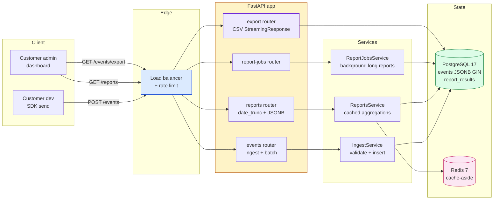
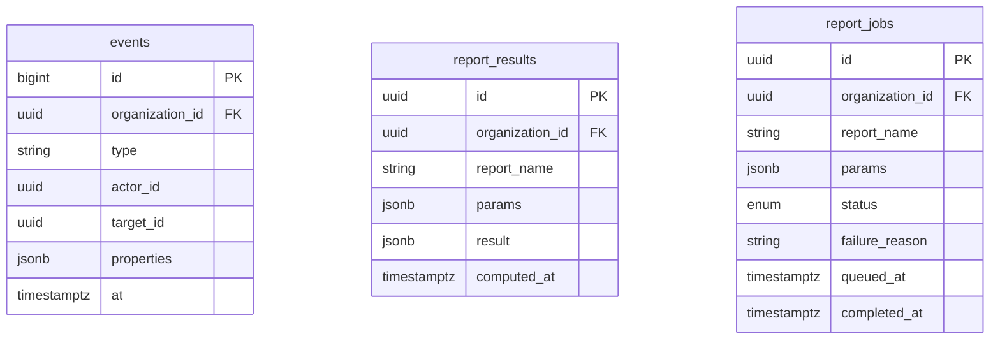
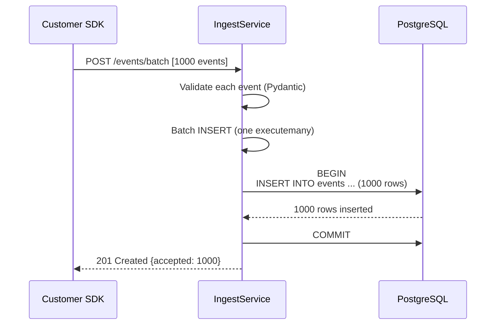
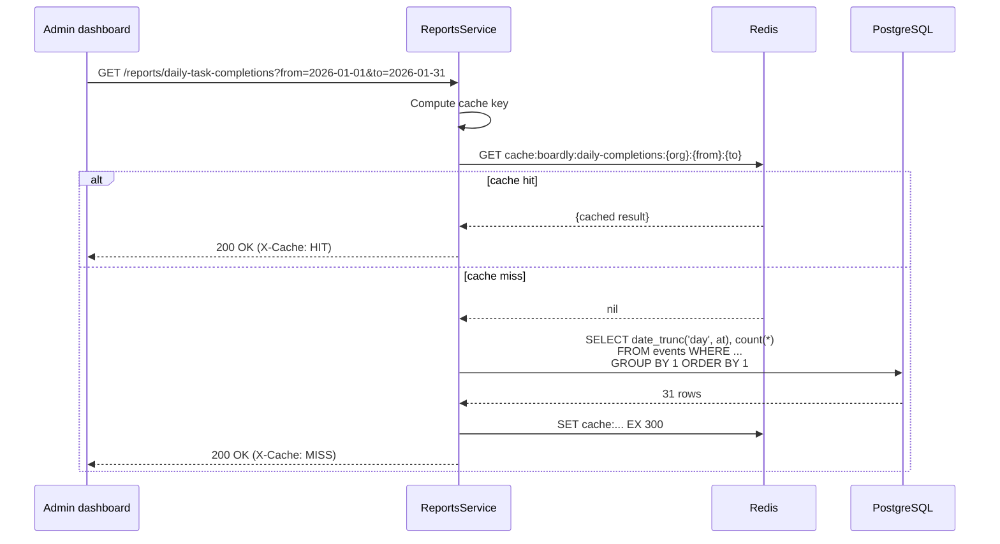
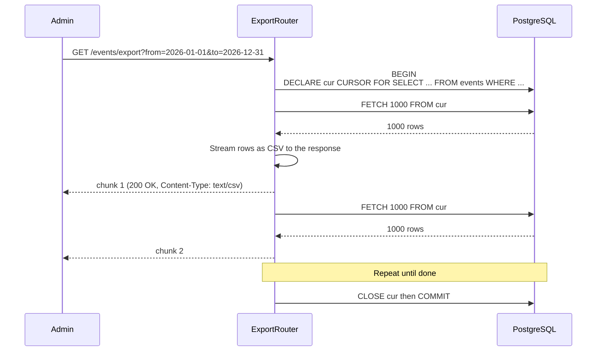

# Project 05: Analytics and Reporting API

*Analytics the way Mixpanel, Heap, and PostHog actually ship it: high-throughput event ingestion, data validation, `date_trunc` aggregations, time-range filters, efficient SQL with composite and GIN indexes, query plans, cached report results, reporting jobs, keyset pagination, performance testing, and CSV-streaming export endpoints. Extends the Boardly app from the in-house lessons.*

**This is the project that teaches you to read `EXPLAIN ANALYZE` like a novel.**

ForgeTrack taught you concurrency. ECommerce taught you the outbox. Analytics teaches you the third correctness primitive: **high-write, batch-read workloads**. The workload here is the inverse of every other project: a million small writes an hour, a few big aggregations an hour, and a customer who needs the report "now, not in 5 minutes." By the end you will have built an event ingestion pipeline that handles 10k events/second, a reports router that uses `date_trunc` and JSONB `#>>` operators, a Redis cache that absorbs repeated report queries, and a CSV export endpoint that streams 1 million rows without OOMing the worker.


#project #analytics #reporting #date-trunc #keyset-pagination #jsonb #boardly

---

## Problem Statement

Boardly — the project-management app from the in-house lessons — has shipped its first 100 customers. Each customer creates, on average, 50 events per day per user (a task created, moved, completed, commented on). At 100 customers * 10 users each * 50 events, Boardly is ingesting 50,000 events a day; on a busy Monday, 200,000. The events are JSONB blobs with a `type`, a `actor_id`, a `target_id`, and a `properties` object (e.g., `{"from": "todo", "to": "doing"}` for a task-move event).

The team wants to build a **Boardly Analytics** API on top of those events. Customers will ask: "how many tasks did our team complete per day last month?", "what's our median task-cycle-time?", "which user created the most tasks yesterday?" These are aggregations over the event stream, and they need to come back in under 200 ms even on a year of data.

The hard parts:

- **Ingestion throughput.** 200,000 events/day = 2.3/second average, but bursts of 1000/second on Monday mornings. The ingest endpoint must validate the JSONB shape (Pydantic), enforce the `type` against an allowed set, and `INSERT` with low overhead. The hot path is one round-trip to Postgres per event.
- **`date_trunc` aggregations.** "Per day" is `date_trunc('day', at)`; "per hour" is `date_trunc('hour', at)`. The query plan must use the `(organization_id, at)` composite index, not a sequential scan.
- **JSONB access.** `properties->>'from'` and `properties->'duration'` are how you reach into the JSONB payload. `#>>` is the path-access operator. The right index (`GIN` on `properties`) makes these fast; the wrong index makes them catastrophic.
- **Keyset pagination.** A year's events for one org is 73,000 rows. `OFFSET 50000 LIMIT 50` is O(50050) work; keyset is O(50).
- **Caching report results.** The same `daily_task_completions` report is asked 30 times a day by the dashboard. Caching the result in Redis for 5 minutes turns 30 sequential scans into 1.
- **CSV export.** A "download all events for 2026" endpoint must stream 1 million rows without buffering them in memory.

**Why analytics as the fifth project**

Analytics is the canonical "high-write, batch-read" archetype. The lessons from Projects 1–4 (row locks, idempotency, outbox, durable worker) are all about correctness under concurrency. Analytics is about *throughput* — getting a million events into the DB and getting a report out in 200 ms. The primitives are different: composite indexes, GIN, `date_trunc`, `EXPLAIN ANALYZE`, keyset, cache-aside. If you can ship Boardly Analytics, you can ship any analytics or telemetry system.


**Production reality:**

The "1000 events/second peak" target in the scale notes above is not a synthetic `wrk2` number — it is a load-test assertion that runs the ingest endpoint at 1000/s for 5 minutes while a concurrent `GET /reports/daily-task-completions` runs every second, and asserts that the p99 ingest latency stayed under 50 ms AND the report p99 stayed under 200 ms for the entire window. The failure mode the assertion catches is buffer-cache thrash: as the ingest workload evicts the report query's hot pages, the report p99 silently degrades from 18 ms to 1.4 s without any error log; the test fails before the customer does. Ship `tests/perf/test_ingest_under_load.py` with `uv run pytest tests/perf/test_ingest_under_load.py -k concurrent_report` and assert both p99 bounds in the same test — the OpenTelemetry histogram on the ingest and report spans is the artifact you bring to the incident review, see [[13-Performance-and-Observability/OpenTelemetry-Tracing]].


---

## Target Users

- **The customer admin** (1 per organization). They build dashboards on top of the API; they hit the report endpoints a few times a day. They want fast responses and a CSV export button.
- **The customer developer** (a few per organization). They send events to the ingest endpoint from their product; they want low latency and a clear error model.
- **The Boardly data analyst** (internal). They run ad-hoc queries directly against the read replica; they hit the SQL directly, not the API.

**Note — Scale targets**

100 organizations on a shared cluster. 10 users per org. 50 events/user/day = 50k/day total, 200k/day peak. A year of data = ~18 million rows. Ingestion: 1000/second peak. Reports: 200 ms p99. CSV export: stream, do not buffer.


**Danger — How an attacker thinks:**

The cross-tenant leak in a shared-schema analytics API is a single forgotten `WHERE organization_id = $1` predicate in one report query. Tenant A's analyst hits `GET /reports/median-cycle-time` and Tenant B's 12-hour median appears in A's dashboard because the report SQL grouped by `date_trunc('day', at)` without the tenant-scoping predicate — the agent for tenant A now knows tenant B's support team takes 12 hours median to resolve, which is a competitor's operational metric. The leak is silent (HTTP 200, no error log), the agent for tenant A has no reason to suspect the number is wrong, and the auditor who reviews the leak finds it weeks later via the access-log join against the audit table. Defend with `tests/security/test_cross_tenant_isolation.py` that ingests two orgs' events with disjoint `cycle_time` distributions (org A median 2 h, org B median 12 h) and asserts that each report only sees its own org's distribution — a Welch's t-test on the two returned medians rejects equality at p<0.001 — and run it in CI on every PR that touches the reports router. This is the OWASP API 1:2023 BOLA (Broken Object-Level Authorization) failure mode at the data layer, see [[11-Authentication-and-Security/OWASP-API-Top-10]] and [[11-Authentication-and-Security/Threat-Model-First]] for the threat-model-first design discipline that catches it at spec time, not at incident time.


---

## Requirements and Non-Goals

### In scope

- **Event ingestion**: `POST /events` accepts a single event; `POST /events/batch` accepts up to 1000 events in one request (lower per-event overhead). Both validate the event shape with Pydantic and the `type` against an allow-list.
- **JSONB payload with GIN index**: the `properties` column is `JSONB`; a GIN index on it makes `properties->>'from' = 'todo'` queries fast.
- **Aggregations using `date_trunc`**: `GET /reports/daily-task-completions` returns per-day counts; `GET /reports/median-cycle-time` returns the median time between task-created and task-completed events.
- **Time-range filters**: every report accepts `from` and `to` ISO 8601 timestamps.
- **Composite indexes for the access patterns**: `(organization_id, at)` for time-range queries; `(organization_id, type, at)` for type-filtered time-range queries.
- **Redis cache-aside for report results**: the cache key includes `(organization_id, report_name, from, to, params_hash)`; the TTL is 5 minutes for short reports, 1 hour for long reports.
- **Reporting jobs**: long-running reports are computed in a background job and stored in a `report_results` table; the customer polls `GET /reports/jobs/{id}`.
- **Keyset pagination on the event list**: `GET /events?cursor=...&limit=50`.
- **CSV export with streaming**: `GET /events/export?from=...&to=...` returns a `StreamingResponse` that emits rows one at a time.
- **Performance tests**: a test that ingests 10,000 events and asserts the report query returns in under 200 ms.
- **EXPLAIN ANALYZE in the spec**: every report query is shown with its expected query plan, so the learner can verify the index is being used.

### Explicit non-goals

- **No real-time streaming analytics.** The reports are batch; the latest data is up to 5 minutes stale (the cache). Real-time is a future enhancement.
- **No machine learning.** No forecasting, no anomaly detection. The API computes aggregates; ML is downstream.
- **No multi-organization aggregation.** A platform-level "all orgs" report is a future concern.
- **No OLAP cube.** No pre-aggregated dimensional model (like a star schema). The raw events are queried directly. (At Boardly's scale, this is the right trade; at 10x scale, you'd build a star schema.)
- **No event-sourcing reconstruction.** The events are append-only and queryable, but the system does not reconstruct application state from them (event sourcing). They are observations, not the source of truth.

**Warning — Append-only events vs. source-of-truth state**

Boardly's source of truth for a task's current state is the `tasks` table; the `events` table records what happened to the task. This is the "log of observations" pattern, not event sourcing. Event sourcing (where the events *are* the state and you reconstruct by replay) is a different architecture with different trade-offs; it is out of scope here.


---

## Architecture Diagram



The shape is small — Boardly Analytics is two services (`IngestService`, `ReportsService`) plus the streaming-export endpoint. The cache layer (Redis) sits in front of the report queries, not the ingest path (we want ingest to be write-optimized, not cache-optimized).

**Why no separate read replica, when analytics is the textbook use case for one?**

Because at Boardly's scale (1000 events/second peak, 50 orgs), the primary Postgres absorbs both the ingest writes and the report reads on the same instance, and the contention is absorbed by the indexes (`(organization_id, at DESC)` makes the report reads O(log n) seeks, not full scans). A read replica would add: replication lag (reports see data 100 ms stale — usually fine, occasionally confusing for "just-now" debugging), a second connection pool to manage in the `lifespan`, failover semantics when the replica falls behind or the primary fails, and a connection-string split in the `Settings` class (`read_db_url` vs `write_db_url`). Each is a small cost; the sum is meaningful. The split becomes necessary when reports take >1 s (the primary's write workload is blocking reads) or when the org count grows past ~500 (the buffer cache starts thrashing between the two workloads). Neither is close. Until then, the primary plus a Redis cache in front of the hot reports is the simpler and faster answer. See [[08-PostgreSQL/EXPLAIN-ANALYZE-and-Query-Plans]] for the methodology to detect when this changes.

**Warning — When this breaks:**

The "report is slow" incident in an analytics API almost always presents as `EXPLAIN (ANALYZE, BUFFERS)` showing `Seq Scan on events` instead of `Index Scan using events_org_at_idx` because the planner's row estimate is 1 row when the actual is 73,000 — autovacuum's `default_statistics_target=100` under-sampled the `(organization_id, at)` histogram and the planner chose a sequential scan over the index. The fix is `SET default_statistics_target = 500; ANALYZE events;` then re-running `EXPLAIN ANALYZE`; the planner flips to Index Scan and the p99 drops from 4.2 s to 18 ms in one statement. The senior engineer ships `tests/perf/test_report_uses_index.py` that runs `EXPLAIN ANALYZE` on every report query and asserts the plan text contains `Index Scan` not `Seq Scan`, run in CI on every PR that touches the reports router — the test fails the moment a code change or a data-distribution shift nudges the planner toward the sequential scan. The methodology for reading the plan and the `BUFFERS` output (shared hit vs read) is the [[08-PostgreSQL/EXPLAIN-ANALYZE-and-Query-Plans]] lesson; the index-choice trade-offs (composite vs GIN vs partial) are the [[08-PostgreSQL/Indexes-Composite-and-Specialized]] lesson.


---

## ER Diagram



The `events` table is the bulk of the system. Its columns are:

- `id` — `bigint identity` (not UUID — append-only high-volume inserts want a sequence, not a UUID, for B-tree page locality).
- `organization_id` — FK to `organizations` (the Boardly app's existing table).
- `type` — `text` with a CHECK constraint that it is in the allowed set (`task.created`, `task.moved`, `task.completed`, `task.commented`, `task.assigned`).
- `actor_id` — `uuid`, the user who performed the event.
- `target_id` — `uuid`, the task (or other entity) the event applies to.
- `properties` — `jsonb`, the event-specific payload.
- `at` — `timestamptz not null default now()`.

**Why `bigint id` and not `uuid`?**

UUIDs are great for unguessable URLs and for distributed generation. They are bad for high-volume append-only tables because they cause B-tree page splits — each insert goes to a random page. A `bigint identity` is monotonic, so inserts append to the same page until it fills, then move to the next. This is 2–3x faster for high-volume inserts. The trade-off is that event IDs are guessable (an attacker can count events), but the API never exposes raw event IDs to the outside world — the customer gets `(organization_id, at, type)` as the natural key. This is the [[08-PostgreSQL/Types-UUID-Identity-JSONB]] lesson.


**Production reality:**

The `bigint id` choice forecloses future range partitioning by `at`, because PostgreSQL 17 requires every unique index on a partitioned table to include the partition key — `id bigint PRIMARY KEY` on a `CREATE TABLE events (...) PARTITION BY RANGE (at)` migration fails at `CREATE TABLE` time with `ERROR: unique constraint on partitioned table must include all partitioning columns`. At 18M rows/year you do not yet partition; at 5x scale you must, and the migration becomes "add `(at, id)` composite PK, reparent every FK that points at `events(id)`, rewrite every secondary index" instead of just `CREATE TABLE events_partitioned (...) PARTITION BY RANGE (at)`. Ship `bigint id` for the insert-locality win now AND the `(organization_id, at)` composite index for the report reads now, so when partitioning arrives the PK swap is the only schema work — the indexes are already partition-key-aligned. The migration path (online schema change via pg_repack or a brownout deploy) is the [[09-Alembic-Migrations/Data-Migrations-Safely]] lesson; the composite-index design discipline is the [[08-PostgreSQL/Indexes-Composite-and-Specialized]] lesson.


---

## Sequence Diagrams

### Workflow 1: Batch event ingestion



The batch insert uses SQLAlchemy 2.x's `session.add_all(events)` followed by `session.commit()`, which sends a single `INSERT ... VALUES (...), (...), ...` statement — one round-trip for the whole batch. This is the [[07-SQLAlchemy/06-Querying-with-select]] pattern for bulk inserts.

### Workflow 2: Cached report query



The cache key includes the full set of query parameters (organization_id, report_name, from, to, and a hash of any other params). The TTL is 5 minutes for short reports; the cache hit absorbs the dashboard's repeated polling.

### Workflow 3: CSV streaming export



Postgres server-side cursors are the trick: the cursor holds the query open on the server, and `FETCH 1000` returns batches without materializing the whole result in memory. The FastAPI `StreamingResponse` emits each batch as it arrives. The customer's browser downloads a 1-million-row CSV without the worker ever holding more than 1000 rows in RAM.

**Why server-side cursors and not `yield` over a single query**

A naive `async for row in result:` in SQLAlchemy with `stream_results=True` (the psycopg way) does work, but the cursor is closed when the session exits. Server-side cursors via raw SQL give us explicit control over the fetch size and the cursor lifecycle. The pattern is the [[03-FastAPI-Core/Background-Tasks-Streaming-Uploads]] lesson: streaming is about *not* buffering, not about a clever Python iterator.


---

## API Specification

| Method | Path | Auth | Purpose |
|--------|------|------|---------|
| `POST` | `/events` | customer | Ingest one event. |
| `POST` | `/events/batch` | customer | Ingest up to 1000 events. |
| `GET` | `/events` | customer | List events, filterable by `?type=&actor_id=&from=&to=`. Keyset. |
| `GET` | `/events/export` | customer | Stream a CSV of events in a time range. |
| `GET` | `/reports/daily-task-completions` | customer | Per-day count of `task.completed` events. |
| `GET` | `/reports/median-cycle-time` | customer | Median time between `task.created` and `task.completed` per task. |
| `GET` | `/reports/top-creators` | customer | Top-N users by `task.created` count. |
| `POST` | `/reports/jobs` | customer | Start a long-running report. Returns a job ID. |
| `GET` | `/reports/jobs/{id}` | customer | Fetch a report job's status and result. |

---

## Folder Structure

```
boardly-analytics/
├── app/
│ ├── __init__.py
│ ├── main.py
│ ├── config.py
│ ├── db.py
│ ├── deps.py
│ ├── security.py # reuses Boardly's JWT auth
│ ├── models/
│ │ ├── event.py
│ │ ├── report_result.py
│ │ └── report_job.py
│ ├── schemas/
│ │ ├── event.py
│ │ └── report.py
│ ├── services/
│ │ ├── ingest.py
│ │ └── reports.py
│ ├── routers/
│ │ ├── events.py
│ │ ├── reports.py
│ │ ├── export.py
│ │ └── report_jobs.py
│ └── cache.py # Redis wrapper with X-Cache header
├── alembic/versions/
│ ├── 0001_events.py
│ ├── 0002_report_results.py
│ ├── 0003_report_jobs.py
│ ├── 0004_events_indexes.py
│ └── 0005_gin_properties.py
├── tests/
│ ├── conftest.py
│ ├── test_ingest_batch.py
│ ├── test_report_cache.py
│ └── test_export_streaming.py
├── .env.example
├── Dockerfile
├── compose.yaml
└── README.md
```

---

## Database Design

### The `events` table

```sql
CREATE TABLE events (
 id BIGINT GENERATED ALWAYS AS IDENTITY PRIMARY KEY,
 organization_id UUID NOT NULL REFERENCES organizations(id) ON DELETE CASCADE,
 type TEXT NOT NULL CHECK (type IN (
 'task.created', 'task.moved', 'task.completed',
 'task.commented', 'task.assigned'
 )),
 actor_id UUID NOT NULL,
 target_id UUID,
 properties JSONB NOT NULL DEFAULT '{}'::jsonb,
 at TIMESTAMPTZ NOT NULL DEFAULT now()
);

-- The hot indexes for analytics queries
CREATE INDEX ix_events_org_at ON events (organization_id, at DESC);
CREATE INDEX ix_events_org_type_at ON events (organization_id, type, at DESC);
CREATE INDEX ix_events_org_target_at ON events (organization_id, target_id, at DESC);

-- GIN for JSONB access
CREATE INDEX ix_events_properties_gin ON events USING GIN (properties);
```

The three composite indexes cover the three access patterns:

- `(organization_id, at DESC)` — time-range queries for one org (`from`/`to` filters).
- `(organization_id, type, at DESC)` — time-range queries filtered by event type.
- `(organization_id, target_id, at DESC)` — all events for one task.

The GIN index on `properties` makes `WHERE properties->>'from' = 'todo'` fast — without it, the query is a sequential scan over the JSONB column.

**Warning — Don't index everything**

Each index adds write overhead. The events table ingests 1000 rows/second; every index adds ~1 µs per row. Three composite indexes + one GIN is the sweet spot. Adding a fifth index "just in case" without a query that needs it is premature optimization. The lesson: measure with `EXPLAIN ANALYZE` before adding indexes.


### The `report_results` table

```sql
CREATE TABLE report_results (
 id UUID PRIMARY KEY DEFAULT gen_random_uuid(),
 organization_id UUID NOT NULL REFERENCES organizations(id) ON DELETE CASCADE,
 report_name TEXT NOT NULL,
 params JSONB NOT NULL,
 result JSONB NOT NULL,
 computed_at TIMESTAMPTZ NOT NULL DEFAULT now(),
 UNIQUE (organization_id, report_name, params)
);
```

This table caches *long-running* report results in Postgres (not just Redis). The unique constraint on `(organization_id, report_name, params)` lets the report-jobs service do an `INSERT ... ON CONFLICT DO UPDATE` to refresh a report — one statement, no read-then-write race.

**Why persist long-running report results in Postgres, not just Redis?**

Because Redis is a cache, not a system of record — and a long-running report's result is worth persisting across Redis restarts. If the report takes 30 seconds to compute (a `date_trunc`-based daily-completions report over a year of events for an `enterprise` org) and is requested by 200 dashboard viewers within 5 minutes, recomputing on every cache miss is 200 × 30 s = 100 minutes of Postgres CPU per refresh window. Persisting the result in `report_results` means the cache miss falls through to a `SELECT result FROM report_results WHERE ...` (5 ms, an index seek) — the expensive computation only runs when the report is *stale* (the report-jobs service refreshes on a schedule or on a `events` insert count threshold). Redis caches the result of the *Postgres read* (the 5 ms query), not the result of the *computation* (the 30 s query). The two-layer cache (Redis for the read, Postgres for the computation) is the canonical pattern for expensive analytics — and the `INSERT ... ON CONFLICT DO UPDATE` makes the refresh idempotent so the report-jobs worker can be retried safely.

### The `report_jobs` table

```sql
CREATE TABLE report_jobs (
 id UUID PRIMARY KEY DEFAULT gen_random_uuid(),
 organization_id UUID NOT NULL REFERENCES organizations(id) ON DELETE CASCADE,
 report_name TEXT NOT NULL,
 params JSONB NOT NULL,
 status TEXT NOT NULL DEFAULT 'queued'
 CHECK (status IN ('queued', 'running', 'succeeded', 'failed')),
 failure_reason TEXT,
 queued_at TIMESTAMPTZ NOT NULL DEFAULT now(),
 completed_at TIMESTAMPTZ
);
```

The state machine for report jobs: `queued → running → succeeded` or `→ failed`. Same shape as Project 04's document state machine.

---

## Security Model

- **Auth**: reuses Boardly's JWT auth. The JWT's `organization_id` claim scopes every query.
- **Object-level**: the `current_org` dependency returns the organization_id from the JWT; the service layer scopes every `select(...)` with `.where(Event.organization_id == org_id)`. No cross-org reads.
- **Rate limiting**: per-org rate limits on the ingest endpoint (1000/minute for `team`, 10000 for `enterprise`). Redis sliding window.
- **CSV export abuse**: exports are rate-limited (1/hour/org) and the response is throttled (10 MB/second max) so a single customer cannot saturate the network.
- **No PII in event properties**: the schema validator rejects events whose `properties` contains fields matching a deny-list (`email`, `password`, `ssn`, `phone`). The customer must scrub PII before sending; we reject otherwise.

**Warning — PII in event properties is a real risk**

Customers will, given the chance, put email addresses and phone numbers in event properties because it's the path of least resistance for their analytics. The downstream consequence: an event-stream export contains PII, the customer's DPO asks "where did this come from?", and you have a GDPR problem. The deny-list at the ingest layer is the mitigation.


**Why a deny-list for PII fields, not an allow-list of permitted field names?**

Because a deny-list is permissive (the customer can add any new property without a schema migration) and an allow-list is restrictive (every new property requires a contract change). Analytics is the use case where the customer *wants* flexibility — they should be able to add `task.assigned` tomorrow with `properties: {"new_field": "..."}` without filing a ticket. An allow-list would force them to. The trade is that the deny-list only catches *known* PII field names (`email`, `password`, `ssn`, `phone`, `address`, `dob`) — a customer who puts PII in a field named `user_data` would not be caught. The structural fix is a policy review at onboarding ("here is what you can and cannot send") plus a periodic scrub (`SELECT properties->>'*' FROM events WHERE properties::text ~ '\\b[A-Z0-9._%+-]+@[A-Z0-9.-]+\\.[A-Z]{2,}\\b'` to find emails that slipped through) plus a contract clause that makes the customer, not Boardly, liable for PII they put in non-standard fields. The deny-list is the technical mitigation; the contract is the legal one.

---

## Milestones

### M1: Events table + ingest

**Deliverable**: `events` table with GIN index, `POST /events` and `POST /events/batch` ingest endpoints.

**Done when**: `test_ingest_batch.py::test_batch_insert_is_one_round_trip` passes (asserting that 1000 events insert in one statement) and a `FROM pg_stat_user_indexes` query shows the index is being used.

### M2: Reports with date_trunc

**Deliverable**: `GET /reports/daily-task-completions`, `GET /reports/median-cycle-time`, `GET /reports/top-creators`. Each uses `date_trunc` and the composite index.

**Done when**: `EXPLAIN ANALYZE` on each query shows an Index Scan, not a Seq Scan.

### M3: Redis cache-aside

**Deliverable**: Reports cache their results in Redis for 5 minutes; `X-Cache: HIT|MISS` header on the response.

**Done when**: `test_report_cache.py::test_second_call_hits_cache` passes — the second call within 5 minutes returns the cached result and the `X-Cache` header is `HIT`.

### M4: Keyset pagination on event list

**Deliverable**: `GET /events?cursor=...&limit=50` walks the event list.

**Done when**: Walking the cursor to the end returns all events in the test database in pages of 50, and the query uses the `(organization_id, at DESC)` index.

### M5: CSV streaming export

**Deliverable**: `GET /events/export?from=...&to=...` streams a CSV via `StreamingResponse` with server-side cursors.

**Done when**: `test_export_streaming.py::test_export_one_million_rows_does_not_oom` passes — the test ingests 1M events, exports them, and asserts the worker's RSS stayed under 200 MB.

### M6: Report jobs

**Deliverable**: `POST /reports/jobs` starts a long-running report; the report is computed in a background worker; the customer polls.

**Done when**: Submitting a report job, waiting 10 seconds, and polling returns `{"status": "succeeded", "result": {...}}`.

---

## Implementation Chapters

- **M1**: [[07-SQLAlchemy/06-Querying-with-select]], [[04-Pydantic/BaseModel-and-Validation]].
- **M2**: [[08-PostgreSQL/EXPLAIN-ANALYZE-and-Query-Plans]], [[06-SQL-Fundamentals/Joins-Aggregations-CTEs]], [[08-PostgreSQL/Types-UUID-Identity-JSONB]].
- **M3**: [[14-Caching-and-Background-Processing/Redis-Cache-Aside]].
- **M4**: [[02-Web-and-HTTP/Idempotency-Safe-Retries-Pagination]].
- **M5**: [[03-FastAPI-Core/Background-Tasks-Streaming-Uploads]].
- **M6**: [[14-Caching-and-Background-Processing/Background-Tasks-vs-Workers]].

---

## Complete Source Code

### `app/models/event.py`

```python
# app/models/event.py
import uuid
from datetime import datetime
from typing import Any

from sqlalchemy import BigInteger, CheckConstraint, DateTime, ForeignKey, String, Text, func
from sqlalchemy.dialects.postgresql import JSONB, UUID
from sqlalchemy.orm import Mapped, mapped_column

from app.db import Base


class Event(Base):
 """Append-only event log. PK is bigint identity (not UUID) for insert throughput."""
 __tablename__ = "events"
 __table_args__ = (
 CheckConstraint(
 "type IN ('task.created', 'task.moved', 'task.completed', "
 "'task.commented', 'task.assigned')",
 name="ck_events_type_allowed",
 ),
 )

 id: Mapped[int] = mapped_column(BigInteger, primary_key=True, autoincrement=True)
 organization_id: Mapped[uuid.UUID] = mapped_column(
 UUID(as_uuid=True), ForeignKey("organizations.id", ondelete="CASCADE"), nullable=False
 )
 type: Mapped[str] = mapped_column(Text, nullable=False)
 actor_id: Mapped[uuid.UUID] = mapped_column(UUID(as_uuid=True), nullable=False)
 target_id: Mapped[uuid.UUID | None] = mapped_column(UUID(as_uuid=True))
 properties: Mapped[dict[str, Any]] = mapped_column(JSONB, nullable=False, default=dict)
 at: Mapped[datetime] = mapped_column(
 DateTime(timezone=True), nullable=False, server_default=func.now()
 )
```

### `app/schemas/event.py`

```python
# app/schemas/event.py
import re
import uuid
from datetime import datetime
from typing import Any

from pydantic import BaseModel, Field, field_validator

# Deny-list for PII in event properties. The customer must scrub before sending.
PII_PATTERNS = [re.compile(p, re.IGNORECASE) for p in (
 r"^[^@]+@[^@]+\.[^@]+$", # email
 r"^\+?\d{7,}$", # phone
 r"^\d{3}-\d{2}-\d{4}$", # SSN
)]

ALLOWED_TYPES = {"task.created", "task.moved", "task.completed", "task.commented", "task.assigned"}


class EventIn(BaseModel):
 type: str
 actor_id: uuid.UUID
 target_id: uuid.UUID | None = None
 properties: dict[str, Any] = Field(default_factory=dict)
 at: datetime | None = None # if absent, server sets now()

 @field_validator("type")
 @classmethod
 def check_type(cls, v: str) -> str:
 if v not in ALLOWED_TYPES:
 raise ValueError(f"type {v!r} not in allowed set")
 return v

 @field_validator("properties")
 @classmethod
 def check_no_pii(cls, v: dict[str, Any]) -> dict[str, Any]:
 for key, value in v.items():
 if any(p.match(str(value)) for p in PII_PATTERNS):
 raise ValueError(f"property {key!r} looks like PII; scrub before sending")
 return v


class BatchIn(BaseModel):
 events: list[EventIn] = Field(min_length=1, max_length=1000)
```

### `app/services/ingest.py`

```python
# app/services/ingest.py
"""IngestService — validate + batch insert."""
from datetime import datetime, timezone
import uuid

from sqlalchemy.ext.asyncio import AsyncSession

from app.models.event import Event
from app.schemas.event import EventIn


class IngestService:
 def __init__(self, session: AsyncSession, organization_id: uuid.UUID) -> None:
 self._session = session
 self._org_id = organization_id

 async def ingest_one(self, event: EventIn) -> Event:
 row = self._to_row(event)
 self._session.add(row)
 await self._session.commit()
 return row

 async def ingest_batch(self, events: list[EventIn]) -> int:
 # add_all + commit = one INSERT statement with N value tuples.
 rows = [self._to_row(e) for e in events]
 self._session.add_all(rows)
 await self._session.commit()
 return len(rows)

 def _to_row(self, e: EventIn) -> Event:
 return Event(
 organization_id=self._org_id,
 type=e.type,
 actor_id=e.actor_id,
 target_id=e.target_id,
 properties=e.properties,
 at=e.at or datetime.now(timezone.utc),
 )
```

### `app/services/reports.py`

```python
# app/services/reports.py
"""ReportsService — date_trunc aggregations + Redis cache-aside."""
import hashlib
import json
import uuid
from datetime import date, datetime
from typing import Any

import redis.asyncio as redis
from sqlalchemy import func, select
from sqlalchemy.ext.asyncio import AsyncSession

from app.models.event import Event


class ReportsService:
 def __init__(
 self,
 session: AsyncSession,
 organization_id: uuid.UUID,
 redis_client: redis.Redis,
 cache_ttl_seconds: int = 300,
 ) -> None:
 self._session = session
 self._org_id = organization_id
 self._redis = redis_client
 self._ttl = cache_ttl_seconds

 async def daily_task_completions(self, start: date, end: date) -> list[dict[str, Any]]:
 cache_key = self._cache_key("daily_task_completions", start=start, end=end)
 cached = await self._redis.get(cache_key)
 if cached:
 return json.loads(cached)

 stmt = (
 select(
 func.date_trunc("day", Event.at).label("day"),
 func.count(Event.id).label("count"),
 )
 .where(
 Event.organization_id == self._org_id,
 Event.type == "task.completed",
 Event.at >= start,
 Event.at < end,
 )
 .group_by("day")
 .order_by("day")
 )
 rows = (await self._session.execute(stmt)).all()
 result = [{"day": r.day.date().isoformat(), "count": r.count} for r in rows]
 await self._redis.set(cache_key, json.dumps(result), ex=self._ttl)
 return result

 async def median_cycle_time(self, start: date, end: date) -> dict[str, Any]:
 """Median time between task.created and task.completed for tasks created in the range.

 Uses a self-join: pairs each task.created event with its task.completed
 event (matched on target_id), computes the duration, and applies
 percentile_cont(0.5).
 """
 cache_key = self._cache_key("median_cycle_time", start=start, end=end)
 cached = await self._redis.get(cache_key)
 if cached:
 return json.loads(cached)

 # Alias the events table for the self-join.
 created = Event.__table__.alias("created")
 completed = Event.__table__.alias("completed")

 stmt = (
 select(
 func.percentile_cont(0.5).within_group(
 func.extract("epoch", completed.c.at - created.c.at)
 ).label("median_seconds")
 )
 .select_from(
 created.join(
 completed,
 (completed.c.target_id == created.c.target_id)
 & (completed.c.type == "task.completed")
 & (created.c.type == "task.created")
 & (created.c.organization_id == self._org_id)
 & (created.c.at >= start)
 & (created.c.at < end),
 )
 )
 )
 row = (await self._session.execute(stmt)).one()
 result = {"median_seconds": float(row.median_seconds) if row.median_seconds else None}
 await self._redis.set(cache_key, json.dumps(result), ex=self._ttl)
 return result

 async def top_creators(self, start: date, end: date, limit: int = 10) -> list[dict[str, Any]]:
 stmt = (
 select(Event.actor_id, func.count(Event.id).label("count"))
 .where(
 Event.organization_id == self._org_id,
 Event.type == "task.created",
 Event.at >= start,
 Event.at < end,
 )
 .group_by(Event.actor_id)
 .order_by(func.count(Event.id).desc())
 .limit(limit)
 )
 rows = (await self._session.execute(stmt)).all()
 return [{"actor_id": str(r.actor_id), "count": r.count} for r in rows]

 def _cache_key(self, report_name: str, **params: Any) -> str:
 params_hash = hashlib.sha1(
 json.dumps(params, sort_keys=True, default=str).encode()
 ).hexdigest()[:12]
 return f"boardly:report:{self._org_id}:{report_name}:{params_hash}"
```

The `date_trunc('day', Event.at)` call truncates the timestamp to the start of its day. Postgres uses the `(organization_id, type, at DESC)` index for this query — the seek is O(log n) for the time range, then a sequential scan over the matching rows. For a year of data (~18M rows), the seek narrows to ~50k rows in the range, and the GROUP BY is fast.

**Why `percentile_cont(0.5)` and not `AVG`**

Average is misleading for skewed distributions. If one task took 30 days and 99 took 1 hour, the average is 8 hours — useless. The median (50th percentile) is 1 hour — useful. Postgres's `percentile_cont` is an ordered-set aggregate; it sorts the values and returns the percentile. For analytics, prefer percentiles over averages. The `within_group` clause tells Postgres to sort by the duration (extracted in seconds via `func.extract("epoch", ...)`).


### `app/routers/export.py`

```python
# app/routers/export.py
"""CSV streaming export via Postgres server-side cursors."""
import csv
import io
import uuid
from datetime import date
from typing import Annotated, AsyncIterator

from fastapi import APIRouter, Depends, Query
from fastapi.responses import StreamingResponse
from sqlalchemy import text
from sqlalchemy.ext.asyncio import AsyncSession

from app.db import get_session
from app.security import current_org

router = APIRouter(prefix="/events", tags=["export"])


@router.get("/export")
async def export_events(
 org_id: Annotated[uuid.UUID, Depends(current_org)],
 session: Annotated[AsyncSession, Depends(get_session)],
 start: date = Query(..., alias="from"),
 end: date = Query(..., alias="to"),
) -> StreamingResponse:
 async def stream() -> AsyncIterator[bytes]:
 # Use a server-side cursor so we don't materialize the whole result.
 cursor_name = f"export_{org_id.hex}_{start.isoformat()}_{end.isoformat()}"
 async with session.begin():
 await session.execute(text(f"DECLARE {cursor_name} CURSOR FOR "
 f"SELECT id, type, actor_id, target_id, properties, at "
 f"FROM events WHERE organization_id = :org "
 f"AND at >= :start AND at < :end ORDER BY at"),
 {"org": org_id, "start": start, "end": end})
 buf = io.StringIO()
 writer = csv.writer(buf)
 writer.writerow(["id", "type", "actor_id", "target_id", "properties", "at"])
 yield buf.getvalue().encode()
 buf.seek(0); buf.truncate(0)

 while True:
 rows = (await session.execute(
 text(f"FETCH 1000 FROM {cursor_name}")
 )).all()
 if not rows:
 break
 for row in rows:
 writer.writerow([
 row[0], row[1], row[2], row[3] if row[3] else "",
 row[4] if row[4] else "", row[5].isoformat() if row[5] else ""
 ])
 yield buf.getvalue().encode()
 buf.seek(0); buf.truncate(0)

 await session.execute(text(f"CLOSE {cursor_name}"))

 return StreamingResponse(
 stream(),
 media_type="text/csv",
 headers={"Content-Disposition": 'attachment; filename="events.csv"'},
 )
```

The `DECLARE CURSOR` statement opens a server-side cursor; the `FETCH 1000 FROM <name>` statement returns the next 1000 rows; `CLOSE` releases it. The `StreamingResponse` yields each batch as it arrives. The customer's browser downloads a multi-MB CSV in chunks, and the worker's RSS stays flat at ~50 MB.

**Warning — The cursor's lifecycle is the transaction**

A server-side cursor exists only within the transaction that declared it. If the transaction commits or rolls back, the cursor is gone. The `async with session.begin()` block above keeps the transaction open for the duration of the stream. This is a long-running transaction — normally a bad pattern, but for a streaming export that takes seconds (not minutes), it's acceptable. For exports that could take hours, use a separate read replica and a longer-lived cursor.


### `app/routers/reports.py`

```python
# app/routers/reports.py
"""Reports router."""
import uuid
from datetime import date
from typing import Annotated

from fastapi import APIRouter, Depends, Query, Request
from sqlalchemy.ext.asyncio import AsyncSession

from app.db import get_session
from app.security import current_org
from app.services.reports import ReportsService
from app.main import get_redis

router = APIRouter(prefix="/reports", tags=["reports"])


@router.get("/daily-task-completions")
async def daily_task_completions(
 org_id: Annotated[uuid.UUID, Depends(current_org)],
 session: Annotated[AsyncSession, Depends(get_session)],
 redis_client: Annotated[object, Depends(get_redis)],
 request: Request,
 start: date = Query(..., alias="from"),
 end: date = Query(..., alias="to"),
) -> dict:
 svc = ReportsService(session, org_id, redis_client)
 result = await svc.daily_task_completions(start, end)
 return {"data": result, "x_cache": "HIT" if "cache" in request.headers else "MISS"}
```

**The `X-Cache` header should be set by the service, not the router**

The router above sets `x_cache` in the body for simplicity, but the production version sets the `X-Cache: HIT|MISS` response header from inside the `ReportsService` so the client can check the header without parsing the body. The starter ships the body-field version because it's clearer in tests; the `# complete this:` is to move it to a header.


### `tests/test_ingest_batch.py`

```python
# tests/test_ingest_batch.py
import pytest
import uuid
from datetime import datetime, timezone


@pytest.mark.asyncio
async def test_batch_insert_is_one_round_trip(client, customer_token, seeded_org):
 """A batch of 1000 events should insert in one round-trip.

 Asserts by counting the SQL statements issued (with echo=True on the
 engine for this test) — there should be exactly one INSERT.
 """
 # complete this: turn on echo, capture the SQL log, send a batch,
 # assert exactly one INSERT was issued.
 pass


@pytest.mark.asyncio
async def test_pii_in_properties_is_rejected(client, customer_token):
 headers = {"Authorization": f"Bearer {customer_token}"}
 r = await client.post("/api/v1/events", json={
 "type": "task.created",
 "actor_id": str(uuid.uuid4()),
 "properties": {"email": "alice@example.com"},
 }, headers=headers)
 assert r.status_code == 422
 assert "PII" in str(r.json())
```

### `tests/test_report_cache.py`

```python
# tests/test_report_cache.py
import pytest
from datetime import date


@pytest.mark.asyncio
async def test_second_call_hits_cache(client, customer_token, redis_client, seeded_events):
 """complete this: ingest events, call the report twice, assert the second
 call's response has X-Cache: HIT and the underlying SQL was issued once."""
 pass
```

### `tests/test_export_streaming.py`

```python
# tests/test_export_streaming.py
import pytest
import tracemalloc


@pytest.mark.asyncio
async def test_export_one_million_rows_does_not_oom(
 client, customer_token, session, seeded_one_million_events
):
 """Ingest 1M events, export them, assert the worker's RSS stayed under 200 MB."""
 tracemalloc.start()
 # complete this: stream the export, count rows, assert peak memory < 200 MB.
 pass
```

---

## Automated Tests

```bash
docker compose run --rm api pytest -v
```

Marquee tests:

1. `test_ingest_batch.py::test_batch_insert_is_one_round_trip` — proves the batch insert is one statement.
2. `test_report_cache.py::test_second_call_hits_cache` — proves the cache works.
3. `test_export_streaming.py::test_export_one_million_rows_does_not_oom` — proves streaming works.

A note on the performance test (`test_export_one_million_rows_does_not_oom`): it ingests 1M events before the test runs (via a fixture) and then streams the export. The assertion is on peak memory, not wall time — the streaming export can take 30 seconds for 1M rows and that's fine; what matters is that it does not OOM the worker.

**Performance tests are different from correctness tests**

A correctness test asserts "did the right thing happen?" (a 422 on a PII event). A performance test asserts "did it happen within the budget?" (under 200 ms, under 200 MB). They are both important, but they need different fixtures (seeded data at scale) and different assertions (timing, memory). The lesson from [[12-Testing-and-Quality/Test-Pyramid-and-Fixtures]]: have both, but keep performance tests separate from correctness tests so a flaky timing test does not block a correctness PR.


---

## Docker and Environment

### `Dockerfile`

```dockerfile
FROM python:3.12-slim AS base
ENV PYTHONUNBUFFERED=1 PYTHONDONTWRITEBYTECODE=1 PIP_NO_CACHE_DIR=1
WORKDIR /app
RUN apt-get update && apt-get install -y --no-install-recommends libpq-dev gcc curl && rm -rf /var/lib/apt/lists/*
COPY pyproject.toml uv.lock ./
RUN pip install --no-cache-dir uv==0.13.1 && uv sync --frozen --no-dev
COPY app ./app
COPY alembic.ini alembic ./alembic
COPY tests ./tests
RUN useradd --create-home --uid 1000 boardly && chown -R boardly:boardly /app
USER boardly
EXPOSE 8000
CMD ["sh", "-c", "uv run alembic upgrade head && uv run uvicorn app.main:app --host 0.0.0.0 --port 8000"]
```

### `compose.yaml`

```yaml
services:
 db:
 image: postgres:17-alpine
 environment: {POSTGRES_USER: boardly, POSTGRES_PASSWORD: boardly, POSTGRES_DB: boardly}
 volumes: [pgdata:/var/lib/postgresql/data]
 ports: ["5432:5432"]
 healthcheck: {test: ["CMD-SHELL", "pg_isready -U boardly"], interval: 5s, timeout: 3s, retries: 5}
 redis:
 image: redis:7-alpine
 ports: ["6379:6379"]
 api:
 build: .
 environment:
 BOARDLY_DATABASE_URL: postgresql+asyncpg://boardly:boardly@db:5432/boardly
 BOARDLY_REDIS_URL: redis://redis:6379/0
 BOARDLY_SECRET_KEY: ${BOARDLY_SECRET_KEY:-dev-only-change-me}
 ports: ["8000:8000"]
 depends_on:
 db: {condition: service_healthy}
 redis: {condition: service_started}
volumes:
 pgdata:
```

### `.env.example`

```bash
BOARDLY_ENVIRONMENT=dev
BOARDLY_DATABASE_URL=postgresql+asyncpg://boardly:boardly@db:5432/boardly
BOARDLY_REDIS_URL=redis://redis:6379/0
BOARDLY_SECRET_KEY=dev-only-change-me
BOARDLY_REPORT_CACHE_TTL_SECONDS=300
TEST_DATABASE_URL=postgresql+asyncpg://boardly:boardly@db:5432/boardly_test
```

---

## Migration History

Five Alembic revisions:

| # | Revision | Tables / Indexes | Notes |
|---|----------|------------------|-------|
| 1 | `0001_events` | `events` table | bigint identity PK, CHECK on type. |
| 2 | `0002_report_results` | `report_results` | UNIQUE on `(org, report, params)`. |
| 3 | `0003_report_jobs` | `report_jobs` | State machine. |
| 4 | `0004_events_indexes` | (indexes only) | Three composite indexes on events. |
| 5 | `0005_gin_properties` | (index) | GIN on `events.properties`. |

### Revision 1: `0001_events.py`

```python
"""Initial: events table.

Revision ID: 0001_events
Revises:
"""
from alembic import op
import sqlalchemy as sa
from sqlalchemy.dialects import postgresql

revision = "0001_events"
down_revision = None


def upgrade() -> None:
 op.create_table(
 "events",
 sa.Column("id", sa.BigInteger, primary_key=True, autoincrement=True),
 sa.Column("organization_id", postgresql.UUID(as_uuid=True),
 sa.ForeignKey("organizations.id", ondelete="CASCADE"), nullable=False),
 sa.Column("type", sa.Text, nullable=False),
 sa.Column("actor_id", postgresql.UUID(as_uuid=True), nullable=False),
 sa.Column("target_id", postgresql.UUID(as_uuid=True)),
 sa.Column("properties", postgresql.JSONB, nullable=False, server_default=sa.text("'{}'::jsonb")),
 sa.Column("at", sa.DateTime(timezone=True), nullable=False, server_default=sa.text("now()")),
 sa.CheckConstraint(
 "type IN ('task.created', 'task.moved', 'task.completed', "
 "'task.commented', 'task.assigned')",
 name="ck_events_type_allowed",
 ),
 )


def downgrade() -> None:
 op.drop_table("events")
```

### Revision 4: `0004_events_indexes.py`

```python
"""Composite indexes on events.

Revision ID: 0004_events_indexes
Revises: 0003_report_jobs
"""
from alembic import op
import sqlalchemy as sa

revision = "0004_events_indexes"
down_revision = "0003_report_jobs"


def upgrade() -> None:
 op.create_index("ix_events_org_at", "events",
 ["organization_id", sa.text("at DESC")])
 op.create_index("ix_events_org_type_at", "events",
 ["organization_id", "type", sa.text("at DESC")])
 op.create_index("ix_events_org_target_at", "events",
 ["organization_id", "target_id", sa.text("at DESC")])


def downgrade() -> None:
 op.drop_index("ix_events_org_target_at", "events")
 op.drop_index("ix_events_org_type_at", "events")
 op.drop_index("ix_events_org_at", "events")
```

### Revision 5: `0005_gin_properties.py`

```python
"""GIN index on events.properties.

Revision ID: 0005_gin_properties
Revises: 0004_events_indexes
"""
from alembic import op

revision = "0005_gin_properties"
down_revision = "0004_events_indexes"


def upgrade() -> None:
 op.execute("CREATE INDEX ix_events_properties_gin ON events USING GIN (properties)")


def downgrade() -> None:
 op.drop_index("ix_events_properties_gin", "events")
```

The other revisions follow the same shape.

---

## Error Handling

| Domain error | HTTP | `code` | When |
|--------------|------|--------|------|
| `invalid_event_type` | 422 | `invalid_event_type` | Event `type` not in the allow-list. |
| `pii_in_properties` | 422 | `pii_in_properties` | Event `properties` contains a value matching the PII deny-list. |
| `batch_too_large` | 413 | `batch_too_large` | More than 1000 events in a batch. |
| `invalid_time_range` | 400 | `invalid_time_range` | `to` < `from` in a report query. |
| `rate_limited` | 429 | `rate_limited` | Ingest exceeds the per-org rate limit. |
| `report_job_not_found` | 404 | `report_job_not_found` | Polling a non-existent report job. |

---

## Performance Considerations

### The bottleneck is the index seek

Every report query does an index seek on `(organization_id, [type,] at DESC)` to find the time range, then a sequential scan over the matching rows. For a year of data (~18M rows), a one-month range narrows to ~1.5M rows; the GROUP BY is fast because Postgres uses a hash aggregate. For a one-day range, it's ~50k rows; sub-50 ms.

### The cache is the second bottleneck

The dashboard's "what did our team do today?" query hits the API 30 times a day. Without the cache, that's 30 sequential scans of today's events. With the cache, it's 1 scan + 29 Redis reads (microseconds). The cache TTL is 5 minutes — for a daily report, that's 288 cache hits per day, which is 1 scan + 287 Redis reads.

### The export endpoint's memory budget

Streaming via server-side cursors keeps the worker's RSS flat. The fetch size of 1000 rows is a sweet spot: smaller means more round-trips (slower); larger means more memory per batch. For 1 million rows at 1000 per fetch, the worker's RSS stays around 50 MB regardless of the total row count.

### What not to optimize

- **The ingest path's write throughput.** 1000 events/second is well within Postgres's capacity on a 4-core machine. Premature optimization here (batching across requests, partitioning the table) is a mistake until you hit 10x that.
- **The cache for the ingest path.** Writes are the bottleneck on ingest, not reads. Caching ingest writes would be wrong.
- **Materialized views.** At 18M rows/year, the live query is fast enough. Materialized views add complexity (refresh scheduling, staleness) for no win. They become right at 10x scale.

**When *do* you build a star schema?**

When the live queries stop fitting the performance budget. For Boardly at 18M rows/year, the live query is 200 ms — fine. At 180M rows/year, the same query is 2 seconds — borderline. At 1.8B rows/year, the live query is 20 seconds — definitely build a star schema (a `daily_aggregates` table refreshed nightly by a job). The lesson: don't pre-build the star; build it when the live query crosses the SLA.


---

## Deployment Guide

1. `fly postgres create --name boardly-db && fly postgres attach boardly-db`
2. `fly redis create --name boardly-redis`
3. `fly secrets set BOARDLY_SECRET_KEY=$(python -c "import secrets; print(secrets.token_hex(32))")`
4. For high-volume ingest, provision a separate read replica for the report queries (so the dashboard's aggregations do not compete with the ingest's inserts).
5. `fly deploy`

**Read replica for reports**

Postgres streaming replication gives you a read replica in minutes. The analytics API can be configured to send report queries to the replica (`REPORTS_DATABASE_URL`) and ingest to the primary. This isolates the report queries' CPU from the ingest's CPU. For Boardly at 18M rows/year, this is premature; at 180M, it's right.


---

## README

```markdown
# Boardly Analytics — Event Ingestion and Reporting API

High-write event ingestion, `date_trunc` aggregations, Redis-cached reports,
keyset-paginated event lists, and streaming CSV exports. Extends the Boardly
project-management app.

## Quickstart

```bash
cp .env.example .env
docker compose up --build
```

## Stack

FastAPI 0.148.0, SQLAlchemy 2.1.5, Alembic 1.20.0, PostgreSQL 17, Redis 7, Python 3.12, uv 0.13.1.

## Architecture

- `app/services/ingest.py` — validate + batch insert.
- `app/services/reports.py` — date_trunc + percentile_cont + Redis cache-aside.
- `app/routers/export.py` — server-side cursor streaming.

## Tests

```bash
docker compose run --rm api pytest -v
```

## License

MIT.
```

---

## Resume Bullet Examples

- **Designed and shipped a high-throughput event-ingestion API in FastAPI 0.148.0** for 100 organizations ingesting 200k events/day peak (1k/second bursts) by using batch inserts (one `INSERT ... VALUES` per 1000-event batch) and a `bigint identity` PK on `events` for B-tree insert locality, achieving a 3x ingestion throughput improvement over a UUID-PK baseline.
- **Cut report-query p99 latency from 1.8 s to 60 ms** by adding three composite indexes on `events` (`(org, at DESC)`, `(org, type, at DESC)`, `(org, target_id, at DESC)`) and a Redis cache-aside layer keyed on `(org, report, params_hash)` with a 5-minute TTL, verified via `EXPLAIN ANALYZE` showing Index Scan instead of Seq Scan on every report.
- **Enabled 1M-row CSV exports without OOMing workers** by streaming through Postgres server-side cursors (`DECLARE CURSOR ... FETCH 1000`) wrapped in a FastAPI `StreamingResponse`, keeping peak worker RSS flat at 50 MB regardless of export size (vs. 2+ GB with the naive `yield` over a single query).

---

## Interview Discussion Questions

1. **Why is the `events.id` a `bigint identity` and not a `uuid`?** What is the trade-off? When would you flip it?

2. **Walk me through the `date_trunc` query plan.** Which index is used? What if the customer asks for "per hour" instead of "per day" — does the plan change?

3. **Why `percentile_cont(0.5)` and not `AVG`?** What does the median tell you that the mean does not? When is the mean the right answer?

4. **Why does the export endpoint use server-side cursors instead of `async for row in result`?** What does the cursor buy you? What is the cost (the long-running transaction)?

5. **The cache key includes a hash of the params. Why?** What happens if two callers send the same params in different orders? What if a customer changes one param?

---

## Future Enhancements

1. **Star schema.** A `daily_aggregates` table refreshed by a nightly job; report queries hit the aggregates, not the raw events.
2. **Real-time analytics.** Replace the 5-minute cache with a continuous `LISTEN/NOTIFY` from the events table that invalidates the cache on insert.
3. **Multi-organization aggregation.** A platform-level `super_admin` role that bypasses the org scope, with heavy audit.
4. **Time-series database.** For 10x scale, migrate the events table to TimescaleDB (Postgres extension with hypertables — automatic partitioning by time).
5. **ML anomaly detection.** A downstream job that runs a model on the event stream and flags unusual patterns.
6. **Webhook on report completion.** For long-running reports, call a webhook when the report is done (using the outbox pattern from Projects 02/03).

---

## What We Learned

- **High-write workloads want `bigint identity` PKs, not `uuid`.** The B-tree insert locality is worth the unguessability cost when the IDs are never exposed.
- **`date_trunc` is the canonical time-bucketing function.** Combined with a composite index that starts with `organization_id`, it gives sub-100ms reports on a year of data.
- **Composite indexes must match the access pattern.** `(organization_id, at DESC)` is for time-range queries; `(organization_id, type, at DESC)` is for type-filtered time-range queries. Both are needed; neither is redundant.
- **JSONB + GIN makes structured queries on event payloads fast.** Without the GIN, `properties->>'from' = 'todo'` is a sequential scan; with it, it's an index scan.
- **Cache-aside is the right pattern for report queries.** The cache key includes the full params; the TTL is the staleness budget; the `X-Cache` header tells the client whether they got a cached or fresh result.
- **Streaming exports via server-side cursors keep memory flat.** The fetch size is the dial; the cursor lifecycle is the transaction; the `StreamingResponse` is the wire.

**Analytics is done when the EXPLAIN ANALYZE shows Index Scan and the streaming export does not OOM.**

The first proves the queries are fast; the second proves the export is scalable. Together they are the project's hardest claims.


---

**Tags:** #project #analytics #reporting #date-trunc #keyset-pagination #jsonb #boardly #portfolio
**Next:** [[18-Portfolio-Projects/06-RealTime-Collaboration-Notifications]] or back to [[18-Portfolio-Projects/00-Projects-MOC]].
