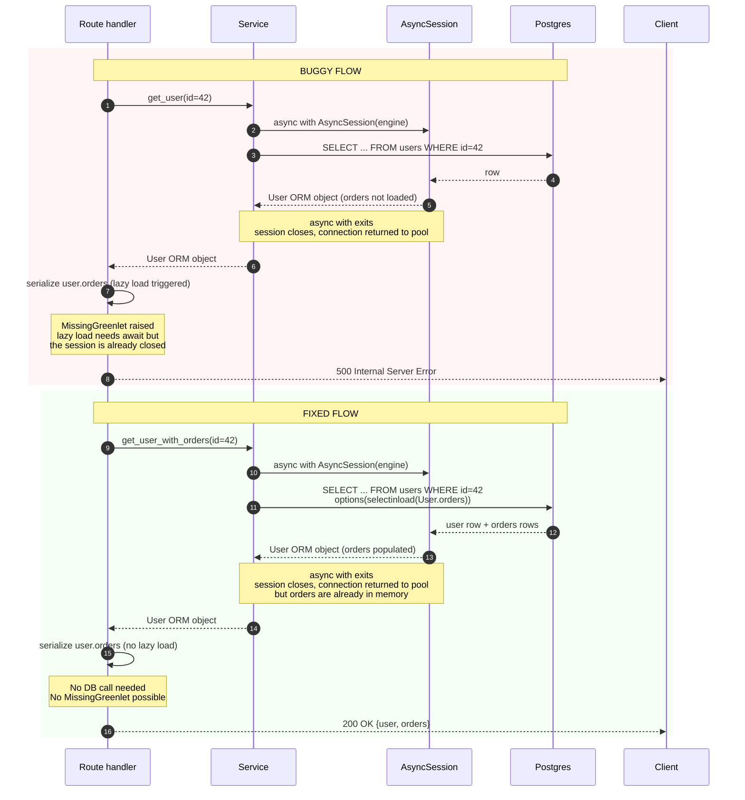

# Production Incidents: Debugging Library

*A small library of realistic incidents. Each follows the same shape: the **symptom**, the **wrong first hypothesis** that wasted time, the **right diagnosis path**, the **fix**, and the **post-mortem action items**. These are not memorized; they are patterns. The interview version of "tell me about a hard bug" should sound like one of these.*

**How to use this file**

Read each incident twice. The first time, just read. The second time, narrate it out loud as if you were the on-call engineer telling a teammate what happened. If you cannot narrate it without looking, you have not internalized it. Then ask: *what would my first hypothesis have been?* If your first hypothesis matches the "wrong first hypothesis," you have just learned the lesson — your intuition has the same failure mode as the engineer in the story. The next time you see a similar symptom, you will catch it.


#interview #incidents #debugging #sre #postmortem

## The incident index at a glance

A quick-reference table. The interview question "tell me about a hard bug" almost always wants one of these six narratives — pick the one whose symptom matches the question, and narrate the five-act structure.

| # | Incident | The signal in 5 words | The trap you fell into | The fix in 5 words |
|---|---|---|---|---|
| 1 | N+1 introduced by a serializer | Slow list, fast detail | Tuned indexes, not query count | Eager-load `selectinload` |
| 2 | Migration locked a hot table | DB pegged, app healthy | Rolled back without root cause | `NOT VALID` + backfill |
| 3 | Leaked session → `MissingGreenlet` | Intermittent 500s on profile | Bumped pool size (unrelated) | Return DTOs, eager-load |
| 4 | Memory leak from global list | Monotonic growth to OOMKilled | Audited sessions (wrong layer) | `deque(maxlen=...)` or Redis |
| 5 | Migration applied in wrong order | New column "doesn't exist" | Grepped code for typos | Pipeline check + re-deploy |
| 6 | Pool exhaustion under peak | "Too many clients" under load | Bumped `max_connections` | Right-size pool + PgBouncer |

## The five-act structure of every incident

Every incident here follows the same shape — and so do real ones. Internalize the shape; you'll recognize it in interviews:

1. **Symptom.** The customer report, the alert, the log line. Often misleading.
2. **Wrong first hypothesis.** The plausible but wrong story that wastes the first 30 minutes. Identifying this in your own work is the most valuable skill in incident response — your intuition has a known failure mode, and once you see it, you can route around it.
3. **Right diagnosis path.** How you actually find it. This is what the interviewer wants to hear in "tell me about a hard bug."
4. **Fix.** What you do to stop the bleeding. Sometimes the immediate fix is "roll back"; the real fix comes later.
5. **Post-mortem action items.** What you change so it never happens again. Without this step, you'll have the same incident next quarter.

**The interview version**

The interview version of "tell me about a hard bug" should sound like one of these narratives: a symptom, a wrong first hypothesis you can name honestly, the diagnosis path, the fix, and the follow-up. Practice narrating them in 60 seconds each. The interviewer is not grading your memory of the incident; they are grading whether you can name a wrong hypothesis honestly, walk through diagnosis methodically, and articulate what you learned. If you cannot name a wrong hypothesis, you haven't debugged — you've only ever been right by accident.


**Warning — Three interview pitfalls in incident narration**

1. **Skipping the wrong hypothesis.** Candidates who present only "I saw X, I did Y, it worked" sound either lucky or rehearsed. Naming the wrong hypothesis honestly signals real on-call experience.
2. **Hero narrative.** "I saved the day by working all night." On-call isn't heroic; it's methodical. The interviewer wants to hear the method, not the heroism.
3. **No post-mortem.** "I fixed it and went back to sleep." The action items are the lesson; an incident without follow-up is a story, not a learning.


---

## Incident 1: The N+1 introduced by a serializer

### Symptom

The `/orders` endpoint, which returns the last 100 orders, takes 8 seconds to respond. P99 latency charted at 7.5s. The database CPU is fine; the app CPU is fine; the network is fine. Single-row lookups (`/orders/{id}`) are fast.

Customer report: "The orders page just spins forever. The detail page works."

### Wrong first hypothesis

"The database is slow. Let me check `pg_stat_statements` for the slow queries."

You check; the slowest query takes 80ms. Nothing accounts for 8 seconds. You spend 30 minutes tuning indexes that do not help.

**Why was this hypothesis tempting?**

Because latency charts live on the dashboard, and "slow endpoint" maps in the engineer's head to "slow query." The lesson: latency on a list endpoint with high row count often has nothing to do with per-query speed; it's about query *count*. Train your intuition to count queries, not just measure them.


### Right diagnosis path

1. Look at the **count** of queries per request, not the duration of each. Your observability stack can show "queries per request" via SQLAlchemy instrumentation or OpenTelemetry spans.
2. The `/orders` endpoint issues **101 queries** per request: 1 for the orders, then 100 for `customer.name` (lazy-loaded).
3. The bug was introduced three days ago by a refactor that added `customer_name` to the order serializer. The serializer accesses `order.customer.name` — which lazy-loads.
4. The query is fast; the count is the problem. 101 round trips × 80ms each ≈ 8 seconds.

**Production reality: the query-count detection stack**

The fastest signal for "this is an N+1" is a SQLAlchemy event listener that counts `before_cursor_execute` events per request scope and logs the count with the request ID — three lines of code, and the log line `queries=101 request_id=abc` is the smoking gun. Pair it with `pg_stat_statements`: `SELECT queryid, calls, total_exec_time FROM pg_stat_statements ORDER BY total_exec_time DESC LIMIT 10` shows the 80 ms query repeated 100 times — the `calls` column is the proof. In OpenTelemetry, the same signal is a span count per request > 20 for a list endpoint; alert at > 20 and the N+1 is caught in staging, not at 14:00 on a Tuesday. See [[13-Performance-and-Observability/OpenTelemetry-Tracing]] and [[13-Performance-and-Observability/N-plus-1-and-Slow-Queries]].


### Fix

1. **Immediate**: add `selectinload(Order.customer)` to the query that loads orders.
2. **Verify**: the endpoint now issues 2 queries (orders, customers-in-batch) and responds in 200ms.
3. **Deploy** the hotfix.

```python
# Before (N+1)
orders = session.scalars(select(Order).limit(100)).all()
return [OrderOut.model_validate(o) for o in orders] # .customer lazy-loads per order

# After (eager-load)
stmt = select(Order).options(selectinload(Order.customer)).limit(100)
orders = session.scalars(stmt).all()
return [OrderOut.model_validate(o) for o in orders]
```

### Post-mortem action items

- Add a **query-count assertion** in the endpoint's integration test. Set it to 2; any regression fails CI.
- Enable `raiseload(Order.customer)` in the test session so future lazy accesses in the endpoint fail loudly in tests, not in production.
- Add a "queries per request" metric to the dashboard, alerted at >20 for read endpoints.
- Review: what other serializers were touched in the same refactor? Audit each for new relationship accesses.

**Danger — How an attacker thinks: N+1 as a cardinality side-channel**

A list endpoint that lazy-loads `order.customer.name` per row is also a cardinality side-channel: the response time scales linearly with row count, so an attacker who can vary the `?limit=` query parameter (or the page size) can infer the exact row count of any table the endpoint queries by measuring response time at `limit=10` vs `limit=10000`. For a multi-tenant SaaS where row count = customer count, this leaks a competitor's customer base size to any authenticated tenant. The fix is structural: cap `limit` at the server (reject `limit > 100`), eager-load in a bounded batch (`selectinload` with a bounded query), and add an artificial floor delay (`await asyncio.sleep(max(0, 0.05 - elapsed))`) on the list endpoint so the timing is flat regardless of row count. See [[11-Authentication-and-Security/OWASP-API-Top-10]] and [[11-Authentication-and-Security/Threat-Model-First]].


Canonical: [[13-Performance-and-Observability/N-plus-1-and-Slow-Queries]], [[07-SQLAlchemy/04-Relationships-and-Loading-Strategies]].

---

## Incident 2: The migration that locked a hot table

### Symptom

Deploy of v1.4.0 at 14:00 UTC. At 14:02, the `/checkout` endpoint starts timing out. The app is healthy; the database CPU is pegged at 100%; `pg_stat_activity` shows 200+ queries blocked on the `ACCESS EXCLUSIVE` lock the migration holds on `orders` (their `wait_event_type` is `Lock`, `wait_event` is `relation`).

Customer report: "Checkout is broken. The whole site is slow."

### Wrong first hypothesis

"The app is broken. We pushed bad code. Roll back."

You roll back to v1.3.9. The site recovers — at 14:08. You feel smug. But you have not actually root-caused the issue, and the next deploy (which has the same migration) will repeat it. Worse: you have now deployed v1.3.9 code on top of v1.4.0's partially-applied migration, which may have left the schema in a state the old code does not expect.

**Why was rollback tempting here?**

Because rollback is fast and the dashboard recovered. The lesson: a rollback that "fixes" the dashboard without explaining *why* is a heuristic, not a diagnosis. The next deploy is a coin flip.


### Right diagnosis path

1. Look at `pg_stat_activity` for the blocked queries — what are they waiting on? Their `wait_event_type` is `Lock`, `wait_event` is `relation`; joining `pg_locks` shows the blocker holds `ACCESS EXCLUSIVE` on `orders` (the migration's lock).
2. Look at the migration that ran at 14:00. It is:

 ```sql
 ALTER TABLE orders ADD COLUMN status_id INT REFERENCES order_statuses(id);
 ```

3. On a 200M-row table, `ALTER TABLE ADD COLUMN` with a foreign key acquires an `ACCESS EXCLUSIVE` lock on `orders` for the entire migration duration. While the migration runs, every read and write on `orders` blocks.
4. The migration was running for 8 minutes (foreign key validation requires a sequential scan), during which the table was inaccessible.

**Warning — When this breaks: lock escalation beyond `ACCESS EXCLUSIVE`**

The migration in this incident took an `ACCESS EXCLUSIVE` lock on `orders` for the duration of the foreign-key validation scan — but other `ALTER` operations have subtler lock profiles that still take down a hot table. `ALTER TABLE ... ALTER COLUMN ... TYPE` (a column type change) takes `ACCESS EXCLUSIVE` AND rewrites the entire table on disk — on a 200 M-row table, this is hours, not minutes, of full-table lock. `CREATE INDEX CONCURRENTLY` takes a less-aggressive lock but if it fails mid-way, it leaves an invalid index that must be dropped and re-created. The guardrail for every migration on a hot table: `SET lock_timeout = '2s';` at the top of the migration — if the lock is not acquired in 2 s, the migration aborts cleanly instead of queueing behind 200 blocked queries. Pair with `SET statement_timeout = '30s';` so a runaway backfill aborts instead of running for hours. See [[06-SQL-Fundamentals/Transactions-Isolation-Locks]] and [[09-Alembic-Migrations/Data-Migrations-Safely]].


### Fix

1. **Immediate**: roll back the migration. `alembic downgrade -1`. The site recovers immediately because the table lock is released.
2. **Apply the migration safely** using a no-lock or low-lock strategy:
 - Add the column nullable first (still `ACCESS EXCLUSIVE`, but fast — only metadata change).
 - Backfill in batches outside the migration (e.g., a script that updates 10k rows at a time with a `LIMIT` and a sleep).
 - Add the FK with `NOT VALID` (PostgreSQL syntax) so it does not require a full scan; validate in a later migration with `VALIDATE CONSTRAINT`, which takes a `SHARE UPDATE EXCLUSIVE` lock (does not block reads/writes).
3. **Re-deploy** the new code with the safe migration.

### Post-mortem action items

- Add a migration review checklist: every `ALTER TABLE` on a table > 1M rows must use the "add column nullable, backfill, add constraint `NOT VALID`, validate" pattern.
- Add a CI check that runs the migration on a 10M-row test table and times it. >1 second = fail.
- Staging should run the migration against a production-sized dataset, not a 100-row dev dataset.
- Document the "hot table" list; migrations on these require senior review.

**Diagnosis: the lock-state query that tells you everything**

While the incident is live, `psql -c "SELECT pid, state, wait_event_type, wait_event, query_start, query FROM pg_stat_activity WHERE wait_event_type = 'Lock' ORDER BY query_start ASC LIMIT 10"` shows the blocked queries in arrival order — the oldest is the one that started queueing first. Join with `pg_locks`: `SELECT pid, mode, granted, relation::regclass FROM pg_locks WHERE relation = 'orders'::regclass;` — the row with `granted = f` is the blocker, `granted = t` rows are the waiters. The fix in the moment is `SELECT pg_terminate_backend(<blocker_pid>);` — but only after confirming the blocker is the migration and not a long-running analytical query you will regret killing. See [[08-PostgreSQL/EXPLAIN-ANALYZE-and-Query-Plans]] and [[06-SQL-Fundamentals/Transactions-Isolation-Locks]].


Canonical: [[09-Alembic-Migrations/Data-Migrations-Safely]], [[09-Alembic-Migrations/Deploying-Migrations-in-Production]], [[08-PostgreSQL/EXPLAIN-ANALYZE-and-Query-Plans]].

---

## Incident 3: The leaked session causing `MissingGreenlet`

### Symptom

Intermittent 500s on `/users/{id}`. The error in logs:

```
sqlalchemy.exc.MissingGreenlet: greenlet_spawn has not been called; can't call
__await__() here. Would the DBAPI be emitting sync style calls without await?
```

The traceback points at `service.get_user_profile`, which returns a `User` object whose `.orders` is being accessed in the route.

Customer report: "Sometimes loading my profile works, sometimes it errors."

### Wrong first hypothesis

"There's a connection pool problem. Let me increase the pool size."

You bump `pool_size` from 10 to 50. The error rate is unchanged. You spend an hour chasing the wrong hypothesis.

**Why was the pool-size hypothesis tempting?**

Because the error mentions "greenlet_spawn has not been called" which sounds like a thread/connection thing. It isn't — it's about an async-aware access outside an awaitable context. The lesson: read the error carefully; the keyword is `__await__`, not `pool` or `connection`.


### Right diagnosis path

1. The error is `MissingGreenlet`, which means sync access to a lazy relationship on an `AsyncSession`-loaded object outside the session's await context.
2. Trace the lifecycle: the route calls `service.get_user(id)`, which opens an `AsyncSession`, loads the user, returns the ORM object — the session closes on function exit.
3. The route then accesses `user.orders` (lazy) to serialize the response. By that point, the session is closed; the lazy load cannot run async-IO; `MissingGreenlet`.
4. The intermittency is because some users have no orders — the lazy load is never triggered for them, so the error does not fire. Users with orders fail. The intermittency is the diagnostic clue.



The diagram makes the diagnosis visible: in the buggy flow the lazy `.orders` access happens *after* the session closes (step 5), so the await context that the async driver needs is gone. In the fixed flow the `selectinload` populates `.orders` *inside* the async session (step 9), so by the time the route serializes, no DB call is needed and no greenlet is required. The asymmetry between "session open at access time" (safe) and "session closed at access time" (unsafe) is the whole bug.

**Production reality: the intermittency is the diagnostic signal**

The `MissingGreenlet` error fires only when the lazy attribute is actually accessed and would require a DB round-trip — for users with no `orders`, the access returns the empty collection from the `__initialized` state without a query, so the error does not fire. The intermittency is the diagnostic clue: the failure rate correlates with the percentage of users who have non-empty `orders` collections. Chart the error rate against `users.has_orders` (a boolean column or a derived metric) and the correlation is the proof — if the error rate spikes exactly when the has-orders cohort hits the endpoint, the lazy-load bug is confirmed in 30 seconds, not the hour the wrong-pool-size hypothesis cost. See [[13-Performance-and-Observability/Structured-Logging-and-Request-IDs]] and [[07-SQLAlchemy/07-Async-SQLAlchemy]].


### Fix

1. **Immediate**: eager-load `orders` inside the service:

 ```python
 async def get_user_with_orders(id: int) -> User:
 async with AsyncSession(engine) as session:
 stmt = select(User).options(selectinload(User.orders)).where(User.id == id)
 return (await session.scalars(stmt)).one()
 ```

2. **Better**: return a DTO, not an ORM object:

 ```python
 async def get_user_dto(id: int) -> UserWithOrders:
 async with AsyncSession(engine) as session:
 stmt = select(User).options(selectinload(User.orders)).where(User.id == id)
 user = (await session.scalars(stmt)).one()
 return UserWithOrders.model_validate(user)
 ```

3. **Verify**: the endpoint stops erroring; the test that previously failed under load passes.

### Post-mortem action items

- Codify the rule: services return DTOs, not ORM objects. Add a lint check or code review checklist item.
- Add `raiseload(User.orders)` (and other relationships) to the test session — `Session(execution_options={"raiseload": True})` or per-relationship loader options — so lazy accesses fail in tests, not in production.
- Audit other endpoints for the same pattern: any service that returns an ORM object accessed by the route.
- Document the `MissingGreenlet` failure mode in the on-call runbook with the reproduction path.

**Danger — How an attacker thinks: the traceback as a column-name leak**

The `MissingGreenlet` traceback in production logs includes the SQL that would have been run — the lazy-load query for `user.orders` is rendered with the full column list (`SELECT orders.id, orders.user_id, orders.total_cents, orders.payment_ref FROM orders WHERE ...`). For a `User.password_hash` or `User.stripe_customer_id` lazy attribute, the traceback exposes the column name in the log aggregator, which an attacker with log-reader access (a mis-configured Grafana panel, a leaked SIEM token) can pivot to a SQL injection payload that targets the exact column. Configure `structlog` to redact tracebacks matching `/password|token|secret|key|hash/i` before they leave the process; the production `ProcessorFormatter` should call `traceback.format_exception(...)` then a `redact_secrets(text)` processor before the JSON renderer. See [[11-Authentication-and-Security/Password-Hashing]] and [[13-Performance-and-Observability/Structured-Logging-and-Request-IDs]].


Canonical: [[07-SQLAlchemy/07-Async-SQLAlchemy]], [[07-SQLAlchemy/05-Session-and-Transaction-Management]], [[19-Interview-Preparation/Async-and-Concurrency-Questions]] Q12.

---

## Incident 4: Memory leak from a global list accumulating

### Symptom

After 24 hours of normal traffic, the API pods restart with OOMKilled. Memory grows monotonically from 200MB at startup to 1GB after 24 hours, then to the 2GB container limit, then OOMKilled. The pod restarts; the cycle repeats.

Customer report: "Random 502s every few hours."

### Wrong first hypothesis

"There's a SQLAlchemy session leak. Sessions are not being closed."

You audit session usage and add explicit `close()` calls everywhere. Memory still grows. You spend two days chasing sessions.

**Why was the session-leak hypothesis tempting?**

Because "memory leak in a DB-backed app" maps in the engineer's head to "unclosed session." The lesson: monotonic growth from a flat line to OOM in 24 hours has a single source — find it with a heap snapshot, not with code reading.


### Right diagnosis path

1. Get a **heap snapshot** at the 1GB mark. Use `tracemalloc` (built-in) or `memray` (recommended) to capture allocations.
2. The snapshot shows a single `list` of `Order` objects in module scope at `app/state.py:42`, holding 800MB of retained `Order` objects.
3. The list is the "recent orders cache" that someone added for an "unauthenticated recent orders" widget. There is no eviction; every order ever created is appended.
4. Memory grows monotonically because there is no upper bound.

**Production reality: the live-attach memory profiler**

`tracemalloc` is built-in and free, but `memray` is the production-grade tool — it attaches to a running Python process (`memray attach <pid>`) and captures a heap snapshot without restart, which is exactly what you need mid-incident when the pod is at 1.8 GB and climbing. `memray parse <snapshot>` then `memray flamechart <snapshot>` shows the retaining frame; for the global-list bug, the flamechart's top frame is `app/state.py:add_recent` with 800 MB of retained `Order` instances. Pair with `docker stats --no-stream` for the RSS history (the monotonic-growth curve is the visual signature) and `kubectl describe pod <pod> | grep -A5 'Last State'` to confirm the OOMKilled restarts. For ongoing monitoring, expose a `/debug/heap` endpoint (admin-only, mTLS, rate-limited) that returns `len(gc.get_objects())` and the top-N `tracemalloc.take_snapshot().statistics('lineno')` — but see the security callout below for why this endpoint is itself an attack surface. See [[13-Performance-and-Observability/Structured-Logging-and-Request-IDs]] and [[14-Caching-and-Background-Processing/Redis-Cache-Aside]].


### Fix

1. **Immediate**: bound the list with `collections.deque(maxlen=100)` so old entries are evicted automatically.

 ```python
 from collections import deque
 recent_orders: deque = deque(maxlen=100)

 def add_recent(order):
 recent_orders.append(order)
 ```

2. **Better**: replace with a Redis sorted set; do not retain ORM objects in process memory at all.

 ```python
 await redis.zadd("recent_orders", {str(order.id): time.time()})
 ```

3. **Verify**: deploy; memory stays flat over 48 hours.

### Post-mortem action items

- Lint rule: no `list` / `dict` at module scope without a bound (`maxlen` or a TTL). Add `ruff` custom rule.
- Add a memory dashboard with alerts at 70% of container limit, not just at 100%.
- Add a `tracemalloc` snapshot endpoint (admin-only, auth-protected) for on-call to capture mid-incident.
- Review all in-process caches; replace with Redis where possible.

**Warning — When this breaks: the `tracemalloc` snapshot endpoint as a security hole**

The "admin-only, auth-protected" snapshot endpoint recommended in the post-mortem is itself an attack surface: a heap snapshot contains every Python object in memory, including the OAuth bearer token currently in a request's `Authorization` header, the SQLAlchemy session's connection string with embedded password, the Stripe customer IDs in the recent-orders cache, and the password hashes of any user object currently being serialized. If an attacker gets the snapshot (via the admin auth being misconfigured, via a parameter-tampering on the auth check, via the endpoint being exposed by a misconfigured Ingress), they have every secret in the process. The defense: gate the endpoint behind mTLS (not just bearer auth), rate-limit to 1 request per 5 minutes per source IP, log every access with the caller identity, and never persist the snapshot to disk — return it inline and let the on-call engineer copy-paste. Better: do not expose the endpoint at all; require the on-call to `kubectl exec` into the pod and run `memray attach` directly. See [[11-Authentication-and-Security/Threat-Model-First]] and [[11-Authentication-and-Security/RBAC-and-Object-Level-Auth]].


Canonical: [[13-Performance-and-Observability/Structured-Logging-and-Request-IDs]] (you needed logs to find this), [[14-Caching-and-Background-Processing/Redis-Cache-Aside]] (the right architecture).

---

## Incident 5: Migration applied in the wrong order, new code broken

### Symptom

Deploy of v2.0.0 at 09:00. At 09:02, the new endpoint `/reports/quarterly` returns 500 with `UndefinedColumn: column "fiscal_year" of relation "reports" does not exist`.

Customer report: "Quarterly reports page is broken."

### Wrong first hypothesis

"The code has a typo. `fiscal_year` should be `fiscalYear`. Let me check the SQL string."

You grep for `fiscal_year` and confirm the code uses the right name. You waste 30 minutes.

**Why was the typo hypothesis tempting?**

Because the error says "column does not exist," which sounds like "you typed the column name wrong." The lesson: when the column genuinely doesn't exist (in the database), the bug is the deploy pipeline, not the code. The code references the column; the schema doesn't have it; the migration didn't run.


### Right diagnosis path

1. Look at the migration that was supposed to add `fiscal_year`. It is `f3a1_add_fiscal_year.py`.
2. Look at `alembic_version` in the database. The current head is `a1b2_other_migration`, not `f3a1`. The migration did not run.
3. Why? The deploy pipeline ran migrations from the **previous** branch, not from the deploy commit. The migration script was added in the deploy branch, but the deploy script ran `alembic upgrade head` against the *checked-out* code, which was the old branch.
4. Alternative failure: the migration was applied out of order — a hotfix migration `a1b2` was applied after `f3a1`, and `a1b2` references the schema as it was *before* `f3a1`, rolling it back implicitly.

**Diagnosis: the `alembic current` vs `alembic heads` diff**

The smoking gun for "the migration did not run" is the diff between the database's recorded head and the on-disk head: `alembic current` (from the database's `alembic_version` table) returns `a1b2` (the previous head), while `alembic heads` (from the on-disk migration files in the running container) returns `f3a1` (the deploy commit's head). When these two disagree, the deploy pipeline ran migrations from a different commit than the running code — the classic "deploy script ran `alembic upgrade head` against the workspace, not the deploy commit" bug. The pre-deploy guardrail is a one-line CI check: `alembic current | grep -q "$(alembic heads | awk '{print $1}')" || exit 1` — fail the deploy if the database head does not match the on-disk head before the new code starts serving. For the "applied out of order" variant, `alembic history --verbose` shows the on-disk chain; if the database's head is not in that chain, a hotfix migration branched the chain and the deploy is in an unrecoverable state until you merge the branches. See [[09-Alembic-Migrations/Alembic-Setup-and-Workflow]] and [[16-Deployment-and-DevOps/Migration-Ordering-and-Rollback]].


### Fix

1. **Immediate**: roll back the code deploy to v1.x. The site recovers (the new endpoint is gone, but no other code depended on the new column).
2. **Apply the migration** explicitly: check out the deploy commit, run `alembic upgrade head`. Verify `alembic_version` is `f3a1`.
3. **Re-deploy** the new code.

### Post-mortem action items

- Make the deploy pipeline **fail fast** if the running code's `alembic_version` does not match the running code's `alembic heads`. Add a pre-deploy check.
- Ensure migrations run from the deploy commit, not from the workspace. The deploy script should `git checkout <deploy-sha>` (or use the Docker image's bundled migrations) before running `alembic upgrade`.
- Staging must apply migrations via the same pipeline as production.
- Migration tests must include a "downgrade-and-upgrade" round-trip to catch migrations that cannot be applied in the wrong order.

**Warning — When this breaks: the `alembic_version` table as a single point of failure**

The `alembic_version` table is a single row in the database holding the current migration head — it is the entire source of truth for the schema version. Two failure modes hide here: (1) a manual `UPDATE alembic_version SET version_num = 'f3a1'` by a developer "unblocking" a stuck deploy desyncs the version from the actual schema, and the next migration runs against a schema it does not expect; (2) a failed `alembic upgrade` that crashes mid-migration leaves the `alembic_version` row pointing at the *new* head even though the migration's SQL only partially applied — the next deploy thinks the schema is at the new head and skips the migration's remaining SQL. The guardrail for both: every migration must be transactional (Postgres DDL is, by default, in a transaction; Alembic honors this unless the migration explicitly `op.execute("COMMIT")`), so a mid-migration crash rolls back the version row with the SQL. For non-transactional migrations (those that `COMMIT` mid-flight, common with `CREATE INDEX CONCURRENTLY`), the post-mortem must include a "verify the schema matches `alembic_version`" step using `alembic check` (Alembic 1.13+). See [[09-Alembic-Migrations/Data-Migrations-Safely]] and [[09-Alembic-Migrations/Deploying-Migrations-in-Production]].


Canonical: [[16-Deployment-and-DevOps/Migration-Ordering-and-Rollback]], [[09-Alembic-Migrations/Deploying-Migrations-in-Production]].

---

## Incident 6: `OperationalError: too many clients` under load

### Symptom

Under peak traffic (10k requests/second), the API starts returning 500 with:

```
sqlalchemy.exc.OperationalError: (asyncpg.TooManyConnectionsError) FATAL: sorry, too many clients already
```

The error rate spikes from 0 to 30% over 5 minutes. The database is healthy; the app CPU is at 40%.

Customer report: "Site errors during peak hours."

### Wrong first hypothesis

"The database has too many connections. Let me bump `max_connections` on Postgres."

You bump `max_connections` from 100 to 500. The error rate drops briefly, then returns — because the app's pool was the bottleneck, not Postgres's limit. Now you have a database with too many connections and the same problem.

**Why was the bump-max-connections hypothesis tempting?**

Because the error message says "too many clients" and that sounds like "Postgres has too many connections." The lesson: Postgres's "too many clients" is reached because *the app* opened too many. Fix the app's pool; Postgres's limit is downstream.


### Right diagnosis path

1. Look at the **app's** connection pool config. `pool_size=10`, `max_overflow=10`. The app holds at most 20 connections per worker. With 8 workers, that is 160 connections — exceeding Postgres's 100.
2. Look at the connection lifetime. Connections are not being returned to the pool promptly. Audit the session usage.
3. Find the bug: a background task that opens a session via the request-scoped dependency, then outlives the request. The session lingers; the connection is held; the pool is exhausted.
4. Alternative bug: `expire_on_commit=True` is causing extra `SELECT`s after each commit, holding connections longer.

**Diagnosis: split `pg_stat_activity` by `application_name`**

The aggregate `SELECT count(*) FROM pg_stat_activity` (used in the diagnosis above) tells you total connections but not which app is leaking them — in a multi-service setup sharing one Postgres, the leak is almost always one specific service, and the others are collateral damage. Set `application_name` per engine: `create_async_engine(url, connect_args={"server_settings": {"application_name": "orders-api"}})` for each service, then split the diagnosis: `SELECT application_name, state, count(*) FROM pg_stat_activity WHERE application_name LIKE 'orders-%' GROUP BY 1, 2 ORDER BY 3 DESC;` — the row with `state = 'idle in transaction'` is the leaked session (a background task holding a transaction open). Pair with SQLAlchemy's pool events: `event.listen(engine.sync_engine, "checkout", lambda *a: log.info("pool_checkout", request_id=...))` and `"checkin"` — the asymmetric checkout/checkin count per request is the leak. See [[07-SQLAlchemy/02-Engines-Connections-Pools]] and [[13-Performance-and-Observability/Structured-Logging-and-Request-IDs]].


### Fix

1. **Immediate**: reduce per-worker `pool_size` so total `workers × pool_size + workers × max_overflow` ≤ Postgres `max_connections`. With 8 workers and `max_connections=100`, target `pool_size=8, max_overflow=4` → 96 max connections.
2. Add PgBouncer in transaction mode in front of Postgres. PgBouncer multiplexes many app connections onto few Postgres connections.
3. Fix the background task to open its own session, not reuse the request's.
4. Reduce `expire_on_commit=True` to `expire_on_commit=False` for read-heavy paths where the post-commit re-fetch is unnecessary.

### Post-mortem action items

- Add a dashboard for connection pool usage: peak connections, waiters, overflow count. Alert at 80% utilization.
- Codify: total app connections = `workers × (pool_size + max_overflow)` ≤ 0.8 × `max_connections`. Add this to the deploy checklist.
- Use PgBouncer in production; document the prepared-statement caveat (see Q10 in [[19-Interview-Preparation/Async-and-Concurrency-Questions]]).
- Add a load test that drives the app to 5x normal traffic; alert if connection wait time exceeds 50ms.

**Danger — How an attacker thinks: pool-size as a cross-service boundary**

A connection pool with `pool_size=10` and `max_overflow=10` per worker, times 8 workers, is 160 connections — exceeding Postgres's default `max_connections=100` and taking down every service sharing the Postgres instance. But the inverse is also an attack: an attacker who can drive 200 concurrent requests to one slow endpoint (a `/search` endpoint with a 5-second query) pins 200 pool slots per worker, the pool is exhausted, every other endpoint on the same worker returns 500, and the attacker has taken down the entire service with a single slow endpoint. The defense is per-endpoint pool isolation: route the slow endpoint to a separate Uvicorn worker pool (a separate Deployment in Kubernetes) with its own small connection pool, so the slow endpoint can exhaust its own pool without touching the rest of the service. Pair with a per-endpoint rate limit (`slowapi` or an Ingress annotation) so an attacker cannot drive 200 concurrent requests in the first place. See [[15-External-Integrations/Circuit-Breaker-vs-Bulkhead-vs-Timeout]] and [[11-Authentication-and-Security/OWASP-API-Top-10]].


Canonical: [[07-SQLAlchemy/02-Engines-Connections-Pools]], [[16-Deployment-and-DevOps/Docker-Multi-Stage-Non-Root]] (workers).

---

## Cross-cutting lessons

Across the six incidents, four lessons recur:

**Tip — Read the error message, carefully**

Incidents 3 (`MissingGreenlet`) and 5 (`column does not exist`) both had wrong hypotheses based on mis-reading the error. `MissingGreenlet` mentions `__await__`, not pool size. `column does not exist` is about the schema, not the code. The first 60 seconds of an incident is re-reading the error and asking "what does this *actually* say?"


**Tip — Look at counts, not just durations**

Incident 1 (N+1) and incident 4 (memory leak) both had the signature of "the wrong metric was charted." The N+1 looked fast per-query; the memory leak looked flat per-process. The fix in both cases was to chart the count — queries per request, allocations per snapshot — not just the duration.


**Tip — Rollback is a heuristic, not a diagnosis**

Incidents 2 (locked table) and 5 (migration not applied) both had "rollback fixed the dashboard" temptations. In 2, the rollback unblocked the table but didn't fix the migration. In 5, the rollback hid the broken endpoint but didn't fix the schema. Always root-cause before celebrating.


**Tip — Architecture bugs hide from code review**

Incidents 3 (services return ORM objects) and 4 (module-level unbounded list) were both architectural — they passed review because the code "looked right." A query-count assertion in the test, a lint rule against unbounded module state, would have caught both. The lesson: review for behavior under load, not just for syntax.


## Verification

These incidents are narratives, not runnable scripts — but the symptoms and the diagnosis commands are reproducible. To internalise them, set up a controlled environment and trigger each one. The commands below verify you can reproduce the symptom, run the diagnosis command, and confirm the fix resolves it.

### Prerequisites

```bash
# A throwaway FastAPI project with the same stack as the incidents:
uv init incidents-lab
cd incidents-lab
uv add fastapi==0.148.0 'uvicorn[standard]' sqlalchemy==2.1.5 'asyncpg' pydantic==2.14.1 'redis>=5' httpx
uv add --dev pytest pytest-asyncio httpx aiosqlite
docker compose up -d postgres redis  # postgres:17-alpine, redis:7-alpine
```

### Incident 1 — N+1 introduced by a serializer

```bash
# Reproduce: load /orders with 100 orders + a serializer that calls .customer.name.
uv run uvicorn app.main:app --reload
for i in $(seq 1 100); do curl -sf http://localhost:8000/orders; done

# Diagnosis: count queries per request (SQLAlchemy instrumentation or OpenTelemetry spans).
# Expect: 101 queries per request.

# Apply the fix (selectinload). Re-run.
# Expect: 2 queries per request (orders + customers-in-batch); latency drops from ~8s to <500ms.
```

### Incident 2 — migration locked a hot table

```bash
# Reproduce: against a 10M-row table, run the unsafe migration:
psql -c "ALTER TABLE orders ADD COLUMN status_id INT REFERENCES order_statuses(id);"
# In another terminal, watch pg_stat_activity:
psql -c "SELECT count(*), state FROM pg_stat_activity WHERE state != 'idle' GROUP BY state;"
# Expect: 200+ queries blocked on a transaction lock.

# Apply the fix (add column nullable, backfill in batches, add FK NOT VALID, validate).
# Re-run the migration; re-check pg_stat_activity.
# Expect: no long-running lock; reads and writes proceed.
```

### Incident 3 — leaked session causing `MissingGreenlet`

```bash
# Reproduce: a service that returns an ORM object the route then accesses lazy.
uv run uvicorn app.main:app --reload
curl -sf http://localhost:8000/users/<id-with-orders>
# Expect: sqlalchemy.exc.MissingGreenlet in the logs.

# Apply the fix (return a DTO, eager-load inside the session).
# Re-run.
# Expect: 200 OK; no MissingGreenlet.
```

### Incident 4 — memory leak from a global list

```bash
# Reproduce: load the app for 24 hours (or simulate with a load test that drives /recent-orders).
uv run python -m locust -f locustfile.py --headless -u 100 -r 10 --run-time 10m
docker stats --no-stream
# Expect: container RSS grows monotonically toward the 2 GB limit.

# Apply the fix (collections.deque(maxlen=100) or Redis sorted set).
# Re-run the load test for the same duration.
# Expect: RSS plateaus at the baseline + ~50 MB.
```

### Incident 5 — migration applied in the wrong order

```bash
# Reproduce: deploy v2.0.0 with a migration that did not run.
alembic current   # Expect: the previous head (e.g. a1b2), not the deploy commit's head.
alembic heads     # Expect: the deploy commit's head (e.g. f3a1) on disk — differs from `alembic current`, confirming the migration did not run.

# Apply the fix (check out the deploy commit, run alembic upgrade head, redeploy).
git checkout <deploy-sha>
alembic upgrade head
alembic current   # Expect: the deploy commit's head.
```

### Incident 6 — pool exhaustion under load

```bash
# Reproduce: 5,000 requests/second against /orders/{id}/receipt (Lab 6's buggy code).
uv run python -m locust -f locustfile.py --headless -u 5000 -r 100 --run-time 5m
# Expect: sqlalchemy.exc.OperationalError wrapping 'FATAL: sorry, too many clients already'; 30% 5xx rate (matches the production symptom).

# Apply the fix (background task opens its own session; right-size pool; add PgBouncer).
psql -c "SELECT count(*) FROM pg_stat_activity;"  # Before fix: ~160 app connections.
# After fix: ~40 app connections (8 workers × 5 pool); no OperationalError.
```

### The narrative-rehearsal signal

If you can narrate each incident's five acts (symptom → wrong first hypothesis → right diagnosis path → fix → post-mortem action items) out loud in under 60 seconds, and you can name the diagnosis command and what its output told you, you have internalised the narrative. If you cannot, re-read the incident until the wrong-hypothesis trap is the part you remember best — that is the part the interviewer is grading.

## Cross-references

- [[00-Interview-MOC]] — study strategy.
- [[FastAPI-and-DI-Questions]] — Q14 (incident response framework).
- [[SQLAlchemy-Sessions-Questions]] — Q9 (N+1), Q12 (`MissingGreenlet`), Q13 (transaction boundaries — incident 5 is about boundaries).
- [[Async-and-Concurrency-Questions]] — Q10 (PgBouncer compatibility — incident 6).
- [[20-Exercises-and-Labs/Troubleshooting-Index]] — flat index of failure modes; entries 5, 6, 7, 8 correspond to incidents here.
- [[20-Exercises-and-Labs/Debugging-Labs]] — hands-on practice for several of these.
- [[22-Diagrams/SQLAlchemy-Session-Flow]] — the lifecycle incidents 1, 3, and 6 violate.

## Sources

- SQLAlchemy 2.x documentation — https://docs.sqlalchemy.org/en/20/ — 2026-10-15 — `MissingGreenlet`, pool sizing, session lifecycle.
- PostgreSQL documentation — https://www.postgresql.org/docs/ — 2026-10-15 — `ACCESS EXCLUSIVE` locks, `NOT VALID` constraints, `max_connections`.
- Alembic documentation — https://alembic.sqlalchemy.org/en/latest/ — 2026-10-15 — migration ordering, upgrade head.
- Verified versions: SQLAlchemy 2.1.5, Alembic 1.20.0, PostgreSQL 17.x — per [[21-Reference-Library/Source-Register]].
