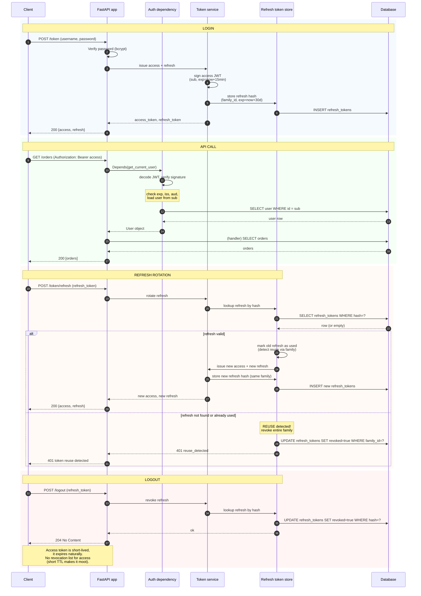

# Auth Flow Diagram

*The canonical Mermaid of the OAuth2 password-grant flow with JWT access and refresh tokens: login → access token → API call → token introspection → refresh rotation with reuse detection → logout (revoke refresh). Lessons that need this diagram link here.*

**You're looking at the fourth interview diagram**

"Walk me through your auth flow" is the security-leaning version of the architecture interview question. The interesting part is not the login (everyone gets that right) — it's the refresh rotation with reuse detection. That's the part that signals you've actually built auth in production, not just read a tutorial. Practice narrating the rotation phase, including the reuse-detection branch.


#diagram #auth #security #jwt #oauth2

## Diagram



## Prose: what each phase does

### Login (password grant)

The client submits username and password. The API verifies the password against a bcrypt hash (see [[11-Authentication-and-Security/Password-Hashing]]). On success, the API issues two tokens:

- **Access token** — a JWT signed by the server, containing `sub` (user ID), `exp` (typically 15 minutes), `iat`, `iss`, `aud`. Stateless; the server does not need to look it up.
- **Refresh token** — a long-lived opaque token (random bytes), stored hashed in the database, with `family_id` (see below), `user_id`, `expires_at`, `revoked=false`.

The refresh token is **opaque**, not a JWT, so it can be revoked server-side. Access tokens are JWTs because the server wants to verify them statelessly; the trade-off is that they cannot be revoked before expiry (only mitigated by short TTL).

**Why two token types and not just one:** A single stateless JWT would be either short-lived (forcing the user to re-enter credentials every 15 minutes) or long-lived and un-revocable (catastrophic if stolen). The two-token split gets the best of both: a short-lived stateless access token (fast verification, no DB) plus a long-lived opaque refresh token (revocable, low DB cost because it's hit only every 15 minutes, not on every request).

**Why the asymmetry?**

Access tokens are JWTs because the server wants to verify them *statelessly* — every protected endpoint just decodes and verifies, no DB lookup. The cost is that they cannot be revoked before expiry; the mitigation is the short TTL (15 min).
Refresh tokens are opaque because they must be *revocable* — logout, reuse detection, forced re-auth all require server-side state. The cost is a DB lookup on every refresh. Refresh happens rarely (every 15 min at most), so the DB cost is acceptable.


**Warning — Security: bcrypt cost factor is a production dial, not a constant**

The login path verifies the password with bcrypt; the cost factor is the difference between a 50 ms login (cost=12) and a 5 ms login (cost=10). OWASP 2026 guidance is to tune the cost factor so verification takes about 250 ms on your production hardware — that lands at cost=13 or 14 on a 2026 CPU. Re-tune annually; hardware gets faster and your cost factor should track it, or brute-force economics improve against you. Set the cost factor in [[04-Pydantic/Pydantic-Settings]] so it changes with a deploy, not a migration. The flip side: too high a cost factor makes login a DoS vector — a flood of bad-password attempts pins CPU. Pair with rate-limiting on `POST /token` (see [[03-FastAPI-Core/Middleware-and-Request-Order]]) and consider an argon2id upgrade path (see [[11-Authentication-and-Security/Password-Hashing]]).


### API call with access token

Every protected endpoint has a `Depends(get_current_user)` dependency. The dependency:

1. Reads `Authorization: Bearer <access_token>`.
2. Decodes the JWT, verifying signature and `exp`, `iss`, `aud`.
3. Loads the user from the database (by `sub`).
4. Returns the user object to the handler.

The introspection here is local (just decode + verify); there is no separate introspection endpoint in this design. If the access token is expired, the dependency returns 401; the client should refresh (see next phase).

**Tip — Why load the user from DB on every request?**

Two reasons: (a) the user's `is_active` flag, scopes, or roles may have changed since the token was minted; (b) the user may have been deleted. The stateless JWT only verifies identity; the DB lookup verifies authorization is still valid. The DB hit is one indexed `SELECT by id`, fast and cached in the identity map if the same user appears in the same session.


**Production: cache the user lookup with a short TTL, and bust on `is_active` flip**

The DB lookup on every protected request (the tip above) is one indexed `SELECT by id` — fast, but at 10,000 req/s it is 10,000 round trips per second to Postgres. The production habit: cache the user row in Redis with a 30-60 s TTL keyed by `user:{id}`, invalidate on logout and on `is_active` flip. This drops the DB load by ~98% in steady state and gives the `is_active` check a 60 s worst-case staleness — acceptable for most apps, not acceptable for security-incident response (where you flip `is_active=false` and need it enforced within seconds). For the incident path, bust the cache explicitly. See [[14-Caching-and-Background-Processing/Redis-Cache-Aside]] for the cache-aside pattern and [[11-Authentication-and-Security/RBAC-and-Object-Level-Auth]] for the authz invalidation contract.


### Refresh rotation

When the access token expires, the client calls `POST /token/refresh` with the refresh token. The server:

1. Looks up the refresh token by hash in the database.
2. Checks: not revoked, not expired, not used.
3. Marks the old refresh as used.
4. Issues a new access token and a new refresh token.
5. Stores the new refresh hash, with the same `family_id` as the old one.

**Rotation** means every refresh produces a new refresh token; the old one is invalidated. This detects token theft: if an attacker steals a refresh token and uses it, the legitimate client's next refresh finds the token already used — and the server revokes the entire family (all refresh tokens descended from the original login). This is the **reuse detection** pattern.

The `family_id` groups all refresh tokens descended from a single login. On reuse detection, the entire family is revoked, forcing the user to re-authenticate. This is the safe response: assume the worst (theft) and force a re-login.

**Why revoke the family and not just the offending token:** Because the server cannot tell which copy of the token was stolen and which was legitimate. Both clients (the user and the attacker) presented valid refresh tokens from the same family. Revoking just the one the attacker used leaves the user's other outstanding refresh tokens (and the attacker's next rotation) still valid. Revoking the whole family invalidates every descendant of the original login — including the attacker's chain — in one write. The user re-auths once; that's the cost of safety.

**Danger — Security: refresh-token lookup must be constant-time on the hash, not the raw token**

The refresh token is opaque and looked up by hash. Two production rules: (a) hash with SHA-256 (or argon2id if you want resistance to a DB dump — see [[11-Authentication-and-Security/Password-Hashing]]), never store the raw token in the `refresh_tokens` table; (b) the lookup `SELECT * FROM refresh_tokens WHERE hash = $1` must use an indexed equality on a fixed-length hash, not a `LIKE` or substring — otherwise the lookup itself becomes a timing side-channel that leaks prefix information. The `family_id` should be a separate indexed column, not derivable from the token, so revoking the family is a single indexed `UPDATE ... WHERE family_id = $1` and not a full scan. See [[06-SQL-Fundamentals/SQL-Injection-and-Parameterized-Queries]] for the parameterized-lookup half of this contract.


**Danger — The "mark as used, not delete" detail**

The old refresh token is marked `used=true`, not deleted. Why? Because if it's deleted, the next request with the same (stolen) token returns "not found" — which the server can't distinguish from a normal "stale token, please re-auth" case. By keeping the row and marking it `used`, the server can detect the reuse: "this token was already used; the family is compromised." Delete loses the signal.


**Debugging: the `reuse_detected` alert is the most important signal in your auth dashboard**

When the 401 `reuse_detected` branch fires (above), it means two clients presented the same refresh token — one is the legitimate user, one is an attacker, and you cannot tell which. Treat every `reuse_detected` event as a security incident: page the on-call, log the `family_id`, the `user_id`, and the source IPs of both refresh attempts, and force a password reset for the user. The rate of these events in steady state should be near zero; a spike means either a credential-stuffing campaign or a token-theft bug in your client (a mobile app leaking refresh tokens to a shared file, a SPA leaking to localStorage under a different origin). See [[13-Performance-and-Observability/Structured-Logging-and-Request-IDs]] for the incident-grade log shape.


### Logout (revoke refresh)

The client calls `POST /logout` with the refresh token. The server:

1. Looks up the refresh token.
2. Marks it as revoked.
3. Returns 204.

The access token is not revoked (it cannot be — it is stateless); it expires naturally within minutes. This is acceptable because the access token is short-lived; if immediate revocation is required, use an access-token denylist (with the trade-off of statefulness).

**Warning — Debugging: zombie sessions are access tokens whose refresh was revoked**

After logout, the refresh token is revoked but the access token is still valid for up to 15 minutes (its TTL). A user who clicks "logout" and then refreshes the page within those 15 minutes will see their data load — the access token is still in their browser, still verifies, still hits the DB. This is *by design* (the tip in the API-call phase), but it confuses QA and customers alike. The debugging signal: a "logged out" user with active requests in the access-token verify logs. The fix is communication (tell QA and support "logout is up to 15 minutes soft") or the access-token denylist variant below. Pick based on threat model, not vibes — see [[11-Authentication-and-Security/Threat-Model-First]].


**Interview follow-up: how would you implement "logout everywhere"?**

Revoke all refresh-token families for the user. The user's access tokens still work for up to 15 minutes (until they expire), but they can't refresh — so they're forced to re-authenticate. If you need truly immediate logout everywhere, you need an access-token denylist (Redis, checked on every request) — at the cost of every protected request doing a Redis lookup.


## Variants

### With an access-token denylist

Add a `revoked_at` column to the access-token table; the `get_current_user` dependency checks the denylist before accepting the token. The trade-off is that every request hits the denylist store (typically Redis for speed). Use when immediate revocation is non-negotiable (e.g., a security incident).

**Tip — Production: the denylist entry TTL must equal the access-token TTL**

The access-token denylist (variant above) is a Redis key per revoked `jti`, with `EX = access_token_ttl`. Two production rules: (a) the TTL must exactly equal the access-token TTL (15 min) — shorter, and a revoked token is re-accepted after the denylist entry expires; longer, and the denylist grows unbounded; (b) check the denylist *after* signature verification, not before — a missing or malformed JWT should fail at decode, not at the Redis lookup, or you give attackers a free Redis round trip per request. The cost is one Redis `GET` per protected request; benchmark before shipping, because at 10k req/s this is 10k Redis ops/s of new load on a service that may already be running the SSE pub/sub fan-out. See [[14-Caching-and-Background-Processing/Redis-Cache-Aside]].


### With external introspection (OAuth2 server)

In a service-oriented architecture, the FastAPI app calls an external introspection endpoint (`POST /introspect` on the auth server) to validate the access token. The auth server is the source of truth; the app caches the result for a short TTL. Used when the auth server is separate from the API server (e.g., Auth0, Keycloak).

**Danger — Security: introspection caching is a poisoning risk**

The external-introspection variant (above) caches the introspection result for a short TTL — typically 30-60 s. The cache key is the access-token `jti`; the value is `{active: bool, scopes: [...], exp: ...}`. Two production rules: (a) cache `exp` and evict on `exp`, not on a fixed TTL — otherwise a token that expires in 5 s can be cached as active for 60 s; (b) cache only the introspection result, never the raw token — the cache (Redis) is a separate trust boundary from the auth server, and a Redis dump leaking raw tokens is a credential breach. Pair with mTLS between the API and the auth server so a man-in-the-middle cannot inject a poisoned introspection response. See [[15-External-Integrations/HTTP-Clients-Timeouts-Retries]] for the mTLS client config.


### With PKCE (auth code flow)

For first-party SPA or mobile apps, replace the password grant with the authorization-code flow with PKCE. The user is redirected to an authorization server, logs in there, and is redirected back with an auth code; the client exchanges the code (plus the PKCE verifier) for tokens. More complex; required for third-party clients.

See [[11-Authentication-and-Security/OAuth2-JWT-Access-Refresh]] for the canonical lesson.

**Production: redirect URIs are exact-match, not prefix-match**

The PKCE flow (above) ends with a redirect back to the client at a registered URI. The production rule that catches 90% of OAuth bugs in code review: redirect URIs must be *exact-match*, including scheme, host, port, path, and trailing slash. `https://app.example.com/callback` and `https://app.example.com/callback/` are different URIs; `http://app.example.com/callback` (no TLS) is a different URI and should be rejected in production. A malicious `app.example.com.evil.com/callback` (host confusion) must be rejected by exact host match, not substring. Configure the allowed-list in [[04-Pydantic/Pydantic-Settings]] and validate against the registered list with `urllib.parse` before any token exchange — never trust the client-supplied redirect URI directly. See [[11-Authentication-and-Security/OAuth2-JWT-Access-Refresh]] for the canonical flow.


## Common interview questions

**Five standard auth interview questions**

- Why are access tokens JWTs and refresh tokens opaque? (Access tokens are verified statelessly; refresh tokens must be revocable, which requires server state.)
- Why rotate refresh tokens? (To detect theft via reuse.)
- What is a refresh-token family? (All refresh tokens descended from a single login; revoking the family on reuse is the safe response to theft.)
- How would you implement "logout everywhere"? (Revoke all refresh-token families for the user. Access tokens expire naturally.)
- What if the JWT signing key leaks? (All access tokens are forgeable; rotate the signing key, which invalidates all outstanding tokens. Refresh tokens are unaffected because they are opaque.)


See Q13 of [[19-Interview-Preparation/FastAPI-and-DI-Questions]] for testing auth in FastAPI (dependency overrides + minted tokens), and entry 9 of [[20-Exercises-and-Labs/Troubleshooting-Index]] for the "Signature has expired" failure mode.

## Cross-references

- [[22-Diagrams/Request-Lifecycle-Diagram]] — the auth dependency is step 9 in the request lifecycle.
- [[22-Diagrams/Deployment-Topology]] — where the auth dependency, the refresh-token store, and the JWT signing key live.
- [[11-Authentication-and-Security/OAuth2-JWT-Access-Refresh]] — canonical lesson.
- [[11-Authentication-and-Security/Password-Hashing]] — login password verification.
- [[11-Authentication-and-Security/RBAC-and-Object-Level-Auth]] — what the auth dependency checks beyond identity.
- [[12-Testing-and-Quality/Testing-FastAPI-Endpoints]] — testing auth (dependency overrides + integration tests).
- [[20-Exercises-and-Labs/Troubleshooting-Index]] entry 9 — JWT "Signature has expired".

## Verification

Verify the Mermaid block renders without parse errors:

```bash
npm install -g @mermaid-js/mermaid-cli   # one-time
mmdc -i 22-Diagrams/Auth-Flow-Diagram.md -o /tmp/auth-flow.svg -t default
# Expected: 'mermaid Render successful: /tmp/auth-flow.svg' (exit code 0).
# If you see 'Parse error on line N: ...' the diagram block has a syntax bug
# (commonly an unquoted `:` in an `alt` branch label, or an unescaped `]`
# inside a participant alias) — see [[00-Diagrams-MOC]] "Common Mermaid syntax pitfalls".
```

To verify your mental model of the four phases, narrate against a timer and name each phase's response code:

```bash
uv run python -c "
import time
t0 = time.time()
input('Draw and narrate the OAuth2 password-grant + refresh-rotation flow. Press Enter when done. ')
print(f'elapsed: {time.time()-t0:.1f}s')
"
# Expected: under 4 minutes for a senior-level narration of all 4 phases
# (LOGIN -> API CALL -> REFRESH ROTATION -> LOGOUT) with the response codes
# named (200 / 200 / 200 / 204) and the reuse-detection branch called out
# ('401 reuse_detected, revoke the family').
# If you forget the family_id reuse-detection branch, you have skipped the
# most interview-relevant part — re-read the prose under 'Refresh rotation'.
```

If `mmdc` reports zero parse errors and your narration completes in under 4 minutes covering all 4 phases with the reuse-detection branch named explicitly, you have internalised the diagram. Cross-check against Q9 of [[20-Exercises-and-Labs/Troubleshooting-Index]] (JWT "Signature has expired") — if you can name when 401 means "expired, refresh" vs "reuse_detected, re-auth", the rotation pattern is in your head.

## Sources

- OAuth 2.0 RFC 6749 — https://datatracker.ietf.org/doc/html/rfc6749 — 2026-10-15 — password grant, refresh token rotation.
- RFC 7662 (OAuth 2.0 Token Introspection) — https://datatracker.ietf.org/doc/html/rfc7662 — 2026-10-15 — introspection endpoint.
- JWT RFC 7519 — https://datatracker.ietf.org/doc/html/rfc7519 — 2026-10-15 — JWT claims and signature.
- OWASP API Security Top 10 — https://owasp.org/API-Security/ — 2026-10-15 — token theft and reuse patterns.
- Verified versions: FastAPI 0.148.0, Pydantic v2.14.1 (for the JWT claims model) — per [[21-Reference-Library/Source-Register]].
