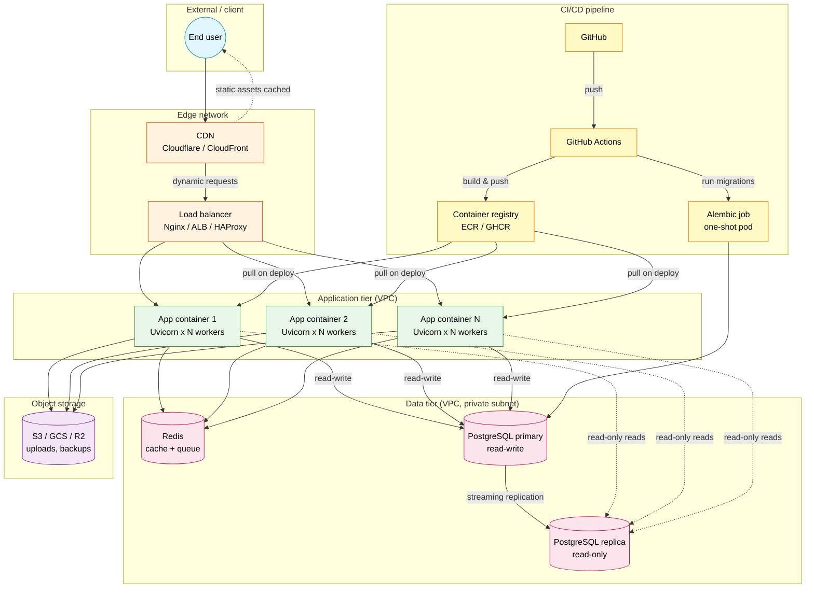

# Deployment Topology

*The canonical Mermaid flowchart of a production topology for a FastAPI service: CDN → load balancer → N app containers → Redis (cache/queue) → PostgreSQL primary + replica → object storage → CI/CD pipeline feeding the registry. Lessons that need this diagram link here.*

**You're looking at the third interview diagram**

"Draw your production architecture on the whiteboard" is the platform / SRE version of the architecture interview question. If you can reproduce this topology from memory — every tier, every connection, every deploy boundary — you have answered it. The prose below tells you what each tier *does* (so you can narrate) and *why* it exists (so you can defend).


#diagram #deployment #architecture #production

## Diagram

This is a **flowchart topology**: each `subgraph` is a network zone (External, Edge, App tier in a VPC, Data tier in a private subnet, Object storage, CI/CD pipeline). Solid arrows (`-->`) are real network/replication connections; dashed arrows (`-.->`) are logical or periodic flows (static-asset cache hits, read-only replica reads, pull-on-deploy). The `classDef` block at the bottom assigns one colour per zone so the diagram reads at a glance: blue=external, orange=edge, green=app, pink=data, purple=storage, yellow=CI/CD. Read the diagram in deployment order — CI/CD pipeline first (it builds what everything else runs), then edge, then app tier, then data tier — and the prose below explains *what each tier does* and *why it exists*.

**Legend: the three arrow types you'll see**

- `LB --> App1` (solid) — a persistent or per-request network connection in the steady state: the LB forwards a request, the app writes to Redis, the app writes to Postgres primary.
- `CDN -.-> User` (dashed) — a logical flow that does not run on every request: cached static assets served directly from the edge, or read-only reads routed to the replica.
- `PgPrimary --> PgReplica` (solid with label `streaming replication`) — the continuous WAL stream from primary to replica; the replica is eventually consistent, never read-your-writes for a freshly committed row.




### The shape of the topology

The topology has six zones that decompose into two axes: a **request path** (User -> CDN -> LB -> App -> Redis/Postgres/S3) and a **deploy path** (GitHub -> Actions -> Registry -> App containers; Actions -> Migrator -> Postgres primary). The two paths intersect only at the app containers and the primary — the deploy path writes new code and new schema there, the request path reads and writes data there. Keeping the deploy path separate from the request path is why the migrator is a one-shot pod, not a long-running service: a long-running migrator would hold a connection, block deploys, and compete with the app for the primary's `max_connections`. The prose below walks each zone in the order an architect would draw it on a whiteboard: edge first (closest to the user), then app tier, then data tier, then storage, then the CI/CD pipeline that feeds all of them.

## Prose: what each component does

### CDN (Cloudflare / CloudFront)

The CDN is the closest layer to the user. It serves cached static assets (CSS, JS, images, fonts) directly from edge locations, reducing latency and load on the application. For dynamic requests, it forwards to the load balancer — typically with HTTP/2 multiplexing, request buffering, and basic WAF rules.

The CDN is optional for low-traffic internal services, but near-mandatory for any user-facing service. Without it, every static-asset request hits the load balancer and the app tier.

**Why the CDN and not just bigger load balancers:** Because static-asset traffic is bimodal — a marketing landing page can go viral and produce 100x the normal request rate overnight, all for one CSS file. A CDN absorbs that spike at the edge for a flat monthly fee; bigger LBs cost linearly and need a human to provision them. The CDN also serves from edge PoPs that are 20-50 ms closer to the user than your load balancer, which is a perceptible latency win.

**Why the CDN forwards dynamic requests too**

Even though the CDN doesn't cache dynamic responses, routing everything through the CDN gives you: (a) edge-level rate limiting and WAF; (b) HTTP/2 multiplexing to the client; (c) DDoS absorption at the edge; (d) TLS termination at the edge. The CDN → LB hop is typically a single TCP connection reused for many requests (keepalive).


### Load balancer (Nginx / ALB / HAProxy)

The load balancer terminates TLS (see [[22-Diagrams/Request-Lifecycle-Diagram]]), validates the `Host` header, applies rate limits, picks a healthy upstream by round-robin or least-connections, and forwards to the app. It typically also handles:

- **Health checks** — pinging each app container on a `/health` endpoint and removing unhealthy containers from rotation.
- **Slow-client protection** — buffering slow uploads so the app does not hold a connection for 30 seconds while the client uploads at 1kb/s.
- **HTTP/2 → HTTP/1.1 translation** — apps often speak HTTP/1.1; the LB presents HTTP/2 to clients.

See [[02-Web-and-HTTP/ASGI-Starlette-Uvicorn]] and [[16-Deployment-and-DevOps/Docker-Multi-Stage-Non-Root]].

### App containers (N replicas)

Each app container runs Uvicorn with multiple workers (one per CPU core, typically). The app containers are stateless and horizontally scalable; the load balancer distributes requests. Deployments roll the containers one at a time (or in batches) for zero-downtime.

The app containers run the FastAPI service, the middleware stack, and the dependency injection. They hold the engine (with its connection pool) and the Redis client. They do **not** hold user session state — that goes in Redis or in a JWT — because stateful containers break horizontal scaling.

**Interview follow-up: why are the containers stateless?**

Because stateless containers can be killed, restarted, scaled, and rolled without losing user state. If a container held a user's in-progress cart, killing it mid-edit loses the cart. Putting the cart in Redis (or in a JWT, or in Postgres) means any container can serve any user. Statelessness is the prerequisite for horizontal scaling and zero-downtime deploys.


### Redis (cache + queue)

Redis serves two roles:

1. **Cache** — the cache-aside pattern: app reads from Redis; on miss, reads from Postgres and writes back. See [[14-Caching-and-Background-Processing/Redis-Cache-Aside]].
2. **Queue** — for background jobs (Celery, RQ, arq workers) or the transactional outbox. Workers poll Redis (or use blocking pop) and execute jobs.

Redis can also hold rate-limit counters, idempotency keys (with TTL), and pub/sub for real-time notifications.

**Warning — Don't put authoritative state in Redis**

Redis is volatile by default (without AOF / RDB persistence). Treat it as a cache and a queue, not as the source of truth. If a Redis flush loses data, the system must be able to recover from Postgres. The transactional outbox pattern makes Redis's queue state safely reproducible from Postgres. See [[14-Caching-and-Background-Processing/Transactional-Outbox]].


### PostgreSQL primary + replica

PostgreSQL runs as a primary (read-write) with one or more replicas (read-only, kept in sync via streaming replication). All writes go to the primary; read-heavy paths (analytics, listing pages) can route to replicas to offload the primary.

Two operational concerns:

- **Connection pooling.** App containers hold a pool of connections; the total across containers must stay below Postgres's `max_connections`. Use PgBouncer in front of Postgres to multiplex many app connections onto few Postgres connections. See Q10 of [[19-Interview-Preparation/Async-and-Concurrency-Questions]] and Incident 6 in [[19-Interview-Preparation/Production-Incidents-Debugging]].
- **Replica lag.** Replicas are eventually consistent; a write to the primary may not be visible on the replica for milliseconds (or seconds under load). Read-your-writes consistency requires routing reads-after-writes to the primary. See [[06-SQL-Fundamentals/Transactions-Isolation-Locks]].

**Why a primary-replica split and not multi-master:** Because multi-master Postgres is a research problem, not a shipping product. The set of acceptable anomalies in multi-master is much larger than the set in single-primary-with-replicas (which is well understood: stale reads, governed by `synchronous_commit` and `wal_sender` flow control). The single-primary model scales writes vertically (one bigger box) and reads horizontally (add replicas); that's the trade-off most apps can actually operate. Multi-master is reserved for cross-region active-active setups with very specific consistency requirements.

### Object storage (S3 / GCS / R2)

Object storage holds user uploads (images, documents), application backups, and any large binary blobs that do not belong in Postgres. The app writes directly to S3 using presigned URLs (the client uploads directly, the app does not proxy the bytes) or via the boto3 client.

Object storage is durable, cheap, and infinitely scalable. It is the right home for anything that does not need transactional semantics with the database.

**Tip — The presigned-URL upload pattern**

For user uploads, the app mints a presigned S3 URL and returns it to the client. The client uploads directly to S3; the app doesn't proxy the bytes. This keeps the app's request handlers small and fast; large uploads don't tie up app workers. See [[03-FastAPI-Core/Background-Tasks-Streaming-Uploads]].


### CI/CD pipeline

GitHub Actions (or equivalent) builds the Docker image, pushes it to the container registry (ECR / GHCR), and on deploy:

1. **Runs migrations** in a one-shot pod (the "migrator"). The migrator connects to the primary, runs `alembic upgrade head`, and exits. See [[09-Alembic-Migrations/Deploying-Migrations-in-Production]].
2. **Deploys the new app containers** by pulling the new image, starting new containers, draining old ones. See [[16-Deployment-and-DevOps/Docker-Multi-Stage-Non-Root]] and [[16-Deployment-and-DevOps/Migration-Ordering-and-Rollback]].

**Danger — The order matters**

Migrations run *before* the new code is rolled out. The new code may rely on a column the migration adds; the old code must not run after the migration drops a column it uses. See Incident 5 in [[19-Interview-Preparation/Production-Incidents-Debugging]] and Lab 5 in [[20-Exercises-and-Labs/Debugging-Labs]]. The "migrator as a one-shot pod" pattern ensures migrations run exactly once per deploy, in order, with the deploy commit's code.


## Variants

### Without a CDN

Drop the CDN; the load balancer serves static assets directly. Acceptable for internal services or low-traffic apps; the load balancer becomes the bottleneck for static assets.

**Tip — The "internal service" boundary**

Internal services (admin dashboards, partner APIs, back-office tools) often skip the CDN because their users are few, their traffic is steady, and their assets are small. The boundary is "would a 100x traffic spike on a single asset be a problem?" If no, skip the CDN. If yes (any user-facing service, any marketing page), the CDN is non-negotiable — a viral landing page will saturate the LB otherwise.


### Without a replica

Drop the replica; all reads and writes go to the primary. Acceptable for low-traffic apps; scaling requires vertical scaling (a bigger database instance).

**When you outgrow the no-replica variant**

The signal is read latency creep under write load. The primary serves both reads and writes; as the read rate climbs, write latency (which needs the same WAL) degrades. The first fix is connection pooling (PgBouncer), the second is a read replica. If you are on a managed Postgres (RDS, Cloud SQL), adding a replica is a config change; promote the replica pattern before considering a sharding project.


### With a worker tier (Celery / RQ / arq)

Add a "Worker tier" subgraph between the app tier and Redis. Workers poll Redis for jobs, execute them, and write results back to Postgres. The app tier enqueues jobs; the worker tier dequeues. See [[14-Caching-and-Background-Processing/Background-Tasks-vs-Workers]] and [[14-Caching-and-Background-Processing/Transactional-Outbox]].

**Warning — The worker tier has its own deploy and its own connection pool**

Workers are a separate process group with their own Uvicorn-free lifecycle (no ASGI, no event loop unless the worker framework adds one). They have their own SQLAlchemy engine and pool, sized independently of the app tier — typically *smaller*, because worker concurrency is bounded by job length, not by request rate. Count the worker pool's connections against the primary's `max_connections` budget or you will exhaust the primary during a backlog drain.


### With a service mesh / sidecar

Add sidecar containers (Envoy, Linkerd) to each app container for mTLS, observability, and traffic control. Common in Kubernetes; less common in container-as-a-service platforms.

**Note — When the sidecar pays for itself**

The service mesh overhead (one extra hop, one extra process per pod, ~5-15% CPU) is justified when you have *internal* service-to-service traffic that needs mTLS, fine-grained traffic shaping (canary, retry budgets), or unified tracing across services you don't own. For a single FastAPI service with no internal mesh, the sidecar is pure overhead — use the LB's TLS and the app's OpenTelemetry instrumentation instead.


### With PgBouncer

Add a PgBouncer pod between the app tier and the Postgres primary. PgBouncer multiplexes many app connections onto few Postgres connections in transaction mode. See Q10 of [[19-Interview-Preparation/Async-and-Concurrency-Questions]].

**Danger — PgBouncer transaction mode breaks prepared statements and session-level features**

PgBouncer in transaction mode multiplexes connections at transaction boundaries, so anything that holds session state (prepared statements, `SET` for the session, advisory locks, `LISTEN`/`NOTIFY`) does not survive the transaction boundary. SQLAlchemy 2.x uses prepared statements for some optimisations; you must disable them or use PgBouncer's session mode (which defeats the multiplexing benefit). See Q10 of [[19-Interview-Preparation/Async-and-Concurrency-Questions]] and Incident 6 in [[19-Interview-Preparation/Production-Incidents-Debugging]] — the pool-exhaustion incident that motivates adding PgBouncer in the first place.


## Common interview questions

The topology interview is a *breadth gauge*: it checks whether you can reason about every tier, not just the one you wrote code for. The five questions below are the canonical follow-ups because each one crosses a tier boundary (edge -> app, app -> data, app -> workers, deploy -> app, health -> orchestrator). A senior answer names the tier, the failure mode, and the mitigation in one breath; a junior answer names the tier only.

**Five standard topology interview questions**

- Where does TLS terminate? (At the load balancer.)
- Why use a replica? (Read scaling, failover.)
- Where do background jobs run? (In a worker tier, separate from the app tier.)
- Why separate the migrator from the app? (So migrations run exactly once per deploy, in order, before the new code is rolled out.)
- What runs when the load balancer health check fails? (The container is removed from rotation; if it stays unhealthy, it is restarted by the orchestrator.)


See [[19-Interview-Preparation/Production-Incidents-Debugging]] for incidents that involve this topology, especially incidents 2 (migration lock), 5 (migration order), and 6 (pool exhaustion).

**Note — The four sentences that prove you've internalised the topology**

(1) "TLS terminates at the LB; the app sees plain HTTP and trusts `X-Forwarded-Proto` via `ProxyHeadersMiddleware`." (2) "Containers are stateless — user state lives in Redis or in a JWT, so any container can serve any user and deploys are zero-downtime." (3) "Redis is volatile; treat it as a cache and a queue, not as the source of truth — the transactional outbox makes its queue state reproducible from Postgres." (4) "Migrations run before the new code, in a one-shot pod, against the primary — so they run exactly once per deploy, in order, with the deploy commit's code." Each sentence maps to a tier (edge, app, data, CI/CD) and to an incident in [[19-Interview-Preparation/Production-Incidents-Debugging]].


## Cross-references

- [[22-Diagrams/Request-Lifecycle-Diagram]] — the lifecycle of a single request through this topology.
- [[22-Diagrams/SQLAlchemy-Session-Flow]] — what happens at the "PostgreSQL primary" hop.
- [[22-Diagrams/Auth-Flow-Diagram]] — where the refresh-token store and JWT signing key live in this topology.
- [[16-Deployment-and-DevOps/Docker-Multi-Stage-Non-Root]] — how the app container is built.
- [[16-Deployment-and-DevOps/Docker-Compose-Local-Dev]] — local dev variant.
- [[16-Deployment-and-DevOps/GitHub-Actions-CI]] — the CI/CD pipeline.
- [[16-Deployment-and-DevOps/Migration-Ordering-and-Rollback]] — the migrator step.
- [[07-SQLAlchemy/02-Engines-Connections-Pools]] — the connection pool between the app and Postgres.

## Verification

Verify the Mermaid block renders without parse errors:

```bash
npm install -g @mermaid-js/mermaid-cli   # one-time
mmdc -i 22-Diagrams/Deployment-Topology.md -o /tmp/deployment-topology.svg -t default
# Expected: 'mermaid Render successful: /tmp/deployment-topology.svg' (exit code 0).
# If you see 'Parse error on line N: ...' the diagram block has a syntax bug
# (commonly a bracket in a node label, or a missing `end` for a subgraph) —
# see [[00-Diagrams-MOC]] "Common Mermaid syntax pitfalls".
```

To verify you can reproduce the topology from memory on a whiteboard:

```bash
uv run python -c "
import time
t0 = time.time()
input('Draw and narrate the production topology. Press Enter when done. ')
print(f'elapsed: {time.time()-t0:.1f}s')
"
# Expected: under 5 minutes for a senior-level narration of all 6 tiers
# (External → Edge → App tier → Data tier → Object storage → CI/CD pipeline),
# with the deploy boundary named (where the migrator one-shot pod sits).
# If you omit the CI/CD pipeline or the migrator, you have skipped the deploy
# path — re-read the prose under 'CI/CD pipeline' above.
```

If `mmdc` reports zero parse errors and your narration completes in under 5 minutes covering all 6 tiers and the migrator's one-shot pattern, you have internalised the diagram. Cross-check your narration against [[19-Interview-Preparation/Production-Incidents-Debugging]] Incidents 2, 5, and 6 — each is a topology-level incident; if you can name which tier each touches, the diagram is in your head.

## Sources

- Docker documentation — https://docs.docker.com/ — 2026-10-15 — multi-stage builds, container runtime.
- PostgreSQL documentation — https://www.postgresql.org/docs/ — 2026-10-15 — streaming replication, connection limits.
- PgBouncer documentation — https://www.pgbouncer.org/ — 2026-10-15 — transaction-mode pooling, prepared-statement caveats.
- GitHub Actions documentation — https://docs.github.com/actions/ — 2026-10-15 — service containers, deploy workflows.
- Verified versions: PostgreSQL 17.x, Docker (latest), GitHub Actions — per [[21-Reference-Library/Source-Register]].
