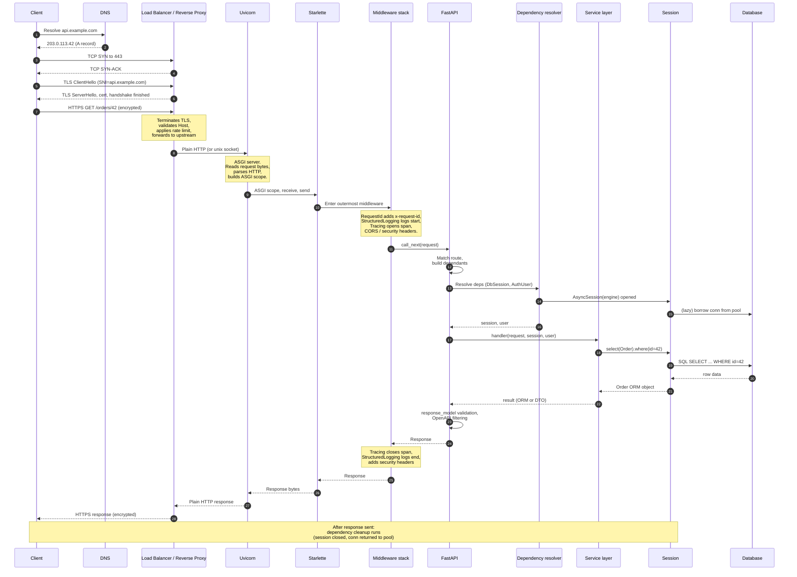

# Request Lifecycle Diagram

*The canonical Mermaid sequence of a request from a client through DNS, TCP, TLS, the reverse proxy, Uvicorn, Starlette, middleware, FastAPI, dependency, service, session, database — and back. Lessons that need this diagram link here instead of re-drawing.*

**You're looking at the canonical interview diagram**

"Draw the request lifecycle on the whiteboard" is the single most common senior architecture interview question. If you can reproduce this diagram from memory — every participant, every arrow, every note — you have answered the question. If you can narrate *why each hop exists* (not just *what* it does), you have answered it well. Practice drawing this. The prose below each section tells you the why.


#diagram #http #request-lifecycle #asgi

## Diagram

This is a **sequence diagram**: time runs top to bottom, participants run left to right, solid arrows (`->>`) are requests, dashed arrows (`-->>`) are responses, and `Note over X` boxes annotate what a participant is doing internally at that moment. The `autonumber` directive numbers every arrow so the prose below can refer to "step 5" or "step 11" without ambiguity. Read it once end to end before reading the prose; the prose explains *why* each hop exists, the diagram shows *what* happens.

**Legend: the four arrow shapes you'll see**

- `Client->>LB` (solid, full arrowhead) — a synchronous request: the caller blocks until the callee responds.
- `LB-->>Client` (dashed, open arrowhead) — a return/response: control passes back to the caller.
- `Note over LB` (yellow box on a lifeline) — internal side effect the caller never sees directly: TLS termination, ASGI scope construction, span open/close.
- `Note over Client,Session` (spanning two lifelines) — a cross-cutting phase that touches both participants, e.g. the post-response cleanup that runs after the response bytes leave the server but before the database connection is returned.




### The shape of the flow

The diagram has a clear shape: a *descent* on the left-to-right participant axis as the request moves deeper into the stack (Client -> DNS -> LB -> Uvicorn -> Starlette -> MW -> FastAPI -> Dep -> Svc -> Session -> DB), a *turn* at the database (steps 11-12, where the SQL goes down and the rows come back up), and an *ascent* as the response reverses direction back through every layer. Two phases are easy to miss on a whiteboard: the post-response **cleanup** (the `yield` dependencies' post-yield code, which runs after the response bytes have left the server) and the **lazy pool borrow** (the connection is not borrowed at session creation in step 9; it is borrowed on the first SQL in step 11). Both are common interview follow-ups; the prose below names them at the steps where they bite.

## Prose: what each hop does

### Steps 1–3. DNS, TCP, TLS

The client resolves the hostname via DNS, opens a TCP connection to the load balancer's IP on port 443, and performs a TLS handshake using SNI to select the certificate. This is the OS-level and cryptographic foundation; FastAPI never sees it. The client doesn't know which load balancer it's hitting — DNS returns an anycast IP that may route to the geographically closest PoP.

See [[02-Web-and-HTTP/HTTP-Request-Lifecycle]] and [[02-Web-and-HTTP/ASGI-Starlette-Uvicorn]].

### Step 4. Load balancer / reverse proxy

The load balancer (Nginx, HAProxy, AWS ALB, Cloudflare) terminates TLS, validates the `Host` header, applies rate limits and WAF rules, picks a healthy upstream, and forwards the decrypted request to a Uvicorn worker. The application never sees the TLS certificate; the LB presents its own cert to the client and a different connection (often plain HTTP or a unix socket) to Uvicorn.

**Why the LB and not Uvicorn for TLS:** Uvicorn is an HTTP server, not a TLS proxy. TLS termination requires SNI-based cert selection, OCSP stapling, HTTP/2's connection coalescing, and (for many sites) rate limiting and WAF rules — none of which Uvicorn is built for. Putting TLS on the LB also lets you rotate certs without touching the app. The app just sees plain HTTP.

**Tip — The TLS-termination pattern**

TLS terminates at the LB. Internally, the LB → Uvicorn connection is plain HTTP (or a unix socket). The application doesn't know TLS was used — `request.url.scheme` is `http` unless you tell Starlette to trust the LB's `X-Forwarded-Proto` header. See [[03-FastAPI-Core/Middleware-and-Request-Order]] for `ProxyHeadersMiddleware`.


See [[02-Web-and-HTTP/ASGI-Starlette-Uvicorn]] and [[22-Diagrams/Deployment-Topology]].

### Step 5. Uvicorn

Uvicorn is the ASGI server. It reads the bytes off the socket, parses the HTTP, builds an ASGI `scope` dict (request method, path, headers, query string, client IP), and calls into the ASGI application (Starlette). Uvicorn does not understand FastAPI; it speaks ASGI.

In production, Uvicorn typically runs N workers (`--workers N`), one per CPU core. Each worker is a separate process with its own event loop, its own copy of `app`, its own connection pool. The `--reload` flag is for development; do not use it in production.

**Why N processes and not N threads:** Uvicorn's workers are separate OS processes for the same reason the GIL exists: Python threads can't run CPU-bound code in parallel. But for I/O-bound async work, the bigger reason is isolation — a segfault in one worker (e.g., a native extension bug in asyncpg or orjson) kills only that worker; the others keep serving. Threads share fate.

See [[02-Web-and-HTTP/ASGI-Starlette-Uvicorn]].

### Step 6. Starlette

Starlette is the ASGI framework that FastAPI extends. It owns the middleware stack, the routing, the `Request` / `Response` abstractions, and the lifespan. It is the substrate; FastAPI is a layer on top. When you write `app = FastAPI()`, the `app` is a Starlette `Starlette` instance (FastAPI subclasses it) plus the FastAPI machinery for dependency resolution, OpenAPI generation, and `response_model` filtering.

### Step 7. Middleware stack

The middleware runs outermost-first on the way in, outermost-last on the way out. The canonical order (see [[03-FastAPI-Core/Middleware-and-Request-Order]] and Q6 of [[19-Interview-Preparation/FastAPI-and-DI-Questions]]) is:

1. **Request ID / correlation ID** (outermost, so every log line and trace has the ID).
2. **Structured logging** (logs the start of the request with the ID).
3. **Tracing** (opens a span for the whole request).
4. **Error handling** (catches exceptions from inner layers).
5. **CORS and security headers.**
6. **GZip / compression** (innermost — compress the response, don't compress the error logs).
7. **Session / auth** (optional; FastAPI typically does auth via dependencies, not middleware).

**Interview follow-up: where would you add a tracing span?**

Three places: (a) at the middleware level — one span for the whole request, opened in the tracing middleware, closed after `call_next`; (b) at the handler level — one span per route, automatically by the OpenTelemetry instrumentation; (c) at the DB level — one span per query, automatically by the SQLAlchemy instrumentation. The instrumentation library does this for you; you don't write it.


Getting the order wrong produces corrupted logs, missing tracing, or missing CORS headers on error responses.

### Step 8. FastAPI route resolution

FastAPI matches the path against registered routes, builds the dependency tree from the route's signature (`Annotated[T, Depends(...)]`), and resolves dependencies in order. The route handler is not yet called — first, all dependencies must resolve.

See [[03-FastAPI-Core/Dependency-Injection]].

### Step 9. Dependency resolution

Each dependency is resolved once per request (cached by default — see Q2 of [[19-Interview-Preparation/FastAPI-and-DI-Questions]]). A `DbSession` dependency opens an `AsyncSession` against the engine; an `AuthUser` dependency verifies the JWT and loads the user. The session is created here and closed by the dependency cleanup (after the response is sent). See [[22-Diagrams/Auth-Flow-Diagram]] for what the `AuthUser` dependency does internally.

**Where the connection pool borrow happens**

Lazily — on the first query, not at session creation. `AsyncSession(engine)` is cheap; it doesn't borrow a connection. The connection is borrowed when the first SQL is issued (step 11). This is a common interview follow-up: "when does the pool borrow happen?" Answer: lazy, on first query.


### Step 10. Service layer

The route handler is typically thin: it calls a service method. The service uses the session and repositories to do the work. The service is where the unit of work (transaction boundary) lives. See [[05-Project-Architecture/Service-and-Repository-Patterns]].

### Step 11. Session → Database

The session borrows a connection from the engine's pool (lazily, on the first query), sends SQL, and receives rows. The connection is returned to the pool when the session closes (after the response). See [[07-SQLAlchemy/02-Engines-Connections-Pools]] and [[22-Diagrams/SQLAlchemy-Session-Flow]] for the full session lifecycle.

### Step 12. Response path

The handler returns. FastAPI runs `response_model` validation (Pydantic), filters fields not on the model, and serializes. The response goes back through middleware (in reverse: each middleware's post-`call_next` code runs), through Starlette, Uvicorn, the LB, TLS, and the network.

**Warning — The "response_model filter is security" point**

`response_model=UserOut` doesn't just shape the response — it *filters* fields. If your handler returns a `User` ORM object with `password_hash`, the `password_hash` is dropped. Without `response_model`, the password hash leaks to the client. This is the security boundary; see Q10 of [[19-Interview-Preparation/FastAPI-and-DI-Questions]].


### Step 13. Cleanup (after response)

The `yield` dependencies run their post-`yield` code. The `AsyncSession` is closed; the connection is returned to the pool; the transaction is committed or rolled back depending on whether the service committed. Background tasks, if any, run after cleanup. See [[03-FastAPI-Core/Dependency-Injection]] and [[03-FastAPI-Core/Background-Tasks-Streaming-Uploads]].

**Danger — The "background task runs after cleanup" trap**

A background task that uses the request's session fails — the session was closed in the cleanup step. Background tasks must open their *own* session. See Q11 of [[19-Interview-Preparation/FastAPI-and-DI-Questions]] and Lab 6 of [[20-Exercises-and-Labs/Debugging-Labs]].


## Variants

### Without TLS (HTTP only)

Skip steps 2–3 and the TLS annotations on steps 1 and 4. The LB → Uvicorn step is unchanged. Used for local development.

**Tip — When you may legitimately drop TLS locally**

Local development against `http://localhost:8000` is fine — the browser will warn about mixed content only if your page is HTTPS and your API is HTTP. For local end-to-end tests that assert on `request.url.scheme`, set `X-Forwarded-Proto: https` on the request so `ProxyHeadersMiddleware` reports `https` even though no TLS handshake ran. See [[02-Web-and-HTTP/CORS-Caching-Headers-Conditional-Requests]] for the secure-redirect pattern in production.


### Without a reverse proxy

Skip the LB entirely; Uvicorn is exposed directly. **Do not do this in production.** A reverse proxy provides TLS termination, rate limiting, request buffering, slow-client protection, and HTTP/2 — none of which Uvicorn does well.

**Danger — The "Uvicorn directly on 443" trap**

Two specific failure modes: (a) a slow client (1 kb/s upload) holds a Uvicorn worker for the entire upload duration — with N workers, N slow clients starve all other clients; the LB absorbs this by buffering. (b) TLS cert rotation requires restarting Uvicorn (downtime); the LB rotates certs without touching the app. If you must run Uvicorn without a reverse proxy (e.g. an internal sidecar), put it behind an internal load balancer or accept the operational costs explicitly.


### With a CDN in front

Add a CDN participant in front of the LB. The CDN serves cached static content directly and forwards dynamic requests to the LB. See [[22-Diagrams/Deployment-Topology]].

**Where the CDN sits in the participant list**

The CDN becomes the new outermost participant: `Client -> DNS -> CDN -> LB -> Uvicorn -> ...`. The CDN -> LB hop is one persistent keepalive connection reused for many client requests, which is why adding a CDN usually *reduces* LB CPU even though it adds a hop. The client never sees the LB's IP; it sees the CDN's anycast IP, which is what makes CDN-based DDoS absorption work. See [[22-Diagrams/Deployment-Topology]] for the topology variant.


## Common interview questions

The base question — "draw the request lifecycle" — is a *depth gauge*. Junior candidates draw Client -> Server -> DB. Mid-level candidates add the load balancer and the middleware. Senior candidates add the TLS termination point, the lazy pool borrow, the post-response cleanup, and the exception-propagation path through the `yield` dependencies. The follow-up questions below are the ones that actually move the level needle; each probes a specific "did you build this in production or read it in a tutorial" detail.

**"Draw the request lifecycle on the whiteboard."**

The senior version of this question:
- Where would you add a tracing span? (One per middleware layer, plus one for the handler, plus one for the DB call. OpenTelemetry does this automatically.)
- Where does the connection pool borrow happen? (Lazily, on the first query — not at session creation.)
- What runs after the response is sent? (Dependency cleanup, background tasks.)
- What happens if the handler raises? (Exception propagates through the dependency generators at the `yield` point, then through middleware, then through exception handlers, then the response is built and sent.)


See [[19-Interview-Preparation/FastAPI-and-DI-Questions]] Q4, Q6, Q7, Q14.

**Note — The four sentences that prove you've internalised the diagram**

When you can say these four unprompted, the diagram is in your head: (1) "TLS terminates at the LB; the app sees plain HTTP unless you configure `ProxyHeadersMiddleware`." (2) "The pool borrow is lazy, on the first query, not at session creation." (3) "Cleanup runs after the response is sent — `yield` dependencies' post-yield code, then background tasks." (4) "Background tasks can't reuse the request session; they must open their own." Each sentence corresponds to a step (4, 9-11, 13, 13) where the production bug actually bites.


## Cross-references

- [[22-Diagrams/SQLAlchemy-Session-Flow]] — zoomed-in version of the session lifecycle (steps 9, 11, 13).
- [[22-Diagrams/Deployment-Topology]] — where these components live in production.
- [[22-Diagrams/Auth-Flow-Diagram]] — the auth-specific version (where the `AuthUser` dependency fits).
- [[03-FastAPI-Core/Middleware-and-Request-Order]] — the canonical middleware lesson.
- [[03-FastAPI-Core/Dependency-Injection]] — the canonical DI lesson.
- [[02-Web-and-HTTP/HTTP-Request-Lifecycle]] — the canonical HTTP lesson.
- [[02-Web-and-HTTP/ASGI-Starlette-Uvicorn]] — the canonical ASGI lesson.

## Verification

Verify the Mermaid block renders without parse errors before relying on it for an interview:

```bash
# Install mermaid-cli (one-time, globally):
npm install -g @mermaid-js/mermaid-cli

# Validate the diagram in this file:
mmdc -i 22-Diagrams/Request-Lifecycle-Diagram.md -o /tmp/request-lifecycle.svg -t default
# Expected: 'Synchronized sweep might have missed some nodes' warnings, then
# 'mermaid Render successful: /tmp/request-lifecycle.svg' (exit code 0).
# If you see 'Parse error on line N: ...' the diagram block has a syntax bug —
# fix the offending line and re-run.
```

To verify the prose matches the arrows, narrate the diagram out loud against a timer:

```bash
# Whiteboard rehearsal: 5-minute timer.
uv run python -c "
import time
t0 = time.time()
input('Draw and narrate the request lifecycle. Press Enter when done. ')
print(f'elapsed: {time.time()-t0:.1f}s')
"
# Expected: under 5 minutes for a senior-level narration (every participant,
# every arrow, every note). If you exceed 5 minutes you are forgetting a hop
# (likely the LB → Uvicorn distinction, or the post-response cleanup phase).
```

If `mmdc` reports zero parse errors and your narration completes in under 5 minutes without omitting any of the 13 numbered arrows, you have internalised the diagram. If `mmdc` reports a parse error, the diagram block on the lines indicated has a Mermaid syntax issue (commonly an unquoted `:` or `;` in a participant label — see [[00-Diagrams-MOC]] "Common Mermaid syntax pitfalls").

## Sources

- ASGI specification — https://asgi.readthedocs.io/ — 2026-10-15 — the ASGI `scope`, `receive`, `send` contract.
- Starlette documentation — https://www.starlette.io/ — 2026-10-15 — middleware stack and routing.
- FastAPI documentation — https://fastapi.tiangolo.com/ — 2026-10-15 — dependency resolution and response model.
- Verified versions: FastAPI 0.148.0, Starlette 1.9.0 — per [[21-Reference-Library/Source-Register]].
