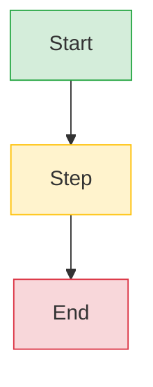
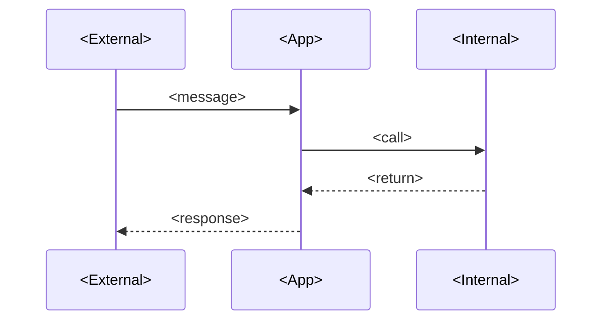

# Lesson Template

Use this structure for substantial lessons. Adapt when a topic genuinely needs a different format (reference sheets, glossary entries, MOCs, project specs). Every rewritten lesson in the vault (Sections 03, 16, 17, 18 project specs, 19, 20) follows this exact 14-section spine, modelled on `03-FastAPI-Core/Application-and-Lifespan.md`.

**Warning — When NOT to use this template**

This 14-section spine is for lessons that teach a *code-first* skill — a single Python file, FastAPI app, or SQL/Alembic artifact the student will type, run, and modify. Do not use it for:
- **Reference sheets** (HTTP status codes, Pydantic field types, SQLAlchemy loading strategies) — use a compact table-driven format like [[02-Web-and-HTTP/Methods-Status-Headers-Content-Types]].
- **Glossary entries** — use the `00-Start-Here/Glossary` one-paragraph-per-term format.
- **MOC (map-of-content) files** — use the `00-`-prefixed folder index format with a one-sentence summary per linked lesson (see any `00-*-MOC.md`).
- **Project specs** (Section 18 portfolio projects) — use the project-spec format in [[18-Portfolio-Projects/00-Projects-MOC]].
- **Diagram files** (Section 22) — use the diagram format in [[22-Diagrams/00-Diagrams-MOC]] (Diagram -> Prose -> Variants -> Interview questions -> Cross-references -> Verification -> Sources).
- **Templates themselves** (Section 23) — a template can't template itself.

If you are unsure, open the closest existing lesson in the same folder and match its section list. The 14-section spine is the default; deviations are deliberate and documented in the lesson's own bold `**Note — …**` block.


**Why the spine changed in the 2026-10-19 rewrite**

The pre-rewrite template used a 15-section spine (Why This Matters, Mental Model, Under the Hood, Step-by-Step Example, Practical Application, Related Lessons). The rewrite replaced those sections because the vault's pedagogy is *real-code-first*: the student sees the working code before any abstraction, then walks every line. Concretely:
- "Why This Matters" was folded into the bold opening welcome line plus the italic one-line summary under the title.
- "Mental Model / Under the Hood / Step-by-Step Example / Practical Application" were replaced by **The Problem → The Code → Line-by-Line Deep Dive** (with numbered subsections like `### Lines 1–8: …`). This is the vault's hallmark: the entire working file is shown once, then walked line-by-line with what/why/internal treatment per block.
- "Related Lessons" was replaced by **What's Next** (forward pointer) and the closing **What We Learned** recap.

The Conventions section at the bottom of this file is unchanged.


````markdown
---
title: "Lesson NN: <Title>"
aliases:
 - <Short alias>
tags:
 - <topic>
 - <topic>
 - canonical        # only when this is the canonical lesson for a registered concept
 - lesson
course_level: beginner | intermediate | advanced
status: complete | stub | draft
difficulty: beginner | intermediate | advanced
estimated_time: "<range>"
prerequisites:
 - "[[folder/Note]]"
related_lessons:
 - "[[folder/Note]]"
first_taught_in: "<folder/Note>"  # only if this is the canonical lesson for a concept
---

# Lesson NN: <Title>

*<One-sentence italic summary of what the student will build or understand.>*

**You're at the very beginning of Section NN.**

<Warm mentor tone. Acknowledge the student's likely state of mind. Tell them this is how everyone learns. Encourage typing every line. Two to four sentences.>


#<topic-tag1> #<topic-tag2> #<canonical-if-applicable>

## Learning Objectives

By the end of this lesson you will be able to:

1. **<observable skill, verb-led>**
2. **<observable skill>**
3. ...

## Prerequisites

Before starting, you need:

- **<Pinned tool version (verified Oct 2026)>** and a one-line install hint.
- **<Concept>** — [[folder/Note]]. One sentence on what you should already know.
- **<Concept>** — [[folder/Note]]. Same.
- **<Time budget.>** Honest estimate of how long the lesson takes.

**The most common gap: <concept>.**

<Bridge paragraph linking to the canonical lesson that fixes the gap.>


## The Problem

<Two to four paragraphs naming the real engineering problem this lesson solves. List 2-4 failure modes the student has either hit or will hit. End with one sentence stating that this lesson is the opinionated way to do it correctly.>

**Note — Historical context — <earlier API/idiom and why it changed>**

<Two to three paragraphs explaining what was used before, why it was deprecated, and what the new form looks like.>


## The Code

<One paragraph: "Here is the complete `<file>` you'll write in this lesson. Save it mentally — every <X> you ever write is a variation of this skeleton.">

```python
# <file path as comment>
"""<module docstring>"""
<full working code, 20-100 lines, runnable>
```

<Two to three sentences inviting the student to run/visit/change/break/fix the code. Then "We'll explain every line next — not just *what it does* but *what Python/Starlette/FastAPI does internally* when that line runs." >

## Line-by-Line Deep Dive

This section is the heart of the lesson. Read it twice. Don't skip.

### Lines 1–8: <heading naming the block>

```python
<the lines being explained, repeated for close reading>
```

**What it does:** <one sentence>

**Why we need each:**
- `<symbol>` — <what/why, 1-2 sentences>.
- `<symbol>` — <same>.

**Tip — <frequently asked question about this block>**

<Answer, two to four sentences.>


**Example — <"What's actually in X?" callout>**

<Enumerate the related exports/concepts the student will meet later.>


**<Inline self-asking Q&A — e.g. "Spot the bug — what happens if you delete `async`?">**

<Answer, 1-3 sentences. Use this pattern at least 3 times per lesson; aim for 5.>


### Lines 10–11: <heading>

<same what/why/internal pattern>

### Lines 12–14: <heading>

<same; add styled Mermaid block(s) here or in Execution Trace as appropriate>



**Warning — <One-line rule that prevents a recurring bug>**

<Why.>


<... continue for every meaningful block of lines ...>

## Execution Trace

Time to run it. In your terminal:

```bash
<exact command>
```

What happens, in order:

1. **<Phase 1>** — <what happens>.
2. **<Phase 2>** — <what happens>.
...
N. **<Final phase>** — <what the student should see and how to verify it>.

<Include the actual terminal output in fenced blocks.>



**<Milestone callout>**

<Encouraging two-sentence note.>


## Common Mistakes

### Mistake 1: <short name>

```python
# WRONG
<the buggy code>
```

**Symptom:** <observable symptom>

**Why:** <one paragraph>

**Fix:** <one paragraph or code block>

**Warning — <One-line pattern rule>**

<Generalised rule.>


### Mistake 2: ...
<same symptom/why/fix shape>

<3-7 numbered mistakes per lesson.>

## Engineering Trade-Offs

### <Decision A vs Decision B>

<2-4 paragraphs. Name the trade-off concretely, give both sides, name the decision the project takes and why.>

### <Decision C vs Decision D>
<same>

<2-4 trade-offs per lesson.>

## Exercises

**Tip — The 20-minute rule**

If you're stuck on an exercise for more than 20 minutes, re-read the relevant section above, then move on and come back. Learning isn't linear.


**Exercise 1 — <task>.** <description>

**Exercise 2 — <task>.** <description>

<3-6 exercises, increasing in difficulty.>

## Verification

Run the <test/app>:

```bash
<exact command>
```

Expected terminal output:

```
<exact output the student should see>
```

<Plus the curl/visit commands the student uses to verify the running app, and what to look for.>

## Previously Learned Here

These concepts were taught in earlier lessons. We link back instead of re-explaining:

- **<Concept>** — [[folder/Note]]. <One sentence on the new detail added here.>
- **<Concept>** — [[folder/Note]]. <Same.>
- ...

## What's Next

In [[folder/Next-Lesson]] we <one-paragraph forward pointer>. You'll:

- <bullet 1>
- <bullet 2>
- <bullet 3>

By the end of Lesson NN+1, <one-sentence state of the project>.

## Sources

- **<Title>** — <<URL>> — accessed 2026-10-19 — <why useful, one sentence>.
- **<Title>** — <<URL>> — accessed 2026-10-19 — <same>.
- ...
- See [[21-Reference-Library/Source-Register]] for the full source list with dates accessed.

## What We Learned

Let's recap. In this lesson you:

- **<Past-tense achievement>** — <one-sentence recap>.
- **<Past-tense achievement>** — <same>.
- ...

<Here's the mental model to walk away with: <one-sentence model.>>

---

> A note from your teacher
<Warm closing paragraph, two to four sentences. Encourage the student.>


---

**Tags:** #<topic1> #<topic2> #canonical #review
**Previous:** [[folder/Previous-Lesson]]
**Next:** [[folder/Next-Lesson]] →
````

## Conventions

- Filenames: numbered, kebab-case (e.g. `03-Dependency-Injection.md`).
- `00-`-prefixed files are MOCs for a folder.
- Lesson titles use `# Lesson NN: <Title>` (colon, matching the canonical `03-FastAPI-Core/Application-and-Lifespan.md` post-R14).
- Code blocks declare language (`python`, `bash`, `yaml`, `toml`, `sql`, `text`).
- Mermaid blocks are used for diagrams (see [[22-Diagrams/00-Diagrams-MOC]]); use `style <Node> fill:#…,stroke:#…` (or `classDef`) ONLY in `flowchart`/`graph` blocks so the diagram carries semantic colour. For `sequenceDiagram`, `erDiagram`, `classDiagram`, `mindmap` blocks, DO NOT use `style` (Mermaid raises a parse error on participants). For `sequenceDiagram` color-grouping of message regions, wrap the messages in `rect rgb(R, G, B) ... end` instead.
- Open every lesson with a bold `**You're at the very beginning of Section NN.**` welcome line — this is the vault's hallmark welcome.
- Frontmatter `first_taught_in` only when this is the canonical lesson for a registered concept.
- Frontmatter `related_lessons` lists adjacent lessons the student should consider before/after.
- Use the inline self-asking Q&A pattern (`**Why X:**` followed by a paragraph, or a bold question line followed by the answer) at least 3 times per lesson; aim for 5.
- If a lesson is incomplete, open the body with `> Status: stub` and mark frontmatter `status: stub`.
- Tags line (`#<topic> …`) immediately follows the opening welcome line.
- All versions must match the verified Oct 2026 pins in [[21-Reference-Library/Source-Register]]: FastAPI 0.148.0, Starlette 1.9.0, Pydantic v2.14.1, SQLAlchemy 2.1.5, Alembic 1.20.0, PostgreSQL 17.x, Redis 7.x, Python 3.12, uv 0.13.1.
- Sources entries use the form `**<Title>** — <<URL>> — accessed YYYY-MM-DD — <one-sentence "why useful">`. The access date must be a real ISO date (use the day you actually opened the source), not a placeholder; Oct 2026 sources should show `2026-10-XX`. See [[21-Reference-Library/Source-Register]] for the canonical dates.
- Code blocks inside the Line-by-Line Deep Dive *repeat* the lines being explained (do not reference line numbers from the earlier code block alone). The student reads top-to-bottom; making them scroll up to "the code block above" breaks the close-reading rhythm. Repeat the 3-8 lines under each `### Lines N-M: <heading>` subsection.
- `### Lines N-M: <heading>` headings name the *block* (what those lines do as a unit), not the line numbers alone. "Lines 12-14: the dependency factory" reads better than "Lines 12-14". The line numbers anchor the heading; the block name carries the meaning.
- Exercises ramp difficulty in named stages: Exercise 1 is "modify one line and re-run"; the final exercise is "extend the artifact with a new feature the lesson didn't cover". Each exercise ends with a `Verify:` line naming the exact `uv run pytest ...` or `curl ...` command and the expected output. An exercise without a `Verify:` line is ungradeable.
- Verification blocks paste the *actual* expected terminal output, not a paraphrase. The student copy-pastes the command, sees the output, and self-grades. If the output is long, show the first 5 and last 5 lines with a `... # (N more lines)` marker — never abbreviate the lines the student needs to recognise.
- Mermaid diagrams inside a lesson use the same edge rules as Section 22: `style`/`classDef` only in `flowchart`/`graph` blocks; `rect rgb(...) ... end` for sequence-diagram region colouring; no `style` on `sequenceDiagram`/`erDiagram`/`classDiagram` participants (parse error). See [[22-Diagrams/00-Diagrams-MOC]] "Common Mermaid syntax pitfalls".
- The closing `**A note from your teacher**` block (bold label + a short paragraph) is warm, not technical. Two to four sentences. No new content. The student has finished; the teacher acknowledges the work and points forward.

## Note & Warning Style Guide

Notes, tips, warnings, and callouts are written as plain Markdown — a bold label on its own line followed by the body as ordinary paragraphs. This renders identically in Obsidian, GitHub, VS Code, and the companion web viewer. No emojis are used; the bold label carries the semantic role.

| Label | Role | When to use | Budget per lesson |
|------|------|--------------|-------------------|
| `**You're at the very beginning of Section NN.**` | Opening welcome + milestone | Open the lesson. Mark the first running-app milestone in Execution Trace. | 1 opening + 1-2 milestones |
| `**Title**` (info) | Reference / "what's actually in X" | Bridge a knowledge gap, point to a canonical lesson, explain a historical change. | 3-6 |
| `**Tip — Title**` | Frequently-asked question / shortcut | Answer the question the student is about to ask. Save them a Google. | 2-5 |
| `**Note — Title**` | Historical context / recap | What was used before and why it changed; or the "four sentences that prove you've internalised it" recap. | 1-2 |
| `**Title**` (question) | Self-asking Q&A | Inline quiz the student answers in their head. Forces active reading. Minimum 3 per lesson; aim for 5. | 3-5 |
| `**Example — Title**` | "What's actually in X?" enumeration | List the related exports/concepts the student will meet later, so the placeholder in the code makes sense. | 1-3 |
| `**Warning — Title**` | One-line rule that prevents a recurring bug | A rule the student must internalise to avoid a common mistake. | 3-7 |
| `**Danger — Title**` | Production-incident-level trap | A trap that has caused a real production incident (cite the incident number). Reserve for the highest-stakes traps. | 2-4 |
| `**A note from your teacher**` | Closing teacher's note | Warm closing paragraph at the very end of the lesson. | 1 |

The budgets are *upper bounds*, not targets. A lesson with 15 `**Warning — …**` blocks has diluted the warning signal — promote the 3 most important to `**Danger — …**`, merge the rest into prose. The same applies to info blocks: if you have 10, the student stops reading them.

Two anti-patterns to avoid:

- **The wall of info blocks** — six consecutive `**Title**` notes become skippable decoration. If the content is reference, fold it into prose; if it is a trap, promote it to `**Warning — …**` or `**Danger — …**`.
- **The question with no answer** — a bold question must be followed by the answer (or a pointer to the answer in a later section). A question without an answer is a dead end; the student closes the tab.

## Section-by-Section Authoring Notes

The 14-section spine is a skeleton, not a fill-in-the-blanks form. Each section has a *job* — if a section isn't doing its job, the lesson is weaker than it should be. The notes below name the job and the most common failure mode for each.

1. **Frontmatter** — the metadata. The job is discoverability (title, aliases, tags) and routing (prerequisites, related_lessons, first_taught_in). Failure mode: aliases that don't match what students search for; prerequisites that list lessons the student hasn't read; `first_taught_in` on a non-canonical lesson.
2. **Opening welcome line + tags line** — the welcome. The job is to acknowledge the student's state of mind and set the tone. Failure mode: a generic "in this lesson you will learn..." opening that reads like a syllabus. The vault's hallmark is *warm mentor tone* — write it like you're talking to one student, not a class.
3. **Learning Objectives** — the contract. The job is to make the lesson falsifiable: by the end, the student can do X. Failure mode: objectives that are not observable ("understand X") or not testable in the exercises that follow. Use verb-led objectives the Exercises section can verify.
4. **Prerequisites** — the on-ramp. The job is to name the single most common gap and link to the canonical lesson that fixes it. Failure mode: a laundry list of "you should know Python" with no links; the student who needs the prerequisite doesn't know which one to read.
5. **The Problem** — the motivation. The job is to name the real engineering problem and 2-4 failure modes the student has hit or will hit. Failure mode: an abstract "in modern web development..." opening that motivates nothing. Name a specific bug the student has debugged.
6. **The Code** — the artifact. The job is to show one complete, runnable file before any abstraction. Failure mode: a snippet that doesn't run, or a 300-line file the student can't hold in working memory. Keep it 20-100 lines; extract boilerplate into a `# ... (setup)` comment only when it's truly irrelevant.
7. **Line-by-Line Deep Dive** — the heart. The job is to walk every meaningful block with what/why/internal treatment. Failure mode: explaining *what* each line does without *why it's there* or *what Python/FastAPI does internally when it runs*. The "internal" treatment is what makes this a senior lesson, not a tutorial.
8. **Execution Trace** — the run. The job is to show what happens, in order, when the code runs, with actual terminal output. Failure mode: a trace that says "the app starts" without the actual log lines. Paste the real output.
9. **Common Mistakes** — the antibodies. The job is to show the buggy code, the symptom, the why, and the fix — in that order. Failure mode: a mistake without a symptom (the student can't recognise it when they hit it) or without a fix (the student can't get out).
10. **Engineering Trade-Offs** — the opinion. The job is to name the decision, give both sides, and commit. Failure mode: "it depends" with no commitment. The lesson is the opinionated way; say what the project does and why.
11. **Exercises** — the practice. The job is to give 3-6 exercises of increasing difficulty, each with a verification command. Failure mode: exercises that restate the deep-dive content without asking the student to *modify* the code, or exercises without a `Verify:` command so the student can't self-grade.
12. **Verification** — the proof. The job is to show the exact command and the exact expected output. Failure mode: a verification that says "run the tests" without naming which test file or what passing output looks like. The student should be able to copy-paste the command and see the expected output verbatim.
13. **Previously Learned Here / What's Next** — the connective tissue. The job is to link back (don't re-explain) and forward (one paragraph, three bullets). Failure mode: a What's Next that summarises the next lesson's content instead of pointing to it.
14. **Sources / What We Learned / Closing quote** — the provenance and the recap. The job is to cite where the code came from and to recap what the student can now do. Failure mode: sources without access dates (the Oct 2026 pins go stale); a recap that lists topics instead of past-tense achievements.
